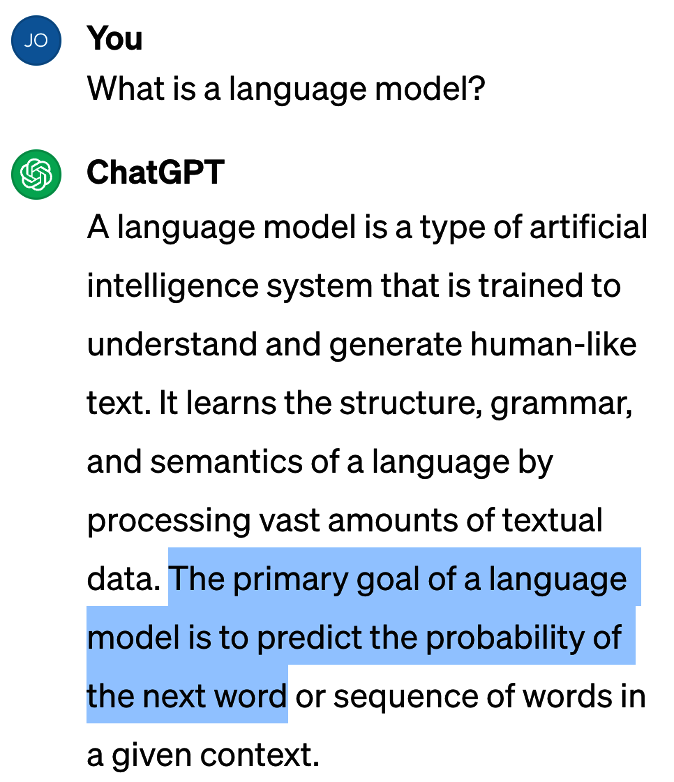
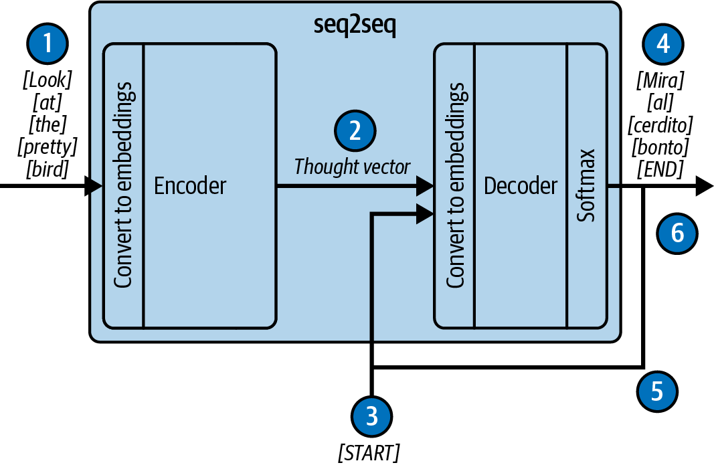
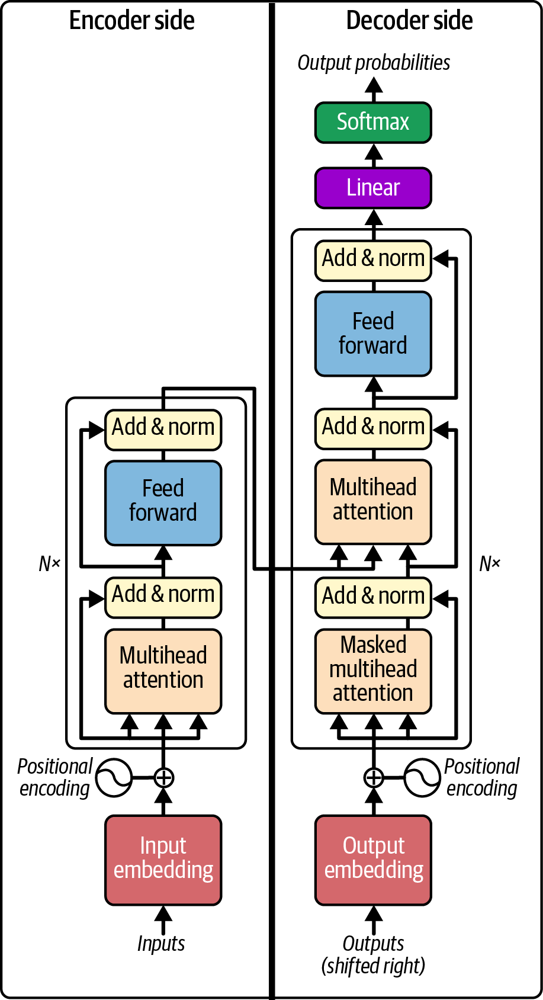

# فصل اول: مقدمه‌ای بر مهندسی پرامپت (Introduction to Prompt Engineering)

چت‌جی‌پی‌تی(ChatGPT) در اواخر ماه نوامبر سال در دسترس عموم قرار گرفت. تا ژانویه سال بعد، این سامانه رکورد۲۰۲۲ حیرت‌انگیز حدود میلیون کاربر فعال ماهانه را به ثبت رساند؛ رقمی که۱۰۰ ChatGPT را به سریع‌ترین نرم‌افزار کاربردی در حال رشد در تمام تاریخ عصر دیجیتال تبدیل کرد. برای درک ابعاد این استقبال تاریخی، یادآوری می‌کنیم که رسیدن به میلیون۱۰۰ کاربر برای شبکه تیک‌تاک ماه و برای پلتفرم اینستاگرام۹ ۵. سال زمان برد. و همان‌طور که شما نیز بی‌گمان تصدیق می‌کنید۲، هیجان و موج عظیمی که به راه افتاد کاملاً به‌جا بود. فناوری هوش مصنوعی از انحصاراً مقالات دانشگاهی خارج شد و وارد زندگی روزمره بشر گردید.

## مدل‌های زبانی بزرگ جادویی هستند!

چرا مدل‌های زبانی تا این اندازه مسحورکننده و فوق‌العاده‌اند؟ زیرا کارکرد آن‌ها عین شبیه به جادو است! نویسنده و آینده‌پژوه برجسته، آرتور سی. کالرک، جمله‌ای جاودانه دارد که می‌گوید:

هر فناوری به قدر کافی پیشرفته، از جادو تمایزناپذیر است».«ما باور داریم سامانه‌ای که بتوان با آن به زبان روزمره گفتگو کرد و پاسخ‌های عمیق دریافت نمود، بدون تردید با تعاریف برابری می‌کند. اما هدف اصلی و محوری این کتاب،جادو جادوزدایی (Dispel the magic) از مدل‌های زبانی است. ما اثبات خواهیم کرد که مهم نیست این سامانه‌ها چقدر شهودی، هوشمند و شبیه به انسان جلوه کنند؛ آن‌ها در حقیقتاً سازوکارهایی محاسباتی، ساختاریافته و کاملاً قانون‌مند هستند که تسلط بر اصول آن‌ها به مهندسان امکان می‌دهد آن‌ها را به شکلی پایدار مهار کنند.

آلبرت لحظه حیرت‌انگیز آشنایی خود با این فناوری را به خوبی در ذهن دارد. در ژوئن، شرکت گیت‌هاب آزمایش۲۰۲۱ محصولی نوآورانه را آغاز کرده بود که اکنون آن را با نام GitHub Copilot می‌شناسیم. آلبرت یکی از مهندسان محقق در تیم توسعه بود و دسترسی زودهنگام به OpenAI Codex (مدل پایه‌ای تولید کد بر مبنای GPT) داشت. وقتی او ساختار اولیه یک تابع را تعریف کرد و با نوشتن یک کامنت ساده خواستار پردازش رشته‌ها شد، دیدن این‌که کادکس تمام الگوریتم را در یک چشم به هم زدن تولید کرد، شبیه به تماشای آینده بود. همان‌جا متوجه شدیم که پیشرانه اصلی عصر آینده نرم‌افزار متولد شده است؛ تنها کاری که باید می‌کردیم ساخت بدنه و خودرویی مناسب پیرامون این پیشرانه قدرتمند بود.

برای جان، این تجربه سحرانگیز کمی دیرتر و در اوایل سال رقم خورد؛ زمانی که می‌خواست قابلیت‌های کوپایلوت را در۲۰۲۳ یک آزمون دشوار بسنجد. او این واقعه را این‌گونه بازگو می‌کند:

«من نرم‌افزار ضبط تصویر صفحه را روشن کردم و مسئله برنامه‌نویسی مدنظرم را مشخص نمودم: می‌خواستم تابعی بنویسم که یک عدد صحیح بزرگ را بگیرد و معادل نوشتاری انگلیسی آن را برگرداند. برای مثال، عدد 10 را بگیرد و "ten" برگرداند، یا عدد 1,004,712 را بگیرد و عبارت "one million four thousand seven hundred twelve" را تحویل دهد. حل این مسئله بسیار سخت‌تر از آن است که در ابتدا به نظر می‌رسد، زیرا در زبان انگلیسی استثنائات امالیی و نگارشی فراوانی وجود دارد (اعداد تا۱۱ از ساختار دهگان‌های ب التر پیروی نمی‌کنند؛ یا چرا۱۹ معادل۹۰ ninety است اما به جای۳۰ threety برابر با thirty است؟). اما پیچیدگی اصلی ماجرا اینجا بود که تصمیم گرفتم این برنامه را در زبانی بنویسم که در آن هیچ‌گونه تجربه شخصی نداشتم — زبان!Rust آیا کوپایلوت می‌توانست از عهده این چالش برآید؟» «در شرایط عادی، برای یادگیری یک زبان نوپا باید سراغ مستندات و کتب آموزشی رفت: چطور متغیر بسازم؟ ساختار حلقه چیست؟ بردارها چگونه تعریف می‌شوند؟ اما با کوپایلوت، من فقط یک داک‌استرینگ راهنما نوشتم و کلیدواژه تعریف تابع را تایپ کردم»:

// GOAL: Create a function that prints a string version of any number supplied to the function.

// 1 -> "one" // 2034 -> "two thousand thirty four" // 11 -> "eleven" fn «کوپایلوت کلمه fn را دید و بالفاصله با هوشمندی پیش‌دستی کرد»:

{ fn number_to_string(number: i32) -> String «فوق‌العاده بود! من حتی نمی‌دانستم در زبان راست چگونه باید نوع متغیرهای ورودی یا خروجی تابع را مشخص کرد. با کار، من با نوشتن کامنت‌های سطح ب ال مسیر منطقی حل مسئله را مشخص می‌کردم (مث ًادامه: عدد را به گروه‌های سه‌رقمی تقسیم کن)، و کوپایلوت پیوسته ساختارهای زبانی راست را به من یاد می‌داد؛ از نحوه ساخت وکتورها با let mut Vec::(new); = number_string_vec گرفته تا نوشتن حلقه‌های کنترلی با { 0 >. while number من بدون اتالف وقت در میان کتب آموزشی، مشغول توسعه پروژه بودم و خود پروژه، معلم زبان من شده بود. اما دقیقه پس از آغاز کار۲۰، کوپایلوت من را مبهوت کرد. من کامنتی برای پیوند دادن نام دهگان‌ها و مرتبه‌ها نوشتم و حلقه را باز کردم»:

// iterate through number_string_vec, assemble the name of the number // for each order of magnitude, and concatenate to number_string for «پس از یک ثانیه مکث، کوپایلوت ناگهان خط کد پایتخت و کامل راست را به میان انداخت۳۰! در ویدیوی ضبط‌شده، صدای نفس عمیق ناشی از حیرت من کاملاً ثبت شده است. کد کامپایل شد، ساختار نحوی کاملاً بی‌نقص بود و برنامه اجرا شد. خروجی البته مقداری اشکال داشت — ورودی ۰۱۲ , ۰۳۴ , را به اشتباه به۵ five thirty four thousand twelve million تبدیل کرد — اما برای بار نخست حتی از یک برنامه‌نویس انسان نیز انتظار پاسخ صددرصدی نمی‌رود و خطایابی آن کمتر از یک دقیقه طول کشید. ظرف دقیقه، من کدی غیربدیهی و کامل را در زبانی که اصًال بلد نبودم پیاده کرده بودم! کوپایلوت من را۴۰ گام‌به‌گام آموزش داد و با درک انتزاعی از هدف من، جزئیات کد را تکمیل کرد؛ کاری که اگر به تنهایی می‌خواستم انجام دهم ساعت‌ها وقت می‌گرفت».

تجربه شگفت‌انگیز ما پدیده‌ای منفرد نیست. اگر شما نیز مشغول خواندن این کتاب هستید، احتماًال برخوردهای هیجان‌انگیز مشابهی با مدل‌های زبانی داشته‌اید. اما دستیابی به این نقطه عطف تاریخی یک‌شبه میسر نشده است؛ برای درک عمیق این سامانه‌ها، لازم است ببینیم تاریخچه تحول آن‌ها چگونه بوده است.

## مدل‌های زبانی: چگونه به اینجا رسیدیم؟

برای آنکه بدانیم چطور به این نقطه جذاب در تاریخ فناوری رسیدیم، نخست باید ببینیم یک مدل زبانی اساس چیست و چه کارکردی دارد. برای پاسخ به این پرسش، چه مرجعی شایسته‌تر از محبوب‌ترین نرم‌افزار کاربردی مبتنی بر مدل زبانی در جهان:

خود چت‌جی‌پی‌تی! (شکل ۱ - ۱.) شکل ۱: - تعریف مدل زبانی از زبان۱ ChatGPT؛ نکته کلیدی برجسته‌شده در کادر آبی: «هدف بنیادین یک مدل زبانی، پیش‌بینی احتمال کلمه بعدی در یک زمینه مشخص است».

همان‌طور که در تصویر ب ال مشاهده می‌کنید، تعریف بنیادین مدل زبانی بسیار ساده است: پیش‌بینی احتمال کلمه بعدی.

این قابلیتی است که پیش از این نیز دیده‌اید؛ نوار پیش‌بینی کلمات در ب الی کیبورد گوشی‌های هوشمند آیفون یا اندروید هنگام ارسال پیامک (شکل ۱). - احتماًال هرگز چندان توجهی به آن نکرده‌اید، چون چندان دقیقاً و کارساز نبود. اگر کارکرد مدل‌های۲ زبانی صرف همین است، پس چگونه مدل‌های مدرن جهان را تسخیر کرده‌اند؟

شکل ۱ - جان بری‌من به نوار تکمیل کلمات ب الی کیبورد تلفن همراه اشاره می‌کند؛ تجسمی اولیه و بسیار ساده از سازوکار مدل‌های زبانی۲.:

مدل‌های زبانی اولیه ● تاریخچه مدل‌های زبانی به دهه‌ها قبل برمی‌گردد. مکانیزم پیش‌بینی کلمه در کیبوردهای تلفن‌های همراه بر پایه مدل‌های مارکوف در پردازش زبان طبیعی بنا شده است که اصول ریاضی آن نخستین بار در سال توسط کلود شانون مطرح گردید. با۱۹۴۸ این حال، معماری‌های متأخرتری زمینه‌ساز واقعی انقلاب کنونی شدند.

تا پیش از سال، مدل‌های آماری متکی بر۲۰۱۴ ان‌گرام (n-gram) حاکم بودند. در مدل gram-2، سامانه فراوانی آماری ظاهر شدن یک کلمه پس از کلمه قبلی را می‌شمرد. اما افزایش طول تاریخچه برای تولید جمالت دقیق‌تر، پدیده‌ای به نام نفرین ابعاد (Curse of Dimensionality) را ایجاد می‌کرد که حافظه و محاسبات مورد نیاز را به شکلی نمایی منفجر می‌ساخت.

در اواسط دهه، شبکه‌های عصبی و بردارهای تعبیه۲۰۱۰(Word Embeddings) وارد صحنه شدند و واژگان را در قالب بردارهای هندسی پیوسته بازنمایی کردند. سپس شبکه‌های عصبی بازگشتی (RNN) و به ویژه LSTM توسعه یافتند. در سال، مهندسان گوگل معماری۲۰۱۴ توالی‌به‌توالی (Seq2seq) را پایه‌گذاری کردند (شکل ۱ - ۳.)

شکل ۱: - معماری کلاسیک یک سامانه ترجمه ماشینی۳ Seq2seq؛ پردازش توکن‌به‌توکن ورودی توسط کدگذار(Encoder)، ذخیره در بردار اندیشه(Thought Vector) و سپس بازتولید توکن‌به‌توکن توسط کدگشا.(Decoder) شیوه کار معماری Seq2seq به این شرح است:

توکن‌های زبان مبدأ یکی پس از دیگری به کدگذار.1(Encoder) ارسال شده، به بردارهای تعبیه تبدیل می‌شوند و وضعیت درونی شبکه را گام‌به‌گام به‌روز می‌کنند..2 وضعیت درونی نهایی انکودر در قالب یک بردار متراکم نهایی به نام بردار اندیشه (Thought Vector) بسته‌بندی شده و به کدگشا Decoder(ارسال می‌گردد.).3 یک توکن ویژه به نام «شروع» (<start> به دکودر داده می‌شود که آغاز فرآیند تولید توکن‌های خروجی را اعلام می‌کند.).4 بر اساس اطلاعات متراکم موجود در بردار اندیشه، وضعیت درونی دکودر به‌روز شده و یک توکن خروجی به زبان مقصد صادر می‌گردد.

توکن صادرشده به عنوان ورودی گام بعدی به دکودر داده می‌شود و این چرخه بازگشتی (مراحل و۴.5) پیوسته تکرار۵ می‌گردد..6 در نهایت، دکودر با صدور یک توکن اختصاصی «پایان» (<end> اعلام می‌کند که فرآیند ترجمه خاتمه یافته است.) پاشنه آشیل مهلک مدل‌های Seq2seq، گلوگاه اطلاعاتی (Information Bottleneck) بود. بردار اندیشه طول ثابتی داشت و تلاش برای فشرده‌سازی تمامی نکات معنایی و جزئیات دستوری یک پاراگراف یا جمله طولانی در یک بردار محدود، باعث می‌شد مدل ابتدای جمالت طولانی را «فراموش» کند.

در سال، مقاله‌ای جریان‌ساز با عنوان۲۰۱۵ Neural Machine Translation by Jointly Learning to Align and«»Translate راهکاری انقلابی برای این بن‌بست پیشنهاد کرد: به جای ارسال یک بردار اندیشه منفرد، تمام بردارهای وضعیت میانی انکودر برای تک‌تک کلمات ذخیره شوند و به دکودر اجازه داده شود هنگام تولید هر کلمه خروجی، در میان تمام این

بردارها یک «جستجوی نرم»(Soft Search) انجام دهد و وزن توجه خود را بر بخش‌های مرتبط متمرکز کند. این متدولوژی نوین به نام سازوکار توجه (Attention Mechanism) معروف شد.

مکانیزم توجه جامعه علمی هوش مصنوعی را به شدت تکان داد و نقطه اوج آن در سال با مقاله تاریخی محققان۲۰۱۷ گوگل با عنوان»Attention Is All You Need«رقم خورد که معماری ترنسفورمر (Transformer) را به جهان معرفی کرد (شکل ۱). - ترنسفورمر کلیه مدارهای بازگشتی۴(RNN) را به طور کامل کنار گذاشت و پردازش توالی‌ها را منحصر بر پایه توجه متمرکز ساخت. این کار سرعت آموزش موازی روی کارت‌های گرافیکی را صدها برابر کرد، اگرچه محدودیت جدیدی به نام «طول پنجره کانتکست متناهی» به وجود آورد که تا امروز نیز در حال گسترش مرزهای آن هستیم.

شکل ۱: - معماری بنیادین ترنسفورمر۴ Vaswani et al.,(2017)؛ شامل کدگذار در سمت چپ و کدگشا در سمت راست، لایه‌های خودتوجهی چندسره(Multi-Head Attention)، شبکه‌های Feed-Forward، و رمزگذاری موقعیتی.(Positional Encoding) ورود GPT به صحنه ● در سال، محققان۲۰۱۸ OpenAI مقاله مهمی با نام Improving Language Understanding by Generative Pre-«»Training منتشر کردند. نبوغ این مقاله در ساده‌سازی رادیکال ترنسفورمر بود: آن‌ها بخش انکودر را کاملاً حذف کردند و معماری را منحصر بر پایه کدگشا (Decoder-only) استوار ساختند. این ساختار GPT (Generative Pre-trained Transformer) نام گرفت.

تا پیش از آن، شیوه استاندارد این بود که مدلی پیش‌آموزش دیده شود و سپس ساختارش دستکاری شده و برای تک‌تک وظایف خاص (نظیر طبقه‌بندی یا استخراج موجودیت) مجدداً آموزش تخصصی ببیند. اما GPT-2 که در اوایل رونمایی۲۰۱۹ شد، قواعد بازی را دگرگون کرد. این مدل با ۵. میلیارد پارامتر۱ (برابر بزرگ‌تر از نسخه نخست) روی۱۰ گیگابایت متن وب۴۰ آموزش دید و دانشمندان متوجه ظهور رفتاری خارق‌العاده شدند: بدون نیاز به هیچ‌گونه تنظیم دقیقاً تخصصی،مدل می‌توانست صرف ًا با دریافت متن اولیه وظایف گوناگون زبانی را با کیفیتی برتر از مدل‌های اختصاصی حل کند! به همین دلیل، اوپن‌ای‌آی در بیانیه‌ای از انتشار عمومی وزن‌های کامل مدل به دلیل خطرات اخبار کذب، جعل هویت و فیشینگ خودداری کرد.

در سال، رونمایی از۲۰۲۰ GPT-3 با میلیارد پارامتر زلزله‌ای بزرگ در هوش مصنوعی ایجاد کرد. مقاله رسمی این مدل با۱۷۵ عنوان»Language Models Are Few-Shot Learners«نشان داد که با نشان دادن چند نمونه از کار مورد نظر در قالب متن ورودی (تکنیک Few-Shot)، مدل به زیبایی الگوی ورودی را دریافت کرده و آن را ادامه می‌دهد. اینجا بود که دانشمندان می‌توان بدون دستکاری در کدهای مدل،دریافتند صرف با مهندسی پرامپت (متن ورودی) رفتار مدل را تنظیم کرد. این رویداد، لحظه تولد رسمی مهندسی پرامپت بود.

جدول ۱: - مشخصات فنی و روند رشد نمایی مدل‌های سری۱ GPT شرکت OpenAI هزینه محاسباتی مدل تاریخ رونمایی تعداد پارامترها حجم داده‌های مجموعه آموزشی (FLOP) GPT-1 ژوئن۱۱ ۲۰۱۸ میلیون۱۱۷ مجموعه: BookCorpus شامل ۵. گیگابایت متن از۴ ۰۰۰ , ۷ 1.7e19 کتاب منتشرنشده GPT-2 فوریه۱۴ ۲۰۱۹ ۵. میلیارد۱ مجموعه: WebText شامل گیگابایت متن و۴۰ میلیون سند۸ 1.5e21 محدود)(وب از صفحات با رأی مثبت ردیت نوامبر۵ ۲۰۱۹ کامل)(GPT-3 مه۲۸ ۲۰۲۰ میلیارد۱۷۵ میلیارد توکن شامل وب کرال بزرگ۴۹۹ (Common Crawl)، 3.1e23 متون وب، ویکی‌پدیا و کتب GPT- مارس۱۵ ۲۰۲۲ میلیارد۱۷۵داده‌های محرمانه چندوجهی با تنظیم دستوری و یادگیری اعلام نشده 3.5 تقویتی GPT-4 مارس۱۴ ۲۰۲۳ ۸. تریلیون۱ تخمین زده شده در حدود تریلیون توکن متنی و کدهای۱۳ 2.1e25 ~ غیررسمی)(گوناگون
## مهندسی پرامپت

اکنون به درگاه ورود به جهان مهندسی پرامپت رسیده‌اید. در بنیادین‌ترین نگاه، مدل‌های زبانی بزرگ تنها به انجام یک کار واحد قادرند: تکمیل متن. (Completing Text) متن ورودی را «پرامپت» می‌نامیم که سندی است که مدل باید آن را ادامه دهد. مهندسی پرامپت در ساده‌ترین تعریف، هنر ساخت این سند ورودی است تا خروجی نهایی، پاسخگوی نیازمندی مشخص ما باشد.

اما دیدگاه ما در این کتاب بسیار فراتر از نوشتن تک‌پرامپت‌های تفننی است؛ ما به مهندسی پرامپت به مثابه معماری جامع برنامه‌های کاربردی نرم‌افزاری نگاه می‌کنیم که در آن تولید پرامپت و پردازش پاسخ‌ها به شکلی کاملاً برنامه‌نویسی‌شده (Programmatic) انجام می‌گیرد. مهندس پرامپت الگوهایی پیوسته میان کاربر، نرم‌افزار و مدل پدید می‌آورد که در چهار سطح از پیچیدگی طبقه‌بندی می‌شوند:.1 پرامپت‌های ایستا:(Static Prompts) ابتدایی‌ترین سطح تعامل که در آن ورودی‌های کاربر با یک قالب آماده (مانند ChatML محصور شده و برای مدل ارسال می‌شوند. در این سطح ساختاربندی عبارات و کاهش ابهامات محوری است.).2 پرامپت‌های پویا و ارتقایافته RAG(&:)Dynamic Context غنی‌سازی ورودی کاربر با اطلاعات متنی خارجی در زمان اجرا؛

برای مثال در پشتیبانی فنی، صدای کاربر به متن تبدیل می‌شود و هم‌زمان کاتالوگ‌های راهنما و تاریخچه پرونده‌های قبلی به پرامپت افزوده می‌شوند. در گیت‌هاب کوپایلوت نیز کدهای تب‌های باز کاربر به پرامپت تزریق می‌شوند تا دقت خروجی ب ال رود. در موتور جستجوی بینگ نیز نتایج وب زنده به پرامپت الحاق می‌گردند تا توهمات مدل مهار شود..3 تعاملات با حفظ وضعیت:(Stateful Conversations) مدیریت گفتگوهای چندمرحله‌ای (چت‌بات‌ها) که در آن‌ها برنامه باید کانتکست تبادالت پیشین را ذخیره کند، تاریخچه‌ها را خلاصه سازد و مراقب پر نشدن سقف پنجره زمینه مدل باشد..4 فراخوانی ابزارها و عامل‌های خودمختار Agency(&:)Tool Calling مجهز ساختن مدل به ابزارهای بیرونی از طریق فراخوانی API؛ مانند خواندن تقویم کاربر برای ارسال خودکار دعوت‌نامه جلسه، یا سامانه‌های عامل هوشمند خودمختار نظیر AutoGPT که به صورت مستقل اهداف کلی کاربر را به گام‌های اجرایی خرد شکسته و در حلقه‌های بازخورد اجرا می‌نمایند.

## نتیجه‌گیری فصل اول

در این فصل، بستر نظری و تاریخی لازم برای درک اهمیت مهندسی پرامپت را مرور کردیم. دریافتیم که چگونه پیش‌بینی احتمال کلمه بعدی به پیشرانه دگرگونی‌های عظیم نرم‌افزاری تبدیل شد و چرا مهندسی پرامپت در حقیقتاً لایه ترجمه نیازمندی‌های دنیای واقعی به زبان اسناد متنی مدل‌هاست. در فصل آینده، به کالبدشکافی ذهنیت مدل‌های زبانی، مفهوم توکن‌ها، چگونگی رخداد توهم و شیوه‌های طالیی غلبه بر خطاهای مدل خواهیم پرداخت.

