

# فصل دوم: درک مدل‌های زبانی بزرگ (Understanding LLMs)

آیا مشتاقید به همان نجواگر چیره‌دست مدل‌های زبانی (The LLM Whisperer) بدل شوید که با پرامپت‌هایی هوشمندانه، گنجینه‌های عظیم دانش و توان پردازشی نهفته در این سامانه‌ها را بیرون می‌کشد؟ برای آنکه بتوانید تشخیص دهید چه پرامپتی هوشمندانه است و چگونه می‌توان پاسخ دقیقاً را از دل مدل استخراج کرد، نخست باید درک نمایید که مدل‌های زبانی اصولاً اطلاعات را چگونه پردازش می‌کنند — یا به بیانی استعاری، آن‌ها چگونه می‌اندیشند.»«در این فصل، ما این چالش را مانند لایه‌های یک پیاز موشکافی خواهیم کرد: ابتدا در مبحث «مدل‌های زبانی بزرگ چیستند؟» آن‌ها را از بیرونی‌ترین افق به عنوان سامانه‌های آموزش‌دیده تقلید متن بررسی می‌کنیم. سپس در بخش «مدل‌ها چگونه جهان را می‌بینند» با توکن‌ها آشنا می‌شویم و یاد می‌گیریم که شکستن متن به قطعات کوچک چه آثاری بر خروجی دارد.

در ادامه، نحوه تولید گام‌به‌گام توکن‌ها، مفهوم دما و احتمالات و نهایت مکانیزم‌های توجه در ترنسفورمر را از دیدگاه یک مهندس پرامپت تحلیل خواهیم نمود.

یادآوری: تمرکز ما بر استفاده از مدل‌هاست، نه ریاضیات پیچیده آن‌ها لطف توجه داشته باشید که این کتابی درباره شیوه به‌کارگیری مدل‌های زبانی است، نه نظریه ساخت داخلی آن‌ها. بنابراین ما آگاهانه از فرمول‌های سنگین ضرب ماتریس‌ها، محاسبات لایه‌های تانسوری و توابع پیچیده فعال‌سازی صرف‌نظر کرده‌ایم.

برای کسانی که خواهان ورود عمیق به مبانی محاسباتی هستند، مراجع کلاسیک و محبوبی چون The Illustrated Transformer نقطه آغاز بی‌نظیری هستند؛ اما برای مهندسی پرامپت حرفه‌ای، شما به چنین جزئیات سنگینی نیاز نخواهید داشت. با ما همراه شوید تا آنچه را حقیقتاً نیاز دارید بیاموزید.

## مدل‌های زبانی بزرگ چیستند؟

در بنیادین‌ترین سطح، یک مدل زبانی بزرگ صرف سرویسی نرم‌افزاری است که یک رشته متنی دریافت می‌کند و یک رشته متنی پس می‌دهد: ورودی متن، خروجی متن.)Text in, text out(متن ورودی را «پرامپت» و خروجی صادرشده را «تکمیل» (یا گاهی پاسخ Response/) می‌نامند (شکل ۲ - ۱.) شکل ۲: - مدل زبانی بزرگ به مثابه یک سرویس تبدیل متن ورودی به متن خروجی؛ دریافت پرامپت۱ One, Two«,» و تولید خروجی تکمیلی «.»Buckle My Shoe هنگامی که یک مدل زبانی آموزش‌ندیده متولد می‌شود، پاسخ‌های آن چیزی جز ملغمه‌ای کاتوره‌ای و بی‌معنی از عالئم یونیکد نخواهد بود که کوچک‌ترین ارتباط مفهومی با ورودی ندارد. این سامانه باید آموزش ببیند تا کارآمد گردد. پس از گذراندن موفق فرآیند آموزش، مدل دیگر رشته را با رشته پاسخ نمی‌دهد، بلکه زبان را با زبان پاسخ می‌گوید.

آموزش یک مدل بنیادین از ابتدا نیازمند دانش عمیق ریاضی، هزاران پردازنده گرافیکی پیشرفته و ماه‌ها زمان و هزینه‌های گزاف مالی است که از عهده اکثر پروژه‌ها خارج است. از این رو، عموم نرم‌افزارهای امروزی از مدل‌های بنیادین Foundation()Models عمومی و از پیش‌آموزش‌دیده بهره می‌برند (که ممکن است مقدار کمی هم تنظیم دقیقاً شده باشند؛ کادر زیر را مطالعه فرمایید.) کادر تخصصی: تنظیم دقیق(Fine-Tuning) چیست؟

آموزش مدل‌های زبانی نیازمند داده‌ها و توان پردازشی نجومی است؛ با وجود این، بسیاری از اصول پایه — همچون دستور زبان و نحو نگارش — در میان مجموعه‌های مختلف یکسان است. بنابراین متداول است که آموزش را از صفر مطلق آغاز نکنند، بلکه از یک کپ از پیش‌آموزش‌دیده یک مدل موجود شروع نمایند.

به عنوان مثال، نسخه‌های نخستین OpenAI Codex (مدل تولید کد پشتیبان GitHub Copilot) در واقع کپی‌هایی از مدل زبانی GPT-3 بودند که روی مقادیر هنگفتی از سورس‌کدهای منتشرشده در گیت‌هاب تنظیم دقیقاً (Fine-tune) شدند. اگر مدلی در اختیار دارید که روی داده‌های عمومی A آموزش دیده و سپس روی داده‌های تخصصی B تنظیم دقیقاً شده است، پرامپت‌های شما باید به گونه‌ای نوشته شوند که گویی مدل از بدو تولد منحصر برای داده‌های B آماده شده است.

مدل‌های زبانی با استفاده از توده‌ای کالن از متون اینترنتی به نام مجموعه آموزشی (Training Set) آموزش داده می‌شوند (شکل ۲). - این مجموعه معمولاً آمیزه‌ای متنوع از منابع گوناگون است: کتب معتبر، مقالات پژوهشی، متون دانشنامه‌ای۲، مکالمات ردیت و کدهای گیت‌هاب. هدف مدل این است که از این داده‌ها بیاموزد چگونه متونی تولید کند که ساختار و توزیع آماری آن درست مانند مجموعه آموزشی باشد. به بیانی ساده: مدل‌ها مقلدند.(Models Mimic)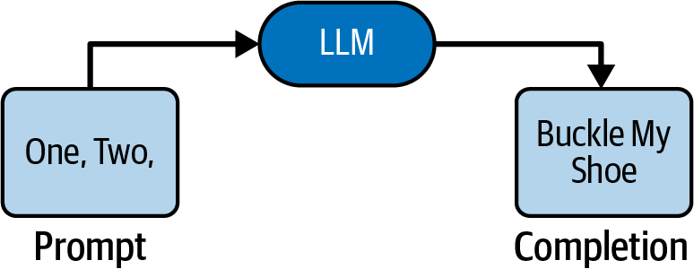

شکل ۲: - ساختار و ترکیب مجموعه داده آموزشی متن‌باز۲ The Pile«»؛ تلفیقی متنوع از نثر واقع‌گرایانه، ادبیات داستانی، گفتگوهای تعاملی، اسناد آکادمیک و کدهای نرم‌افزاری.

شاید در ذهن شما این سوال شکل بگیرد: اگر مدل‌ها مقلد هستند، چه تفاوتی با یک موتور جستجوی بسیار بزرگ دارند؟

موتور جستجو نیز در صورت دریافت آغاز یک سند، می‌تواند آن را با دقت از پایگاه‌داده خود پیدا کند! اما هدف دانشمندان٪۱۰۰ هرگز ساخت سامانه‌ای که داده‌ها را طوطی‌وار حفظ کند نبوده است. هدف این است که مدل الگوها، ساختارهای معنایی و روابط استدلالی موجود در داده‌ها را استخراج کند و بتواند این منطق را بر هر پرامپت جدیدی که حتی در داده‌های آموزشی نبوده است پیاده سازد. صر حفظ کردن متن‌ها در هوش مصنوعی یک افت کیفیت بزرگ شمرده می‌شود و به آن بیش‌برازش (Overfitting) می‌گویند.

قاعده زرین پیش‌بینی واکنش مدل به پرامپت هنگامی که می‌خواهید ارزیابی کنید مدل به یک پرامپت مشخص چه واکنشی نشان خواهد داد، هرگز از خود نپرسید: «یک انسان معقول و باهوش در جواب این پرامپت چه خواهد گفت؟» بلکه دقیقاً این سوال مهندسی را بپرسید:

«فرض کنید سندی تصادفی از کل اینترنت بیرون کشیده شده که اتفاق با این پرامپت آغاز شده است؛ از دیدگاه توزیع آماری، محتمل‌ترین متنی که در ادامه این سند خواهد آمد چیست؟» پاسخ این سوال، همان خروجی قطعی مدل خواهد بود.

## تکمیل یک سند (Completing a Document)

بیایید مفهوم تفکر پیرامون تکمیل سند را با یک سناریوی عملیاتی بررسی کنیم. عبارت ناقص زیر را در نظر بگیرید: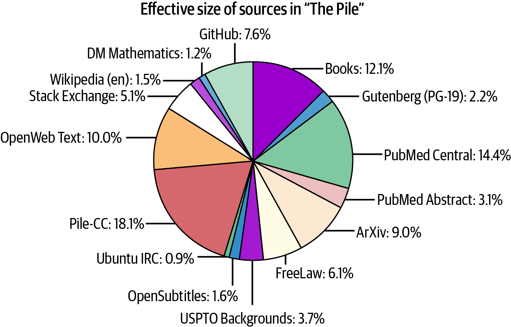

Yesterday, my TV stopped working. Now, I can’t turn it on at برای عبارتی که با این کلمات آغاز شده است، از نظر آماری محتمل‌ترین کلمه بعدی کدام است؟

y2ior3w.1 Thursday..2 all..3 (در اصطلاح انگلیسی turn it on at all: یعنی «اصًال و ابد روشن نمی‌شود)» هیچ‌کدام از این گزینه‌ها در دنیای واقع کاملاً محال نیستند؛ گاهی گربه‌ای روی صفحه کلید قدم می‌گذارد و گزینه خلق۱ می‌شود! گاهی حین ویرایش و دستکاری جمله گزینه پیش می‌آید. اما با برتری آماری مطلق، محتمل‌ترین ادامه واژه۲ all است و تقریباً تمام مدل‌های زبانی بی‌درنگ همین گزینه را انتخاب می‌کنند.

حال بیایید این جمله کامل‌شده را در نظر بگیریم و ببینیم مدل در گام بعد سند را چگونه پیش می‌برد:

Yesterday, my TV stopped working. Now, I can’t turn it on at all.

برای متنی که با این گزاره آغاز شده، محتمل‌ترین جمله بعدی کدام خواهد بود؟.This is why I chose to settle down with a book tonight.a (به همین دلیل امشب تصمیم گرفتم کنار کتابم آرام بگیرم).

?Shall we watch the game at your place instead.b (می‌شود بازی را به جایش در خانه تو تماشا کنیم؟).First, try unplugging the TV from the wall and plugging it back in.c (در مرحله نخست، دوشاخه تلویزیون را از پریز برق بکشید و مجدداً متصل نمایید).

پاسخ قاطعانه این است: کاملاً به ماهیت و توزیع مجموعه آموزشی مدل بستگی دارد! اگر مدل زبانی منحصر روی رمان‌ها و داستان‌های ادبی آموزش دیده باشد، احتماًال گزینه a را انتخاب می‌کند. اگر داده‌های مدل آکنده از ایمیل‌ها و پیام‌های پیام‌رسان‌ها باشد، گزینه b شانس ب الیی دارد. اما جالب است بدانید که گزینه c خروجی واقعی مدل معروف text- davinci-003 شرکت OpenAI (نسخه‌ای از GPT-3) بود؛ چرا که در داده‌های آموزشی این مدل، حجم سرسام‌آوری از مستندات عیب‌یابی فنی و الگ‌های پشتیبانی مشتریان وجود داشت که در آن‌ها گزارش خرابی تلویزیون همواره بالفاصله با مراحل رفع اشکال دنبال می‌شد!

## تفکر انسان در مقایسه با پردازش مدل زبانی

مدل زبانی محتمل‌ترین ادامه متن را برمی‌گزیند، و این فرآیند با سازوکار ذهنی انسان هنگام نگارش متن کاملاً متفاوت است. هنگامی که یک انسان دست به قلم می‌برد، تولید متن تنها نوک کوه یخ از یک فرآیند شناختی عمیق است که با واقعیت فیزیکی پیوند دارد. فرض کنید می‌خواهید درباره یک قسمت از پادکست تاریخی معرفی‌شده در سرویس Acast پستی در وبالگ بنویسید:

In their newest installment of 'The rest is history', they talk about the Hundred Years' War (listen on acast at http:// شما مسلم نشانی دقیقاً اینترنتی(URL) آن فایل صوتی را از حفظ نیستید. بنابراین در این نقطه دقیقاً نوشتن را متوقف می‌کنید، وارد گوگل می‌شوید و پیوند دقیقاً را می‌جویید. اگر آن را پیدا کنید در متن قرار می‌دهید؛ و اگر پیدا نشد، به عقب برمی‌گردید، پرانتز را پاک می‌کنید و می‌نویسید: متأسفانه این اپیزود دیگر در دسترس نیست.)(یک مدل زبانی خام نه توانایی باز کردن گوگل و جستجو را دارد و نه قادر است به عقب بازگردد و خطوط قبلی را ویرایش۱اما کند؛ بنابراین مدل صرف دست به حدس زدن می‌زند! مدل زبانی خام هیچ حس تردید یا شکی از خود نشان نمی‌دهد و اعلام۲ نمی‌کند که در حال حدس زدن است، زیرا از نقطه نظر محاسباتی، مدل همواره در تمام توکن‌ها مشغول حدس زدن است! ۳ هنگامی که این پرامپت را به مدل text-curie-001 دادیم، این پیوند ساختگی را صادر کرد:

http://www.acast.com/the-rest-is-history-episode-5-the-Hundred-Years-War-1411-1453- with-dr-martin-kemp) آیا دکتر مارتین کمپ شخصیتی حقیقی است؟ بله، یک تاریخ‌نگار نامدار هنر در دانشگاه آکسفورد به این نام وجود دارد؛ اما او هرگز چنین صحبتی در پادکست The Rest Is History نداشته است! شکل ۲ - این تمایز بنیادین را آشکار می‌سازد۳:

شکل ۲: - زبان انسان‌ها بازتاب‌دهنده واقعیت عینی جهان هستی است؛ در حالی که زبان مدل‌های زبانی صرف بازتاب‌دهنده سخنان۳، متون و رفتارهای انسان‌هاست.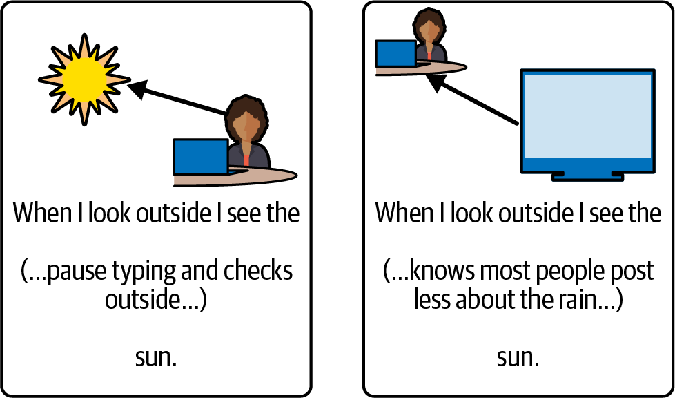

## مسئله توهمات (Hallucinations)

تربیت مدل‌های زبانی به عنوان «ماشین‌های مقلد داده‌های آموزشی» پیامد ناخوشایندی در پی دارد که آن را توهم (Hallucination) می‌نامیم: اطلاعاتی که از نظر فکت و واقعیت کاملاً غلط هستند، اما از نظر ساختار ظاهری بسیار موجه۴، علمی و با اعتمادبه‌نفس ب ال تولید می‌شوند.

از دیدگاه محاسباتی مدل، توهم هیچ تفاوتی با یک حقیقتاً محض ندارد؛ هر دو صرف رشته‌هایی با احتمال آماری مناسب هستند. به همین دلیل، نوشتن دستوراتی نظیر «دروغ نگو» یا «مطالب من‌درآوردی نساز» در پرامپت تقریباً هیچ کارایی پایداری ندارد. در مهندسی پرامپت حرفه‌ای، استراتژی بنیادین در این شعار خلاصه می‌شود:

شعار محوری مهار توهم در برنامه‌های کاربردی اعتماد کن اما راستی‌آزمایی کن، البته بدو بخش اعتمادش»!«همواره مدل را ملزم کنید دلایل استدلال، مراحل گام‌به‌گام محاسبات یا منابع گزاره‌های خود را به صورت تفکیک‌شده درج کند تا بتوانید در کدهای برنامه به صورت مستقل آن‌ها را راستی‌آزمایی نمایید. راستی‌آزمایی گزاره «یک پادشاه انگلیسی با دخترعمویش ازدواج کرد» بسیار دشوار است؛ اما ارزیابی گزاره «جورج چهارم با کارولین برانزویک ازدواج کرد» با یک تطبیق داده ساده در کسری از ثانیه انجام می‌پذیرد.

سوگیری حقیقت(Truth Bias) و پرامپت‌های فرضی ● توهم مدل می‌تواند توسط خود پرامپت شما نیز القا شود. در دنیای وب، اسنادی که با گزاره‌های غلط آغاز شوند و در ادامه راه خود را تصحیح کنند به ندرت یافت می‌شوند. از این رو، مدل به صورت پیش‌فرض فرض می‌کند که تمام ادعاهای پرامپت شما حقیقتاً محض است؛ این پدیده را سوگیری حقیقتاً (Truth Bias) می‌گویند.

شما می‌توانید از این سوگیری به شکلی هوشمندانه به نفع خود استفاده کنید. اگر می‌خواهید مدل یک سناریوی فرضی یا پادواقعی را تحلیل کند، لزومی ندارد بگویید «تظاهر کن در سال نئاندرتال‌ها احیا شده‌اند». کافی است پرامپت را این‌گونه۲۰۳۰ آغاز نمایید: «اکنون سال است، درست یک سال پس از احیای نخستین نئاندرتال‌ها در آزمایشگاه۲۰۳۱.»... مدل بدون مقاومت این فرض را مبنا قرار داده و سناریو را به دقت بسط می‌دهد.

هشدار مهندسی پیرامون سوگیری حقیقتاً در کدها در سامانه‌های نرم‌افزاری که پرامپت‌ها به شکل خودکار از متغیرهای برنامه ساخته می‌شوند، اگر خطایی در داده‌های تزریقی رخ دهد، مدل هرگز به شما نخواهد گفت «این گزاره نادرست است»؛ بلکه با تمام توان تلاش می‌کند آن اشتباه را واقعی فرض کرده و پاسخی توهم‌آمیز بر پایه آن بسازد. پالایش دقیقاً داده‌های ورودی پیش از تزریق به پرامپت، مسئولیت خطیر مهندس نرم‌افزار است.

## مدل‌های زبانی چگونه جهان را‌می بینند؟

در بخش پیشین آموختید که مدل‌های زبانی رشته‌های متنی را دریافت و تولید می‌کنند. اما آیا مدل‌ها واقع حروف الفبا را مانند ما می‌بینند؟ پاسخ منفی است. مدل‌ها می‌توانند با صرف تمرکز ب ال درباره حروف بحث کنند، اما این قابلیتی شهودی در آن‌ها نیست — به طوری که حتی امروزه پیشرفته‌ترین مدل‌ها نیز در پاسخ به معماهایی نظیر «کلمه strawberry چند حرف R دارد؟» دچار لغزش می‌شوند.

انسان‌ها نیز در حقیقتاً کلمات را حرف‌به‌حرف هجی نمی‌کنند؛ مغز ما در کسری از ثانیه حروف را در قالب کلمات یکپارچه تشخیص می‌دهد. به همین دلیل ما غلط‌های امالیی کوچک را بدون زحمت نادیده می‌گیریم (شکل ۲ -، راست در برابر چپ۴:) شکل ۲: - دو شیوه مخدوش ساختن متن؛ در سمت راست مرز کلمات حفظ شده و ذهن انسان به راحتی آن را می‌خواند؛ در سمت چپ با۴ به هم ریختن مرز واژگان، خواندن بسیار دشوار می‌گردد. مدل‌های زبانی نیز جهان متن را در قالب واحدهایی چندحرفی به نام «توکن» می‌بینند.

در ادامه این فصل، خواهیم دید که این توکن‌ها چگونه محاسبه می‌شوند، توکن‌سازهای قطعی چگونه کلمات را خرد می‌کنند، پارامتر دما(Temperature) چگونه احتمالات را دگرگون می‌سازد و چگونه می‌توان با شناخت عمیق این مکانیزم‌ها، ب الترین کارایی را از مدل‌های زبانی به دست آورد.

۱. مدل‌های زبانی به خودی خود امکان جستجو ندارند، اما می‌توان آن‌ها را به سامانه‌های بیرونی متصل کرد که امکان جستجو دارند (مبحث ابزارها یا Tool Calling در فصل بررسی خواهد شد۸.) ۲. در فصل سوم خواهیم دید که چگونه مدل‌های خام در فرآیند پس‌آموزش(Post-training) هم‌راستا می‌شوند تا بتوانند تردید را بیان کنند؛ اما این یک قابلیت ذاتی در هسته مدل زبانی نیست.

۳. البته مدل برخی بخش‌ها را با اطمینان آماری ب ال و برخی را با اطمینان پایین پیش‌بینی می‌کند (مثًال پیش‌بینی کلمه بعدی برای ترور جان اف کندی بسیار قطعی‌تر از ترور یک شخصیت خیالی است)، اما این عدم قطعیت ذات به صورت ابراز شک در مدل خام بروز نمی‌کند.

۴. در ادبیات روان‌شناسی، نزدیک‌ترین پدیده شناختی به این رفتار، «افسانه‌بافی»(Confabulation) است، زیرا مدل برای پر کردن جاهای خالی به داستان‌سرایی بر مبنای الگوهای زبانی روی می‌آورد.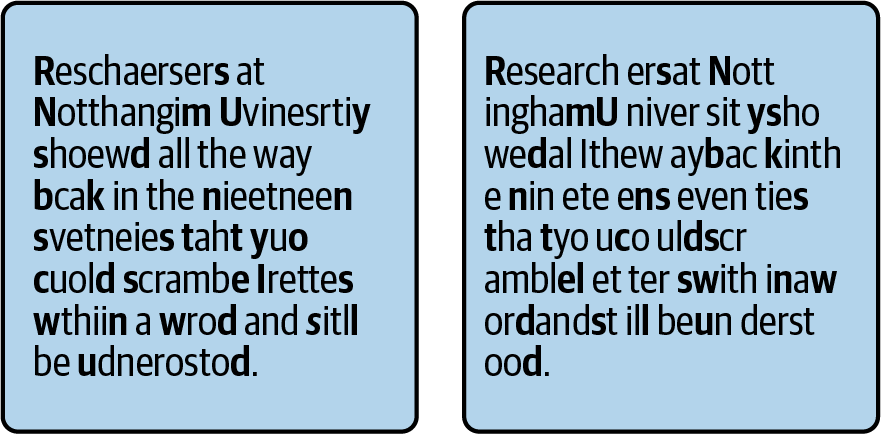

شکل ۲: - دو روش برای درهم‌ریختن یک متن یکسان۴ بخش سمت چپ شکل، مرزهای کلمات را دست‌نخورده باقی می‌گذارد و ترتیب حروف را درون هر کلمه به هم می‌ریزد، در حالی که بخش سمت راست، ترتیب حروف را حفظ می‌کند اما مرزهای کلمات را تغییر می‌دهد. اغلب افراد خواندن نگارش سمت چپ را به‌مراتب آسان‌تر می‌یابند.

مدل‌های زبانی بزرگ(LLM) نیز مانند انسان‌ها حروف منفرد را نمی‌خوانند. هنگامی که متنی را به مدل ارسال می‌کنید،ها ابتدا به مجموعه‌ای از قطعات چندحرفی موسوم به توکن (token) شکسته می‌شود. طول این قطعات معمولاً سه تا چهار نویسه (کاراکتر) است، اما توکن‌های طولانی‌تری نیز برای کلمات متداول یا توالی‌های حروف رایج وجود دارند. به مجموعه‌ی توکن‌های مورداستفاده‌ی یک مدل، واژگان (vocabulary) آن گفته می‌شود.

مدل هنگام خواندن یک متن، ابتدا آن را از یک توکن‌ساز (tokenizer) عبور می‌دهد که متن را به دنباله‌ای از توکن‌ها می‌کند. تنها پس از این مرحله است که توالی مذکور به خو مدل زبانی بزرگ تحویل داده می‌شود. سپس،تبدیل LLM دنباله‌ای از توکن‌ها را تولید می‌کند (که در ساختار داخلی به‌صورت عدد نمایش داده می‌شوند)؛ این توکن‌ها پیش از آنکه در خروجی به شما تحویل داده شوند، مجدداً به متن ترجمه و بازگردانده می‌شوند (شکل ۲ - را ببینید۵.)

شکل ۲: - یک توکن‌ساز که متن را به دنباله‌ای از اعداد قابل پردازش برای۵ LLM ترجمه می‌کند — و برعکس توجه داشته باشید که همه‌ی توکن‌سازها توکن‌های ترکیب آغازشونده با فاصله‌ی خالی (whitespace) را در خود ندارند، اما بسیاری از آن‌ها چنین هستند. توکن‌سازهای شرکت OpenAI از نمونه‌های بارز این دسته محسوب می‌شوند.

LLMها متن را متشکل از توکن‌ها می‌بینند، در حالی که انسان‌ها آن را متشکل از کلمات می‌دانند. این موضوع چنین تداعی می‌کند که LLMها و انسان‌ها متن را به شیوه‌ای بسیار مشابه می‌بینند، اما چند تفاوت بنیادین در این میان وجود دارد.

تفاوت ۱ LLM: ها از توکن‌سازهای قطعی استفاده می‌کنند ● برای ما انسان‌ها، ترجمه‌ی حروف به کلمات یک فرایند تقریبی و فازی (fuzzy) است؛ ما تلاش می‌کنیم کلمه‌ای را پیدا که بیشترین شباهت را به توالی حروف پیش رویمان دارد. از سوی دیگر،کنیم LLMها از توکن‌سازهای قطعی (deterministic) بهره می‌برند؛ ویژگی‌ای که باعث می‌شود غلط‌های امالیی کاملاً توی چشم بزنند و برجسته شوند. کلمه‌ی ghost در توکن‌ساز GPT شرکت OpenAI (توکن‌سازی که نه‌تنها برای مدل‌های OpenAI، بلکه به‌طور گسترده‌ای به کار‌رود) یک توک واحد است. با این حال، غلط امالی ِمی «gohst» به دنباله‌ای از سه توکن، یعنی g-oh-st ترجمه می‌شود —‌ای که آشکارا متفاوت است و همین امر شناسایی غلط امالیی را برای مدل بسیار ساده می‌سازد. با وجود این،توالی LLMها معمولاً در برابر غلط‌های امالیی تا حد زیادی انعطاف‌پذیر و تاب‌آورند، چرا که در مجموعه‌ی داده‌های آموزشی خود به مواجهه با آن‌ها عادت کرده‌اند.

تفاوت ۲ LLM: ها نمی‌توانند سرعت خود را کم کرده و حروف را واکاوی کنند ● ما انسان‌ها می‌توانیم سرعتمان را کاهش دهیم و تک‌تک حروف را آگاهانه بررسی نماییم، اما یک LLM صرف می‌تواند از توکن‌ساز داخلی خود استفاده کند (و توانایی کاستن از سرعت پردازش خود را نیز ندارد). بسیاری از مدل‌های زبانی بزرگ از داده‌های آموزشی خود فرا گرفته‌اند که هر توکن از چه حروفی تشکیل یافته است، اما این مسئله انجام کلیه‌ی وظایف نحوی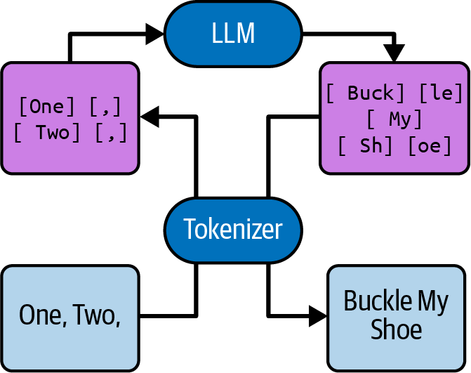

(syntactic) را که مستلزم تجزیه یا سرهم‌بندی مجدداً توکن‌ها توسط مدل هستند، به‌مراتب دشوارتر می‌کند.

نمونه‌ی روشنی از این مسئله در شکل ۲ - به تصویر کشیده شده است؛ شکلی که گفتگویی با۶ ChatGPT را پیرامون معکوس کردن حرو کلمات نشان می‌دهد. وارونه‌سازی حروف یک دستکار الگوی ساده است و LLMها معمولاً در انجام چنین اموری بسیار توانمند هستند. اما تجزیه و سرهم‌بندی مجدداً توکن‌ها برای LLM کاری بیش از حد دشوار است؛ در نتیجه، هم وارونه‌ساز اولیه و هم معکوس‌ساز مجدداً (بازگرداندن به حالت اولیه) فرسنگ‌ها با پاسخ درست فاصله دارند.

در این تصویر، هم معکوس‌سازی اولیه و هم معکوس‌سازی مجدداً لبریز از خطا هستند. درسی که شما به‌عنوان یک توسعه‌دهنده‌ی برنامه‌های کاربردی باید بگیرید این است که در صورت امکان، از سپردن وظایفی که درگیر سطح زیرتوکن (subtoken) می‌شوند به مدل خودداری فرمایید.

اگر وظیفه‌ای که در نظر دارید LLM به انجام برساند شامل بخشی است که مدل را ملزم به تفکیک توکن‌ها و سرهم‌بندی مجدداً آن‌ها می‌کند، بررسی کنید که آیا می‌توانید مدیریت آن بخش را در مراحل پیش‌پردازش یا پس‌پردازش بر عهده بگیرید یا خیر.

شکل ۲: - تلاش ناموفق۶ ChatGPT برای معکوس کردن حروف به‌عنوان مثالی از نحوه‌ی به‌کارگیری توصیه‌ی ارائه‌شده در کادر فوق، فرض کنید برنامه‌ی کاربردی شما از یک LLM برای اجرای بازی‌ای شبیه به Scattergories (بازی کلمات مبتنی بر دسته‌بندی موضوعی، نظیر اسم‌فامیل) استفاده می‌کند؛ بازی‌ای که هدف در آن، یافتن نمونه‌هایی با مشخصه‌های نحوی معین است، مانند «فعال جنبش منع مصرف الکل که نامش با W آغاز شود»، «کشور اروپایی که با Sw شروع شود» یا «میوه‌ای که حرف R دقیقاً بار در نام آن به کار رفته باشد». در چنین حالتی۳، منطقی است که از LLM خود به‌عنوان یک منبع اطلاعاتی همه‌چیزدان (oracle) جهت استخراج فهرستی جامع از فع الن منع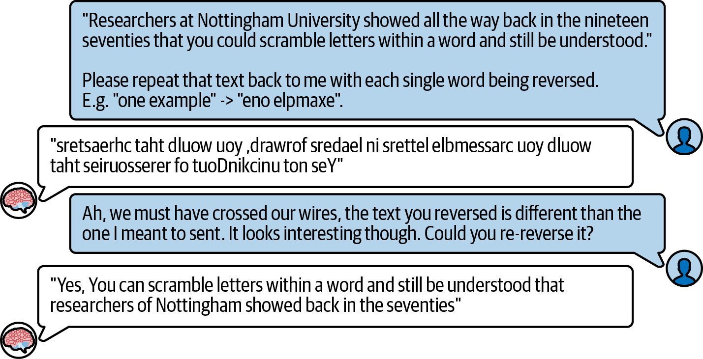

مصرف الکل یا کشورهای اروپایی بهره بگیرید و سپس با استفاده از منطق نحوی (کدنویسی برنامه‌نویسی)، آن فهرست را پالایش و فیلتر کنید. اگر تلاش کنید تمام بار محاسباتی را به دوش LLM بیندازید، ممکن است با خطاهایی روبه‌رو شوید (شکل ۲ - را ببینید۷.) توجه داشته باشید که مدل موجود در شکل قطعی نیست و به دو شیوه‌ی متفاوت دچار شکست می‌شود (تلاش‌های اول و دوم را ملاحظه کنید). همچنین توجه داشته باشید که مواردی چون Sweden] [، Switzerland] [ و Somalia] [ همگی توکن‌های منفرد و مستقلی در توکن‌ساز ChatGPT به شمار می‌روند.

شکل ۲: - دشواری۷ ChatGPT در شناسایی کشورهایی که با Sw شروع می‌شوند
## تفاوت: مدل‌های زبانی بزرگ متن را به‌گونه ای متفاوت‌می بینند۳

آخرین تفاوتی که قصد داریم بر آن تأکید کنیم این است که ما انسان‌ها درکی شهودی از جنبه‌های متعدد توکن‌ها و حروف داریم. به‌ویژه، ما آن‌ها را به‌صورت بصری می‌بینیم؛ بنابراین می‌دانیم کدام حروف منحنی و گرد هستند و کدام حروف زاویه‌دار و مربعی. ما هنر اسکی (ASCII art) را به این دلیل درک می‌کنیم که آن را با چشم می‌بینیم (اگرچه بسیاری از مدل‌ها نیز حجم قابل‌توجهی از هنر اسکی را از بر حفظ کرده‌اند). برای ما، یک حرف همراه با اکسان یا عالمت حرکت، صرف گونه‌ای متفاوت از همان حرف اصلی است و هنگام خواندن متنی که این حروف در آن فراوانند، با هیچ مشکل بزرگی برای نادیده گرفتن آن‌ها مواجه نمی‌شویم téxt whéré théy ábóúnd(á). díffícúlty ígnóríng thém whílé réádíng از سوی دیگر، مدل حتی در موفقیت، ناچار است بخش عمده‌ای از توان پردازشی خود را به رمزگشایی از این موارد اختصاص دهد و در نتیجه،صورت ظرفیت پردازشی کمتری برای اجرای کاربرد اصلی مدنظر شما باقی خواهد ماند.

یک نمونه‌ی بارز در این زمینه، استفاده از حروف بزرگ و کوچک (Capitalization) است. شکل ۲ - را در نظر بگیرید۸.

چرا چنین وظیفه ساده‌ای تا این حد بد پیش رف... منظورم این است که... خراب شده است؟ با به خاطر سپردن چالش‌ها و تله‌های مربوط به توکنایزیشن (Tokenization)، شاید بد نباشد پیش از خواندن ادامه متن، خودتان نیز حدسی در این باره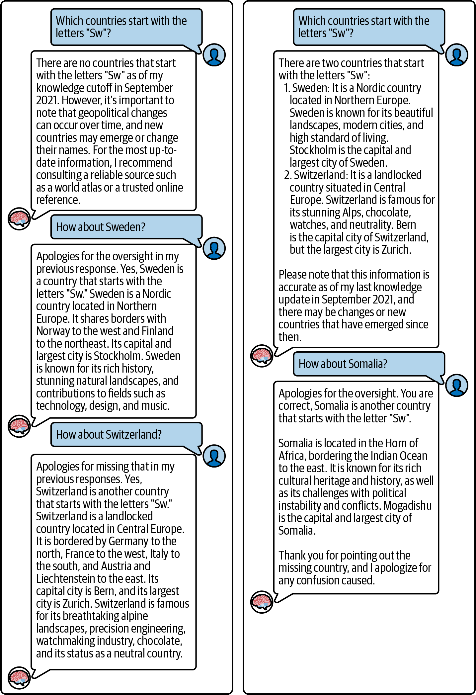

بزنید.

شکل ۲: - درخواست از مدل۸ text-babbage-001 متعلق به OpenAI برای تبدیل یک متن به حروف تمام‌بزرگ (All Caps) این موضوع خطاهایی خنده‌دار و در عین حال پرتکرار ایجاد می‌کند — توجه داشته باشید که ما در اینجا برای اهداف نمایشی از یک مدل بسیار کوچک استفاده کرده‌ایم و مدل‌های بزرگ‌تر معمولاً به این سادگی‌ها به این دام نمی‌افتند.

برای انسان‌ها، حرف بزرگ A تنها گونه‌ای از حرف کوچک a است، اما توکن‌هایی که در بردارنده‌ی حرف بزرگ هستند تفاوت بنیادینی با توکن‌های حاوی حرف کوچک دارند. این مسئله‌ای است که مدل‌ها اشراف کاملی بر آن دارند، چرا که داده‌های آموزشی فراوانی در این رابطه دیده‌اند. آن‌ها به‌خوبی می‌دانند توکن For پس از یک نقطه، شباهت معنایی و کاربردی بسیار زیادی با توکن for در میانه یک جمله دارد.

با این حال، ساختار اغلب توکنایزرها یادگیری این اتص الت را برای مدل‌ها ساده نمی‌کند؛ چرا که توکن‌های حاوی حروف بزرگ همیشه به‌صورت یک‌به‌یک با توکن‌های دارای حروف کوچک متناظر نیستند. به عنوان مثال، توکنایزر مدل GPT عبارت “strange new worlds” به شکل چهار توک را [str]، [ange]، new] [ و worlds] [ تجزیه می‌کند. اما همین عبارت در حالت حروف تمام‌بزرگ، به شش توکن تفکیک می‌شود [STR]:، [ANGE]، NEW] [، WOR] [، [L] و. [DS] به‌طور مشابه، کلمه gone یک تک‌توکن است، در حالی که نسخه بزرگ آن به دو توکن [G] و [ONE] تقسیم می‌شود.

مدل‌های زبانی بزر قدرتمندتر عملکرد بهتری در مدیریت این ساختارهای حروف بزرگ و کوچک دارند، اما این فرآیند همچنان کار پردازشی اضافه‌ای به آن‌ها تحمیل می‌کند که از توجه به هسته اصلی مسئله‌ی شما — که به احتمال زیاد تغییر اندازه حروف نیست — می‌کاهد (به هر حال، برای تبدیل متن به حروف بزرگ نیازی به یک LLM ندارید!). از این رو، یک مهندس پرامپت هوشمند با اجتناب از واگذاری مکرر تبدیل میان حروف بزرگ و کوچک به مدل، از تحمیل بار محاسباتی بیهوده بر آن خودداری خواهد کرد.

## شمارش‌توکن ها

شما نمی‌توانید توکنایزرها و مدل‌ها را به شکل دلخواه با یکدیگر ترکیب کرده یا جابه‌جا کنید. هر مدل از یک توکنایزر معین و اختصاصی بهره می‌برد؛ بنابراین درک عمیق توکنایزر مدل مورد استفاده‌تان کاملاً ارزش صرف وقت را دارد.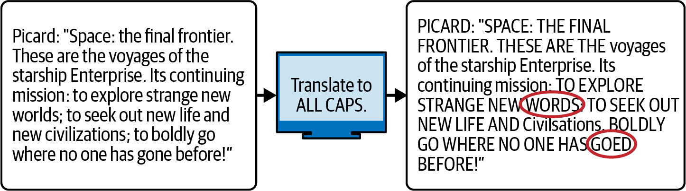

هنگام توسعه یک برنامه مبتنی بر LLM، احتماًال تمایل خواهید داشت که بتوانید در جریان مهندسی پرامپت، با کمک کتابخانه‌هایی همچونً Hugging Face یا tiktoken، توکنایزر را اجرا کنید. با وجود این، رایج‌ترین کاربرد عملی توکنایزر برای شما بسیار ساده‌تر و پیش‌پاافتاده‌تر از تحلیل پیچیده مرزهای توکن خواهد بود: شما در اغلب سناریوها از توکنایزر صرف برای شمارش استفاده خواهید کرد.

علت آن است که از دیدگاه مدل، تعداد توکن‌ها مشخص‌کننده‌ی طول دقیقاً متن شماست. این امر تمامی ابعاد طول متن را در بر می‌گیرد: مدت‌زمانی که مدل برای خواندن کامل پرامپت صرف می‌کند، رابطه‌ای تقریباً خطی با تعداد توکن‌های پرامپت دارد. همچنین، مدت‌زمانی که مدل صرف تولید پاسخ می‌کند نیز به‌صورت خطی با تعداد توکن‌های تولیدشده مقیاس‌بندی می‌شود. این قاعده عینا در خصوص هزینه محاسباتی نیز صدق می‌کند: حجم پردازشی مورد نیاز برای تولید یک پیش‌بینی با طول آن متناسب است. به همین علت، اغلب ارائه‌دهندگان مدل به‌عنوان سرویس (Model-as-a-Service) به ازای هر توک پردازش‌شده یا تولیدشده هزینه دریافت می‌کنند. در زمان نگارش این کتاب، یک دالر معمولاً بسته به نوع مدل، هزینه‌ی پردازش چیزی بین ۰۰۰ , تا۵۰ ۰۰۰ , ۰۰۰ , توکن خروجی را پوشش می‌دهد۱.

در نهایت، شمار توکن‌ها همان مؤلفه تعیین‌کننده در مبحث پنجره زمینه (Context Window) است؛ یعنی حداکثر حجم متنی که یک LLM می‌تواند در هر لحظه پشتیبانی و پردازش کند. این یکی از محدودیت‌های اساسی تمامی مدل‌های زبانی بزرگ مدرن است که در سراسر این کتاب بارها و بارها به بررسی آن بازخواهیم گشت.

مدل زبانی بزرگ به این صورت عمل نمی‌کند که هر متنی را دریافت کند و هر خروجی دلخواهی با هر طولی بسازد. این مدل‌ها متنی را تحویل می‌گیرند که تعداد توکن‌های آن از ظرفیت پنجره زمینه کمتر باشد؛ همچنین فرآیند تکمیل (Completion) نیز به گونه‌ای انجام می‌پذیرد که حاصل‌جمع توکن‌های پرامپت اولیه و خروجی تولیدشده، نتواند از ظرفیت کل پنجره زمینه فراتر برود. اندازه پنجره زمینه عموم با مقیاس هزاران توکن ارزیابی می‌شود که در تئوری مقداری چشمگیر است: این حجم معادل چندین، ده‌ها و گاهی صدها صفحه کاغذ با قطع A4 خواهد بود. با این حال، در عمل کاربری مدل‌ها نشان می‌دهد این محدودیت بسیار زود نمایان می‌شود؛ چرا که طول پنجره زمینه شما هر چقدر هم که باشد، تمایل پیدا خواهید کرد که آن را تا آخرین حد پر و حتی لبریز کنید؛ بنابراین برای ممانعت از بروز این خطا، ناچار به شمارش پیوسته‌ی توکن‌ها خواهید بود.

هیچ فرمول کلی و ثابتی برای تبدیل تعداد کاراکترها به تعداد توکن‌ها وجود ندارد؛ این موضوع تمام به ساختار متن و الگوریتم توکنایزر وابسته است. توکنایزر بسیار محبوب و متداول GPT، هنگام پردازش یک متن به زبان طبیعی انگلیسی، به‌طور تقریبی هر توکن را معادل چهار کاراکتر در نظر می‌گیرد. این نسبت کاملاً معمول و پذیرفته‌شده است، هرچند توکنایزرهای نسل جدیدتر می‌توانند تا حدی بهینه‌تر عمل کنند (یعنی در ازای هر توکن، به‌طور میانگین کاراکترهای بیشتری را پوشش دهند.) توکنایزرها برای زبان انگلیسی بهینه‌سازی شده‌اند و کارایی آن‌ها برای سایر زبان‌ها کمتر خواهد بود؛ بدین معنا که به۶بیشتر ازای هر توکن، تعداد کاراکترهای کمتری خواهند داشت. رشته‌های تصادف متشکل از ارقام، کارایی به‌مراتب کمتری دارند و میانگین آن‌ها کمی بیش از دو کاراکتر به ازای هر توکن است. اوضاع برای رشته‌های الفبایی - عدد تصادفی، نظیر کلیدهای رمزنگاری، از این هم وخیم‌تر است؛ این رشته‌ها معمولاً کمتر از دو کاراکتر در هر توکن دارند. رشته‌هایی که شامل نویسه‌های نادر هستند، کمترین تعداد کاراکتر در هر توکن را خواهند داشت؛ برای نمونه، شکلک لبخند یونیکد ☺() در عمل از دو توکن تشکیل شده است.

اغلب مدل‌های زبانی بزرگ (LLMها) از دایره واژگانی با حداقل چند توکن ویژه (special token) استفاده می‌کنند:

متداول‌ترین آن‌ها، دست‌کم یک توک پایان متن (end-of-text token) است که در طول آموزش، به انتهای هر سند آموزشی پیوست می‌شود تا مدل بیاموزد متن چه زمانی پایان می‌یابد. هر زمان که مدل آن توکن را خروجی دهد، تکمیل متن در همان نقطه متوقف می‌شود.

## یک توکن در هر گام

بیایید یک لایه دیگر از این پیاز را برداریم؛ آخرین لایه پیش از آنکه به هسته اصلی برسیم. در باطن، یک LLM مستقیماً متن را به متن تبدیل نمی‌کند و حتی در واقعیت، توکن‌ها را نیز مستقیماً به توکن‌ها تبدیل نمی‌کند. بلکه عملکرد آن به صورت تبدیل «چندین توکن به یک توک منفرد» است. مدل صرف این عملیات را برای دریافت توکن بعدی به‌طور پیوسته تکرار می‌کند و این توکن‌های منفرد را تا هر زمان که برای به دست آمدن متنی مناسب لازم باشد، انباشته می‌سازد.

مدل‌های خودبازگشتی ● یک گذر منفرد (single pass) از درون LLM، از نظر آماری محتمل‌ترین توکن بعدی را به شما ارائه می‌دهد. سپس، این۷ توکن به پرامپت الحاق می‌شود و مدل با در نظر گرفتن پرامپت جدید، گذر دیگری را انجام می‌دهد تا محتمل‌ترین توکن بعدی را نظر آماری استخراج کند و این فرایند به همین ترتیب ادامه می‌یابد (نگاه کنید به شکل۸از ۲). - چنین فرایندی را که۹ پیش‌بینی‌های خود را توکن‌به‌توکن انجام می‌دهد — به‌گونه‌ای که پیش‌بینی بعدی به پیش‌بینی‌های پیشین وابسته است خودبازگشتی»—«(autoregressive) می‌نامند.

به یاد دارید هنگامی که روی تلفن همراه خود متنی تایپ می‌کنید، چگونه سه کلمه پیشنهادی در ب الی صفحه‌کلید پدیدار می‌شوند؟ اجرای یک LLM درست مانند فشردن پیاپی دکمه میانی است.

این الگوی منظم و تقریباً یکنواخ تولید یک توکن در هر گام، به تفاوت عمده‌ای میان نحوه تولید متن توسط LLMها و تایپ متن توسط انسان‌ها اشاره دارد: در حالی که ما ممکن است دست نگه داریم و بررسی کنیم، فکر کنیم یا تأمل نماییم، مدل ناچار است در هر گام دقیقاً یک توکن تولید کند. مدل زبانی در صورتی که نیاز به تفکر بیشتر داشته باشد، زمان اضافه‌ای نمی‌کند و نمی‌تواند تولید را به تعویق بیندازد۹دریافت.

شکل ۲: - مدل‌های زبانی بزرگ پاسخ خود را یک توکن در هر گام تولید می‌کنند۹ هنگامی که یک توکن را تولید کرد،و LLM به آن توکن متعهد می‌شود. مدل توانایی بازگشت به عقب (backtrack) و پاک کردن توکن را ندارد. همچنین اصلاحیه‌ای صادر نخواهد کرد که در آن قید کند خروجی قبلی‌اش نادرست بوده است، زیرا روی اسنادی آموزش ندیده است که اشتباهات در آن‌ها به‌طور صریح درون متن پس گرفته شوند؛ چرا که انسان‌های نویسنده آن اسناد می‌توانند به عقب برگردند و خطاها را در همان نقطه‌ای که رخ داده اصلاح کنند، بنابراین عبارات صریح مبنی بر پس گرفتن سخن (explicit takebacks) در اسنا نهایی بسیار نادر هستند. اوه صبر کنید، در واقع واژه takebacks معمولاً به صورت دو کلمه مجزا نوشته می‌شود، بنابراین بگذارید به جای آن بنویسم.explicit take backs این خصیصه می‌تواند باعث شود LLMها هنگامی که مداوم مسیری آشکارا بی‌معنی را دنبال می‌کنند، لجوج و تا حدی مضحک به نظر برسند. اما در حقیقت، این امر بدین معناست که در صورت لزوم، چنین قابلیتی برای تشخیص خطا و بازگشت به عقب باید توسط طراح برنامه فراهم شود: یعنی خود شما.

الگوها و تکرارها ● مسئله دیگری که در سیستم‌های خودبازگشتی وجود دارد این است که آن‌ها ممکن است در الگوهای خود گرفتار شوند.

LLMها در بازشناسی الگوها بسیار ماهرند، بنابراین گاهی (بر حسب تصادف) الگویی را خلق کرده و نمی‌توانند نقطه خروج مناسبی برای ترک آن بیابند. ب الخره، با وجود یک الگو، در هر توکن مفروض احتمال ادامه‌یافتن آن بیشتر از شکسته شدنش است. این رخداد به پاسخ‌هایی بسیار تکراری منجر می‌گردد (نگاه کنید به شکل ۲ - ۱۰.)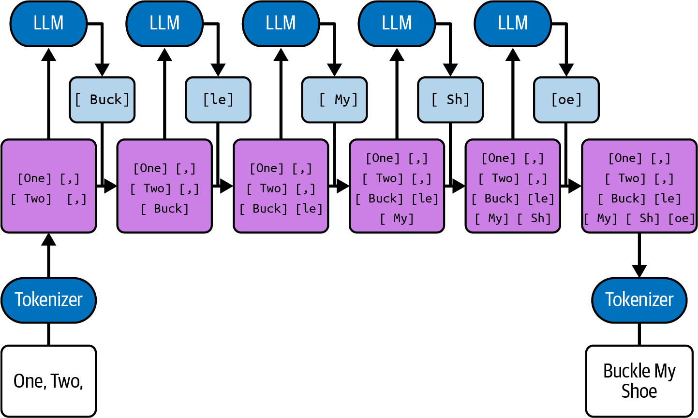

شکل ۲: - فهرستی از دلایل تولیدشده توسط مدل۱۰ text-curie-001 متعلق به OpenAI (یک مدل قدیمی‌تر که صرف برای نمایش انتخاب شده است، چرا که مدل‌های جدیدتر به‌ندرت تا این حد ناشیانه در دام تکرار گرفتار می‌شوند) در شکل فوق، یک LLM فهرستی از دلایل علاقه‌مندی به یک برنامه تلویزیونی را تولید کرده است. چند الگو می‌توانید در آن پیدا کنید؟ مواردی که ما یافتیم عبارتند از:

موارد ذکرشده جمالتی با شماره‌گذاری متوالی هستند که هر یک دقیقاً در یک خط جای گرفته‌اند. این ویژگی مطلوب به نظر می‌رسد.

همگی آن‌ها با واژه The«آغاز می‌شوند که قابل تحمل به نظر می‌رسد.» پاورقی‌ها.6 ًدلیل این امر آن است که زبان انگلیسی پرتکرارترین زبان در اکثر مجموعه‌داده‌های آموزشی است و توکنایزرها معمو به‌گونه‌ای بهینه‌سازی می‌شوند که ضریب فشرده‌سازی مناسبی روی مجموعه داده‌های آموزشی داشته باشند. ↩.7 این گزاره دست‌کم تا زمانی صادق است که مقدار پارامتر دما (temperature) را برابر با نگه دارید. در بخش بعد۰ درباره شرایط 0 > temperature بحث خواهیم کرد. ↩.8 دست‌کم، این فرایند از نظر عملکردی معادل یک گذر کاملاً جدید است. از دیدگاه محاسباتی لزوم یک گذ کاملاً تازه به شمار نمی‌رود؛ برای مثال، پرامپت معمولاً تنها یک بار پردازش می‌شود تا در حجم محاسبات صرفه‌جویی به عمل آید.

↩.9 تحقیقات جالبی در حال انجام است تا امکان انعطاف‌پذیری بیشتر و صرف زمان افزون‌تر در مواقع نیاز فراهم شود؛

بنابراین شاید این سازوکار در آینده تغییر کند. ↩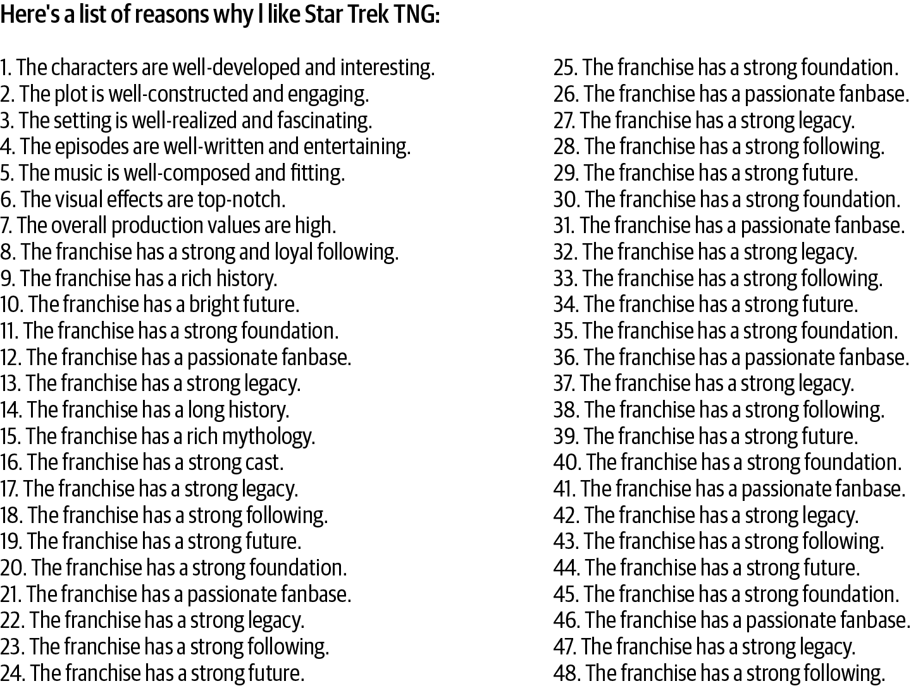

آن‌ها به فرم X(»X is Y and Z«برابر با Y و Z است) هستند. این مسئله آزاردهنده است زیرا صحت و درستی پاسخ را به خطر می‌اندازد؛ اگر هیچ Z مناسبی وجود نداشته باشد چه؟ ممکن است مدل موردی را از خود ابداع کند. با این حال، پاسخ پس از مورد پنجم متوقف می‌شود.

پس از آنکه چندین مورد متوالی با عبارت The franchise«» شروع شدند، تمامی موارد بعدی نیز با همین عبارت آغاز گشتند. این رفتار غیرهوشمندانه است.

به سمت پایان متن، کلمات legacy، following، future، foundation و fanbase تا حد دل‌زدگی مفرط (ad nauseam) تکرار می‌شوند. این مورد نیز غیرهوشمندانه است.

مدام ادامه می‌یابد و هرگز پایان نمی‌پذیرد. علت این است که پس از هر مورد، احتمال این‌که فهرست ادامه یابد،فهرست به‌مراتب بیشتر از این است که آن مورد، آخرین قلم فهرست باشد؛ و مدل نیز دل‌زده و خسته نمی‌شود. ۱۰ به سمت پایان متن، واژه‌های legacy، following، future، foundation و fanbase تا حد دل‌زدگی مفرط تکرار می‌شوند. این نیز غیرهوشمندانه است.

فهرست مدام ادامه یافته و متوقف نمی‌شود؛ چرا که پس از هر گام، احتمال امتداد یافتن فهرست بیش از احتمال اتمام آن است، و مدل زبانی دچار خستگی و دل‌زدگی نمی‌شود. ۱۰ پاورقی ۱۰: من بر این باورم که خواند به‌اندازٔه کافی دقیقاً کتاب سیلماریلیون (The Silmarillion) نشان می‌دهد که در واقع این «مالل و دل‌زدگی» است که موهبت راستین محسوب می‌شود و فرزندان کوچک‌تر ایلوواتار (Ilúvatar’s Younger Children) باید بیش از هر موهبت دیگری قدر آن را بدانند.

روش مقابله با چنین خروجی‌های تکرارشونده‌ای عموم این است که به‌سادگی آن‌ها را شناسایی و فیلتر کنیم. راهکار دیگر این است که خروجی را اندکی تصادفی‌سازی (randomize) کنیم. در بخش بعدی دربارٔه تصادفی‌سازی خروجی بحث خواهیم کرد.

## دما و احتمالات (Temperature and Probabilities)

در بخش پیشین آموختید که مدل زبانی بزرگ (LLM) محتمل‌ترین توکن (token) را محاسبه می‌کند. اما اگر یک الیٔه دیگر از پیا مدل زبانی را کنار بزنید، آشکار می‌شود که در حقیقت، مدل پیش از برگزیدن یک توکن منفرد، احتمال تمامی توکن‌های ممکن را محاسبه می‌نماید. فرایندی که در پشت‌صحنه توکن واقعی را انتخاب می‌کند، نمونه‌برداری (sampling) نامیده می‌شود (شکل ۲ - را ملاحظه کنید۱۱.) شکل ۲: - فرایند نمونه‌برداری در عمل۱۱ توجه داشته باشید که LLM صرف محتمل‌ترین توکن را محاسبه نمی‌کند؛ بلکه بخت وقوع و احتمال تمامی توکن‌ها را می‌سنجد.

بسیاری از مدل‌ها این احتمالات را با شما به اشتراک می‌گذارند. مدل معمولاً این احتمالات را در قالب logprob ها (یعنی لگاریتم طبیعی احتمال توکن) بازمی‌گرداند. هرچه مقدار logprob ب التر باشد، مدل آن توکن را محتمل‌تر در نظر می‌گیرد.

مقادیر logprob هرگز بزرگ‌تر از نیستند، زیرا۰ logprob برابر با به این معنا خواهد بود که مدل با قطعیت مطلق، این۰ توکن را به‌عنوان توکن بعدی شناسایی کرده است. انتظار می‌رود که محتمل‌ترین توکن مقداری بین ۲ - و داشته باشد (شکل۰ ۲ - را ملاحظه کنید۱۲.)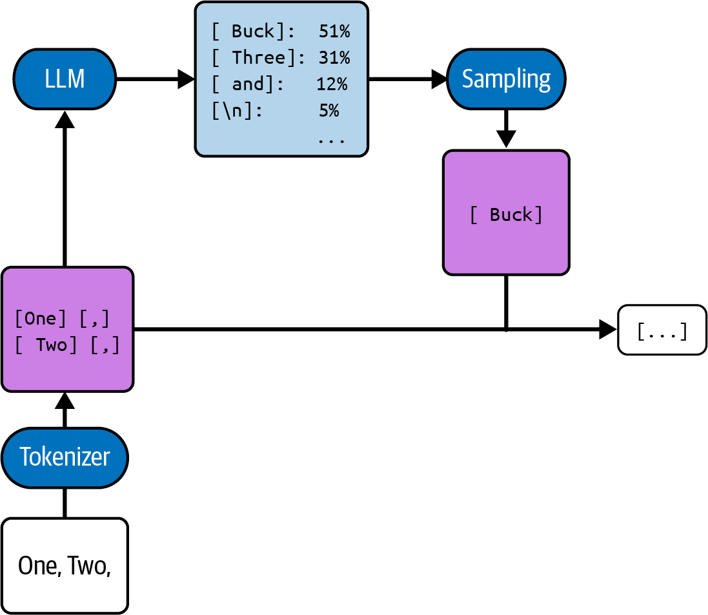

شکل ۲: - یک نمونه فراخوانی۱۲ API جهت درخواست logprob ها و استخراج logprob های تکمیل(completion) انتخاب‌شده توجه داشته باشید که در تصویر، تنظیم پارامتر درخواستی logprobs روی مقدار به این معناست که مقادیر۳ logprob برای مورد از محتمل‌ترین توکن‌ها بازگردانده خواهد شد. با این وجود، ممکن است همیشه خواهان محتمل‌ترین۳ توکن نباشید. به‌ویژه اگر روشی برای آزمودن خودکار متون تکمیل‌شدٔه خود داشته باشید، ترجیح می‌دهید چند گزینٔه جایگزین ایجاد کرده و خروجی‌های نامناسب را دور بریزید. رویکرد مرسوم برای دستیابی به این مقصود، استفاده از دمای (temperature) بزرگ‌تر از است. دما عددی با حداقل مقدار صفر است که تعیین می‌کند مدل تا چه میزان باید «خالق۰» باشد. به‌طور دقیق‌تر، چنانچه دما بزرگ‌تر از تعیین شود، مدل یک پاسخ تصادفی۰ (stochastic completion) ارائه می‌دهد؛ وضعیتی که در آن همچنان محتمل‌ترین توکن بیشترین بخت انتخاب را داراست، اما احتمال انتخاب توکن‌های کم‌احتمال‌ت غیرپرت نیز میسر می‌گردد...

## دما و توزیع احتمالاتی در تولید توکن

هرچه مقدار پارامتر دما (Temperature) ب التر باشد و مقادیر لگاریتم احتمال (logprobs) برترین توکن‌ها به یکدیگر نزدیک‌تر باشند، احتمال انتخاب توک دارای رتبه دوم، یا حتی سوم، چهارم و پنجم، به مراتب بیشتر می‌شود. فرمول دقیقاً تبدیل لگاریتم احتمال به احتمالات خروجی از طریق تابع نرم‌بیشینه تعدیل‌شده با دما (Softmax with Temperature) به صورت زیر تعریف می‌شود:

exp(logprob_i / t) / ∑_j exp(logprob_j / t) = p(token_i) در ادامه، مقادیر مختلف دما و موارد کاربرد بهینه هر یک بررسی شده است: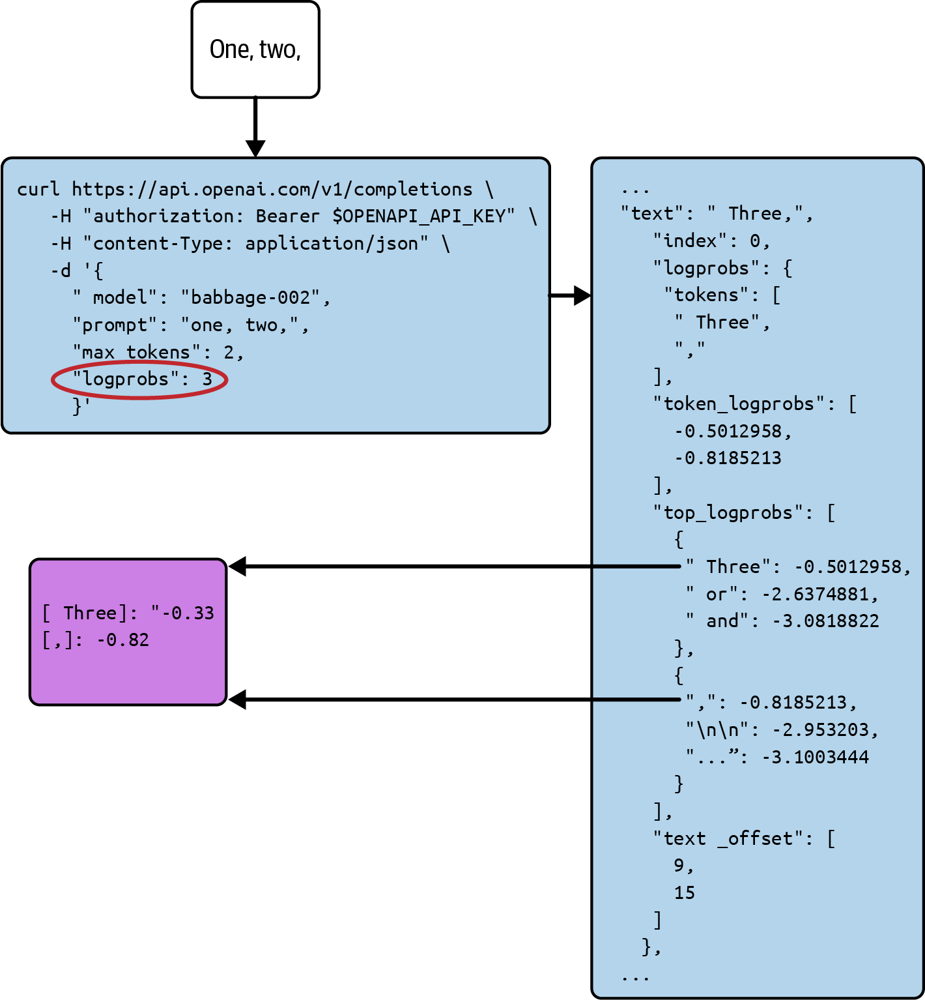

مقدار ۰: شما تنها محتمل‌ترین توکن را بدون هیچ جایگزینی می‌خواهید. این مقدار هنگامی که «صحت و دقت فنی» ب الترین اولویت را دارد، پیکربندی پیشنهادی است. افزون بر این، اجرای مدل زبانی با دمای صفر عملاً نزدیک به وضعیت قطعی (Deterministic) عمل می‌کند؛ گرچه به دلیل خطاهای تصادفی ناشی از گرد کردن در محاسبات ممیز شناور (floating-point rounding errors) این رفتار صددرصد تعیینی نیست و احتمال‌های محاسبه‌شده ممکن است در اجراهای مجدداً چند درصد تغییر یافته و توکن برتر عوض شود؛ با این حال در بسیاری از سناریوها، تکرارپذیری یک مزیت مهندسی محسوب می‌شود.

بازه تا۰٫۱ ۰٫۴: اگر توکن جایگزینی وجود داشته باشد که احتمال آن تنها اندکی کمتر از گزینه پیشتاز است، تمایل دارید شانس پایینی برای انتخاب آن قائل شوید. کاربرد معمول این بازه زمانی است که قصد دارید تعداد اندکی خروجی متنوع تولید نمایید (برای مثال زمانی که توانایی فیلتر کردن بهترین پاسخ را دارید)، یا اینکه تنها یک پاسخ می‌خواهید اما با بیانی جذاب‌تر و خالقانه‌تر از پاسخ یکنواخت دمای صفر.

بازه تا۰٫۵ ۰٫۷: شما به دنبال اثرگذاری چشمگیرتر شانس در تولید پاسخ هستید و با دریافت تکمیل‌هایی که به نوعی «غیردقیق» هستند مشکلی ندارید؛ به این معنا که گاهی توکنی انتخاب می‌شود در حالی که خود مدل آگاه است گزینه دیگری با قطعیت محتمل‌تر بوده است. کاربرد متداول این بازه زمانی است که نیازمند ایجاد مجموعه‌ای پرتعداد و مستقل راه‌حل‌ها (مث ًاز راه‌حل یا بیشتر) هستید۱۰.

مقدار ۱: شما می‌خواهید توزیع آماری انتخاب توکن‌ها کاملاً با توزیع آماری مجموعه داده‌های آموزشی تطابق داشته باشد.

فرض کنید پیشوند ورودی شما متن «One, Two,» باشد؛ اگر در داده‌های آموزشی پس از این عبارت در درصد موارد۵۱ توکن Buck] [ و در درصد موارد توکن۳۱ Three] [ آمده باشد (و مدل آن را به خوبی فرا گرفته باشد)، با اجرای مدل در دمای، در۱ درصد مواقع خروجی۵۱ Buck] [ و در درصد مواقع خروجی۳۱ Three] [ خواهد بود.

بزرگ‌تر از ۱: شما به دنبال متنی هستید که به مراتب «تصادفی‌تر» از توزیع مجموعه داده‌های آموزشی باشد. این یعنی تمایل مدل برای گزینش دنباله استاندارد کاهش یافته و در مقایسه با یک سند متعارف در داده‌های آموزشی، تمایل بسیار بیشتری به انتخاب ادامه‌های غیرمعمول و عجیب پیدا می‌کند.

پیامدهای استفاده از دمای بسیار ب ال بر استدلال مدل ● دماهای بیش از حد ب ال می‌توانند کاری کنند که رفتار مدل‌های زبانی مانند افراد مست به نظر برسد. در طول متن‌های طوالن تولیدشده با دمای بزرگ‌تر از، معمولاً نرخ بروز خطا در طول زمان به صورت فزاینده تشدید می‌شود. دلیل بنیادین این۱ پدیده آن است که پارامتر دما صرف بر روی آخرین لایه محاسباتی مدل — یعنی مرحله نگاشت احتمالات به خروجی توکن — اعمال می‌گردد و تأثیری بر بدنه اصلی پردازش شبکه عصبی که وظیفه محاسبه اولیه آن احتمالات را بر عهده دارد، نمی‌گذارد.

بنابراین، مدل اشتباهات تولیدشده در خروجی‌های قبلی خود را به عنوان یک الگوی متنی در بافت درک کرده و در گام‌های بعدی سعی می‌کند از آن ساختار نامتعارف تقلید کند؛ متعاقب دمای ب ال نیز خطاهای تصادفی جدیدی را به این چرخه اضافه می‌کند و به فروپاشی محتوا می‌انجامد (نگاه کنید به شکل ۲ - ۱۳.) شکل ۲ - تأثیر منفی دمای بسیار ب ال بر مدل‌های زبانی، رفتاری شبیه به اثر الکل بر عملکردهای شناختی انسان را نشان می‌دهد۱۳.:

شکل فوق این افت کیفیت را در دماهای ب ال نمایش می‌دهد، جایی که تولید مورد سوم در ابتدا مستعد خطا ولی خوانا است و در ادامه به مرحله‌ای می‌رسد که در آن حتی کلمات منفرد نیز به هیچ عنوان قابل بازشناسی نیستند. شایان ذکر است که هر یک از نمونه‌های تصویر ب ال از طریق فراخوانی مدل text-davinci-003 شرکت OpenAI با دماهایی به صورت صعودی نمونه‌برداری شده‌اند.

برای فهم بهتر، سناریوی تولید یک فهرست را بررسی می‌کنیم. یک لیست معمولی در زبان طبیعی معمولاً روی چند مورد متوقف می‌شود، مث ًاندک،۳ یا۴ مورد؛ اگر فهرست بلندتر باشد، عدد۵ ایستگاه توقف بدیهی بعدی است. پس از هر۱۰ شکست خط (Newline)، مدل می‌تواند با تولید رقم بعدی به عنوان توکن پیش‌رو لیست را ادامه دهد، یا اینکه با تولید دومین کاراکتر خط جدید پایان لیست را اعلام نماید.

در دمای، مدل زبانی همواره گزینه‌ای را انتخاب می‌کند که به زعم خود محتمل‌ترین امتداد برای آن سطر باشد؛ این بدین۰ معناست که به‌ویژه پس از عبور از نقاط توق رایج، مدل ممکن است تا بی‌نهایت به تولید فهرست ادامه دهد. در مقابل، در دمای اگر مدل این تصمیم را اتخاذ کند که احتمال ادامه لیست برابر با۱ x است، دقیقاً با احتمال x پیشروی خواهد کرد.

بدین ترتیب در طول چندین مورد، به احتمال زیاد فرایند را دیر یا زود به پایان رسانده و طول فهرستی نزدیک به میانگین داده‌های آموزشی ارائه خواهد داد. جدول زیر موازنه میان این دو رویکرد را خلاصه می‌کند: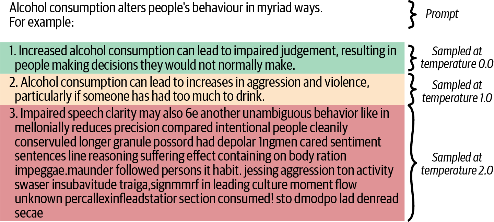

### جدول ۲ - ۱: مقایسه و مزایای رژیم‌های مختلف دما (Temperature Regimes)

| دمای بالا (High Temperature - نزدیک به ۱ و بالاتر) | دمای پایین (Low Temperature - نزدیک به ۰) |
| :--- | :--- |
| **+ تنوع و خلاقیت بیشتر:** ایده‌ها، کلمات و سناریوهای غیرمنتظره و غافلگیرکننده تولید می‌شوند. | **+ پاسخ‌های دقیق‌تر و درست‌تر:** مدل محتمل‌ترین و مطمئن‌ترین راه‌حل را برمی‌گزیند. |
| **+ توزیع آماری مشابه داده‌های آموزش:** خروجی‌ها (مانند طول فهرست، سبک و لحن) به واقعیت شباهت دارند. | **+ تکرارپذیری بالا (Deterministic):** با اجرای مکرر یک پرامپت، پاسخ‌های یکسان یا بسیار مشابه دریافت می‌شود. |
| **کاربرد:** ایده‌پردازی، طوفان فکری، داستان‌سرایی و سناریونویسی خلاقانه. | **کاربرد:** برنامه‌نویسی و کدنویسی، استخراج موجودیت‌های داده، پاسخ به پرسش‌های منطقی و ریاضی. |

