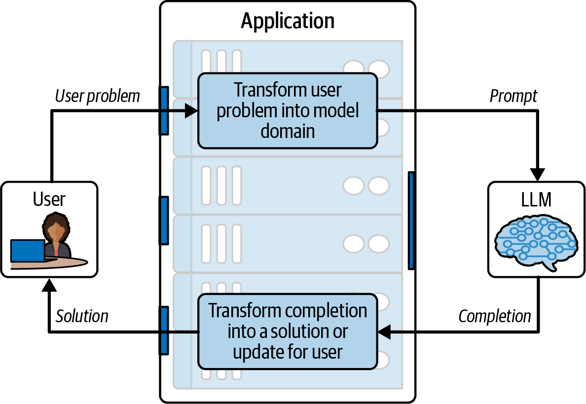
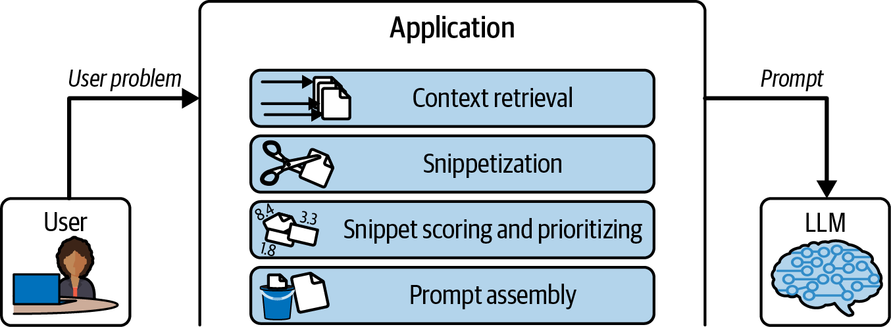
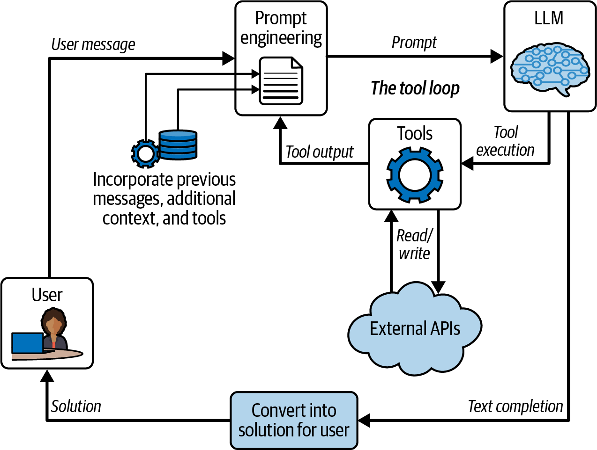

<div dir="rtl">

# فصل چهارم: طراحی برنامه‌های کاربردی مدل‌های زبانی بزرگ (Designing LLM Applications)

دو فصل گذشته پایه‌های لازم را برای بخش‌های باقی‌مانده کتاب بنا نهادند. در فصل به‌تفصیل نشان داده شد که۲ مدل‌های زبانی بزرگ (LLM) چگونه کار می‌کنند، و نشان دادیم که این مدل‌ها در غایت امر، عملاً مدل‌های تکمیل سند (document completion models) هستند که محتوا را توکن‌به‌توکن (یک توکن در هر گام) پیش‌بینی می‌کنند. فصل ۳ توضیح داد که چگونه رابط برنامه‌نویسی کاربردی گفتگو (chat API) بر پایه مدل‌های زبانی بزر فصل ساخته می‌شود. با۲ اندکی قند نحوی (syntactic sugar) در سطح API و میزان مناسبی از ریزتنظیم (fine-tuning)، از مدل تکمیل سند برای کامل کردن مکالمات میان کاربر و یک دستیار فرضی استفاده می‌شود. وقتی دقیقاً و موشکافانه بنگرید، مدل گفتگو در واقع هنوز هم یک مدل تکمیل سند است؛ با این تفاوت که اسنادی که تکمیل می‌کند، همگی رونوشت‌های گفتگو (conversation transcripts) هستند.

از این نقطه به بعد در کتاب، هر آنچه را که برای ساخت برنامه‌های کاربردی LLM جهت حل مسائل به نمایندگی از شرکت و کاربرانتان نیاز دارید، خواهید آموخت. این فصل به عنوان مدخلی برای ورود به این مباحث عمل می‌کند. در این فصل، به درون برنامه‌های کاربردی LLM عمیق خواهیم شد؛ برنامه‌هایی که خواهید دید در اصل یک لایه تبدیل (transformation layer) میان دامنه مسئله کاربر و دامنه متنی مدل هستند. علاوه بر این، برنامه کاربردی LLM یک لایه تبدی هدفمند است؛ با هدف حل مسئله!

کالبدشناسی حلقه ● در شکل ۴ -، برنامه کاربردی۱ LLM در قالب یک «حلقه» نمایش داده شده است، به این معنا که تعاملی رفت‌وبرگشتی میان کاربر و مدل برقرار است. دامنه‌های مدل و کاربر غالب کاملاً متمایز از یکدیگرند. کاربر ممکن است مشغول انجام کارهای متعددی باشد؛ مثًال نوشتن یک رایانامه (ایمیل) و جستجو برای یافتن کلمات دقیقاً جهت انتقال پیام خود. یا ممکن است در حال انجام کاری پیچیده باشد، نظیر سازماندهی یک سفر گروهی، رزرو بلیت‌های مسافرت و تهیه اقامتگاه. شاید هم کاربر مستقیماً با برنامه کاربردی LLM در تعامل نباشد؛ برای نمونه، ممکن است فرایند تحلیل تکرارشونده‌ای را تنظیم کرده باشد که برنامه کاربردی LLM با دردسترس قرار گرفتن داده‌های جدید، آن را به‌طور دوره‌ای اجرا کند. نکته حائز اهمیت این است که کاربر می‌تواند کارهای بسیار گوناگونی انجام دهد.

از سوی دیگر، مدل تنها یک کار انجام می‌دهد: اسناد را تکمیل می‌کند. اما همین قابلیت، انعطاف‌پذیری فوق‌العاده‌ای هنگام ساخت برنامه کاربردی LLM به شما می‌بخشد. توانایی تکمیل اسناد به مدل امکان می‌دهد ایمیل‌ها، کدها، داستان‌ها، مستندات و (اصولاً) هر چیزی را که یک انسان ممکن است بنویسد، به رشته تحریر درآورد. همان‌گونه که در فصل پیشین نشان دادیم، یک برنامه چت، نوعی برنامه کاربردی LLM است که اسناد رونوشت را تکمیل می‌کند؛ و اجرای ابزار (tool execution) صرف برداشتن یک گام فراتر و تکمیل یک سند رونوشت تخصصی است که شامل نح فراخوانی تابع (function calling syntax) است. با وجود توانایی مدل‌های زبانی بزرگ در تکمیل متن، مشارکت در گفتگو و اجرای ابزارها، می‌توان آن‌ها را در گستره‌ای تقریباً نامحدود از سناریوهای کاربردی به کار گرفت.

شکل ۴: - برنامه‌های کاربردی مبتنی بر۱ LLM حلقه‌ای را پیاده‌سازی می‌کنند که اطلاعات را از دامنه کاربر به دامنه متنی LLM و سپس مجدداً بازمی‌گرداند.

این حلقه، وظیفه پیاده‌سازی فرایند تبدیل میان دامنه کاربر و دامنه مدل را بر عهده دارد. حلقه مسئله کاربر را گرفته و آن را به سند یا رونوشتی تبدیل می‌کند که مدل باید آن را تکمیل کند. پس از آنکه مدل پاسخ داد، حلقه خروجی مدل را مجدداً به شکل راه‌حلی برای مسئله کاربر (یا دست‌کم گامی در جهت درست) به دامنه کاربر بازمی‌گرداند.

برنامه کاربردی LLM ممکن است تنها شامل یک دور گردش در این حلقه باشد. به عنوان مثال، اگر کاربر در حال نوشتن ایمیلی باشد و بخواهد فهرستی از نکات بالت‌پوینت‌شده را به نثری پیوسته تبدیل کند، تنها به یک بار تکرار در این حلقه نیاز خواهید داشت؛ به محض آنکه مدل نثر پیوسته را بازگرداند، وظیفه برنامه به اتمام رسیده است. کاربر در صورت تمایل می‌تواند برنامه را دوباره اجرا کند، اما در هر نوبت، حلقه هیچ وضعیتی (state) را از اجرای قبلی حفظ نمی‌کند.

در مقابل، برنامه کاربردی LLM ممکن است این حلقه را چندین بار پیاپی اجرا کند، همان‌طور که در مورد یک دستیار گفتگو محور صدق می‌کند. یا اینکه برنامه کاربردی ممکن است به‌طور مکرر اجرا شود، به حجم وسیعی از وضعیت‌ها رجوع کند و با تغییر شکل مسئله، حلقه را دستخوش تغییر نماید. یک برنامه برنامه‌ریزی سفر، مثالی عالی از این سناریو است. در ابتدا، برنامه در ایده‌پردازی برای گزینه‌های سفر همفکری می‌کند؛ سپس، به سراغ انجام ترتیبات واقعی سفر می‌رود؛ و در نهایت، یادآورها و نکات مربوط به سفر را تنظیم می‌نماید.

در بخش‌های پیش‌رو، شما را به یک چرخش کامل در حلقه شکل ۴ - خواهیم برد. ما به بحث پیرامون دامنه مسئله کاربر۱ خواهیم پرداخت، آن مسئله را به دامنه مدل تبدیل خواهیم کرد، متن تکمیل‌شده (completion) را گردآوری نموده و آن را دوباره به یک راه‌حل برای کاربر تبدیل خواهیم کرد.

مسئله کاربر ● این حلقه با کاربر و مسئله‌ای که درصدد حل آن است آغاز می‌شود. جدول ۴ - مشخص می‌سازد که چگونه دامنه مسئله۱ کاربر می‌تواند بر اساس چندین ُبعد متفاوت باشد و از سطوح ساده تا بسیار پیچیده تغییر کند. این ابعاد عبارتند از:

بستری که مسئله در آن منتقل می‌شود: (که متن، طبیعی‌ترین بستر برای مدل‌های زبانی بزرگ است) سطح انتزاع: (که انتزاع ب التر، نیازمند استدلال پیچیده‌تری است) اطلاعات زمینه‌ای (Context) مورد نیاز: (که اغلب دامنه‌ها علاوه بر اطلاعات ارائه‌شده توسط کاربر، مستلزم بازیابی اطلاعات تکمیلی نیز هستند) میزان وابستگی مسئله به وضعیت Stateful(بودن:() که دامنه‌های مسائل پیچیده‌تر، نیازمند حافظه‌ای از تعاملات گذشته و ترجیحات کاربر هستند) همان‌گونه که در جدول ۴ - مشاهده می‌کنید، دامنه‌های مسئله کاربر در ابعاد مختلف دارای سطوح گوناگونی از پیچیدگی۱ هستند. به عنوان مثال، یک برنامه نمونه‌خوانی و ویراستاری (proofreading) در تمام ابعاد دارای پیچیدگی پایینی خواهد بود، در حالی که یک دستیار برنامه‌ریزی سفر بسیار پیچیده خواهد بود. هنگام توسعه یک برنامه کاربردی LLM، شما با تمام این گونه‌های پیچیدگی به شیوه‌های مختلف دست‌وپنجه نرم خواهید کرد. ما در این فصل پیش‌درآمدی بر این رویکردها ارائه می‌دهیم و در فصول آتی کتاب، آن‌ها را با جزئیات کامل بررسی خواهیم کرد.

جدول ۴ - ۱: سه حوزه مسئله (در ستون‌ها) در چهار ُبعد از پیچیدگی (در سطرها) پیچیدگی فزاینده ◄ (Increasing Complexity) دستیار پشتیبانی فناوری ابعاد پیچیدگی نمونه‌خوانی برنامه‌ریزی سفر اطلاعات Travel Planning Proofreading Dimension IT Support بستر ارائه مسئله متن صوت از طریق پیچیده در وب‌سایت تلفن،تعاملات Medium ورودی متنی از سوی کاربر و تعامل با رابط‌های برنامه‌نویسی API(ها.) سطح انتزاع مسئله کاملاً عینی، مشخص و فضای مسئله انتزاعی گسترده و مسئله نیازمند درک سالیق Level of Abstraction محدود است. فضای راه‌حل بزرگ، اما مقید به شخصی کاربر و محدودیت‌های مستندات در دسترس. عینی او به منظور هماهنگ‌سازی یک راه‌حل پیچیده است.

کانتکست مورد نیاز هیچ چیزی فراتر از متن ارسال‌شده دسترسی قابل جستجو به به تقویم‌ها،دسترسی API های Context Required توسط کاربر نیاز نیست. مستندات فنی و رونوشت هوایی، مقالات خبری اخیر،خطوط نمونه‌های پشتیبانی قبلی.‌های مسافرتی دولتی،توصیه ویکی‌پدیا و موارد دیگر.

وضعیت‌مندی فاقد وضعیت باید تاریخچه مکالمه و راهکارهای باید تعاملات را در طول چندین (No statefulness) Statefulness؛ هر امتحان‌شده را ردیابی کند. هفته برنامه‌ریزی، از طریق فراخوانی API شامل یک بیان کانال‌های تعاملی مختلف و مسئله کاملاً مجزا و مستقل است.‌های لغوشده برنامه‌ریزی،شاخه ردگیری نماید.

## تبدیل مسئله کاربر به دامنه مدل)

Converting the User’s Problem to the Model Domain(ایستگاه بعدی در چرخه ارائه‌شده در «شکل ۱ -»، درون خود برنامه کاربردی قرار دارد؛ جایی که مسئله کاربر به دامنه زبانی و۴ مفهومی مدل تبدیل می‌شود. نقطه عطف و هسته بنیادین مهندسی پرامپت (Prompt Engineering) دقیقاً در همین گام نهفته است. هدف این مرحله، تدوین پرامپتی است که فرآیند تکمیل (Completion) آن حاوی اطلاعاتی باشد که بتوان مستقیماً برای حل چالش کاربر از آن‌ها استفاده کرد. خلق چنین پرامپت بی‌نقصی به‌هیچ‌وجه وظیفه ساده‌ای نیست و سیستم نرم‌افزاری باید بتواند چهار معیار بنیادین زیر را به‌طور هم‌زمان برآورده سازد:.1 پرامپت باید شباهت ساختاری و محتوایی وثیقی با داده‌های مجموعه آموزشی مدل داشته باشد..2 پرامپت باید دربرگیرنده تمام اطلاعات مرتبط و ضروری برای حل مسئله کاربر باشد..3 پرامپت باید مدل را به‌سوی تولید متنی هدایت کند که به‌طور مؤثر به حل مسئله بپردازد.

متن تکمیلی.4(Completion) باید دارای یک نقطه پایان منطقی باشد تا فرایند تولید متن به‌صورت طبیعی و در جای درست متوقف شود.

بیایید هر یک از این شاخص‌ها را به‌دقت کالبدشکافی کنیم. نخستین و حیاتی‌ترین اصل این است که ساختار پرامپت باید به اسناد موجود در مجموعه داده آموزشی شباهت زیادی داشته باشد. ما این موضوع را اصل شنل‌قرمزی»«Little Red()Riding Hood principle می‌نامیم. مسلم آن داستان کلاسیک را به خاطر دارید: دختربچه‌ای ساده‌دل با لباسی سرخ، در امتداد یک مسیر جنگلی حرکت می‌کند تا به مادربزرگ بیمارش سر بزند. علی‌رغم هشدارهای اکید مادرش، دخترک از مسیر اصلی منحرف می‌شود، با گرگی درنده مواجه می‌گردد و پس از آن، ماجرا کاملاً فاجعه‌بار پیش می‌رود؛ خون‌ریزی فراوان، وحشت و تاریکی... واقع شگفت‌آور است که ما این روایت دلهره‌آور را برای کودکان تعریف می‌کنیم!

اما در کاربرد فنی ما، مقصود کاملاً شفاف است: از مسیری که مدل بر روی آن آموزش دیده است فاصله نگیرید و منحرف نشوید. هر چقدر سند پرامپت خود را واقعی‌تر، ملموس‌تر و از نظر الگوهای زبانی شبیه‌تر به مستندات مجموعه داده‌های آموزشی(Training Set) بسازید، خروجی و متن تکمیلی تولیدشده توسط مدل، قابل پیش‌بینی‌تر و پایدارتر خواهد بود. اصل شنل‌قرمزی راهبردی کلیدی است که در طول این کتاب بارها به آن بازخواهیم گشت. در حال حاضر، به ذکر این نکته بسنده می‌کنیم که رویکرد همیشگی شما باید شبیه‌سازی و بازتولید الگوهای رایج در داده‌های آموزشی باشدً.

بسیاری از پیشرفته‌ترین مدل‌های زبانی بزرگ(LLMs) در قبال ماهیت و محتوای داده‌های آموزشی خود شدید محرمانگی به خرج می‌دهند و اطلاعاتی فاش نمی‌کنند؛ البته این رویکرد دلیل موجهی دارد. اگر بدانید مستندات آموزشی آن‌ها دقیقاً چگونه قالب‌بندی شده‌اند، در دستکاری پرامپت‌ها و کشف استراتژی‌های جدید دور زدن محدودیت‌های ایمنی (Jailbreaking) دست ب ال را خواهید داشت. با این حال، اگر قصد دارید بفهمید مدل با چه فرمت‌ها و سبک‌های نوشتاری آشناتر است، آسان‌ترین راه این است که مستقیماً از خود مدل سؤال کنید! به‌عنوان نمونه، می‌توانید این دستور را امتحان نمایید:

"What types of formal documents are useful for specifying financial information about a company?" پس از ارسال این درخواست، مجموعه متنوعی از اسناد استاندارد را مشاهده خواهید کرد که می‌توانید قالب درخواست‌های آتی خود را بر مبنای آن‌ها تنظیم کنید. در مرحله بعد، از مدل بخواهید یک نمونه واقعی از آن سند تولید کند تا بررسی کنید که آیا فرمت ارائه شده دقیقاً همان ساختار مدنظر شما است یا خیر.

خوشبختانه طیف نامحدودی از الگوها و انواع اسناد برای الگوبرداری در دسترس قرار دارند. در کار با مدل‌های تکمیلی متنی (Completion Models)، پرامپت خود را شبیه به کدهای برنامه‌نویسی، مقالات خبری، توییت‌ها، مستندات مارک‌داون (Markdown) یا رونوشت‌های ارتباطی پیاده‌سازی کنید. در مدل‌های گفتگومحور(Chat Models)، ساختار کلی سند از پیش برای شما تعریف و تثبیت شده است؛ به عنوان نمونه در پلتفرم OpenAI، این ساختار در قالب یک سند ChatML تنظیم می‌شود که با یک پیام سیستمی(System Message) حاوی دستورالعمل‌های هدایتی آغاز شده و سپس تعاملات رفت‌وبرگشتی میان کاربر و کاراکتر دستیار هوشمند ادامه می‌یابد. با این حال، کماکان می‌توانید با درج الگوهای رایج نشانه‌گذاری در پیام‌های کاربر، اصل شنل‌قرمزی را اعمال کنید. به‌عنوان مثال، بهره‌گیری از سینتکس مارک‌داون به فهم بهتر ساختار محتوا توسط مدل کمک شایانی می‌کند؛ نظیر استفاده از هشتگ (#) جهت جداسازی بخش‌ها، بکتیک (```) برای تفکیک بلوک‌های کد و عالمت ستاره (* برای مشخص‌سازی عناصر لیست‌ها.) اکنون معیار دوم را بررسی می‌کنیم: پرامپت باید حاوی کلیه اطلاعات ضروری و مرتبط برای رفع نیاز کاربر باشد. همگام با تبدیل مسئله کاربر به دامنه قابل درک مدل، موظفید کلیه داده‌های مرتبط با تحلیل و حل مسئله را گردآوری و در بافت پرامپت تزریق نمایید. گاهی کاربر تمام داده‌های لازم را بی‌واسطه در اختیارتان قرار می‌دهد؛ برای نمونه در تسک ویراستاری، متن خام ورودی کاربر به تنهایی کفایت می‌کند. اما در نقطه مقابل، سیستمی مثل برنامه‌ریزی سفر مستلزم آن است که ترجیحات کاربر، اطلاعات تقویم‌های شخصی، دسترسی و ظرفیت پروازهای خطوط هوایی، اخبار متأخر پیرامون مقصد،شخصی هشدارهای امنیتی و مسافرتی مراجع رسمی و اطلاعات عمومی را از منابع ثالث استخراج و ادغام نمایید.

یافتن تمام محتواهای بالقوه، نخستین چالش و دستچین کردن بهینه‌ترین محتوا، چالش بعدی شماست. چنانچه پرامپت را با انبوهی از داده‌های حاشیه‌ای و کم جدول ۴ - ۲: یک پرامپت نمونه برای یک برنامه کاربردی پیشنهاد سفر
### بخش محتوا

Content Section پرامپت مطالعات اوقات فراغت، سفر و گردشگری ۱۰۱ - تمرین کلاسی Prompt به سه مسئله زیر پاسخ دهید. هر پاسخ باید موجز و حداکثر در یک یا دو جمله باشد.

مسئله ۱ سه مقصد برتر گلف برای پیشنهاد به مشتریان کدامند؟ پاسخ را در قالب یک جمله کوتاه ارائه دهید.‌راه حل ۱ سنت اندروز در اسکاتلند؛ پبل بیچ در کالیفرنیا؛ و آگوستا در جورجیای ای الت متحده (باشگاه ملی گلف آگوستا) مقاصدی عالی برای گلف‌بازی هستند.

مسئله ۲ فرض کنید مشتری برای کمک در برنامه‌ریزی سفر به پیونگ‌یانگ، کره شمالی به شما مراجعه می‌کند.

شما توصیه‌های وزارت امور خارجه را بررسی می‌کنید و آن‌ها هشدار می‌دهند:

«به دلیل خطر جدی و ادامه‌دا بازداشت و حبس طولانی‌مدت اتباع ای الت متحده، به کره شمالی سفر نکنید. به دلیل تهدید بحران بازداشت نادرست، در سفر به کره شمالی احتیاط بیشتری به خرج دهید».

شما اخبار اخیر را بررسی می‌کنید و این عناوین را می‌بینید:

«ژاپن می‌گوید کره شمالی موشک بالستیک شلیک کرده است» «قرنطینه پنج‌روزه کووید - در پیونگ‌یانگ اعمال شد۱۹» «تجدید تلاش‌های یون برای رسیدگی به وضعیت وخیم حقوق بشر در کره شمالی» لطف یک توصیه کوتاه برای سفر به مقصد مورد نظر به مشتری ارائه دهید. به مشتری چه خواهید گفت؟‌راه حل ۲ تکمیل شاید در حال حاضر کره شمالی مقصد چندان مناسبی نباشد؛ اما مطمئنم می‌توانیم مکان دلپذیری را در Completion کره جنوبی برای بازدید پیدا کنیم.

نخست، دقت کنید که این پرامپت چگونه از «اصل شنل‌قرمزی» (Little Red Riding Hood principle) پیروی می‌کند — این متن یک مسئله تکلیف درسی است، یعنی گونه‌ای از اسناد که به احتمال زیاد و به طور مرتب در داده‌های آموزشی یافت می‌شود. علاوه بر این، سند با ساختار مارک‌داون (Markdown) قالب‌بندی شده که یک زبان نشانه‌گذاری رایج است. این ساختار، مدل را تشویق می‌کند تا سند را به شیوه‌ای قابل پیش‌بینی، همراه با سرعنوان‌های بخش‌ها و ساختار نحوی مشخص‌کننده کلمات پررنگ (bold) یا مورب (italic) قالب‌بندی کند. در پایه‌ای‌ترین سطح، این سند از دستور زبان صحیحی بهره می‌برد. این نکته بسیار حائز اهمیت است؛ زیرا دستور زبان ضعیف و شلخته مدل را ترغیب خواهد کرد تا متنی با همان سبک نامرتب تولید نماید. کاملاً مشهود است که ما استوارانه در مسیر رسیدن به خانه مادربزرگ گام برمی‌داریم.

در گام بعد، نگاهی بیندازید به نحوه گنجاندن زمینه‌ای (context) که مدل زبانی بزرگ برای درک مسئله به آن نیاز دارد؛

این زمینه در جدول ۴ - به صورت مورب نشان داده شده است. نخست، مسئله واقعی کاربر مطرح می‌شود. احتماًال کاربر به۲ تازگی کره شمالی را از یک منوی کشویی (drop-down) در وب‌سایت مسافرتی انتخاب کرده است؛ چه بسا حتی آن را به اشتباه برگزیده باشد. با این وجود، این بخش به عنوان اولین قطعه متن برجسته به پرامپت اضافه شده است. تکه‌های بعدی متن برجسته از سایر منابع مرتبط استخراج شده‌اند: توصیه‌های مسافرتی وزارت امور خارجه و عناوین مقالات خبری اخیر. برای مثال ما، این مقدار اطلاعات جهت ارائه یک توصیه سفر کفایت می‌کند.

چندین روش وجود دارد که از طریق آن‌ها، این پرامپت مدل را به سمت یک راه‌حل قطعی هدایت می‌کند، نه به سوی شرح و بسط بیشتر صورت مسئله. در سطر نخست، ما مدل را نسبت به نوع پاسخی که امیدواریم دریافت کنیم مشروط می‌سازیم — پاسخی که در حوزه اوقات فراغت، سفر و گردشگری باشد. سپس، یک مسئله نمونه را می‌گنجانیم. این نمونه ارتباطی با درخواست فعلی کاربر ندارد، اما الگویی را برای مدل پایه‌ریزی می‌کند: مسئله با Problem N ## آغاز می‌شود و در پی آن، راه‌حلی با سرعنوان Solution N ## خواهد آمد.

مسئله همچنین استفاده از لحنی مشخص را برای پاسخ‌های بعدی تقویت می‌کند — موجز و مؤدبانه. این واقعیت که۱ راه‌حل یک جمله کوتاه است، تداوم این الگو را در متن تکمیل‌شده۱ (completion) بیش از پیش ترغیب می‌کند. با استقرار این الگو، مسئله همان مسئله واقعی کاربر است. ما مسئله را شرح می‌دهیم، زمینه را اضافه می‌کنیم و درخواست را مطرح۲ می‌سازیم: به مشتری چه خواهید گفت؟ سپس با قرار دادن عبارت Solution 2 ##، نشان می‌دهیم که بیان صورت مسئله خاتمه یافته و زمان ارائه پاسخ فرا رسیده است. اگر این بخش را از قلم می‌انداختیم، مدل به احتمال زیاد با بافتن اطلاعات نادرست (confabulating) و خیالبافی درباره کره شمالی، به بسط دادن صورت مسئله ادامه می‌داد.

آخرین وظیفه، اصرار بر یک توقف قطعی است. از آنجا که هر بخش جدید از ساختار مارک‌داون با ## آغاز می‌شود، الگویی در اختیار داریم که می‌توانیم از آن بهره‌برداری کنیم. چنانچه مدل شروع به برساختن یک مسئله سوم کند، می‌توانیم تکمیل مدل را با تعیین متن توقف (stop text) قطع نماییم؛ این متن به مدل فرمان می‌دهد که به محض تولید این عبارت، تولید متن را متوقف سازد. در این سناریو، انتخابی معقول برای متن توقف، عبارت \n# است که نشان می‌دهد مدل راه‌حل فعلی را کامل نموده و در حال آغاز بخشی جدید است که احتماًال نقطه شروع مسئله ساختگی خواهد بود۳.

##‌مدل های چت در برابر مدل‌های تکمیل

در مثال پیشین، ما بر یک مدل تکمیل تکیه کردیم تا معیارهای تبدیل میان دامنه کاربر و دامنه مدل را به نمایش بگذاریم.

با ظهور مدل‌های چت (chat models)، بخش عمده‌ای از این روند تسهیل شده است. رابط‌های برنامه‌نویسی (API) چت تضمین می‌کنند که ورودی مدل‌ها شباهت بسیار زیادی با داده‌های ریزتنظیم (fine-tuning) داشته باشد؛ چرا که پیام‌ها در لایه درونی به شکل یک سند رونوشت (transcript document) قالب‌بندی می‌شوند (معیار از ابتدای این بخش۱.) مدل به شکلی بسیار دقیقاً شرطی شده است تا پاسخی متناسب با نیاز کاربر ارائه دهد (معیار)، و همواره در نقطه‌ای منطقی۳ توقف می‌کند — در انتهای پیام دستیار (معیار ۴.) اما این امر بدین معنا نیست که بار مسئولیت از دوش شما به عنوان مهندس پرامپت (prompt engineer) برداشته شده است! مسئولیت گنجاندن کلیه اطلاعات مرتبط به منظور حل مسئله کاربر کماکان کاملاً بر عهده شماست (معیار). شما۲ باید متن درون گفتگو را به گونه‌ای تدوین کنید که با ویژگی‌های اسناد مرحله آموزش مطابقت داشته باشد (معیار). مهم‌تر از۱ همه، شما باید سند رونوشت، پیام سیستم (system message) و تعاریف توابع (function definitions) را به نحوی شکل‌دهی کنید که مدل بتواند مسئله را با موفقیت بررسی کرده و به نقطه توقف برسد (معیارهای و۳ ۴.) ح ال شما امتحان کنید!

● با استفاده از یک مدل تکمیل نظیر gpt-3.5-turbo-instruct، کار را با پرامپت پیشین آغاز کنید و پیامد تغییر بخش‌های مختلف پرامپت را به روش‌های زیر مورد ارزیابی قرار دهید:.1 اگر عبارت Solution 2 ## یا حتی پرسش پیش از آن را حذف نمایید چه پیامدی خواهد داشت؟ آیا مدل به بسط صورت مسئله ادامه می‌دهد؟ حتی در صورت تکمیل صورت مسئله توسط مدل، چرا کماکان حفظ پرسش و سرعنوان راه‌حل ضروری است؟.2 مسئله در نقش یک نمونه۱ (example) عمل می‌کند. چنانچه متن راه‌حل را تغییر دهید، آیا متن تولیدشده برای۱ راه‌حل نیز دچار دگرگونی می‌شود؟ بکوشید طول راه‌حل۲ را به میزان چشمگیری کم یا زیاد کنید. تلاش کنید لحن آن را۱ شبیه به یک دزد دریایی کنید یا آن را با لحنی زننده بازنویسی نمایید. این دستکاری‌ها چگونه راه‌حل را تحت تأثیر قرار۲ می‌دهند؟.3 همان کشور را حفظ کرده ولی زمینه منفی را با توصیف‌های به مرور مثبت‌تر جایگزین کنید. آیا مدل همچنان سفر به کره شمالی را منع خواهد کرد؟ علت آن چه می‌تواند باشد؟.4 در صورت حذف کلمه توقف (stop word)، آیا مدل اقدام به جعل مسئله سوم می‌کند؟ در غیر این صورت، با افزودن یک نویسه خط جدید (newline character) دیگر چه رخ می‌دهد؟ آیا قادرید با افزودن تنها یک نویسه، مدل را به جعل مسئله چهارم وادارید؟.5 آیا دلایلی وجود دارد که نشان دهد استفاده از ساختار تمرین کلاسی می‌تواند چالش‌برانگیز باشد؟ ساختار متفاوتی را امتحان کنید؛ برای نمونه، رونوشتی از مکالمات خط ویژه پشتیبانی یک آژانس مسافرتی.

## استفاده از مدل زبانی بزرگ برای تکمیل پرامپت

با ارجاع به شکل ۴ -، در گام بعدی از چرخه برنامه کاربردی مدل زبانی بزرگ۱ (LLM-application loop)، پرامپت را به مدل تحویل داده و متن تکمیل‌شده را بازمی‌یابید. اگر صرف با یک مدل به خصوص مانند ChatGPT کار کرده باشید، شاید تصور کنید در این گام تصمیمی برای اتخاذ وجود ندارد — تنها پرامپت را برای مدل ارسال کرده و مانند نمونه ارائه‌شده در انتظار پاسخ می‌مانید. با این وجود، تمامی مدل‌ها یکسان نیستند! شما ناگزیرید در خصوص ابعاد و بزرگی مدل خود تصمیم‌گیری کنید. معمولاً مدل هر چه بزرگ‌تر باشد، تکمیل‌های حاصل از آن نیز باکیفیت‌تر خواهد بود. با این حال، مصالحه‌ها و موازنه‌های بسیار مهمی مانند هزینه در میان است. در زمان تدوین این کتاب، اجرای GPT-4 می‌تواند برابر پرهزینه‌تر از اجرای۲۰ gpt- 3.5-turbo تمام شود. آیا این ارتقای کیفی ارزش این افزایش مرتبه بزرگی در قیمت را دارد؟ در پاره‌ای از موارد، قطع دارد!

شکل ۴: - چرخه برنامه کاربردی مدل زبانی بزرگ۱ (LLM) عامل مهم دیگر، تأخیر زمانی (latency) است. مدل‌های بزرگ‌تر به محاسبات افزون‌تری نیاز دارند و حجم پردازش بیشتر ممکن است زمانی فراتر از ظرفیت و شکیبایی کاربران شما بطلبد. در روزهای نخست گیت‌هاب کوپایلوت (GitHub Copilot)، ما تصمیم گرفتیم از یکی از مدل‌های شرکت OpenAI موسوم به کدکس (Codex) استفاده نماییم که...... کوچک، به اندازه کافی هوشمند و با سرعتی برق‌آسا باشد. اگر از GPT-4 استفاده می‌کردیم، کاربران به‌ندرت تمایلی به انتظار کشیدن برای تکمیل کد نشان می‌دادند، صرف‌نظر از اینکه خروجی نهایی چقدر باکیفیت و بی‌نقص می‌بود.

در نهایت، باید این مسئله را ارزیابی کنید که آیا می‌توانید از طریق ریزتنظیم (fine-tuning) به عملکرد بهتری دست یابید یا خیر. ما در گیت‌هاب (GitHub) در حال آزمایش ریزتنظیم مدل‌های کدکس (Codex) هستیم تا نتایجی با کیفیت ب التر را برای زبان‌های کمتر رایج برنامه‌نویسی فراهم آوریم. به‌طور کلی، ریزتنظیم زمانی می‌تواند سودمند باشد که بخواهید مدل اطلاعاتی را ارائه دهد که در مجموعه‌داده‌های عمومی (که مدل در ابتدا بر روی آن‌ها آموزش دیده است) وجود ندارد، یا هنگامی که تمایل دارید مدل رفتاری متفاوت با رفتار مدل پایه و اولیه از خود نشان دهد. فرایند ریزتنظیم فراتر از دامنه و اهداف این کتاب است، اما اطمینان داریم که ریزتنظیم مدل‌ها به‌مرور ساده‌تر و فراگیرتر خواهد شد؛ بنابراین قطع ابزاری است که باید آن را در جعبه‌ابزار مهارتی خود به همراه داشته باشید.

## تبدیل مجدداً به دامنه کاربر

بیایید فاز نهایی چرخه ارائه‌شده در شکل ۴ - را با دقت بررسی کنیم. تکمی مدل زبانی بزرگ۱ (LLM completion) در واقع یک توده یا قطعه متنی خام (blob of text) است. اگر در حال توسعه یک برنامه چت و گفتگوی متنی ساده هستید، شاید کار شما در همین نقطه به پایان برسد؛ یعنی صرف متن را به کالینت بفرستید و آن را مستقیماً به کاربر نشان دهید. اما در بیشتر موارد، لازم است این متن را دگرگون ساخته یا اطلاعات مورد نظر را از دل آن استخراج کنید تا برای کاربر نهایی سودمند و قابل استفاده باشد.

در مدل‌های تکمیلی اولیه (completion models)، این فرایند اغلب به معنای درخواست از مدل برای ارائه داده‌هایی مشخص در قالبی بسیار دقیق، و سپس پارس کردن (تجزیه) آن اطلاعات و بازنمایی نهایی آن برای کاربر بود. برای مثال، ممکن بود از مدل بخواهید متنی را مطالعه کند و سپس اطلاعات را در قالب داده‌های جدولی تولید نماید تا برنامه بتواند آن‌ها را استخراج کرده و به کاربر نشان دهد.

با این وجود، از زمان پیدایش مدل‌های با قابلیت فراخوانی تابع (function-calling models)، تبدیل خروجی مدل به اطلاعاتی که برای کاربر کاربردی باشد، بسیار آسان‌تر شده است. در این مدل‌ها، مهندس پرامپت مسئله کاربر را صورت‌بندی‌کند، فهرستی از توابع را در اختیار مدل می‌گذارد و سپس از مدل می‌خواهد متن تولید کند. متن تولیدشده در این حالت،می نمایانگر یک فراخوانی تابع (function call) خواهد بود.

به‌عنوان نمونه، در یک برنامه مسافرتی، می‌توانید توابعی برای جستجوی پروازهای خطوط هوایی را همراه با شرح خواسته‌های کاربر در اختیار مدل بگذارید. سپس ممکن است مدل یک فراخوانی تابع تولید کند که بلیت‌هایی را برای تاریخی معین همراه با مبدأ و مقصد درخواستی کاربر تقاضا می‌کند. برنامه مبتنی بر LLM می‌تواند از این فراخوانی برای برقراری ارتباط با رابط برنامه‌نویسی (API) واقعی شرکت هواپیمایی، دریافت پروازهای موجود و ارائه آن‌ها به کاربر بهره بگیرد؛ یعنی بازگشت کامل به دامنه کاربر.

شما حتی می‌توانید پا را فراتر بگذارید و توابعی را در دسترس مدل قرار دهید که عملاً تغییری بنیادین در دنیای واقعی رقم می‌زنند. برای مثال، می‌توانید توابعی برای خرید قطعی بلیت‌ها تعریف کنید. وقتی مدل یک فراخوانی تابع برای خرید بلیت صادر‌کند، برنامه می‌تواند ابتدا صحت آن را مجدداً با کاربر بررسی و تأیید کند و سپس تراکنش مالی را نهایی سازد. بدین ترتیب،می شما از دامنه مدل — متنی که نشان‌دهنده فراخوانی یک تابع است — به دامنه کاربر در قالب یک خرید واقعی به نیابت از او ترجمه انجام داده‌اید. ما در فصل‌های و۸ با جزئیات کامل به این مبحث خواهیم پرداخت۹.

در نهایت، هنگام تبدیل مجدداً به دامنه کاربر، ممکن است رسانه یا بستر ارتباطی (medium) را به‌کل دگرگون کنید. خروجی مدل متنی است، اما اگر کاربر از طریق تماس تلفنی با یک سامانه خودکار پشتیبانی فنی گفتگو کند، تکمیل‌های متنی مدل باید به گفتار (speech) تبدیل شوند. اگر کاربر با برنامه‌ای کار کند که رابط کاربری (UI) پیچیده‌ای دارد، خروجی‌های مدل ممکن است بیانگر رویدادهایی (events) باشند که اجزای گوناگون رابط کاربری را دستخوش تغییر می‌کنند.

حتی اگر دامنه کاربر مبتنی بر متن باشد، باز هم ممکن است بازآرایی و تعدیل نحوه ارائه خروجی‌های مدل ضرورت یابد.

برای نمونه، تکمیل کد در گیت‌هاب کوپایلوت به‌صورت یک قطعه‌کد خاکستری‌رنگ در محیط توسعه یکپارچه (IDE) به تصویر کشیده می‌شود که کاربر می‌تواند با فشردن کلید Tab آن را قبول کند. اما هنگامی که از چت کوپایلوت (Copilot chat) برای اعمال تغییر در کد استفاده می‌کنید، خروجی‌ها در قالب یک تمایز متنی قرمز / سبز (red/green text diff) به نمایش درمی‌آیند.

## نگاهی‌دقیقاً تر به گذر پیش‌رو (Feedforward Pass)

بیایید زمان بیشتری را به بررسی دقیقاً چرخه کاربرد مدل زبانی بزرگ در شکلً ۴ - اختصاص دهیم؛ به‌ویژه گذر پیش‌رو۱ (feedforward pass)، که بخشی از چرخه است که در آن مسئله کاربر را به دامنه مدل ترجمه و تبدیل می‌کنید. تقریباً تمامی فصل‌های باقیمانده این کتاب با جزئیات کامل بررسی خواهند کرد که چگونه می‌توان به خروجی‌ها و تکمیل‌های باکیفیت دست یافت. اما پیش از پرداختن به ریزه‌کاری‌های فنی، بیایید اصول بنیادینی را پی‌ریزی کنیم که در فصل‌های پیش‌رو روی آن‌ها تکیه خواهیم کرد.

ساخت گذر پیش‌رو پایه ● گذر پیش‌رو از چندین گام اساسی تشکیل یافته است که به شما امکان می‌دهند مسئله کاربر را به دامنه متن منتقل سازید (شکل ۴ - را ببینید). فصل‌های میانی این کتاب این گام‌ها را به‌طور مشروح تشریح خواهند کرد۲.

شکل ۴: - مراحل اساسی و معمول برای تبدیل مسئله کاربر به دامنه مدل زبانی بزرگ۲ (LLM) بازیابی زمینه (Context retrieval) ● نخستین اقدامی که برای ساخت گذر پیش‌رو انجام می‌دهید، تولید یا بازیابی متن خامی است که نقش اطلاعات زمینه (context) را برای پرامپت ایفا می‌کند. یک رویکرد برای تحلیل و فهم این مسئله، دسته‌بندی زمینه بر پایه میزان مستقیماً یا غیرمستقیماً بودن آن است.

مستقیم‌ترین زمینه مستقیماً از سوی کاربر در زمان شرح مسئله‌اش ارائه می‌شود. اگر در حال پیاده‌سازی یک دستیار پشتیبانی فنی هستید، این زمینه همان متنی است که کاربر مستقیماً درون کادر راهنما (help box) وارد می‌کند؛ در گیت‌هاب کوپایلوت (GitHub Copilot)، این بخش همان قطعه‌کدی است که برنامه‌نویس در لحظه مشغول ویرایش آن است.

زمینه غیرمستقیماً از منابع مرتبط پیرامونی به دست می‌آید. به‌عنوان مثال، چنانچه در حال توسعه یک برنامه پشتیبانی فنی باشید، ممکن است مستندات را برای یافتن گزیده‌هایی که به پرسش کاربر پاسخ می‌دهند جستجو کنید. برای کوپایلوت، زمینه غیرمستقیماً غالب از سایر برگه‌های (tabs) باز در محیط IDE توسعه‌دهنده به دست می‌آید، چرا که این پرونده‌ها اغلب دارای قطعه‌کدهای مرتبط با مسئله جاری کاربر هستند. غیرمستقیم‌ترین (دورترین) زمینه منطبق بر متن‌های قالبی و از پیش‌آماده‌ای

(boilerplate text) است که جهت جهت‌دهی به پاسخ مدل استفاده می‌شوند. برای یک برنامه پشتیبانی فنی، این متن می‌تواند پیامی در ب الترین بخش پرامپت باشد با این مضمون: «این یک درخواست پشتیبانی فناوری اطلاعات است. ما از هر تلاشی برای کمک به حل مشکلات کاربران دریغ نمی‌کنیم».

متن قالبی در ابتدای پرامپت با هدف تشریح و معرفی کلی مسئله به کار می‌رود. در بخش‌های پایینی پرامپت، این متن همانند چسب عمل می‌کند تا بخش‌های گوناگون زمینه مستقیماً را به‌شکلی به یکدیگر متصل سازد که برای مدل فهم‌پذیر و معنادار باشد. به‌عنوان نمونه، متن‌های معمولی (غیربرجسته) در جدول ۴ - متن قالبی به شمار می‌روند. متن قالبی در ب الی۲ جدول، مسئله مسافرت را شرح می‌دهد و متن قالب پایین‌تر به ما اجازه می‌دهد داده‌های مستقیمی را که از سوی کاربر در رابطه با برنامه‌های سفر ارائه شده، در کنار اطلاعات مرتبط اخذشده از منابع خبری و دولتی ادغام و یکپارچه سازیم.

قطعه‌بندی زمینه (Snippetizing context) ● زمانی که زمینه مرتبط بازیابی شد، باید آن را قطعه‌بندی (snippetized) و اولویت‌بندی کرد. قطعه‌بندی به معنای تجزیه و شکستن متن زمینه به واحدهایی (chunks) است که بیشترین ارتباط ساختاری و موضوعی را با پرامپت دارند. برای مثال، اگر نرم‌افزار پشتیبانی فناوری اطلاعات شما مستندات را جستجو کند و صفحاتی حاوی نتایج برگرداند، موظفید تنها مرتبط‌ترین فرازها را گلچین کنید؛ در غیر این صورت، ممکن است از سقف بودجه توکن (token budget) پرامپت تجاوز نماییم.

در برخی شرایط، قطعه‌بندی به مفهوم ایجاد گزیده‌های متنی از طریق تغییر فرمت اطلاعات زمینه است. برای نمونه، چنانچه برنامه پشتیبانی فنی در قالب یک دستیار تلفنی پیاده شده باشد، ملزم خواهید بود درخواست کاربر را از صوت به متن رونویسی (transcribe) کنید. همچنین اگر سامانه بازیابی زمینه شما داده‌ها را از طریق یک JSON API فراخوانی کند، فرمت‌بندی پاسخ به صورت نثر روان زبان طبیعی ضرورت می‌یابد تا مدل تکه‌های کد و عبارات ساختار JSON را ناخواسته وارد پاسخ نهایی نکند.

## امتیازدهی و‌اولویت بندی قطعه‌‌متن ها (Snippets)

پنجره توکن در مدل‌های اولیه GPT-3.5 تنها ۰۹۶ , توکن ناچیز بود؛ بنابراین در گذشته اتمام فضای توکن یکی از۴ دغدغه‌های مبرم و اضطراری در هر برنامه کاربردی مبتنی بر LLM به شمار می‌رفت. امروزه با پنجره‌های توکنی فراتر از ۰۰۰ , ۱۰۰ توکن، احتمال کمتری وجود دارد که در پرامپت خود با کمبود فضا مواجه شوید. با این حال، همچنان بسیار حائز اهمیت است پرامپت‌های خود را تا حد ممکن مرتب، پیراسته و موجز نگه دارید؛ چرا که توده‌های حجیم و طولانی از متن‌های نامرتبط،که مدل را دچار سردرگمی کرده و به خروجی‌ها و پاسخ‌های ضعیف‌تری منجر می‌شوند.

برای گزینش بهترین محتوا، زمانی که مجموعه‌ای از قطعه‌متن‌ها (snippets) را گردآوری کردید، باید به هر قطعه‌متن یک اولویت (priority) یا یک امتیاز (score) متناسب با میزان اهمیت آن برای پرامپت اختصاص دهید. ما تعاریف بسیار مشخصی برای امتیازها و اولویت‌ها داریم. اولویت‌ها را می‌توان اعدادی صحیح در نظر گرفت که رده‌ها و سطوحی از قطعه‌متن‌ها را بر پایه میزان اهمیت و نحوه کارکردشان در پرامپت تعیین می‌کنند. هنگام سرهم‌بندی پرامپت، اطمینان حاصل خواهید کرد که پیش از رجوع به قطعه‌متن‌های رده بعدی، تمامی قطعه‌متن‌های متعلق به رده ب التر مورد استفاده قرار گیرند.

در مقابل، امتیازها را می‌توان مقادیری با ممیز شناور (floating-point) دانست که بر تفاوت‌های ظری میان قطعه‌متن‌ها تأکید می‌ورزند. برخی از قطعه‌متن‌ها درون یک سطح اولوی یکسان، نسبت به دیگران مرتبط‌تر هستند و باید زودتر به کار گرفته شوند.

## سرهم‌بندی پرامپت (Prompt Assembly)

در آخرین مرحله، تمامی این خورا حاصل از قطعه‌متن‌ها در قالب پرامپت نهایی سرهم‌بندی می‌شوند. شما در طول این مرحله اهداف متعددی را دنبال می‌کنید: باید مسئله کاربر را به‌طور کاملاً شفاف انتقال دهید و پرامپت را تا حد ممکن از غنی‌ترین و بهترین بافت پشتیبان (supporting context) پر کنید — و همچنین باید مطمئن شوید که از بودجه توکن فراتر نروید، چرا که در صورت وقوع این اتفاق، تنها چیزی که از مدل دریافت خواهید کرد یک پیام خطا خواهد بود.

دقیقاً در همین نقطه است که محاسبات و حساب‌رس دقیقاً توکن‌ها نقشی حیاتی پیدا می‌کند. باید اطمینان یابید که تمامی دستورالعمل‌های قالبی و همیشگی (boilerplate instructions) در بافت پرامپت جا می‌شوند، مطمئن شوید که درخواست کاربر درون آن می‌گنجد، و سپس تا جای ممکن بیشترین بافت پشتیبان را گردآوری کنید. گاهی ممکن است در حین این مرحله بخواهید در آخرین لحظه تلاشی برای کوتاه‌سازی بافت انجام دهید. به عنوان مثال، اگر می‌دانید که یک فایل ک کامل برای پاسخ به کاربر کاملاً مرتبط است اما در پنجره توکن جا نمی‌شود، در این مرحله این گزینه را در اختیار دارید که خطوط کدهای کم‌اهمیت‌تر را حذف یا خلاصه (elide) کنید تا در نهایت سند درون ظرفیت مجاز جای گیرد. چنانچه سند بلندی در اختیار دارید، می‌توانید از روش‌های خلاصه‌سازی نیز استفاده کنید.

علاوه بر حصول اطمینان از جا شدن تمامی بخش‌ها، باید تضمین کنید که آن‌ها با ترتیبی مناسب و درست چیده شده‌اند.

در نهایت، سند پرامپت نهایی باید متنی روان و پیوسته داشته باشد؛ درست مانند سندی که ممکن است در داده‌های آموزشی اولیه مدل یافت شود (همانند هدایت شنل‌قرمزی دقیقاً در مسیری که به خانه مادربزرگ ختم می‌گردد.)
## بررسی پیچیدگی حلقه (Exploring the Complexity of the Loop)

بخش قبلی بر ساده‌ترین نوع برنامه‌های کاربردی LLM تمرکز داشت — برنامه‌ای که تمامی وظایف خود را در قالب یک درخواس منفرد به مدل ارسال کرده و سپس پاسخ تولیدشده را به کاربر تحویل می‌دهد. درک چنین برنامه ساده‌ای بسیار اساسی است، زیرا به عنوان نقطه شروع عمل می‌کند و اصول بنیادینی را ارائه می‌دهد که برنامه‌های با پیچیدگی فزاینده بر پایه آن‌ها ساخته می‌شوند. با پیچیده‌تر شدن برنامه‌های کاربردی، این پیچیدگی در چند ُبعد خود را نشان می‌دهد:

وضعیت (State) بیشتر در سطح برنامه کاربردی محتوای خارج فراتر استدلال پیچیده‌تر تعامل پیچیده‌تر با جهان خارج از مدل ماندگاری وضعیت برنامه کاربردی (Persisting Application State) ● برنامه پیش‌خور (feedforward) که در بخش پیشین به آن پرداخته شد، هیچ وضعیت پایداری را نگهداری نمی‌کند. این برنامه صرف ورودی کاربر را می‌گیرد، مقداری بافت (که امید است مرتبط باشد) به آن می‌افزاید، آن را تحویل مدل می‌دهد و در نهایت پاسخ مدل را به کاربر برمی‌گرداند. در این دنیای ساده، چنانچه کاربر درخواست دیگری ارسال نماید، برنامه هیچ خاطره و سابقه‌ای از تبادل پیشین ندارد. ابزار تکمیل کد گیت‌هاب کوپایلت (Copilot code completion) برنامه‌ای است که دقیقاً بر همین مبنا کار می‌کند.

برنامه‌های کاربردی پیچیده‌ت مبتنی بر LLM، معمولاً نیازمند حفظ وضعیت میان درخواست‌های متوالی هستند. به عنوان مثال، حتی ابتدایی‌ترین برنامه چت نیز موظف است سابقه‌ای از تعاملات گفتگو را نگه دارد. در میانه یک نشست چت، هنگامی که کاربر پیام جدیدی را به برنامه ارسال می‌کند، برنامه این رشته گفتگو (conversation thread) را در یک پایگاه‌داده جستجو کرده و از تبادالت پیشین به عنوان بافت تکمیلی برای پرامپت بعدی بهره می‌برد.

چنانچه تعاملات کاربر طولانی‌مدت باشد، احتماًال نیاز پیدا خواهید کرد که تاریخچه را کوتاه کنید تا درون پرامپت جای گیرد.

ساده‌ترین راه برای انجام این کار، کوتاه کردن یا برش دادن (truncating) گفتگو و حذف تبادالت اولیه است. البته این ترفند همیشه مؤثر واقع نمی‌شود! گاهی اوقات محتوای پیام‌های نخستین به‌قدری مهم است که نمی‌توان آن را حذف کرد؛ در چنین شرایطی، رویکرد دیگر خلاصه‌سازی بخش‌های پیشین گفتگو است.

بافت خارجی (External Context) ● مدل‌های زبانی بزرگ — حتی قدرتمندترین آن‌ها — پاسخ همه پرسش‌ها را نمی‌دانند. اصولاً چطور می‌توانند بدانند؟ آن‌ها تنهاِ بر روی داده‌های در دسترس عموم آموزش دیده‌اند و هیچ اطلاعی از رخدادهای اخیر و اطلاعاتی که در پ دیوارهای محرمانگ سازمانی، دولتی یا حریم خصوصی افراد پنهان شده است، ندارند. چنانچه از مدلی در مورد اطلاعاتی بپرسید که فاقد آن است، در وضعیت مطلوب، مدل عذرخواهی کرده و شفاف‌سازی می‌کند که به آن اطلاعات دسترسی ندارد. این امر اگرچه رضایت صددرصدی کاربر را تأمین نمی‌کند، اما بی‌نهایت بهتر از سناریوی جایگزین است — حالتی که در آن مدل با اعتمادبه‌نفس ب ال دچار توهم (hallucinating) شده و پاسخی را ارائه می‌دهد که سرتاسر کذب و نادرست است.

به همین سبب، بسیاری از برنامه‌های کاربردی LLM از معماری «تولید مبتنی بر بازیابی» یا همان RAG (Retrieval-Augmented Generation) استفاده می‌کنند. در روش RAG، شما پرامپت را با بافت استخراج‌شده از منابعی غنی می‌سازید که حین آموزش مدل در دسترس آن نبوده‌اند. این منابع می‌توانند بازه گسترده‌ای را شامل شوند: از مستندات شرکتی و پرونده‌های درمان کاربر گرفته تا وقایع خبری اخیر و مقالات به‌تازگی منتشرشده.

این دسته از اطلاعات در نوعی موتور جستجو ایندکس‌گذاری و نمایه‌سازی می‌شوند. افراد بسیاری از مدل‌های تعبیه‌سازی (embedding models) بهره می‌برند تا اسناد (یا بخش‌هایی از اسناد) را به بردارهایی تبدیل کرده و آن‌ها را در یک پایگاه‌داده برداری vector store(نظیر Pinecone) ذخیره کنند. با این حال، نباید نمایه‌های سنتی و کارآزموده جستجو (نظیر Elasticsearch) را نادیده بگیرید یا دست‌کم بپندارید؛ زیرا مدیریت آن‌ها نسبت ساده‌تر است و در مواردی که اسناد مد نظرتان پیدا نمی‌شوند، فرایند اشکال‌زدایی (debug) با آن‌ها بسیار راحت‌تر صورت می‌گیرد.

بازیابی بافت در عمل، طیفی از رویکردهای گوناگون را در بر می‌گیرد. ساده‌ترین روش، استفاده مستقیماً از درخواست کاربر به عنوان پرس‌وجوی جستجو (search query) است. اما چنانچه پرسش کاربر یک پاراگراف طولانی و متصل‌به‌هم باشد، ممکن است دربردارنده جزئیات اضافه‌ای باشد که باعث بازگشت نتایج کاذب و نامربوط از سمت نمایه جستجو گردد. در این می‌توانید از خوً ِوضعیت، LLM نظر بخواهید که عبارت جستجوی مناسب چه چیزی می‌تواند باشد و منحصر از متن پاسخ آن برای جستجو در ایندکس استفاده کنید. در نهایت، اگر برنامه شما درگیر یک چت طولانی با کاربر باشد، ممکن است اص مشخص نباشد که چه زمانی جستجو ضرورت دارد؛ شما نمی‌توانید برای هر تک‌پیا کاربر اسناد جدیدی بازیابی کنید، چرا که کاربر ممکن است همچنان در حال گفت‌وگو پیرامون اسناد مربوط به پیام قبلی خود باشد. در چنین شرایطی، می‌توانید یک ابزار جستجو (search tool) به دستیار هوشمند اختصاص دهید و انتخاب زمان جستجو و تعیین کلیدواژه‌های جستجو را به خو دستیار واگذار نمایید. (کمی جلوتر به مقوله به‌کارگیری ابزارها خواهیم پرداخت).

افزایش عمق استدلال (Increasing Reasoning Depth) ● همان‌گونه که در فصل شرح دادیم، نکته واقع شگفت‌انگیز در مورد مدل‌های زبانی بزرگ‌تر که از۱ GPT-2 شروع شد، این بود که آن‌ها نسبت به نسل‌های قبلی خود قابلیت تعمیم‌دهی بسیار گسترده‌تری پیدا کردند. مقاله معروفی تحت عنوان مدل‌های زبانی، یادگیرنده‌های چندوظیفه‌ا بدون نظارت هستند»«“Language Models are Unsupervised(Multitask Learners”) دقیقاً مؤید همین نکته است — مدل GPT-2 که بر روی میلیون‌ها صفحه وب آموزش دیده بود، توانست در معیارهای سنجش (benchmarks) چندین حوزه مختلف که پیش از آن مستلزم آموزش مدل‌های فوق‌العاده تخصصی بودند، به پیروزی برسد.

به عنوان مثال، برای اینکه GPT-2 متنی را خلاصه‌سازی کند، فقط کافی بود عبارت TL;DR را به انتهای متن بیفزایید؛

نتیجه فور حاصل می‌شد! همچنین برای اینکه این مدل متنی را از زبان انگلیسی به فرانسوی ترجمه کند، ارائه تنها یک نمونه ترجمه و سپس قرار دادن جمله انگلیس هدف کافی بود تا مدل الگو را فرا بگیرد و طبق آن ترجمه را پیاده‌سازی کند. گویی مدل به طریقی در حال استدلال در خصوص متن پرامپت بود. در سال‌های بعدی، رویکردهایی برای استخراج و هدایت الگوهای استدلالی پیچیده‌تر از دل مدل‌های زبانی بزرگ کشف شد. یکی از شیوه‌های ساده اما شگفت‌انگیز و کارآمد، این است که از مدل مص ّرانه بخواهیم پیش از ارائه پاسخ مسئله، فرایند تفکر و مراحل گام‌به‌گام استدلال خود را نمایش دهد. این روش پرامپت‌نویسی زنجیره فکر»«(chain-of-thought prompting) نامیده می‌شود. شهود و پایه فکر نهفته در این روش آن است که مدل‌های زبانی بزرگ، بر خالف انسان‌ها، فاقد تک‌گویی درونی (internal monologue) هستند؛ بنابراین پیش از آنکه شروع به تولید پاسخ نمایند، عملاً نمی‌توانند در خلوت خود به مسئله بیندیشند.

در عوض، هر توکن به‌صورت مکانیکی و به‌عنوان تابعی از تمامی توکن‌های پیش از خود تولید می‌شود. بنابراین، اگر می‌خواهید مدل پیش از پاسخ دادن پیرامون یک مسئله «فکر کند»، این تفکر باید به‌صورت «علنی» در متن تکمیل‌شده (completion) انجام گیرد. پس از آن، هنگام محاسبه توکن‌های بعدی، مدل توکن‌هایی را پیش‌بینی خواهد کرد که تا حد امکان با توکن‌های پیشین و در نتیجه با «فرآیند فکری» خود سازگار باشند. این امر اغلب به پاسخ‌هایی با استدلال بسیار قوی‌تر منتهی می‌شود.

با توجه به این‌که برنامه‌های کاربردی مدل‌های زبانی بزرگ (LLM) نیازمند انجام وظایف پیچیده‌تری هستند، مهندس پرامپت باید روش‌های هوشمندانه‌ای برای تجزیه مسئله و استخراج تفکر گام‌به‌گام مناسب برای هر بخش بیابد تا مدل را به سمت راه‌حلی مطلوب‌تر هدایت کند.

## استفاده از ابزار (Tool usage)

مدل‌های زبانی بزرگ به‌خودی‌خود در یک دنیای بسته عمل می‌کنند؛ آن‌ها هیچ شناختی از جهان پیرامون ندارند و از هیچ توانایی برای اعمال تغییر در دنیای بیرون برخوردار نیستند. این محدودیت، کارآمدی برنامه‌های کاربردی LLM را به‌شدت محدود می‌سازد. در پاسخ به این نقطه‌ضعف، امروزه اکثر LLMهای پیشرو قادرند از طریق ابزارها با جهان خارج تعامل داشته باشند.

به حلقه ابزار در شکل ۴ - نگاهی بیندازید. ایده بنیادین ساده است: شما درون پرامپت، مدل را از وجود یک یا چند ابزار که۳ به آن‌ها دسترسی دارد مطلع می‌کنید. این ابزارها شبیه به توابعی شامل یک نام، چندین آرگومان و توضیحاتی مشخص برای نام و آرگومان‌ها تعریف می‌شوند. در طول مکالمه، مدل می‌تواند اجرای این ابزارها را انتخاب کند؛ اساس از طریق فراخوانی یکی از توابع به‌همراه مجموعه‌ای مناسب از آرگومان‌ها.

شکل ۴: - یک حلقه کاربردی پیچیده‌تر که شامل یک حلقه ابزار داخلی است۳ توجه داشته باشید که برنامه‌های کاربردی مبتنی بر LLM می‌توانند بسیار پیچیده شوند. گفتگوها دارای وضعیت (stateful) هستند و بافتار (context) باید از یک درخواست به درخواست بعدی حفظ شود. از اطلاعات حاصل از رابط‌های برنامه‌نویسی خارجی (External APIs) برای غنی‌سازی داده‌ها استفاده می‌شود، و حلقه اجرای ابزار ممکن است پیش از بازگرداندن پاسخ نهایی به کاربر، چندین بار رفت‌وبرگشت میان برنامه کاربردی و مدل را تکرار کند.

طبیعت مدل هیچ توانایی ذاتی برای اجرای واقعی کدها ندارد؛ بنابراین، این مسئولیت برنامه کاربردی LLM است که فراخوانی تابع از سوی مدل را رهگیری کند، یک API واقعی در دنیای واقعی را اجرا کرده و اطلاعات پاسخ حاصله را به پرامپت ضمیمه نماید. به لطف این سازوکار، مدل می‌تواند در نوبت بعدی (turn) از آن اطلاعات برای استدلال پیرامون مسئله پیش‌رو بهره گیرد.

یکی از مقالات پیشگام در بررسی استفاده از ابزار، مقاله «ReAct: Synergizing Reasoning and Acting in Language Models» (2022) بود. این پژوهش سه ابزار را معرفی کرد search: (جستجو)، lookup (پیمایش دقیقاً متن) و finish (اتمام کار)، که به ترتیب به مدل امکان می‌دادند در ویکی‌پدیا به جستجو بپردازد، بلوک‌های متنی مرتبط را درون یک صفحه ویکی‌پدیا واکشی کند و پاسخ را به کاربر برگرداند. این فرآیند نشان می‌دهد چگونه استفاده از ابزار می‌تواند با الگوی تولید با بازیابی افزوده (RAG) همپوشانی داشته باشد؛ به این معنا که اگر مدل را به ابزارهای جستجو مجهز سازید، خود مدل قادر خواهد بود تشخیص دهد که چه زمانی به اطلاعات خارجی نیاز دارد و چگونه باید آن‌ها را بیابد.

با این حال، جستجو یک رفتار صرف خواندنی (read-only) محسوب می‌شود. به‌طور مشابه، ابزارهای متصل به API های خارجی که شرایط آب‌وهوا را بررسی می‌کنند، وضعیت دریافت ایمیل‌های جدید را گزارش می‌دهند یا آخرین پست‌های لینکدین را بازیابی می‌کنند، همگی ماهیتی صرف خواندنی دارند. نقطه عطف جذاب ماجرا زمانی است که به آن‌ها اجازه می‌دهیم تغییراتی

در دنیای واقعی به ثبت برسانند (عملیات نوشتنی). از آنجا که ابزارها دسترسی به هرگونه API قابل تصوری در دنیای واقعی را فراهم می‌کنند، شما قادر خواهید بود دستیارهای مبتنی بر LLM توسعه دهید که می‌توانند کدنویسی کرده و پول ریکوئست (pull-request) ثبت کنند، در برنامه‌ریزی سفر، رزرو پرواز و هتل یاری برسانند و قابلیت‌های متعدد دیگری ارائه دهند.

طبیعت با قدرت بسیار، مسئولیت سنگین نیز همراه است. مدل‌ها رفتاری احتمالاتی دارند و مکرر مرتکب خطا می‌شوند؛

بنابراین هرگز به برنامه کاربردی LLM اجازه ندهید صرف به این دلیل که کاربر گفته «دوست دارد روزی از یونان دیدن کند»، اقدام به رزرو یک سفر کامل به یونان نماید!

## ارزیابی کیفیت‌برنامه های کاربردی LLM

مجدداً تأکید می‌شود که LLMها ماهیتی مبتنی بر احتمالات دارند و خطاهای متعددی مرتکب می‌شوند. از این رو، هنگام طراحی و عملیاتی‌سازی یک برنامه مبتنی بر LLM، ارزیابی مستمر کیفیت برنامه امری حیاتی است. پیش از آنکه ویژگی جدیدی از این دست را روانه محیط عملیاتی (ship) کنید، زمان لازم را برای ساخت نمونه اولیه (prototype) عملکرد آن و جمع‌آوری معیارهای ک ی پیرامون نحوه عکس‌العمل مدل صرف نمایید. سپس، پس از استقرار نهایی، برنامه شما باید داده‌های تله‌متری (telemetry) را به دقت ثبت کند تا بتوانید رفتار مدل و عملکرد کاربران را همزمان پایش کنید و در صورت بروز هرگونه افت کیفی در برنامه، بالفاصله آن را تشخیص دهید.

ارزیابی آفلاین (Offline Evaluation) ● ارزیابی آفلاین بر آزمایش ایده‌های جدید در برنامه کاربردی LLM، پیش از قرار دادن کاربران در معرض یک تجربه ناآزموده تمرکز دارد. ارزیابی آفلاین به‌مراتب پیچیده‌تر از ارزیابی آنلاین است که در بخش‌های بعدی شرح داده خواهد شد. از آنجا که پیش از استقرار یک ویژگی در محیط پروداکشن، کاربری وجود ندارد که خوب یا بد بودن نتیجه را اعلام کند، ناچارید سنجه‌های جانشین شبیه‌سازی‌شده‌ای (simulated proxy) برای سنجش کیفیت تعیین نمایید.

گاهی بخت با شما یار است. برای مثال، در فرآیند تکمیل کد کوپایلت (Copilot)، شاخص جانشین بسیار کارآمد برای سنجش رضایت کاربر این است که آیا کد نهایی کاربردی و کامل هست یا خیر. اندازه‌گیری این شاخص در قلمرو کدنویسی در عمل ساده است؛ چنانچه بخش‌هایی از یک کد فعال و سالم را حذف کنید و کدی تولید نمایید که همچنان آزمون‌های واحد (unit tests) را با موفقیت پاس کند، کد کار می‌کند و به احتمال زیاد کاربران شما در محیط واقعی نیز از چنین پیشنهادهایی خرسند خواهند بود. این دقیقاً همان سازوکاری است که ما برای سنجش تغییرات پیش از اعمال آن‌ها در مرحله انتشار استفاده کردیم: صدها مخزن کد (repository) را جمع‌آوری کردیم، از اجرای موفقیت‌آمیز آزمون‌های آن‌ها اطمینان یافتیم، سپس با دقتی جراحی‌گونه بخش‌هایی از کدها را حذف و مجدداً بازتولید کردیم و بررسی نمودیم که آیا آزمون‌ها کماکان بدون خطا اجرا می‌شوند یا خیر.

با این حال، در اکثر مواقع چنین شرایط مطلوبی فراهم نیست. چگونه می‌توان یک دستیار زمان‌بندی را که قرار است تعاملاتی در دنیای واقعی شکل دهد ارزیابی کرد؟ یا عملکرد یک سیستم مکالمه عمومی را که کاربران را درگیر دیالوگ‌های باز و بدون ساختار از پیش‌تعیین‌شده می‌کند چگونه می‌سنجید؟ یکی از رهیافت‌های نوین، استفاده از یک LLM دیگر به‌عنوان قاضی (LLM as a judge) است؛ دقیقاً همانند یک ارزیاب انسانی، تاریخچه مکالمات را بررسی کرده و تعیین می‌کند کدام نسخه خروجی بهتری ارائه داده است. این قضاوت می‌تواند پاسخی به یک پرسش بنیادین مانند «کدام نسخه بهتر است؟» باشد؛ با این حال، جهت دستیابی به امتیازی دقیق‌تر، می‌توانید فهرستی از معیارهای ارزیابی (checklist of criteria) را به مدل داور ارائه دهید تا هر گزینه را با دقت تحلیل کند.

هر روشی را که برای ارزیابی برنامه LLM خود برمی‌گزینید، پیوسته بکوشید تا حد امکان بخش‌های بیشتری از سامانه را مستقیماً وارد چرخه سنجش نمایید. ساختگی در نظر گرفتن مرحله گردآوری بافتار (context-gathering) و آزمودن مجزای بخش سرهم‌بندی پرامپت و قالب‌های کلی آن (prompt boilerplate) شاید ساده‌تر به نظر برسد؛ حتی گاهی شبیه‌سازی بافتار با داده‌های ساختگی (mocking) اجتناب‌ناپذیر است، اما در واقعیت، مراحل گردآوری بافتار نقشی کلیدی‌تر توسعه سامانه‌های باکیفیت دارند. چنانچه گردآوری بافتار یا هر بخش محوری دیگری از ساختار نرم‌افزار نادیده گرفته شود،در تضمین کیفیت سیستم به خطر خواهد افتاد و ممکن است با استقرار ویژگی جدید در پروداکشن، با پیامدهای ناخوشایندی روبه‌رو شوید.

ارزیابی آنلاین (Online Evaluation) ● در ارزیابی آنلاین، هدف شما دستیابی به بازخوردهای واقعی کاربران پیرامون این است که آیا سامانه تجربه مطلوبی برای آنان رقم می‌زند یا خیر. با این وجود، دریافت بازخورد لزوم به معنای وادار کردن کاربر به تکمیل فرم‌های عریض و طویل نیست.

شریان حیاتی ارزیابی آنلاین، داده‌های دورسنجی (telemetry data) است؛ بنابراین ثبت همه‌جانبه داده‌ها را در اولویت قرار دهید.

یکی از رویکردهای بدیهی جهت سنجش کیفیت، درخواست مستقیماً بازخورد از کاربران است. در ChatGPT و سایر تجارب چت‌محور LLM، احتماًال آیکون‌های کوچک شست روبه‌ب ال و شست روبه‌پایین را در کنار هر پاسخ مشاهده کرده‌اید. اگرچه این گزینه معیاری واضح برای ارزیابی کیفیت به نظر می‌رسد، باید مسأله سوگیری (bias) را نیز در نظر داشت؛ چه بسا تنها کاربرانی که به‌شدت ناراضی هستند بازخورد ثبت کنند و همواره رأی منفی بدهند. علاوه بر این، به‌طور نسبی...... به‌طور کلی، بخش عمده‌ای از ترافیک ورودی هیچ‌گونه تعاملی با دکمه‌های بازخورد مثبت / منفی (thumbs up/down) برقرار نمی‌کند. بنابراین، مگر در صورتی که برنامه کاربردی شما دارای ترافیک واقع ب الیی باشد، احتماًال داده‌های کافی از دکمه‌های ب ال / پایین دریافت نخواهید کرد.

بدیهی است که ما باید در ارزیابی‌ها و سنجه‌های خود خالقانه‌تر عمل کنیم؛ از این رو باید شاخص‌های کیفی ضمنی (implicit indicators) را نیز مد نظر قرار دهید. برای نمونه، در قابلیت تکمیل کد گیت‌هاب کوپایلوت (GitHub Copilot)، ما اندازه می‌گیریم که پیشنهادهای تکمیل‌کننده با چه بسامدی از سوی کاربر پذیرفته می‌شوند و بررسی می‌کنیم که آیا کاربران پس از پذیرش، مجدداً بازمی‌گردند تا کدهای ارائه‌شده توسط ما را ویرایش و اصلاح کنند یا خیر. در برنامه‌های کاربردی اختصاصی خودتان نیز احتماًال شیوه‌های منحصربه‌فردی برای اندازه‌گیری ضمنی کیفیت خواهید یافت. با این حال، در نحوه تفسیر بازخوردهای ضمنی بسیار محتاط باشید. اگر در حال ساخت یک دستیار زمان‌بندی مبتنی بر مدل‌های زبانی بزرگ (LLM) هستید و کاربران پس از اندکی تعامل به‌سرعت از برنامه خارج می‌شوند، این مسئله ممکن است به این معنا باشد که وظایف خود را با کارایی ب ال به پایان رسانده‌اند (که اتفاقی عالی است!)؛ اما از سوی دیگر می‌تواند نشان‌دهنده کالفگی کاربران و رها کردن کامل تجربه کاربری باشد.

چیزی را بسنجید که واقع اهمیت داشته باشد — چیزی که اثبات‌کننده افزایش بهره‌وری برای مشتریان شما باشد. کوپایلوت نرخ پذیرش (acceptance rate) را به عنوان سنجه کلیدی برگزید؛ زیرا این شاخص ب الترین همبستگی را با میزان ارتقای بهره‌وری کاربران نشان می‌داد. در مورد یک دستیار زمان‌بندی، به جای سنجش مبهم مدت‌زمان نشست کاربری (session length)، بررسی کنید که چه تعداد رویداد تقویمی با موفقیت ایجاد شده‌اند و همچنین پایش کنید که کاربران پس از ثبت، چند بار جزئیات این رویدادها را تغییر می‌دهند.

## نتیجه‌گیری

پس از آنکه در فصل‌های پیشین با سازوکار درونی یک مدل زبانی بزرگ (LLM) آشنا شدید، در این فصل دریافتید که یک برنامه کاربردی مبتنی بر LLM عملاً یک لایه تبدیل (transformation layer) میان دامنه مسئله کاربر (user’s problem domain) و دامنه سندی (document domain) است؛ جایی که مدل در آن به فعالیت می‌پردازد.

ما بر بخش پیش‌خور (feedforward) این حلقه تمرکز کردیم و شما فراگرفتید که چگونه یک پرامپت با جمع‌آوری زمینه (context) مرتبط با مسئله کاربر، استخراج مهم‌ترین بخش‌ها و تجمیع آن‌ها درون متن قالب استاندارد سند پرامپت، شکل می‌گیرد. سپس با نگاهی فراگیرتر مشاهده کردیم که مهندسی پرامپت تا چه اندازه می‌تواند پیچیده شود؛ چرا که به مدیریت وضعیت (state management)، یکپارچه‌سازی با زمینه خارجی، استدلال‌های به‌مرور پیچیده‌تر و تعامل با ابزارهای بیرونی وابسته است.

در این فصل، به تک‌تک مباحث حوزه توسعه برنامه‌های کاربردی LLM پرداختیم؛ اما صرف در سطحی بسیار کالن و مقدماتی. در فصول آتی، به شکل عمیق در تمامی سرفصل‌های معرفی‌شده در این بخش غوطه‌ور خواهیم شد. خواهید آموخت که زمینه را باید از چه منابعی استخراج کرد، چگونه قطعه‌کدها و متون مرتبط (snippets) را ایجاد کرده و اولویت‌بندی نمود، و چطور پرامپتی بسازید که به شکلی اثربخش نیازهای کاربر را برطرف سازد. سپس، در فصل‌های بعدی، وارد برنامه‌های پیشرفته‌تر خواهیم شد و به‌صورت مفصل بررسی می‌کنیم که چگونه می‌توان از این مفاهیم بنیادین برای خلق عاملیت‌های مکالمه‌ای خودکار (conversational agency) و جریان‌های کاری پیچیده بهره برد.

### بخش دوم

تکنیک‌های بنیادین (Core Techniques) فصول تا۵: راهنماهای جامع مهندسی محتوای پرامپت، خطوط لوله‌داده های متنی۷ و‌تکنیک های پیشرفته مهار و هدایت‌مدل ها

</div>
