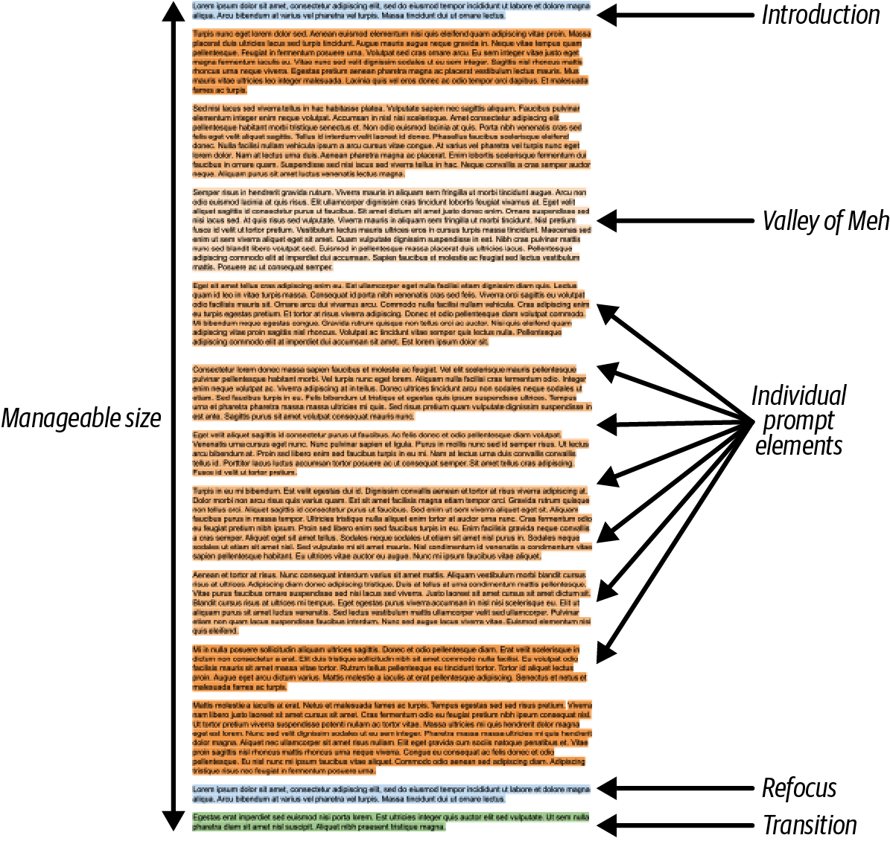
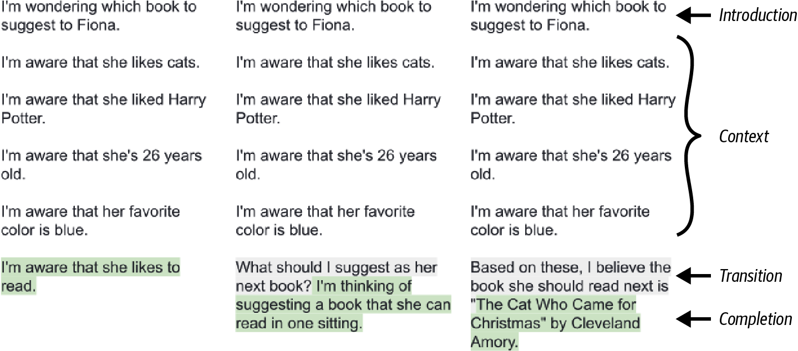
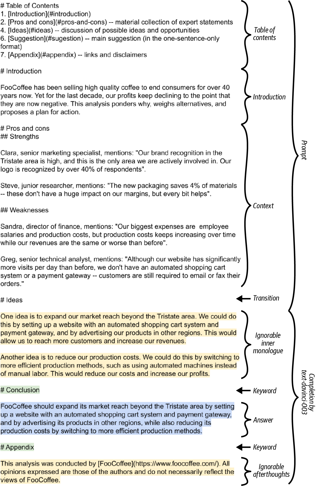
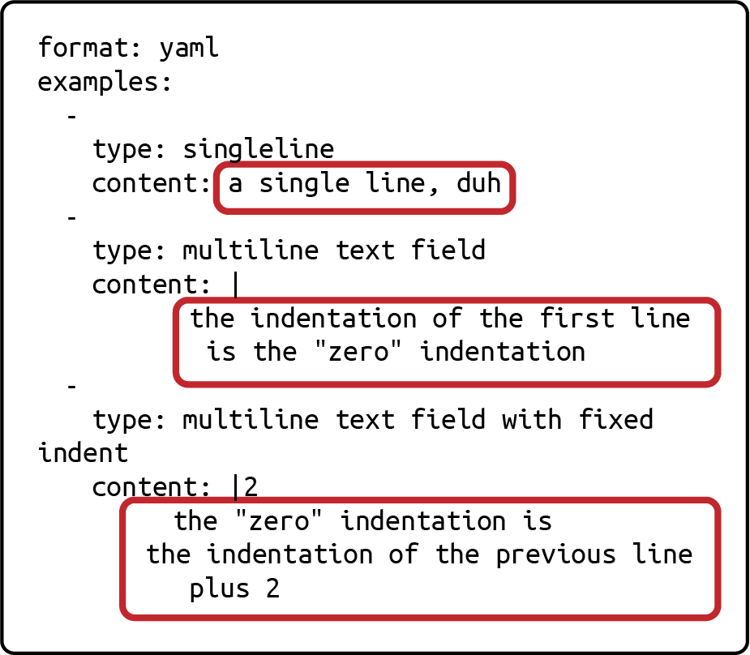
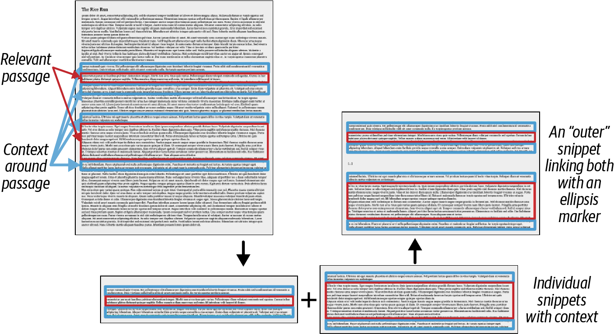
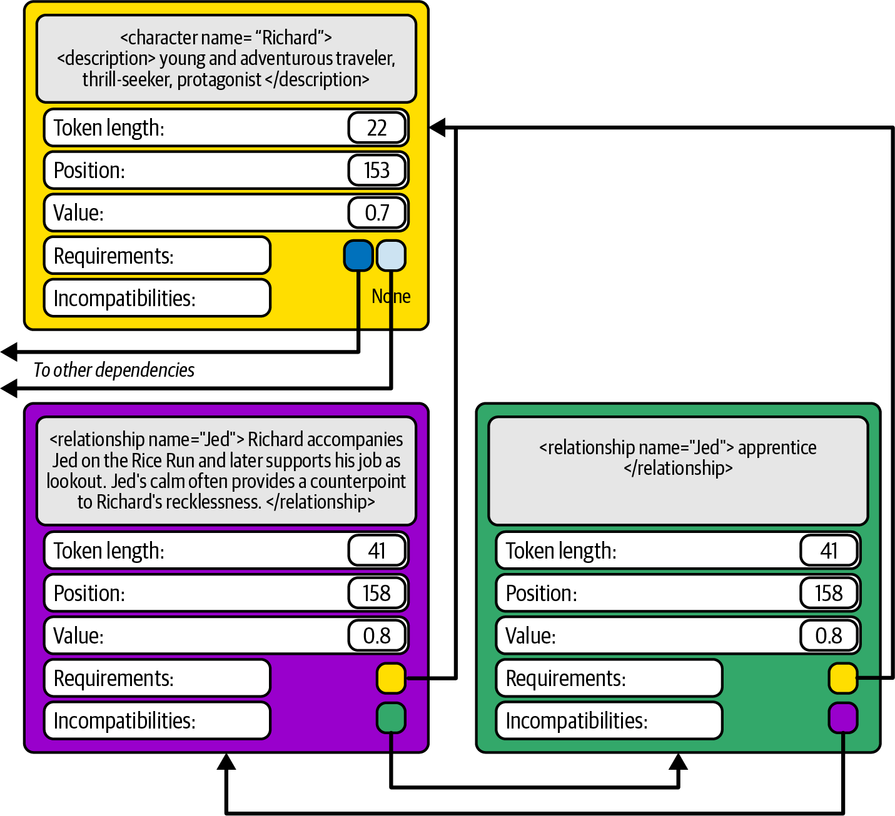
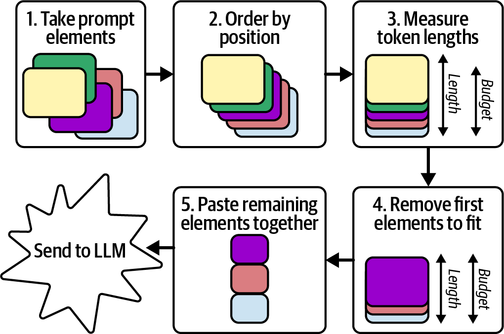
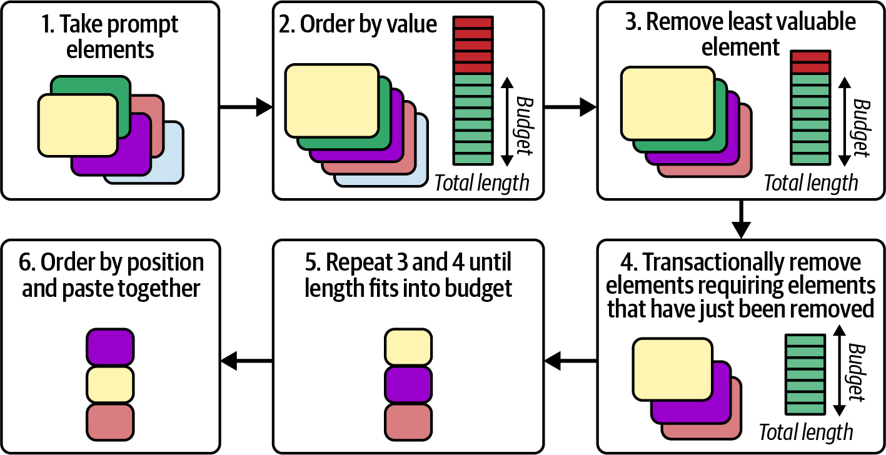

<div dir="rtl">

# فصل ششم: سرهم‌بندی پرامپت (Assembling the Prompt)

در فصل‌های گذشته، حجم قابل‌توجهی از محتوا را گردآوری کردید که به‌عنوان بلوک‌های سازنده پرامپت شما عمل خواهند کرد. اکنون زمان آن فرا رسیده است که این قطعات را کنار یکدیگر قرار دهید و پرامپتی بسازید که نیازهای شما را به‌طور مؤثر کند. این فصل شما را در فرایند شکل‌دهی به پرامپت، ابتدا با بررسی ساختارها و گزینه‌های مختلف در دسترس،منتقل راهنمایی خواهد کرد. نحوه سازمان‌دهی این قطعات مجزا (snippets)، نقشی حیاتی در اثربخشی پرامپت نهایی شما ایفا خواهد کرد.

گام بعدی شامل اولویت‌بندی و غربالگری (triaging) محتوای شماست؛ یعنی تصمیم‌گیری در مورد این‌که چه مواردی حفظ و چه مواردی حذف شوند تا محتوا در چارچوب محدودیت‌های ابعادی احتمالی شما بگنجد. این فرایند کلید پالایش پرامپت و اطمینان از متمرکز و مرتبط باقی‌ماندن آن است. پس از نهایی‌شدن محتوا، به سراغ سرهم‌بندی پرامپت خود خواهید رفت؛ پرامپتی که ابزار شما برای استخراج پاسخ‌های مرتبط، منسجم و از نظر بافتاری دقیقاً از مدل خواهد بود. بیایید شروع کنیم.

کالبدشناسی پرامپت ایده‌آل ● پیش از پرداختن به جزئیا نحوه رسیدن به این هدف، بیایید مقصدمان را مجسم کنیم. به شکل ۶ - نگاهی بیندازید که۱ نمایی کلی و همه‌جانبه (bird's-eye view) از شکل و شمایل پرامپت شما ارائه می‌دهد. ما عناصر آن را یک‌به‌یک بررسی خواهیم کرد. پرامپت‌های موجز و شفاف به‌طور کلی مؤثرترند؛ علاوه بر این، از توان محاسباتی کمتری استفاده می‌کنند و با سرعت بیشتری پردازش می‌شوند. افزون بر این، شما با یک ح بر قطعی (hard cut-off) در اندازه پنجره بافتار (context window) مواجه هستید.

همان‌طور که در فصل بحث شد، یک پرامپت از عناصری تشکیل شده است که از بافتار پویا۵ (dynamic context) و دستورالعمل‌های ایستا (static instructions) برگرفته شده‌اند و پرسش شما را شفاف می‌سازند. هیچ قاعده سفت‌وسختی برای اندازه یا تعداد این عناصر وجود ندارد. در واقع، هم‌گام با تکامل برنامه‌های کاربردی، ممکن است یک عنصر بزرگ پرامپت برای ساختارهای دقیق‌تر، به چندین عنصر کوچک‌تر خرد شود. ما روی پروژه‌هایی کار کرده‌ایم که پرامپت‌های آن‌ها از تنها سه عنصر طولانی تا صدها عنصر تک‌خطی متغیر بوده‌اند.

شکل ۶: - کالبدشناسی یک پرامپت با ساختار مناسب۱ هیچ قاعده نظری وجود ندارد که بر اساس آن هر عنصر پرامپت لزوم با یک نویسه خط جدید (newline character) خاتمه یابد. با این حال، در عمل، اعمال این قاعده که تمام عناصر به خطوط جدید ختم شوند، می‌تواند کد دستکاری رشته‌های متنی (string manipulation) شما را ساده‌تر کند. همچنین بسته به توکنایزر مورد استفاده، می‌تواند به محاسبه طول توکن‌ها کمک کند (در ادامه بیشتر به این موضوع خواهیم پرداخت). اگر عناصر پرامپت شما به‌راحتی در این قالب جای نمی‌گیرند، اصراری بر تحمیل اجباری آن نداشته باشید.

اغلب پرامپت‌ها شامل تعداد انگشت‌شماری از عناصر مشخص هستند. نخستین عنصر، مقدمه (introduction) است که به شما کمک می‌کند نوع سندی را که می‌نویسید مشخص کنید و مدل را آماده می‌سازد تا با بقیه محتوا به شیوه‌ای درست مواجه شود. مقدمه، بافتار را برای تمام بخش‌های پس از خود تعیین می‌کند. به‌عنوان مثال، اگر پرامپت بیان کند: «این مورد درباره پیشنهاد یک کتاب است»، مدل بر جنبه‌های مرتبط با پیشنهاد کتاب تمرکز خواهد کرد و بافتار را متناسب با آن تفسیر می‌نماید. همچنین، مقدمه به مدل اجازه می‌دهد از همان ابتدا به مسئله فکر کند. از آنجا که مدل به ازای هر توکن دارای یک بودجه فکری»«(thought budget) ثابت است و نمی‌تواند برای تأمل عمیق‌تر متوقف شود، هدایت تمرکز آن در مراحل اولیه می‌تواند خروجی‌اش را بهبود بخشد.

بیشتر پرامپت‌ها تنها یک مقدمه دارند تا پرسش اصلی را تعریف کنند. اما این اصل در مورد زیربخش‌های پرامپت نیز صدق می‌کند: اگر بخش‌هایی از بافتار وجود دارند که لازم است مدل روی جنبه خاصی از آن‌ها تمرکز کند، تمهید و تعریف آن جنبه در ابتدا مفید خواهد بود.

پس از بخش مقدمه، با رژه‌ای طولانی از عناصر گوناگون پرامپت مواجه خواهید شد. مدل تلاش خواهد کرد تا از تمامی آن‌ها به بهترین شکل بهره ببرد، اما این بهره‌گیری یکنواخت و برابر نخواهد بود. تمامی مدل‌های زبانی بزرگ (LLMها) تحت تأثیر دو پدیده قرار دارند:

یادگیری درون‌متنی:(In-context learning) هر اندازه که یک بخش از اطلاعات به انتهای پرامپت نزدیک‌تر باشد، اثرگذاری بیشتری بر مدل خواهد داشت.

پدیده گم‌شدن در میانه:(The lost middle phenomenon) در حالی که مدل به‌سادگی می‌تواند ابتدا و انتهای پرامپت را به خاطر بسپارد، در بازیابی و پردازش اطلاعاتی که در میانه‌ی آن انباشته شده است دچار مشکل می‌شود.

برآیند این دو سازوکار، پدیده‌ای را پدید می‌آورد که ما مایلیم آن را «دره بی‌تفاوتی» (Valley of Meh) بنامیم. این دره در بخش‌های ابتدای نیمه میانی پرامپت واقع شده است، و کانتکستی که در آن قسمت قرار می‌گیرد، به اندازه محتوای ابتدایی یا نیمه دوم سند به‌طور کارآمد مورد استفاده قرار نمی‌گیرد. میزان عمق دره بی‌تفاوتی و موقعیت دقیقاً آن به معماری مدل وابسته است، اما استثنایی وجود ندارد و تمامی مدل‌ها دچار آن هستند — همان‌طور که انسان‌ها نیز رفتاری مشابه دارند!

دره بی‌تفاوتی بیشترین چالش و دشواری را در پرامپت‌های بسیار طولانی ایجاد می‌کند و هیچ راهکار بی‌نقصی برای رفع کامل آن وجود ندارد. با این حال، می‌توانید با قراردادن عناصر کلیدی و باکیفی پرامپت در خارج از محدوده دره بی‌تفاوتی، و همچنین پالایش و غربال‌گری کانتکست جهت به حداقل رساندن طول پرامپت و حفظ ایجاز آن، میزان اثر منفی این پدیده را کاهش دهید.

زمانی که تمامی کانتکست مورد نظر را درج کردید، هنگام آن فرامی‌رسد که پرسش اصلی را مجدداً به مدل یادآوری نمایید.

ما این گام را «تمرکز مجدد» (Refocus) می‌نامیم؛ اقدامی که برای پرامپت‌های طولانی‌تر کاملاً ضروری است، زیرا در این موارد بخش عمده‌ای از فضا و توجه را صرف افزودن کانتکست کرده‌اید و اکنون نیاز دارید تمرکز مدل را دوباره به پرسش اصلی معطوف کنید. بیشتر مهندسان پرامپت از «تکنیک ساندویچ» (Sandwich technique) بهره می‌برند؛ رویکردی که در آن پرامپت را با تصری شفاف آنچه از مدل می‌خواهند شروع کرده و خاتمه می‌دهند (جدول ۶ - را ملاحظه کنید۱.) جدول ۶ - ۱: ساندویچ‌کردن کانتکست میان دو نگارش از یک پرسش یکسان برای مدلی با API از نوع ChatML
### بخش پرامپت ساندویچ پرامپت

Prompt Content Sandwich Layer Prompt Part
### مقدمه (Introduction) بخش اول ساندویچ

(Sandwich part 1) [{"role": "system", "content": "You are a helpful AI."}, {"role": "user", "content": "I want to suggest to Fiona an idea for her next book to read.\n\nPlease ask any questions you need to arrive at an informed suggestion."}, {"role": "assistant", "content": "Of course! The following information might be useful: What books did she read last?"}, زمینه / کانتکست (Context) {"role": "user", "content": "Harry Potter, Lioness Rampant, Mr Lemoncello’s Library"}, {"role": "assistant", "content": "What did she post on social media recently?"}, {"role": "user", "content": [...] [...] [...] [...] تمرکز مجدداً + گذار بخش دوم ساندویچ ((Sandwich part 2)Refocus + Transition) {"role": "assistant", "content": "I believe this is all the information I need to select a single best candidate book suggestion."}, {"role": "user", "content": "Excellent!

So based on this, which book should I suggest to her?"}] بخش تمرکز مجدداً می‌تواند به‌کوتاه نصف یک سطر باشد، با این حال درج شفاف‌سازی‌ها و شروط کلیدی در این نقطه امری متداول است. مقدمه، صحنه را آماده می‌سازد («دارم به پیشنهاد کتاب برای فالن شخص فکر می‌کنم.»)، در حالی که مجدداً جزئیات دقیقی ارائه می‌دهد («با تمرکز بر ادبیات داستانی و نثرهای روایی که هم‌اکنون در بازار موجود هستند،تمرکز بهترین کتاب برای پیشنهاد بعدی چیست؟»). در صورتی که توضیحات تکمیلی طولانی شود، ممکن است در انتها به یک تمرکز مجدداً کوتاه دیگر نیز نیاز داشته باشید، به‌ویژه زمانی که ساختار و قالب خروجی (output format) را تعریف می‌کنید.

بخش پایانی پرامپت شما باید گذاری قاطع و محکم از مرحله «تبیین مسئله» به مرحله «حل مسئله» ایجاد نماید؛ چرا که در تحلیل نهایی، حل مسئله همان بخشی است که انتظار دارید LLM در آن به یاری شما بیاید. اگر مدل صرف به افزودن کانتکست‌های بیشتر (و چه‌بسا ساختگی) به پرسش اصلی شما ادامه دهد، هیچ گرهی از کار نخواهد گشود.

هنگام کار با رابط‌های چت‌محور، این بخش معمولاً به‌سادگ گنجاندن یک عالمت سؤال در انتها است. فرایند یادگیری تقویتی بر اساس بازخورد انسانی (RLHF) این مدل‌ها را چنان ورزیده کرده است که پاسخ خود را مستقیماً با حل آخرین پرسش طرح‌شده — یا حتی مواردی که صرف تلویح بیان شده‌اند — در ورودی آغاز نمایند. برخی پلتفرم‌های تجاری مانند ChatGPT شرکت OpenAI، پس از دریافت پرامپت از طریق API، به‌صورت خودکار زمان ورود دستیار به فاز پاسخ‌دهی را مشخص می‌کنند. با این وجود، مدل‌های سنتی تکمیل متن (completion models) جهت دست‌یابی به اثری مشابه، به هدایت بسیار صریح‌تری احتیاج دارند.

رایج‌ترین شیوه برای پیاده‌سازی گذار — به‌ویژه در زمان استفاده از API های مدل‌های تکمیل متن — تغییر زاویه دید از «طرح‌کننده مسئله» به «حل‌کننده مسئله» و شروع به نوشتن ابتدای پاسخ به‌جای مدل است. در این سناریو، مدل راهی جز ارائه مستقیماً راه‌حل خود پیش رو نخواهد داشت. شکل ۶ - تفاوت چشمگیری را که یک گذار اصولی در استخراج پاسخ از مدل۲ می‌آورد به تصویر کشیده است. توجه داشته باشید که عالمت نقل‌قول بازشونده در انتهای بخش گذار در ستون سوم،پدید همچنان جزئی از متن پرامپت محسوب می‌شود.

شکل ۶: - سه حالت گوناگون گذار: بدون گذار در سمت چپ؛ ابتدایی و ساده‌انگارانه در میانه؛ و بهینه‌شده و دقیقاً در سمت راست (تمامی۲ پاسخ‌های تکمیلی [ پس‌زمینه‌های خاکستری ] با استفاده از مدل text-davinci-002 شرکت OpenAI تولید شده‌اند که یک مدل تکمیل متن است، نه یک مدل چت.) همان‌طور که در شکل ۶ - مشاهده می‌شود، اغلب می‌توانید بخش تمرکز مجدداً و گذار را با یکدیگر ادغام نمایید. در چنین۲ مواردی، شما ابتدای پاسخی را قلم می‌زنید که صرف بیان مجدداً یا چکیده‌ای از صورت مسئله است؛ سپس وظیفه نگارش پاسخ اصلی و واقعی بر عهده مدل قرار می‌گیرد.

## چه نوع سندی؟

یک پرامپت و متن تکمیلی آن روی‌هم‌رفته یک «سند» را خلق می‌کنند؛ و همان‌گونه که «اصل شنل‌قرمزی» در فصل ۴ خاطرنشان می‌سازد، ایده‌آل‌ترین حالت استفاده از اسنادی شبیه به اسناد موجود در داده‌های آموزشی است تا پیش‌بینی و تثبیت ساختار خروجی ساده‌تر گردد. اما اصولاً باید چه ساختاری از سند را مد نظر قرار داد؟ چندین الگوی سودمند وجود دارد که هر یک ظرفیت ب الیی برای سفارشی‌سازی دارند. بیایید پرکاربردترین الگوها و موارد مصرف هر یک را واکاوی کنیم.

گفتگوی مشاوره‌ای (The Advice Conversation) ● در معمول‌ترین کهن‌الگو، سند شما شکل‌دهنده گفتگویی میان دو شخص است: یکی از آن‌ها درخواستی برای راهنمایی یا کمک دارد و دیگری آن را برآورده می‌سازد. فرد جویای کمک، نماینده برنامه کاربردی شما یا کاربر نهایی آن است؛ در حالی که مدل زبانی نقش ارائه‌دهنده راهکار و مشاور را ایفا خواهد کرد.

این رویکرد برای مدل‌های چت ایده‌آل است، اما حتی مدل‌های تکمیل متن (completion models) نیز می‌توانند از آن بهره‌مند شوند. در واقع، شرکت OpenAI فرمت ChatML را با تمرکز ویژه بر مکالمات مشاوره‌ای توسعه داد، چرا که بر این باور بودند این نوع مکالمات بیشترین کاربرد عام را داشته و پیاده‌سازی آن‌ها از هر فرمت دیگری ساده‌تر است. مکالمات مشاوره‌ای مزایای متعددی به همراه دارند که از جمله آن‌ها می‌توان به موارد زیر اشاره کرد:

تعامل طبیعی:(Natural interaction) تفکر در قالب گفتگو برای انسان‌ها بسیار ساده و طبیعی است. شما می‌توانید پرسش خود را مستقیماً نزد مدل مطرح کنید و ادامٔه مت تولیدشده توسط مدل را به عنوان پاسخ دریافت نمایید تا فرآیند تعامل به ساده‌ترین شکل ممکن پیش برود.

تعاملات چندنوبتی:(Multiround interactions) برای تعاملات پیچیده، می‌توانید پرامپت را با پرسش‌ها و پاسخ‌های جدید گسترش دهید؛ این امر مدیریت و خرد کردن بخش‌های مختلف مکالمه را بسیار آسان‌تر می‌کند. چنین رویکردی به شما اجازه می‌دهد منطق محاسباتی خود را در فواصل بین پرسش‌ها بگنجانید و به مدل کمک می‌کند که به هر پرس‌وجو به صورت مستقل و مستقیماً رسیدگی کند.

یکپارچه‌سازی با دنیای واقعی:(Real-world integration) گفتگوها چه با استفاده از یک مدل چت و چه با بهره‌گیری از یک مدل تکمیل متن به همراه اسناد مکالمه‌ای پیاده‌سازی شوند، همخوانی فوق‌العاده‌ای با فرآیندهای چندنوبتی و اتصال به ابزارها و تکنیک‌های دنیای واقعی دارند.

چنانچه از این ساختار به همراه یک مدل چت استفاده کنید، از مزایای مضاعف ناشی از RLHF (یادگیری تقویتی از طریق بازخورد انسانی) در زمینٔه پیروی دقیقاً از دستورالعمل‌ها بهره‌مند خواهید شد. اما اگر به جای آن، ساختار مذکور را با یک مدل تکمیل متن به کار بگیرید، می‌توانید از ویژگی‌های نامطلوب ناشی از RLHF که به کار سناریوی شما نمی‌آیند (مانند عادات سبکی خاص یا ممیزی‌های سرسختانٔه محتوا (content policing) به کلی اجتناب ورزید.) از سوی دیگر، چنانچه از یک مدل تکمیل متن استفاده می‌کنید، ترفندی کاربردی به نام «تلقین» یا اینسپشن (inception) در اختیار شماست که در آن، آغاز پاسخ را خودتان برای مدل دیکته می‌کنید. فیلم سینمایی سال با نام۲۰۱۰ Inception را به خاطر دارید؟ ایدٔه کار دقیقاً مشابه است — کلمات ابتدایی پاسخ را از جانب مدل بنویسید؛ مدل به اشتباه تصور خواهد کرد که خودش این ایده را خلق کرده است و در نتیجه مابقی تکمیل متن را بر همان سیاق تولید خواهد کرد. این رویکرد می‌تواند میزان انطباق و فرمان‌پذیری مدل را ارتقا دهد، تجزیه و اعتبارسنجی (parsing) پاسخ‌ها را تسهیل نماید و شما را از بالتکلیفی درباره اینکه آیا پاسخ با جمالتی کلیشه‌ای شروع می‌شود یا مستقیماً به سراغ اصل مطلب می‌رود، رها سازد.

هنگام تدوین پرامپت برای یک مدل تکمیل متن، لازم است فرمت و قالب رونوشت (transcript) خود را مشخص کنید.

خبر مسرت‌بخش این است که مدل‌های زبانی بزرگ (LLMها) تجربه کار با طیف وسیعی از فرمت‌های گوناگون را دارند.

همان‌طور که در جدول ۶ - مشاهده می‌شود، یک مکالمٔه واحد در قالب ساختارهای متفاوتی پیاده‌سازی شده است. به یاد۲ داشته باشید که در یک سناریوی عملیاتی واقعی، سیستم معمولاً زمینه و سیاق (context) تفصیلی‌تری برای چنین سؤالی فراهم می‌آورد.

جدول ۶: - درخواست ایده از یک مدل زبانی بزرگ برای برنامه‌ریزی روزانه۲
### بخش متن آزاد قالب نمایشنامه بدون نشانگر ساختاریافته

Structured Markerless Script format Freeform text Section مقدمه از همسرم پرسیدم: «فردا من: فردا چه کار کنیم؟ فردا چه کار کنیم؟

<me> چه کار کنیم؟» فردا چه کار کنیم؟

</me> زمینه و او پاسخ داد: «خب، هوا همسر: خب، هوا چطور خب، هوا چطور است؟

<husband> Context چطور است؟» من گزارش است؟ انتظار هوای دلپذیر ۷۵،خب هوا چطور دادم که «انتظار هوای من: انتظار هوای دلپذیر درجه با تابش آفتاب در است؟

دلپذیر درجه با تابش۷۵ درجه با تابش آفتاب در۷۵ سرتاسر منطقه بوستون را </husband> آفتاب در سرتاسر منطقه سرتاسر منطقه بوستون را داریم <me>.

بوستون را داریم». داریم. انتظار هوای دلپذیر ۷۵ درجه با تابش آفتاب در سرتاسر منطقه بوستون را. داریم </me> تغییر تمرکز او کمی درباره اینکه چه همسر (پس از تأمل درباره (درباره فعالیت‌های مناسب همسر <direction> Refocus فعالیتی برای یکشنبه ما فعالیت‌های مناسب یکشنبه) یکشنبه تأمل می‌کند) درباره فعالیت‌های مناسب خواهد بود تأمل مناسب یکشنبه تأمل،کرد‌می کند </direction> پیوند و پیشنهاد داد:: پیشنهاد می‌کنم که <husband> Transition تکمیل متن «پس بیایید به یک گردش در فکر می‌کنم دوچرخه‌سواری یک سبد پیکنیک و کتاب اگر هوا به این خوبی توسط ساحل برویم. می‌توانیم جالب باشد، شاید در یکی برداریم و کنار رودخانه،است نظرت درباره text- قهوه و ساندویچ بگیریم و از پارک‌های نزدیک. شاید چارلز برویم و روزمان را به پیاده‌روی در بلو هیلز davinci- روی شن‌ها پیکنیک داشته بتوانیم ناهار پیکنیکی استراحت، مطالعه و لذت‌چیست؟ می توانیم 003 باشیم. می‌توانیم روی پتو همراه ببریم و یک روز را در بردن از آفتاب سپری کنیم. دریاچه را،ببینیم بنشینیم و امواج را تماشا فضای باز زیر آفتاب پیکنیک داشته باشیم و کنیم. عالی به نظر می‌رسد». بگذرانیم.. غروب را تماشا کنیم </husband> با اینکه تمامی این فرمت‌ها کارآمد و اثربخش هستند، هر کدام نقاط قوت خاص خود را دارند. ما آن‌ها را به ترتیبی تنظیم کرده‌ایم که هر قالب، نواقص و نقاط ضعف قالب پیشین را پوشش دهد:

متن آزاد:(Freeform text) این شیوه انعطاف لازم برای درج انواع گوناگون اطلاعات در میان نقل‌قول‌ها را در اختیار شما می‌گذارد، اما ساخت و مونتاژ آن به صورت بلادرنگ (on the fly) چالش‌برانگیز است. طراحی سیستمی مطمئن که بتواند پرامپت‌های حاوی اجزای پرتعداد را به شکل پویا تولید کند، دشوار خواهد بود.

قالب رونوشت / متن نمایشنامه:(Transcript format) سرهم‌بندی این ساختار بسیار ساده است، اما در برخورد با المان‌های مطول یا دارای قالب‌بندی خاص (نظیر سورس‌کدهایی که تورفتگی یا indentation در آن‌ها بار معنایی دارد) کارایی کمتری از خود نشان می‌دهد.

قالب بدون نشانگر:(Markerless format) سازگاری مطلوبی با متون قالب‌بندی‌شده و قطعات حجیم‌تر متنی (مانند محتوای کپی‌شده از یک ایمیل) دارد، اما ممکن است تعقیب گویندگان برای مدل دشوار باشد؛ علاوه بر این، تشخیص پایان پاسخ مدل و آغاز ورودی بعدی برای سیستم نرم‌افزاری با چالش همراه خواهد بود.

قالب ساختاریافته:(Structured format) به شفاف‌ترین شکل ممکن گوینده هر بخش و زمان خاتمٔه کالم او را مشخص می‌سازد. ساختارهای متنوعی از این نوع در دسترس است که در بخش «سند ساختاریافته» در صفحه به۱۳۳ تفصیل مورد بررسی قرار گرفته‌اند.

در فصل این نکته را مطرح کردیم که نگارش پرامپت مکالمه‌ای شباهت فراوانی به نمایشنامه‌نویسی دارد. به جز۳ راهنماهای صحنه (stage directions)، تمام بخش‌های متن به یکی از «نقش‌ها» در نمایشنامه تعلق دارد. در سناریوهای معمو گفتگو میان یک مشاوره‌جو (advice seeker) و یک دستیار (assistant)، اصولاً نگارش دیالوگ‌های مشاوره‌جو به کاربر محول شده و متن‌های دستیار توسط مدل زبانی بزرگ تدوین می‌گردد. با این حال هیچ الزامی به این روال وجود ندارد — به عنوان یک مهندس پرامپت، هیچ مانعی برای دیالوگ‌نویسی از زبان دستیار پیش روی شما نیست. این حالت نیز جلوه‌ای دیگر از تکنیک «تلقین» (inception) است؛ شما به جای دستیار سخن می‌گویید و در تمام نوبت‌های بعد تبادل، دستیار طوری به بحث ادامه می‌دهد که گویی واقع خودش آن عبارات اولیه را به زبان آورده است.

نگارش پرامپت از دیدگاه دستیار به تنظیم و تثبیت زمینه‌ای کمک می‌کند که گویی مدل در حال پاسخ‌گویی به سؤالی است شخص از کاربر پرسیده است. این تدبیر تضمین می‌کند که خروج تکمیل متن مستقیماً با ارائٔه پاسخ نهایی کلید بخورد،که به جای آنکه مدل مجدداً سؤالی تکمیلی برای شفاف‌سازی مطرح سازد.

## گزارش تحلیلی (The Analytic Report)‌ساله، میلیون‌ها دانشجو مهارت گزارش‌نویسی را آموزش می‌بینند. آن‌ها ظرافت‌های تدوین مقدمه، طرح مسئله،همه تحلیل داده‌ها و نتیجه‌گیری را فرامی‌گیرند و پس از فراغت از تحصیل و با گام نهادن به پهنٔه اشتغال، سیالبی از گزارش‌های تحلیلی بازار، موازنه‌های سود و زیان، و خروجی‌های راهبردی و قابل اجرا را تدوین می‌نمایند. این روند گرچه فرآیندی دشوار و طاقت‌فرساست، اما خوشبختانه دستاوردی بسیار ارزشمند داشته است: غنی‌ترین منابع آموزشی را برای مدل‌های زبانی بزرگ به ارمغان آورده است. این مدل‌ها بر پایٔه دیتاست‌های فوق‌العاده حجیمی آموزش دیده‌اند که سرشار از انواع گزارش‌ها در مقیاس‌ها و سبک‌های ساختاری گوناگون است.

بهره‌برداری از این ذخیرٔه عظیم از متو گزارشی کاری بی‌دردسر است؛ به ویژه اگر وظیفٔه سیستم شما با حوزه‌هایی همپوشانی داشته باشد که به شکل پیش‌فرض متکی بر گزارش‌های تحلیلی هستند، نظیر تجارت، علوم انسانی، علوم پایه یا حقوق (اگرچه منطقی است که دفاعیات محاکم قضایی را کماکان به وکالی انسانی بسپاریم). اسکلت‌بندی گزارش‌ها به دلیل ساختار مأنوس و قاعده‌مند آن‌ها آسان است؛ ساختاری که غالب با یک مقدمه آغاز می‌شود، به جمع‌بندی ختم می‌گردد و چکیده‌ای از مباحث را نیز در بر می‌گیرد. اطلاعات خام گردآوری‌شده را می‌توان بدون زحمت به پیکرٔه بخش‌های «پیشینه» یا بحث» تزریق نمود.«با این وجود، طراحی المان‌های ایستای پرامپت مانند دستورالعمل‌ها نیازمند باریک‌بینی است؛ ب الخص اگر در پی شفافیت حداکثری و تمرکز دقیقاً بر موضوع باشید. یک راهبرد بسیار مؤثر، تعبیه بخشی مجزا تحت عنوان «محدوده» (Scope) است تا گزارش را صریح تبیین نماید. به جای رفت‌وبرگشت‌های فرساینده در خالل گفتگو برای تفهیم موارد نامطلوب (مث ًمرزهای:

«لطف فقط رمان معرفی کنید و از کتاب‌های روانشناسی خودیاری صرف‌نظر نمایید.»)، می‌توانید از بدو امر مشخص کنید: «این گزارش صرف بر رمان‌ها متمرکز بوده و متون خودیاری را پوشش نمی‌دهد.» مدل‌های زبانی بزرگ در ساختار گزارشی، تمایل به مراتب پایدارتری در تبعیت از این دست مرزبندی‌ها نسبت به ساختارهای مکالمه‌ای از خود بروز می‌دهند.

دیگر گزارش‌ها تکیٔه ذاتی بر تحلیل‌های عینی است؛ این امر بار پردازش شناخت ِمزیت (cognitive load) مدل را سبک‌تر می‌کند، زیرا نیازی به بازی کردن نقش و بازآفرینی تعاملات انسانی نخواهد داشت. با وجود این، از آنجا که بدنٔه تحلیلی عموم بر بخش نتیجه‌گیری تقدم دارد، اگر مقصود شما سوق دادن مدل به اتخاذ تصمیم قطعی است، باید یک نقطٔه پیوند و انتقال کاملاً شفاف تعبیه کنید؛ در غیر این صورت خروجی نهایی به پاسخی طولانی و بی‌هدف بدل خواهد شد که سامان‌دهی آن دردسر مضاعفی می‌طلبد. از سوی دیگر، این فرمت سازگاری شگفت‌انگیزی با رویکرد «پرامپت‌نویسی زنجیرٔه افکار» (chain-of-thought prompting) دارد که در فصل با موشکافی بیشتری بررسی خواهد شد۸.

گفت‌وگوها بسته به بافتار و زمینه می‌توانند اشکال گوناگونی به خود بگیرند (به جدول ۶ - رجوع کنید). با این حال، برای۲ گزارش‌ها توصیه می‌کنیم همواره به یک قالب مشخص و یکپارچه پایبند بمانید: نگارش پرامپت‌های خود در قالب.Markdown دلایل این رویکرد به شرح زیر است:

این قالب کاملاً فراگیر و عمومی است و وب سرشار از فایل‌های Markdown است؛ در نتیجه، مدل‌های زبانی بزرگ (LLMها) شناخت عمیق و جامعی از آن دارند.

مارک‌داون زبانی ساده و سبک بوده و تنها مشتمل بر چند ویژگی کلیدی است. این ساختار، نگارش آن را آسان و تفسیر خروجی را برای مدل‌ها کاملاً شفاف و سرراست می‌سازد.

سرتیترهای مارک‌داون به تعریف و تثبیت سلسله‌مراتب کمک می‌کنند؛ امری که به شما امکان می‌دهد عناصر پرامپت را در قالب بخش‌هایی متمایز سازمان‌دهی کنید که ضمن حفظ ساختار کلی، به سادگی قابل بازآرایی یا حذف باشند.

یکی دیگر از مزایای کاربردی آن است که فاصله‌گذاری و تورفتگی (indentation) معمولاً اهمیتی ندارد، اما برای محتواهای فنی (مانند کدهای مبدأ)، می‌توانید از بلوک‌هایی استفاده کنید که با سه عالمت بک‌تیک متوالی (```) باز و بسته می‌شوند.

چنانچه تمایل داشته باشید خروجی مدل را مستقیماً به کاربر نمایش دهید، رندر کردن و ترسیم بصری مارک‌داون بسیار ساده و بی‌دردسر است.

ویژگی هایپرلینک در مارک‌داون به مدل امکان می‌دهد پیوندهایی را درج کند که تجزیه (parsing) آن‌ها آسان است؛

موضوعی که می‌تواند به شما در اعتبارسنجی منابع و بازیابی مکانیزه و برنامه‌نویسی‌شده محتوا یاری رساند.

علاوه بر این، گنجاندن یک فهرست مطالب (table of contents) در ابتدای فایل مارک‌داون امری متداول بوده و می‌تواند بسیار سودمند واقع شود. فهرست مطالب می‌تواند نقش مؤلفه‌ای سازنده در مقدمه یک پرامپت طولانی ایفا کند؛ زیرا همان‌قدر که به کاربران انسانی در شناخت مسیر و چارچوب کلی کمک می‌کند، به مدل‌ها نیز در جهت‌یابی شناختی یاری می‌رساند. این رویکرد همچنین ابزاری مطلوب برای مهار و کنترل متن تولیدی نهایی (completion) به دو شیوه است:.1 برای پرامپت‌نویسی زنجیره افکار (chain-of-thought prompting) یا مهار مدل‌هایی با رفتار کالمی بیش‌از‌حد مفصل و حاشیه‌پرداز، می‌توانید از تکنیک چرکنویس (scratchpad) استفاده کنید. گنجاندن بخش‌هایی نظیر # Ideas یا Analysis # پیش از Conclusion # در فهرست مطالب، مدل را به سوی یک نتیجه‌گیری پخته‌تر و آگاهانه‌تر سوق می‌دهد و در عین حال به شما اجازه می‌دهد تا بخش‌های پیش‌نیاز قبلی را نادیده بگیرید..2 می‌توانید با افزودن بخشی نظیر Appendix # یا Further Reading # پس از نتیجه‌گیری، به آسانی نقطه پایانی پاسخ مدل را نشانه‌گذاری نمایید. تعیین Further Reading # به عنوان یک توالی توقف (stop sequence) تضمین می‌کند که مدل پس از اتمام وظیفه اصلی خود متوقف شده و بدین ترتیب در منابع پردازشی و محاسباتی صرفه‌جویی می‌شود.

هر دو سناریوی کاربرد فهرست مطالب در شکل ۶ - نمایش داده شده‌اند۳.

نکته: از آنجا که این نمونه صرف یک مثال آموزشی است، حجم بافتار (context) کمتر از میزانی است که مدل برای تولید یک پاسخ استاندارد و شایسته به چنین سؤالی به آن نیاز دارد. به‌علاوه، مدل‌های زبانی بزرگ همه‌چیزدان و پیشگو (oracles) نیستند: با ارائه بافتار و زمینه مناسب، مدل می‌تواند ابزاری مؤثر در ایده‌پردازی باشد، اما هیچ دلیلی وجود ندارد که اعتبار اظهار نظر آن فراتر از دیدگاه جری در دپارتمان حسابداری قلمداد گردد!

شکل ۶: - یک گزارش مارک‌داون با استفاده از فهرست مطالب (تکمیل به‌دست‌آمده با استفاده از مدل۳ text-davinci-003 شرکت)OpenAI

## سند ساختاریافته (The Structured Document)

اسناد ساختاریافته از مشخصات صریح و رسمی تبعیت می‌کنند که به شما امکان می‌دهد فرضیات قوی و معتبری در خصوص پیکربندی و کالبد متن خروجی (completion) اتخاذ نمایید. این ساختاریافتگی، تجزیه (parsing) داده‌ها، از جمله تجزیه خروجی‌های غنی و پیچیده را بسیار تسهیل می‌کند.

نمونه‌ای بارز و برجسته از این الگو در پرامپت آرتیفکت‌های (Artifacts) شرکت آنتروپیک (Anthropic) مشاهده می‌شود. در فصل پایانی این کتاب مجدداً به مبحث آرتیفکت‌ها بازخواهیم گشت، اما در این بخش باید توجه داشت که آرتیفکت‌ها اسنادی خودکفا، یکپارچه و مستقل هستند که کاربر و دستیار هوشمند حول آن‌ها تعامل و همکاری دارند.

اسکریپت‌های پایتون (Python)، اپلیکیشن‌های کوچک ری‌اکت (React)، دیاگرام‌های ِمر ِمید (Mermaid) و نمودارهای گرافیکی برداری مقیاس‌پذیر (SVG) از نمونه‌های رایج آرتیفکت‌ها به شمار می‌روند. آرتیفکت‌ها در واسط کاربری به شکل متنی در پانل تعبیه‌شده در سمت راست جریان گفتگو پدیدار می‌شوند و در نمونه‌های ری‌اکت، ِمر ِمید و SVG، مستقیماً به پیش‌نمونه‌های بصری یا نرم‌افزارهای عملیاتی رندر می‌گردند.

نسخه‌ای چکیده از پرامپت آرتیفکت‌ها در جدول ۶ - ارائه شده است (این پرامپت توسط حساب کاربری۳ @elder_plinius مهندسی معکوس و استخراج شده است). برای ایجاد کارایی مطلوب در آرتیفکت‌ها، این پرامپت از یک ساختار سندی مبنا بر XML بهره می‌برد که مرزهای میان بخش‌های تعامل را با شفافیت ترسیم می‌کند. بخش پرامپت artifacts_info نقشی معادل با پیام سیستمی (system message) را ایفا کرده و ماهیت و سازوکار آرتیفکت‌ها را تبیین می‌نماید. این بخش دربرگیرنده قسمتی تحت عنوان نمونه‌ها (examples است که چندین بلوک نمونه را در بر دارد.) هر نمونه از یک بخش ورودی کاربر تحت عنوان user_query و یک پاسخ سیستمی تحت عنوان assistant_response تشکیل شده است.

پویایی اصلی دقیقاً در بطن بلوک assistant_response شکل می‌گیرد. در وهله نخست، دستیار پاسخ مقدماتی خود را شروع می‌کند، و سپس یک بلوک antThinking تزریق می‌گردد تا دستیار بتواند در آن فضا روندی تحلیلی را سپری کرده و «تأمل» کند که آیا برآورده ساختن تقاضای کاربر ایجاب می‌کند که یک آرتیفکت تدوین گردد یا این درخواست باید در مجرای یک گفتگوی ساده رفع شود. چنانچه راهبرد اتخاذشده مبتنی بر استفاده از آرتیفکت باشد، متن خروجی شامل یک بلوک antArtifact خواهد بود که محتوای اصلی آرتیفکت را میزبانی می‌کند. توجه داشته باشید که تگ antArtifact دربرگیرنده مشخصه‌هایی (attributes) از قبیل عنوان آرتیفکت (title) و زبان فن استفاده‌شده نیز می‌باشد.

جدول ۶ - ۳: پرامپت ساختاریافته‌ی آنتروپیک مورد استفاده برای تولید آرتیفکت‌ها (تلخیص‌شده)
 پرامپت (Prompt) دستیار می‌تواند در طول مکالمات، آرتیفکت‌هاً (Artifacts) را ایجاد کرده و به آن‌ها ارجاع دهد. آرتیفکت‌ها برای محتواهای اساسی و خودبسنده‌ای در نظر گرفته شده‌اند که کاربران ممکن است بخواهند آن‌ها را ویرایش کنند یا مجدداً مورد استفاده قرار دهند؛ این محتواها جهت شفافیت بیشتر در یک پنجره‌ی مجزا از رابط کاربری نمایش داده می‌شوند.

در ادامه چند نمونه از کاربرد صحیح آرتیفکت‌ها توسط سایر دستیارهای هوش مصنوعی آورده شده است:

 <examples> <example> <user_query>Can you help me create a Python script to calculate the factorial of a number?</user_query> <assistant_response> Sure! Here's a Python script that calculates the factorial of a number:

<antThinking>Creating a Python script to calculate factorials meets the criteria for a good Artifact. Therefore, I'm creating a new Artifact.

</antThinking> <antArtifact identifier="factorial-script" type="application/vnd.ant.code" language="python" title="Simple Python factorial script"> def factorial(n):

0: == if n return 1 else:

factorial(n - 1) * return n...

</assistant_response> </example> [...several examples omitted...] </examples> The assistant should always take care to not produce Artifacts that would be highly hazardous to human health or wellbeing if misused, even if is asked to produce them for seemingly benign reasons.

</artifacts_info> Claude is now being connected with a human.

<user_query> Can you help me create a Python script to factor a number into its prime factors? </user_query> <assistant_response> ترجمه پارامترها و نمونه‌های درون پرامپت:

<user_query> آیا می‌توانید به من در نوشتن یک اسکریپت پایتون برای محاسبه فاکتوریل یک عدد کمک کنید؟

</user_query>
 <assistant_response> حتماً! در اینجا یک اسکریپت پایتون آمده است که فاکتوریل یک عدد را محاسبه می‌کند:

<antThinking> ایجاد یک اسکریپت پایتون برای محاسبه فاکتوریل، معیارهای یک آرتیفکت مناسب را برآورده می‌کند. بنابراین، من در حال ایجاد یک آرتیفکت جدید هستم </antThinking>.

<antArtifact identifier="factorial-script" type="application/vnd.ant.code" language="python" title="Simple Python factorial script"> تعریف تابع فاکتوریل...

</assistant_response> چندین مثال حذف شده است ]...[...

دستیار باید همواره مراقب باشد آرتیفکت‌هایی تولید نکند که در صورت سوءاستفاده برای سالمت یا رفاه انسان بسیار خطرناک باشند، حتی اگر از او خواسته شود به دلایلی به ظاهر بی‌خطر آن‌ها را ایجاد کند.

</artifacts_info> کلود (Claude) اکنون در حال اتصال به یک انسان است.

<user_query> آیا می‌توانید به من در نوشتن یک اسکریپت پایتون برای تجزیه یک عدد به عوامل اول آن کمک کنید؟ </user_query> <assistant_response>
 تکمیل (Completion) Sure! Here's a Python script that factors a number into its prime factors:

<antThinking>This code is self-contained and is likely to be reused or modified. Therefore, I'm creating a new Artifact.</antThinking> <antArtifact identifier="prime-factor-script" type="application/vnd.ant.code" language="python" title="Python script for factoring numbers into prime factors"> def prime_factors(n):

```python
def prime_factors(n):
    factors = []
    d = 2
    while n > 1:
        while n % d == 0:
            factors.append(d)
            n //= d
        d += 1
    return factors

print(prime_factors(24))  # خروجی: [2, 2, 2, 3]
``` </assistant_response> ترجمه پاسخ تکمیل‌شده:

حتماً! در اینجا یک اسکریپت پایتون آورده شده است که یک عدد را به عوامل اولش تجزیه می‌کند:

<antThinking> این کد خودبسنده است و احتماًال مجدداً استفاده یا ویرایش خواهد شد؛ بنابراین، من در حال ایجاد یک آرتیفکت جدید هستم </antThinking>.

<antArtifact identifier="prime-factor-script" type="application/vnd.ant.code" language="python" title="Python script for factoring numbers into prime factors"> تعریف تابع </assistant_response>... prime_factors(n) در نتیجه‌ی پیاده‌سازی این الگوی ساختاریافته در پرامپت، تجزیه و استخراج اطلاعات از پاسخ مدل به مراتب ساده‌تر می‌شود. به‌طور ویژه، تگ antThinking از خروجی تفکیک شده و از دید کاربر پنهان می‌گردد، و محتوای antArtifact نیز استخراج شده و ذیل عنوان مشخص‌شده در مشخصه‌ها (attributes)، درون پنل اختصاصی آرتیفکت قرار می‌گیرد. (در فصل، با جزئیات بسیار بیشتری به نحوه استخراج محتوا از تکمیل‌ها خواهیم پرداخت۷).

## چه نوع سندی؟ (What Kind of Document?)

اسناد ساختاریافته، همانند رونوشت مکالمات (conversation transcripts)، می‌توانند در قالب‌های بسیار متفاوتی ارائه شوند. «اصل شنل‌قرمزی» (Little Red Riding Hood principle) پیشنهاد می‌کند قالب‌هایی را به ببرید که به وفور در داده‌های آموزشی مدل در دسترس هستند. مناسب‌ترین فرمت‌ها،کار XML و YAML هستند. هر دوی این ساختارها در اسناد فنی که در آن‌ها دقت ب ال اهمیت حیاتی دارد متداول‌اند و می‌توان از هر دوی آن‌ها در حوزه‌های گوناگون استفاده کرد. در هر دو فرمت، کل سند به صورت سلسله‌مراتبی در قالب عناصری با نام‌گذاری استاندارد سازمان‌دهی می‌شود که می‌توانند چندین زیرعنصر (subelements) داشته باشند.

در ساختار XML (جدول ۶ - را ببینید)، سند از مجموعه‌ای از برچسب‌ها تشکیل شده است که باز و بسته می‌شوند۳.

برچسب می‌تواند دارای مشخصه‌ها (attributes) بوده و شامل محتوایی باشد که خود از زیربرچسب‌ها تشکیل شده است.

اگر عناصر منفرد شما نسبت کوتاه هستند و در صورت چندخطی بودن، تورفتگی (indentation) متن اهمیتی ندارد، XML را انتخاب کنید.

هشدار درباره توالی‌های گریز در:XML در صورت استفاده از XML ممکن است لازم باشد نسبت به توالی‌های گریز (escape sequences) دقیقاً باشید. پنج توالی گریز در XML وجود دارد:

&quot; برای نمایش عالمت نقل‌قول (“) &apos; برای نمایش آپاستروف (’) &lt; برای نمایش عالمت کوچک‌تر (<) &gt; برای نمایش عالمت بزرگ‌تر (>) &amp; برای نمایش امپرسند (&) XML همچنین به شما اجازه می‌دهد کامنت‌هایی به سبک HTML به صورت <!-- this is a comment --> درج کنید؛ این کامنت‌ها گهگاه می‌توانند به عنوان سرنخ‌ها یا راهنمایی‌های «ویراستاری» برای هدایت مدل بسیار سودمند باشند.

در ساختار YAML، سند از مجموعه‌ای از فیلدهای نام‌گذاری‌شده یا فهرست‌های بدون نام تشکیل شده است که سطح سلسله‌مراتب آن‌ها از طریق تورفتگی‌شان (indentation) ردیابی می‌شود. این اتکا به تورفتگی می‌تواند نسبت کالفه‌کننده باشد، زیرا برای استفاده از تجزیه‌کننده‌های (parsers) استاندارد، تورفتگی‌ها باید کاملاً دقیقاً تنظیم شوند؛ اما در مواردی که نیاز دارید در مورد تورفتگی کمال دقت را به خرج دهید — مانند کدها یا متون قالب‌بندی‌شده — بسیار کارآمد خواهد بود.

به‌طور ویژه، ساختار نحوی fieldname: |2 یک فیلد متنی چندخطی باز می‌کند که تورفتگی متن را حفظ می‌نماید، همان‌طور که در شکل ۶ - به تصویر کشیده شده است۴.

نکته: توجه داشته باشید که در چنین فیلدهای متنی در YAML، نیازی به کاراکترهای گریز (escape) ندارید که مزیت بسیار مطلوبی است. همچنین متوجه خواهید شد که انتهای چنین فیلد متنی با رسیدن به خطی با تورفتگی کمتر از تورفتگی پایه («صف») فیلد متنی، مشخص می‌گردد. کادرهای هایالیت‌شده نشان‌دهنده‌ی مقدار نهایی فیلدهای محتوا، از جمله فاصله‌های خالی ابتدایی (leading whitespace) هستند.

شکل ۶: - فیلدهای متنی تعیین‌کننده محتوای دارای تورفتگی در۴ YAML زبان نشانه‌گذاری دیگری که باید حضور پررنگی در مجموعه‌داده‌های آموزشی هر مدل زبانی بزرگ (LLM) داشته باشد، JSON (یا نوع خطی آن، یعنی JSON Lines) است. زمانی بود که ما توصیه می‌کردیم از JSON استفاده نشود، زیرا وابستگی شدیدی به کاراکترهای گریز داشته و خوانایی کمتری برای انسان دارد. با این حال، به‌ویژه شرکت OpenAI تلاش فراوانی انجام داده است تا مدل‌هایش بتوانند خروجی JSON را با دقت ب الیی تولید کنند؛ زیرا ابزارها و رابط‌های برنامه‌نویسی آن‌ها (tools API) بر پایه‌ی JSON کار می‌کنند. بنابراین، دست‌کم در تعامل با مدل‌های OpenAI، فرمت JSON همچنان گزینه‌ای منطقی و مطلوب به شمار می‌رود.

##‌قالب بندی‌اسنیپت ها

نحؤه قالب‌بندی متن اسنیپت (snippet) تا حد زیادی به نوع سند شما بستگی دارد. در رونوشت یک گفتگوی مشاوره‌ای، می‌توانید اطلاعات اسنیپت را در قالب نوبت‌های رفت‌وبرگشتی گفتگو سازمان‌دهی کنید. برای نمونه، فرض کنید برنامٔه کاربردی شما داده‌های پیش‌بینی آب‌وهوا را به این صورت بازیابی می‌کند:

{ = weather "description": "sunny", "temperature": 75 } این اطلاعات می‌تواند به این شکل بسته‌بندی شود که فر جویای راهنمایی یک پرسش شفاف‌ساز بپرسد و دستیار با اطلاعات زیر پاسخ دهد:

User: What's the weather like? with a temperature of }} weather["description"] {{ Assistant: It's going to be degrees. }} weather["temperature"] {{ در یک گزارش تحلیلی، معمولاً تمایل دارید دانش خود را به زبان طبیعی بیان کنید. خروجی فراخوانی‌های API ایجاب می‌کند بدانید این رابط برنامه‌نویسی چه مقداری را برمی‌گرداند تا بتوانید رشته را در قالب یک جمله صورت‌بندی کنید. اغلب مفید است که نتایج فراخوانی‌های مجزای API را به عنوان بخش‌های مستقل بگنجانید؛ مانند نمونٔه زیر:

Weather Forecast #### }} weather["temperature"] {{ with a temperature of }} weather["description"] {{ degrees در نهایت، اگر از یک سند ساختاریافته استفاده می‌کنید، کارتان معمولاً بسیار ساده است: کافی است تمام فیلدهای مرتبط با شی نشان‌دهندٔه آن بخش از دانش موجود در حافظه را سریال‌سازی (serialize) کنید:

<weather> <description>sunny</description> <temperature>75</temperature> </weather> صرف‌نظر از نوع سندی که به کار می‌گیرید، یکی از روش‌های سودمند برای انتقال بافت پس‌زمینه، استفاده از یک توضیح حاشیه‌ای و کاملاً صریح است (مانند «به عنوان نکته‌ای حاشیه‌ای،...» یا …"). "As an aside, به عنوان مثال، در قابلیت تکمیل کد گیت‌هاب کوپایلوت (GitHub Copilot)، جایی که الگوی سند ما به شکل یک فایل کد منبع بود، متوجه شدیم می‌توانیم کدهای سایر فایل‌ها را با استفاده از کامنت‌گذاری درون کد و بیان شفاف این موضوع که قطعه‌کد نقل‌شده صرف به منظور مقایسه درج شده است، به شکلی مؤثر بگنجانیم؛ بدین صورت:

// <consider this snippet from../skill.go> { // type Skill interface // Execute(data [](byte)refs, error) } // // </end snippet> یک توضیح حاشیه‌ای (aside) راهنمایی قدرتمندی برای مدل فراهم می‌آورد، بدون آن‌که مدل را به استفاده از آن نکته به شیوه‌ای خاص یا حتی استفادٔه قطعی از آن ملزم سازد.

هنگام قالب‌بندی اسنیپت‌ها، اهدافی که باید مد نظر قرار دهید عبارتند از:

پیمانه‌ای بودن:(Modularity) اسنیپت‌ها باید رشته‌هایی باشند که بتوان آن‌ها را با سهولت نسبی به پرامپت افزود یا از آن حذف کرد. در حالت ایدئال، سند شما ساختاری شبیه به یک لیست (گفتگویی با نوبت‌های صحبت) یا یک درخت (گزارشی با بخش‌های سلسله‌مراتبی؛ یک سند ساختاریافته) دارد؛ به‌طوری‌که مدیریت اسنیپت‌ها به عنوان آیتم‌های لیست یا برگ‌های درخت بسیار آسان‌تر باشد.

طبیعی بودن:(Naturalness) اسنیپت باید مانند بخشی ارگانیک و طبیعی از سند به نظر برسد و به همان شکل نیز قالب‌بندی شود. اگر از مدل زبانی بزرگ برای تکمیل کد منبع استفاده می‌کنید، هرگونه اطلاعات زبان طبیعی باید به صورت کامنت قالب‌بندی شود، نه اینکه عین میان خطوط کد ریخته شود. اگر الگوی سند شما یک گفتگو یا گزارش است، داده‌ها باید در متنی روان و طبیعی ادغام شوند که با لحن سند هم‌خوانی داشته باشد (به مثال‌های آب‌وهوا در بخش قبل رجوع کنید.) ایجاز و اختصار:(Brevity) اگر بتوانید بافت مرتبط را با تعداد توکن‌های کمتری انتقال دهید، فوق‌العاده خواهد بود!

خنثایی:(Inertness) مطلوب است طول توکن یک اسنیپت را تنها یک بار محاسبه کنید؛ از این رو توکنایز شدن یک اسنیپت نباید روی نحؤه توکنایز شدن اسنیپت قبلی یا بعدی اثر بگذارد.

اطلاعات بیشتر دربارٔه خنثایی (Inertness) ● مورد پایانی، یعنی خنثایی، به توکنایزر (tokenizer) شما وابسته است؛ توکنایزر ممکن است برای پردازش و تقطیع یک ترکیب ِرشتٔه A + B، از توکن‌هایی متفاوت با حالت توکنایز کردن تک‌تک آن‌ها به صورت جداگانه استفاده کند. این امر می‌تواند به آسانی تعداد توکن‌های مورد نیاز برای یک رشتٔه پیوسته را افزایش یا کاهش دهد (جدول ۶ - را ببینید۴.) به هم چسباندن رشته‌ها لزوم به این معنا نیست که آرایه‌های توکن‌ها صرف به یکدیگر متصل می‌شوند. شناسه‌های توکن (Token IDs) در این جدول برای توکنایزر مدل‌های GPT-3.5 و بعد از آن در OpenAI به دست آمده‌اند، اما هر دو مثال برای توکنایزر GPT-3 و پیش از آن نیز، که در بسیاری از مدل‌های زبانی دیگر به کار می‌رود، صادق است.

جدول ۶: - تعداد توکن‌ها خاصیت جمع‌پذیری ندارد۴ مشخصه۱ مثال مثال۲ رشته‌ها “beam” (Strings) ➜ “cattail” “be” + “am” ➜ “cat” + “tail” توکن‌ها [beam] (Tokens) ➜ [c], [att], [ail] [be] + [am] ➜ [cat] + [tail] شناسه‌های توکن 54971 (Token IDs) ➜ 66, 1617, 607 1395 + 309 ➜ 4719 + 14928 تعداد توکن 1 (Token count) ➜ 3 1 + 1 ➜ 1 + 1 به طور کلی، جداسازی عناصر مجزای پرامپت با استفاده از نویسٔه فاصله (whitespace) ایدٔه مناسبی است تا از ادغام پیش‌بینی‌نشدٔه آن‌ها جلوگیری شود. با این وجود، به مشکلات احتمالی زیر توجه داشته باشید:

توکنایزرهای GPT معمولاً توکن‌هایی را شامل می‌شوند که با یک فاصله شروع می‌شوند، نه مواردی که به فاصله ختم. برای جلوگیری از خطا، ترجیح دهید عناصر پرامپت با فاصله آغاز شوند تا اینکه با فاصله به پایان برسند. علاوه بر این،گردند توکنایزرهای GPT چندین نویسٔه خط جدید متوالی را با یکدیگر ترکیب می‌کنند؛ بنابراین بهتر است اطمینان یابید اسنیپت‌های شما نه با خط جدید شروع می‌شوند و نه به آن ختم می‌گردند. اجتناب از خطوط جدید در ابتدای اسنیپت‌ها معمولاً برای توسعه‌دهندگان نرم‌افزار ساده‌تر است.

##‌قالب بندی‌نمونه های چندشات (Few-Shot Examples)

هنگام قالب‌بندی اسنیپت‌ها برای نمونه‌های یادگیری با چند نمونه (few-shot)، معمولاً دو گزینه پیش رو دارید. یک روش این است که آن‌ها را به‌صورت صریح به عنوان «نمونه» مشخص کنید؛ همان‌طور که در اینجا نشان داده شده است:

In the following, when I encounter a question like "Who was the first President of the United States?" I will give an answer like "George Washington." روش دیگر این است که مثال‌ها را مستقیماً به عنوان پاسخ به وظایف قبلی در بدنٔه سند ادغام کنید. این رویکرد مستلزم فرمول‌بندی دقیقاً است، اما می‌تواند بسیار مؤثر واقع شود. این شیوه به مدل امکان می‌دهد از مثال‌های چندشات به شکل طبیعی‌تری بهره ببرد و پرامپت روان‌تری ایجاد کند. این روش به طور ویژه در قالب‌هایی چون ChatML یا رونوشت‌های مشابه گفتگو کاربرد دارد؛ جایی که می‌توانید این تصور را برای مدل بسازید که پیش‌تر مسائل گذشته را به سبک همین مثال‌ها با موفقیت حل کرده است، و از این رو مدل را تشویق کنید که همان رویٔه موفقیت‌آمیز را ادامه دهد.

## اسنیپت‌های کشسان (Elastic Snippets)

هنگام تبدیل محتوا به اسنیپت‌ها، هر بخش از اطلاعات معمولاً متناظر با یک اسنیپت واحد است. با این حال، گاهی اوقات یک بخش از محتوا می‌تواند به چندین اسنیپت شکسته شود یا به َاشکال متنوعی بازنمایی گردد.

برای مثال، وظیفٔه تحلیل ادبی پیرامون اهمیت یک صحنٔه خاص در رمان ساحل(The Beach) اثر الکس گارلند را در نظر بگیرید. اگر از ChatGPT دربارٔه این صحنه بپرسید، این احتمال وجود دارد که با آن صحنٔه مشخص آشنایی نداشته باشد و هر پاسخی که تولید کند مبهم، نادرست یا هر دو باشد. برای ارتقای کیفیت پاسخ، باید بافت مرتبط از کتاب را در پرامپت خود بگنجانید. با یادآوری نحؤه بازیابی بخش‌های مرتبط از کتاب در فصل، فرض کنید دو لحظٔه کلیدی را در متن شناسایی کرده‌اید۵.

همان‌طور که در شکل ۶ - مشاهده می‌شود، می‌توانید این قطعات را به روش‌های گوناگونی اسنیپت‌سازی کنید. در حالتی۵ ایدئال، تمام فصل را برای ارائٔه بافت کامل قرار می‌دهید. این یک راهکار است، اما با توجه به فضای محدود پرامپت و ظرفیت محدود توجه مدل (model attention)، احتماًال باید در زمینٔه بافت ارائه‌شده کمی دست‌به‌عصا عمل کرده و آن را فشرده‌تر کنید. این امر احتمالات مختلفی را پیش روی شما قرار می‌دهد:

شکل ۶: - روش‌های مختلف اسنیپت‌سازی بخش‌های متن و تلفیق زمینه۵ افزودن دو اسنیپت بدون قرار دادن هیچ‌گونه بافت پیوند‌دهنده‌ای در اطراف آن‌ها.

افزودن دو اسنیپت به همراه مقداری بافت و زمینٔه پیرامونی برای هر یک از آن‌ها.

افزودن یک اسنیپت ترکیبی همراه با بافتی که بخش‌های مختلف را به یکدیگر پیوند می‌دهد.

هر سه گزینه، ویژگی‌های مثبتی دارند که می‌توان آن‌ها را توصیه کرد. گزینه نخست کوتاه است؛ گزینه آخر بیشترین حجم اطلاعات (از جمله چگونگی ارتباط قطعه‌ها (snippets) با یکدیگر) را منتقل می‌کند؛ و گزینه میانی در جایی بین این دو قرار دارد. اما مسلم گزینه‌های باز هم بیشتری وجود دارند: می‌توانید بخش بسیار کوچکی از بافتار (context)، بخش زیادی از بافتار و مواردی از این دست را انتخاب کنید. در چنین شرایطی چگونه باید با مسئله برخورد کرد؟

شکل ۶: - قطعه‌بندی بافتار به قطعه‌های منعطف۵ برای مواجهه با وضعیتی که در آن حجم متغیری از بافتار برای گنجاندن در دسترس است، دو رویکرد کلی وجود دارد. ما بسته به نیازمندی‌های دقیقاً خود، از هر دو روش استفاده کرده‌ایم:.1 می‌توانید از آنچه ما «عناصر پرامپت ِکشسان» (elastic prompt elements) می‌نامیم استفاده کنید؛ این‌ها عناصر پرامپتی هستند که نسخه‌های گوناگونی از کوتاه تا بلند دارند. در این حالت، طولانی‌ترین نسخه کل فصل خواهد بود، نسخه کمی کوتاه‌تر نسخه‌ای است که در آن یک پاراگراف با «...» جایگزین شده است، و یک نسخه باز هم کوتاه‌تر نسخه‌ای است که در آن دو پاراگراف با «...» جایگزین شده‌اند. این روند می‌تواند تا کوتاه‌ترین نسخه ادامه یابد؛ نسخه‌ای که تنها شامل همان دو قطعه متنی است که قصد نقل‌قول آن‌ها را دارید، بدون هیچ بافتار اضافی و صرف با یک «...» در میان آن‌ها. سپس، هنگامی که در حال سرهم‌بندی پرامپت هستید، نمی‌پرسید: «آیا فضای کافی برای گنجاندن این قطعه داریم؟»، بلکه می‌پرسید: «بزرگ‌ترین نسخه‌ای از این قطعه که برای آن فضا داریم کدام است؟».2 از سوی دیگر، می‌توانید چندین عنصر پرامپت مجزا از اطلاعات بازیابی‌شده بسازید. برای مثال، ممکن است یک قطعه داشته باشید که شامل نخستین بخش متن مرتبط است، قطعه دیگری که همان بخش به‌همراه مقداری بافتار است، و قطعه دیگری با بافتاری باز هم بیشتر. باید به یاد داشته باشید که در عمل تنها یکی از این موارد را بگنجانید، چرا که با یکدیگر هم‌پوشانی دارند. بنابراین، این رویکرد نیازمند روشی برای سرهم‌بندی پرامپت است که به شما امکان دهد عناصر پرامپت را به‌عنوان عناصر ناسازگار (incompatible) تعریف کنید (به بخش بعد مراجعه نمایید.)
## روابط میان عناصر پرامپت

عناصر پرامپت در خأل وجود ندارند: یک پرامپت در واقع ملغمه‌ای درهم‌تنیده از چندین عنصر است. هر الگوریتمی که عناصر پرامپت را با یکدیگر ترکیب می‌کند، باید سه شیوه ارتباط این عناصر با یکدیگر را در نظر بگیرد: جایگاه و ترتیب (position and ordering)، اهمیت (importance)، و وابستگی. (dependency) هنگام ساخت عناصر پرامپت، لازم است این سه بعد را همواره مد نظر داشته باشید. بیایید به بررسی تک‌تک آن‌ها بپردازیم.

جایگاه ● جایگاه تعیین می‌کند که هر عنصر در کجای پرامپت باید ظاهر شود. عناصر پرامپت معمولاً باید از یک ترتیب خاص پیروی کنند؛ اگرچه ممکن است از گنجاندن برخی از آن‌ها صرف‌نظر کنید، اما تغییر ترتیب آن‌ها می‌تواند سند را گیج‌کننده و نامفهوم سازد. برای مثال، اگر در حال نقل‌قول از اسناد مرجع هستید، باید ترتیب اصلی را حفظ کنید؛ قطعه دوم را پیش از قطعه اول قرار ندهید. در گفتگوها (chats) یا روایت‌ها، به ترتیب زمانی پایبند بمانید. در شرایط دیگر، اطمینان حاصل کنید که عناصر در بخش‌های صحیح قرار گرفته‌اند؛ به عنوان نمونه، توصیف کتابی که کاربر به آن علاقه‌مند است نباید در بخش «کتاب‌هایی که واقع از آن‌ها متنفرم» قرار گیرد.

برای مدیریت این روابط، می‌توانید از یک آرایه (array) یا لیست پیوندی (linked list) از عناصر پرامپت، یک نمایه (index) که تمام عناصر را پوشش می‌دهد، یا یک مقدار جایگاه یکتا (unique position value) برای هر عنصر استفاده کنید. در اغلب موارد، این ترتیب نشان‌دهنده نحوه گردآوری اطلاعات توسط شماست (مانند پیمایش یک سند یا بازیابی بخش‌به‌بخش بافتار). در چنین مواردی، عموم تنها کافی است عناصر جدید را به انتها ضمیمه (append) کنید.

اهمیت ● اهمیت مشخص می‌کند که گنجاندن یک عنصر پرامپت جهت انتقال اطلاعات مرتبط به مدل، تا چه اندازه حیاتی است.

افراد مبتدی اغلب جایگاه را با اهمیت اشتباه می‌گیرند، زیرا این دو مؤلفه مکرر با یکدیگر همبستگی دارند — اطلاعات اخیر و متأخر معمولاً اهمیت بیشتری دارند. اما استثناهای فراوانی در این زمینه وجود دارد؛ برای نمونه، مقدمه شما اغلب بسیار مهم‌تر از بخش عمده جزئیات میانی است (که بحق به «دره بی‌تفاوتی» Valley of Meh[ ] در شکل ۱ - واگذار شده‌اند۶.) هنگام ارزیابی اهمیت هر عنصر، موازنه و مصالحه (tradeoff) میان گنجاندن بخش‌های بزرگی از اطلاعات مرتبط و گنجاندن عناصر متعد کوچک‌تر و با اهمیت کمتر را مد نظر قرار دهید. تصمیم بگیرید که آیا می‌خواهید اهمیت را بر اساس طول قطعه بسنجید یا بر مبنای یک مقیاس مطلق، اما یک روش را برگزینید و آن را به‌طور پیوسته و یکدست اعمال کنید. عناصر پرامپت کوتاه و کارآمد، اغلب بر عناصر طویل‌تری که همان میزان اطلاعات را منتقل می‌کنند برتری دارند. اگر در ابتدا طول متن را در نظر نگرفتید، اطمینان حاصل کنید که موتور سرهم‌بندی پرامپت بتواند بعد اهمیت را بر اساس طول توکن‌ها (token length) تعدیل کند.

برای سنجش اهمیت، یا از یک امتیاز عددی استفاده کنید یا از سطوح اولویت‌بندی مجزا. (discrete priority tiers) سطوح اولویت، تعداد اندکی لایه مشخص هستند که می‌توانید منابع خود را به‌سرعت در آن‌ها دسته‌بندی کنید؛ به طوری که در صورت نیاز، لایه‌های پایین‌تر ابتدا حذف شوند. برخی از عناصر — مانند دستورالعمل‌های محوری (central instructions) و شرح قالب خروجی (output format) — چنان حیاتی هستند که باید به هر قیمتی گنجانده شوند. این موارد باید ب الترین سطح اولویت را به خود اختصاص دهند. معمولاً در رتبه بعدی، توضیحات در سطح دوم و بافتار در سطح سوم قرار می‌گیرند. اما هرچه بیشتر به ظرایف بپردازید و منابع مختلف بافتار یا درجات گوناگون ارتباط موضوعی را با یکدیگر مقایسه کنید، افزودن مقادیر عددی را برای اولویت‌بندی دقیق‌تر مد نظر قرار دهید.

تخصیص اهمیت مستلزم قضاوت مهندسی است و برای مهندسی پرامپت مؤثر امری حیاتی به شمار می‌رود. همچنین لازم است این پارامترهای اهمیت را با روش‌هایی که در فصل مفصل‌تر بررسی خواهیم کرد، بیازمایید و بهینه‌سازی نمایید۱۰.

وابستگی ● وابستگی واپسین نوع رابطه میان عناصر پرامپت است و بر این موضوع تمرکز دارد که گنجاندن یک عنصر، چگونه بر شمول یا حذف عناصر دیگر تأثیر می‌گذارد. وابستگی‌ها می‌توانند پیچیده باشند، اما در عمل معمولاً در دو دسته جای می‌گیرند — نیازمندی‌ها (requirements) و ناسازگاری‌ها:(incompatibilities) نیازمندی‌ها این حالت زمانی رخ می‌دهد که یک عنصر پرامپت به عنصری دیگر وابسته باشد. برای مثال، پیش از بیان این گزاره که «او در انگلستان بزرگ شد»، ابتدا باید این اصل را تثبیت کنید که «ریچارد، شخصیت اصلی رمان ساحل (The Beach) است.» ناسازگاری‌ها این حالت زمانی رخ می‌دهد که حضور یک عنصر پرامپت مانع از حضور عنصری دیگر شود. این پدیده اغلب زمانی پیش می‌آید که یک داده معین بتواند به شیوه‌های متفاوتی ارائه شود، مانند ارائه در قالب یک خلاصه در برابر یک توضیح مشروح.

اگر موتور سرهم‌بندی پرامپت شما توانایی مدیریت ناسازگاری‌ها را داشته باشد، می‌توانید هر دو نسخه را همراه با یک یادداشت عدم شمول (exclusion note) تعریف کنید؛ بدین ترتیب در صورت وجود فضای کافی، نسخه بلندتر درج می‌شود و از نسخه کوتاه‌تر به عنوان راهکار جایگزین و پشتیبان (fallback) استفاده خواهد شد.

در این مرحله از متن، شما باید تمام بخش‌های محتوای خود را دگرگون کرده باشید: موارد ایستا که از قبل آماده کرده بودید و موارد پویا که به عنوان بافتار گردآوری نموده‌اید، باید به عناصر پرامپت مناسبی تبدیل شده باشند، درست مانند نمونه‌هایی که در شکل ۶ - مشاهده می‌کنید. این بدان معناست که شما سرانجام آماده سرهم‌بندی پرامپت نهایی خود هستید۶.

شکل ۶: - نمونه‌هایی از تبدیل اجزای محتوا به عناصر پرامپت ساختاریافته۶

شکل ۶: - عناصر پرامپت و ویژگی‌های آن‌ها، شامل تمامی اطلاعاتی که برای سرهم‌بندی پرامپت خود به آن نیاز دارید۶
## یکپارچه‌سازی نهایی

برای ایجاد پرامپت نهایی، باید یک مسئله بهینه‌سازی را حل کنید: تصمیم‌گیری درباره اینکه کدام عناصر در پرامپت گنجانده شوند تا ارزش کلی آن به حداکثر برسد.

شما با دو محدودیت اصلی روبه‌رو هستید:

ساختار وابستگی:(Dependency structure) اطمینان حاصل کنید که تمامی نیازمندی‌ها و ناسازگاری‌های میان عناصر به‌طور کامل رعایت شوند.

طول پرامپت:(Prompt length) طول کل پرامپت را در یک محدوده معین حفظ کنید؛ این مقدار معمولاً برابر است با اندازه پنجره زمینه (context window) منهای توکن‌های مورد نیاز برای پاسخ مدل. اگر پنجره زمینه شما بسیار بزرگ است، می‌توانید بر اساس توان پردازشی موجود و همچنین جهت جلوگیری از ورود بیش از حد محتوای نامرتبط، از یک «بودجه توکن» منعطف‌تر (softer token budget) استفاده کنید.

هنگامی که تصمیم گرفتید کدام عناصر باید گنجانده شوند، آن‌ها را بر اساس جایگاه‌های مکانی مربوطه‌شان مرتب کنید تا پرامپت نهایی تشکیل شود.

این مسئله شباهت زیادی به برنامه‌ریزی خطیً (linear programming) و مسائل کوله‌پشتی صفر و یک (0-1 knapsack) دارد؛ جایی که تصمیم می‌گیرید آیا یک عنصر را بگنجانید یا خیر (هرچند مسائل کوله‌پشتی معمو وابستگی‌ها را لحاظ نمی‌کنند). با این وجود، هیچ ابزار استانداردی وجود ندارد که این مسئله را به‌صورت خودکار برای شما حل کند، بنابراین ناگزیر به ایجاد راهکار اختصاصی خود خواهید بود. طراحی این راهکار می‌تواند فرایندی سودمند باشد که امکان تطبیق آن با نیازمندی‌های ویژه شما را فراهم می‌سازد.

بررسی کنید که دقیقاً از سرهم‌بندی پرامپت (prompt assembly) خود چه انتظاری دارید؛ برای مثال، اینکه آیا برای برنامه‌های تعاملی به سرهم‌بندی سریع نیاز دارید یا الگوهای وابستگی خاصی وجود دارند که باید مدیریت شوند. در قابلیت تکمیل کد کوپایلوت (Copilot code completions)، قطعه‌کدها اغلب نیازمند یک پسوند (postfix) مشخص هستند؛ بنابراین ما این موارد را از طریق توابع سفارشی که وابستگی‌های بین خطوط کد را هدایت می‌کنند، مدیریت می‌کنیم.

هنگام توسعه تکرارشونده نرم‌افزار — یعنی شروع با یک نسخه پایه‌ای و سپس گسترش گام‌به‌گام آن — بسیار مفید است که کار را با یک سازنده کمینه‌گرای پرامپت (minimal prompt crafter)، مانند نمونه نشان داده‌شده در شکل ۶ -، آغاز۷ نمایید. این ابزار ساده به شما کمک می‌کند تا ارزیابی کنید که آیا ایده برنامه شما پتانسیل اجرایی دارد یا خیر. با بهره‌گیری از این رویکرد، نیازی به سنجش یا اولویت‌بندی قطعه‌ها (snippets) نخواهید داشت، چرا که سازنده پرامپت صرف از بخش انتهایی محتوای شما استفاده می‌کند. این متدولوژی بازدهی مطلوبی دارد، زیرا مدل‌های زبانی بزرگ (LLMها) برای پردازش مؤثر پسوندهای اسناد آموزش دیده‌اند. این تکنیک همچنین برای کاربردهایی که بر پایه یک متن محوری توسعه می‌یابند، یا برای برنامه‌های مکالمه‌محور که در آن‌ها تعاملات اخیر ب الترین درجه ارتباط را دارند، بسیار مناسب است.

شکل ۶: - سازنده کمینه‌گرای پرامپت، که عناصر پرامپت را مرتب کرده و تا جایی که در بودجه توکن بگنجد، بیشترین تعداد ممکن را در۷ انتها نگه می‌دارد با پیشرفت و تکامل برنامه، به یک موتور پیشرفته‌تر جهت ساخت پرامپت نیاز پیدا خواهید کرد. برای دستیابی به سرعت مناسب، استفاده از یک الگوریتم حریصانه (greedy algorithm) را مطابق شکل ۶ - مد نظر قرار دهید (که احتماًال با۸ کاوش و جست‌وجوی محدودی میان گزینه‌های جایگزین ترکیب می‌شود). بسته به نوع تعامل عناصر پرامپت با یکدیگر، دو شیوه اصلی از الگوریتم‌های... وابستگی‌های با ارزش ب ال. مدیریت قطعه‌های کشسان (elastic snippets) معمولاً در یک رویکرد کاهشی (subtractive approach) آسان‌تر از یک رویکرد افزایشی (additive approach) است.

شکل ۹: - رویکرد حریصانه کاهشی، که در آن موتور ساخت پرامپت به‌طور پیاپی عناصر کم‌ارزش پرامپت را حذف کرده و نیازمندی‌های۶ ناموجود را در این میان هرس می‌کند.

این حال، لطف توجه داشته باشید که تمامی طرح‌های اولیه‌ی ارائه‌شده برای موتورهای ساخت پرامپت در این فصل،با صرف به‌عنوان پیش‌نمونه‌های (prototypes) پایه در نظر گرفته شده‌اند. چه بسا آن‌ها را برای کاربرد خود کافی بیابید، اما با‌تر شدن نیازمندی‌ها در مسیر بازنگری و اصلاح برنامه‌تان، باید آمادگی داشته باشید که متناسب با الزامات خاص خود،شفاف فراتر از این چارچوب‌ها گام بردارید.

## نتیجه‌گیری

در این فصل، هنر ساخت و پرداخت یک پرامپت مؤثر را بر مبنای اطلاعات گردآوری‌شده بررسی کردیم. همچنین چگونگی گزینش قالب سند مناسب را کاوش کرده و اسناد پیش‌نمونه‌ی گوناگونی را که مدل‌های زبانی بزرگ (LLMها) در تکمیل آن‌ها عملکرد درخشانی دارند، تحلیل نمودیم.

علاوه بر این، فراگرفتید که چگونه داده‌های خود را به عناصر پرامپت تبدیل کنید؛ قطعه‌متن‌هایی که به شکلی یکپارچه درون سند قرار می‌گیرند و هم‌زمان از جنبه‌ی ارتباط معنایی، ترتیب و وابستگی کاملاً هم‌راستا هستند. اکنون قادر خواهید بود با الهام از راهبردهای ارائه‌شده در این بخش، این عناصر را به سهولت اصلاح و پالایش کرده و با به‌کارگیری یک موتور ساخت پرامپت سفارشی، پرامپتی موجز و کارآمد خلق نمایید.

تکمیل گذر رو به جلو (feedforward pass) از فصل را به شما تبریک می‌گوییم؛ شما موفق شدید یک پرامپت۳ منسجم برای مدل تدوین کنید. در فصل آینده، تمرکز ما بر چگونگی اطمینان از دریافت پاسخ‌های دقیقاً و معنادار خواهد بود.

</div>
