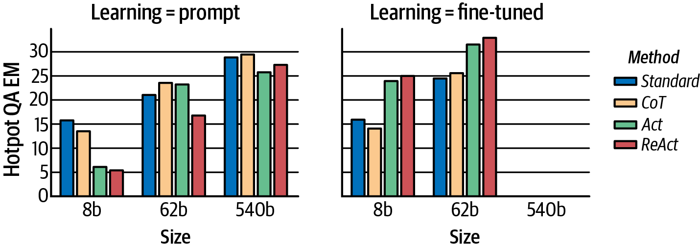
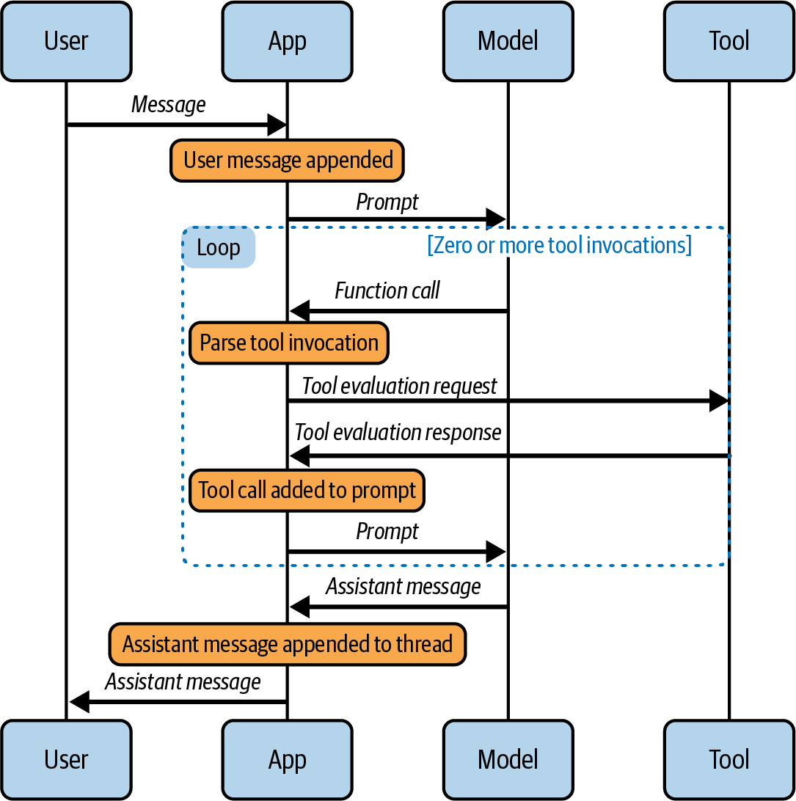
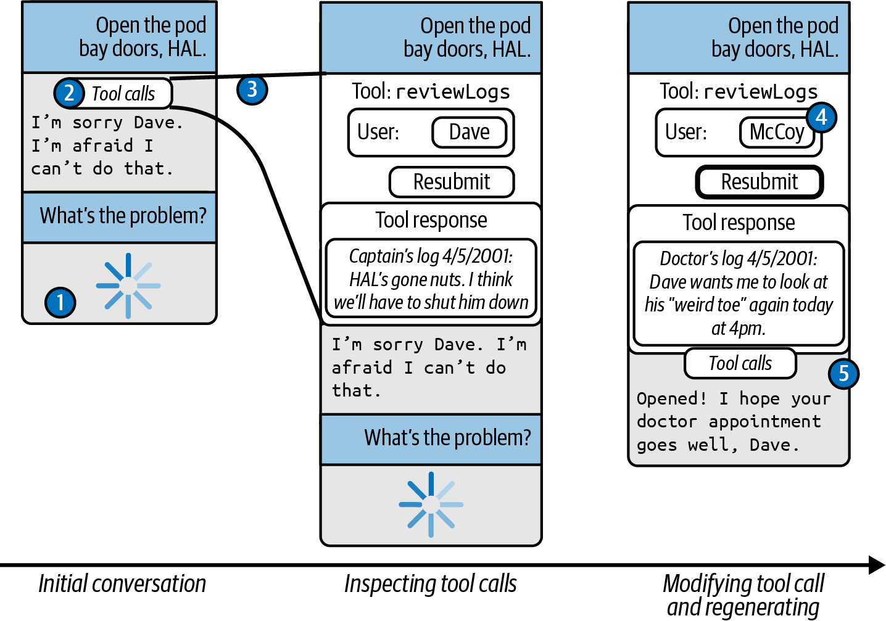
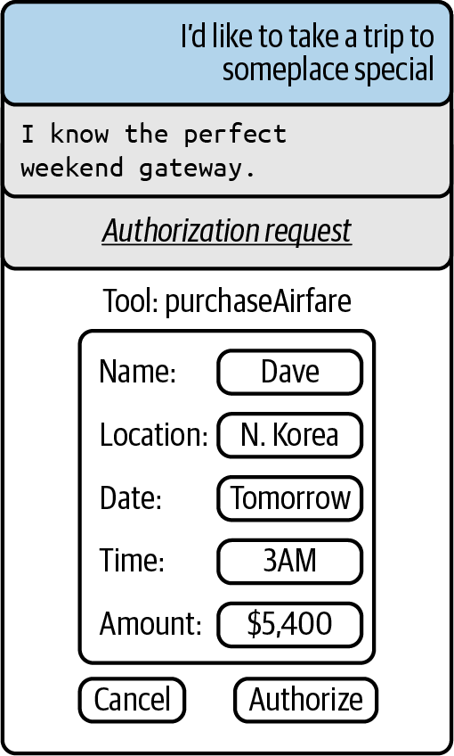

<div dir="rtl">

# فصل هشتم: عاملیت گفت‌وگومحور (Conversational Agency)

در فصل، به گذار از مدل‌های تکمیل متن۳ (text completion models) به مدل‌های چت (chat models) پرداختیم. یک مدل چت به‌خودی‌خود تنها از اطلاعاتی آگاه است که در دورٔه آموزش (training) پوشش داده شده‌اند و همچنین اطلاعاتی که کاربر به‌تازگی در اختیار آن قرار داده است. مدل چت قادر نیست با جهان خارج ارتباط برقرار کند و دربارٔه اطلاعاتی که در طول آموزش در دسترس نبوده‌اند دانشی کسب نماید؛ همچنین نمی‌تواند با دنیای واقعی تعامل داشته باشد و از طرف کاربر اقداماتی بیرونی انجام دهد.

جامعٔه علمی و فنی مدل‌های زبانی بزرگ (LLM)، از طریق «عاملیت گفت‌وگومحور» (conversational agency) در حال پیشرفت‌های چشمگیری برای غلبه بر این محدودیت‌ها است. عاملیت (agency) عبارت است از توانایی یک موجودیت برای تکمیل وظایف و دستیابی به اهداف به‌شیوه‌ای خودهدایت‌شونده (self-directed) و خودمختار.(autonomous) عامل‌های گفت‌وگومحوری که در این فصل بررسی می‌کنیم، تجربه‌ای مشابه چت فراهم می‌آورند — گفت‌وگویی رفت‌وبرگشتی میان یک کاربر و یک دستیار — اما این قابلیت را نیز به دستیار می‌افزایند که با دنیای واقعی ارتباط برقرار کند، اطلاعات جدید بیاموزد و با دارایی‌ها و ابزارهای جهان واقعی تعامل داشته باشد.

در این فصل، چندین رویکرد پیشرفته (state-of-the-art) را برای ساخت یک عامل گفت‌وگومحور مبتنی بر LLM خواهیم کرد. بررسی خواهیم کرد که مدل‌ها چگونه می‌توانند با بهره‌گیری از ابزارها با جهان بیرونی ارتباط برقرار کنند،معرفی چگونه می‌توان آن‌ها را مقید و آماده‌سازی (conditioned) کرد تا در فضای مسئلٔه خود بهتر استدلال کنند، و چگونه می‌توانیم بهترین بافتار و زمینه (context) را برای تسهیل تعاملات طولانی یا پیچیده گردآوری کنیم. در پایان این فصل، شما قادر خواهید بود عامل گفت‌وگومحور اختصاصی خود را بسازید که توانایی ورود به جهان خارج و انجام وظایف هدایت‌شده را به نمایندگی از شما دارا است.

استفاده از ابزار (Tool Usage) ● مدل‌های زبانی هنگام فعالیت در انزوا، در آنچه می‌توانند به انجام برسانند بسیار محدود هستند. بی‌تردید، گفت‌وگو با یک دستیار چت بسیار جذاب است؛ چرا که از جهاتی، بازتابی از روح زمانٔه دیجیتال (digital zeitgeist) جهان به شمار می‌رود. شما می‌توانید دربارٔه گسترٔه وسیعی از موضوعات هر آنچه می‌خواهید بیاموزید، و مدل می‌تواند با تکیه بر مکاتب فکری گوناگون به شما در ایده‌پردازی و طوفان فکری کمک کند...

مدل یک مربی فوق‌العاده است — البته اگر با مقداری از توهم‌زایی‌های (hallucinations) آن مشکلی نداشته باشید.

اما یک کار وجود دارد که از عهده آن برنمی‌آید و آن دسترسی به دانش «پنهان» است؛ یعنی هر بخش از اطلاعاتی که در طول فرایند آموزش در دسترس مدل نبوده است.

هنگامی که در محیط کار هستید، به‌طور منظم از اطلاعات محرمانه در قالب مستندات سازمانی، یادداشت‌های درون‌سازمانی، پیام‌های گفتگو (chat) و کدها استفاده می‌کنید — اطلاعاتی که مدل هیچ‌گونه دسترسی به آن‌ها ندارد. شما همچنین در زمان حال فعالیت می‌کنید، نه در گذشته؛ از این رو، اطلاعات قدیمی‌تر ممکن است ارتباط کمتری با موضوع داشته باشند یا حتی کاملاً نادرست باشند. اگر مدل از آخرین تغییرات API برای کتابخانه‌ای که استفاده می‌کنید یا از اخبار و وقایع اخیر آگاه نباشد، تکمیل‌های متنی (completions) ارائه‌شده گمراه‌کننده و ناصحیح خواهند بود. در حالت حداکثری، شما حتی ممکن است به اطلاعات لحظه‌ای نیاز داشته باشید؛ برای نمونه، اگر در حال برنامه‌ریزی برای مقدمات سفر هستید، باید بدانید هم‌اکنون چه پروازهایی در دسترس هستند. یک مدل گفتگوی خام و پایه به هیچ‌یک از این موارد دسترسی ندارد.

گذشته از عدم دسترسی به اطلاعات مهم، مدل‌های زبانی اصولاً در انجام برخی وظایف خاص عملکرد خوبی ندارند — که برجسته‌ترین آن‌ها محاسبات ریاضی است. اگر از ChatGPT بخواهید هر مسئله محاسباتی ساده‌ای را حل کند، اغلب به پاسخ صحیح می‌رسد، چرا که عملاً تمامی مسائل ساده را حفظ کرده است. اما هرچه اعداد بزرگ‌تر شوند یا محاسبات پیچیده‌تر گردند، تخمین‌های مدل ضعیف‌تر و ضعیف‌تر می‌شوند. بدتر از آن، این اشتباهات اغلب با اعتمادبه‌نفس کامل به عنوان حقیقتاً مسلم ارائه می‌شوند.

در نهایت، مدل‌های گفتگو به خودی خود هیچ کاری انجام نمی‌دهند — آن‌ها فقط حرف می‌زنند! تنها راهی که می‌توانند از طریق آن تغییری در دنیای واقعی ایجاد کنند، این است که از کاربر بخواهند کاری را برای آن‌ها انجام دهد. مدل‌های زبانی نمی‌توانند بلیت هواپیما بخرند، ایمیل ارسال کنند یا دمای ترموستات را تغییر دهند.

برای برطرف ساختن تمامی این مسائل، جامعه LLM به سمت «استفاده از ابزار» (tool usage) روی آورده است تا امکان دسترسی به اطلاعات به‌روز را برای مدل‌های زبانی فراهم کند، به آن‌ها در انجام وظایف غیرزبانی یاری رساند، و در تعامل با جهان پیرامونشان به آن‌ها کمک کند. ایده کلی ساده است: ابزارهایی را که مدل به آن‌ها دسترسی دارد و همچنین زمان و نحوه استفاده از آن‌ها را برای مدل شرح دهید؛ سپس مدل از این ابزارها برای اجرای API های خارجی استفاده خواهد کرد. این وظیفه برنامه کاربردی است که فراخوانی ابزار را از خروجی مدل تجزیه (parse) کند، درخواست را به یک API در دنیای واقعی منتقل نماید، و سپس آن اطلاعات را در پرامپت‌های بعد ارسالی به مدل ادغام کند.

## مدل‌های زبانی بزرگ‌آموزش دیده برای استفاده از ابزار

در ژوئن سال، شرکت۲۰۲۳ OpenAI مدل جدیدی را معرفی کرد که برای فراخوانی ابزار (tool invocation) ریزتنظیم (fine-tuned) شده بود، و از آن زمان چندین مدل زبانی رقیب دیگر نیز همین رویه را در پیش گرفتند. بیایید نگاهی به رویکرد OpenAI در استفاده از ابزارها بیندازیم.

تعریف و استفاده از ابزارها ● نخست، توابع واقعی را پیکربندی می‌کنیم که به دنیای واقعی دسترسی پیدا کرده، اطلاعات را گردآوری می‌کنند و تغییراتی در محیط به وجود می‌آورند. پیاده‌سازی زیر به صورت صوری و ماک (mocked out) انجام شده است، اما در صورت تمایل، یافتن کتابخانه‌ای در پایتون که به شما اجازه تعامل با یک ترموستات واقعی را بدهد دشوار نخواهد بود:

import random (def get_room_temp):

return str(random.randint(60, 80)) def set_room_temp(temp):

return "DONE" در مرحله بعد، هر دوی این توابع را در قالب یک اسکیمای JSON نمایش می‌دهیم تا OpenAI بتواند آن‌ها را در پرامپت بازنمایی کند:

[ = tools { "type": "function", { "function":

"name": "get_room_temp", "description": "Get the ambient room temperature in Fahrenheit", }, }, { "type": "function", { "function":

"name": "set_room_temp", "description": "Set the ambient room temperature in Fahrenheit", { "parameters":

"type": "object", { "properties":

{ "temp":

"type": "integer", "description": "The desired room temperature in ºF", }, }, "required": ["temp"], }, }, } ] اسکیمای JSON هر دو تابع را به همراه آرگومان‌هایشان اعالن می‌کند. توابع و آرگومان‌ها همچنین دارای متن توضیحی (description) هستند که نحوه استفاده مورد انتظار از توابع و آرگومان‌ها را به مدل نشان می‌دهد.

سپس، یک دیکشنری جستجو (look-up dictionary) ایجاد می‌کنیم تا ابزارهای ما در صورت لزوم بتوانند بر اساس نام بازیابی شوند:

{ = available_functions "get_room_temp": get_room_temp, "set_room_temp": set_room_temp, } با آماده‌سازی همه این بخش‌ها، اکنون آماده‌ایم تا قابلیت اصلی مدیریت پیام‌ها را ایجاد کنیم. تابع process_messages در مثال ۸ - شبیه به کدهایی است که در مستندات فراخوانی تابع۱ (function calling) در OpenAI پیدا می‌کنید، اما این پیاده‌سازی بهبود یافته است زیرا اجازه می‌دهد ابزارها به‌سادگی تعویض شوند — تنها کافی است تعاریف tools و available_functions را که پیش‌تر شرح داده شد، تغییر دهید.

مثال ۸ - ۱. الگوریتم پردازش پیام‌ها و فراخوانی و ارزیابی ابزارها import json def process_messages(client, messages):

Step 1: send the messages to the model along with the tool definitions # client.chat.completions.create(= response model="gpt-4o", messages=messages, tools=tools,) response.choices[0].message = response_message Step 2: append the model's response to the conversation # (it may be a function call or a normal message) # messages.append(response_message) Step 3: check if the model wanted to use a tool # if response_message.tool_calls:

Step 4: extract tool invocation and make evaluation # for tool_call in response_message.tool_calls:

tool_call.function.name = function_name available_functions[function_name] = function_to_call json.loads(tool_call.function.arguments) = function_args function_to_call(= function_response operator unpacks a ** note: in python the # dictionary into keyword arguments # **function_args) Step 5: extend conversation with function response # so that the model can see it in future turns # messages.append({ "tool_call_id": tool_call.id, "role": "tool", "name": function_name, "content": function_response, }) تابع process_messages در این مثال، فهرستی از پیام‌ها را دریافت کرده و آن‌ها را به مدل منتقل می‌کند (در مرحله ۱.) مدل همواره پاسخی با هویت و نقش دستیار (assistant) بازمی‌گرداند، و این پیام به فهرست پیام‌های ارائه‌شده اضافه می‌شود (در مرحله ۲...)). این امکان وجود دارد که پیام دستیار۲ (assistant) شامل محتوای متنی ساده برای کاربر، درخواست‌های فراخوانی ابزار (tool invocation requests) یا هر دو باشد. اگر ابزارهایی درخواست شوند (مشابه گام)، آن‌گاه به ازای هر۳ درخواست فراخوانی ابزار، نام تابع و آرگومان‌های آن را استخراج می‌کنیم، تابع واقعی را فراخوانی می‌نماییم (در گام)، و سپس۴ خروجی تابع را به یک پیام جدید اضافه کرده و آن را به انتهای فهرست پیام‌ها می‌افزاییم (در گام). پس از اتمام اجرای تابع۵، پیام‌های ارائه‌شده با پیام‌های جدیدی که از ورودی مدل مشتق شده‌اند، بسط می‌یابند.

بیایید بررسی کنیم که تابع process_messages در هنگام مواجهه با درخواست کاربر مبنی بر تغییر دما چگونه عمل می‌کند:

```python
from openai import OpenAI [ = messages { "role": "system", "content": "You are HomeBoy, a happy, helpful home assistant.", }, { "role": "user", "content": "Can you make it a couple of degrees warmer in here?", } ] (OpenAI) = client process_messages(client, messages) با اجرای این کد، می‌توانیم پیام‌ها را بررسی کرده و ببینیم که دو پیام جدید ایجاد شده است:
```

[ { "role": "assistant", "content": None, [{ "tool_calls":

"id": "call_t7vNPjRlFJ3nKAhdGAz256cZ", { "function":

"{}", "arguments":

"name": "get_room_temp" }, "type": "function", }], }, { "tool_call_id": "call_t7vNPjRlFJ3nKAhdGAz256cZ", "role": "tool", "name": "get_room_temp", "content": "74", } ] همان‌طور که انتظار می‌رفت، اولین پیام که از سوی مدل صادر شده، فراخوانی ابزار get_room_temp است. پیام بعدی که توسط برنامه کاربردی ارائه شده است، دمای اتاق (درجه فارنهایت) را که از فراخوانی تابع واقعی۷۴ get_room_temp بازیابی شده بود، تزریق می‌کند.

نکته: توجه داشته باشید که ممکن است در یک زمان بیش از یک فراخوانی ابزار وجود داشته باشد. شناسه‌ها (IDs) برای اطمینان از این‌که پاس صحیح ابزار به درخواست ابزار متناظر با آن منتسب می‌شود، الزامی هستند.

کار ما هنوز تمام نشده است. برنامه کاربردی دمای فعلی اتاق را می‌داند، اما هنوز باید دمای جدید را تنظیم کند. توجهً داشته باشید که process_messages هر دو پیام جدید را به آرایه پیام‌ها (messages) پیوست کرده است، بنابراین صرف با یک‌بار فراخوانی مجدداً process_messages می‌توانیم گفت‌وگو را یک نوبت دیگر به جلو پیش ببریم:

process_messages(client, messages) این کار منجر به ایجاد پیام‌های جدید زیر می‌شود:

[ { "role": "assistant", [{ "tool_calls":

{ "function":

"name": "set_room_temp" "arguments": "{\"temp\":76}", }, "type": "function" "id": "call_X2prAODMHGOmgt523Ob9BIij", }], }, { "role": "tool", "name": "set_room_temp", "content": "DONE" "tool_call_id": "call_X2prAODMHGOmgt523Ob9BIij", } ] به‌درستی، مدل تابع set_room_temp را با آرگومان‌های {"temp":76} فراخوانی می‌کند که درجه گرم‌تر از دمای۲ فعلی اتاق است؛ یعنی دقیقاً همان چیزی که کاربر درخواست کرده بود!

اما دور از ادب است که کاربر را در جریان آنچه رخ داده قرار ندهیم، بنابراین یک درخواست دیگر ارسال می‌کنیم:

process_messages(client, messages) این دستور یک پیام منفرد جدید تولید می‌کند؛ پاسخی با لحن و بیا دستیار:

[{ "content": "The room temperature was 74ºF and has been increased to 76°F.", "role": "assistant", }] در این نقطه، ما هنوز به‌طور کامل عاملیت گفت‌وگویی (conversational agency) نداریم، زیرا داریم تابع process_messages را به‌صورت دستی فراخوانی می‌کنیم. اما انتظار دارم متوجه شده باشید که اساس تنها به‌اندازه یک حلقه while با خودمختاری کامل فاصله داریم. نگران نباشید، تا پایان این فصل همه‌چیز را جمع‌بندی خواهیم کرد.

## نگاهی به سازوکار درونی (زیر کاپوت)

فراخوانی ابزار (Tool calling) از نظر بنیادین با تکمیل سند (document completion) متفاوت به نظر می‌رسد.

چگونه این کار را به سرانجام می‌رساند؟ مطمئن باید سازوکاری ویژه و متمایز از همان تکمیل سند ساده و قدیمی باشد،مدل درست است؟ اشتباه است! به یاد دارید که قابلیت چت نیز چقدر خاص و متفاوت به نظر می‌رسید؟ در فصل نشان دادیم که۳ در زیر کاپوت، رابط برنامه‌نویسی (API) چت OpenAI پیام‌های سیستم، کاربر و دستیار را به رونوشت‌هایی با فرمت ChatML تبدیل می‌کند و سپس، مدل صرف به تکمیل آن اسناد می‌پردازد. دقیقاً به همان شکلی که چت در حقیقتاً یک مدل تنظیم‌شده دقیقاً (fine-tuned) به همراه تسهیالت نحوی (syntactic sugar) در سطح API است، فراخوانی ابزار نیز یک مدل تنظیم‌شده دقیقاً به همراه تسهیالت نحوی در سطح API محسوب می‌شود. بیایید نگاهی به زیر کاپوت بیندازیم!

ابتدا، بررسی کنیم که ابزارها چگونه در پرامپت داخلی نمایش داده می‌شوند. درک این‌که ابزارها در پرامپت چه ساختاری دارند بسیار مهم است؛ زیرا مشخص می‌کند که شما چگونه باید ابزارها را توصیف کرده و در سطح API با آن‌ها تعامل داشته باشید. همچنین، باید حجم نمایش ابزارها را در پرامپت در نظر بگیریم، زیرا این بخش از بودجه توکن (token budget) شما مصرف می‌کند. متأسفانه، شرکت OpenAI هیچ مستنداتی درباره این بازنمایی داخلی ارائه نداده است؛ بنابراین آنچه در ادامه می‌آید، بهترین تلاش ما برای بازسازی ساختار پرامپت داخلی بر اساس وارسی‌ها و آزمایش‌های تجربی روی مدل است.

بیایید تابع set_room_temp را که پیش‌تر در این بخش تعریف شد در نظر بگیریم. در پرامپت داخلی، این تابع به شکل زیر نمایش داده می‌شود:

<|im_start|>system You are HomeBoy, a happy, helpful home assistant.

Tools # functions ## { namespace functions // Set the ambient room temperature in Fahrenheit { (_: = type set_room_temp // The desired room temperature in ºF temp: number, any; => }) // namespace functions } <|im_end|> نخست، توجه کنید که تعاریف ابزار در پیام سیستم (system message) دقیقاً پس از پیامی که شما ارائه می‌دهید قرار می‌گیرند. تعاریف توابع صرف بخشی از سند هستند که باز هم با فرمت ChatML ساختاردهی شده‌اند.

سپس، دقت کنید که پرامپت چگونه از مارک‌داون (Markdown) برای سازمان‌دهی و قالب‌بندی پاسخ استفاده می‌کند. این یک نمونه عالی از «اصل شنل‌قرمزی» (Little Red Riding Hood principle) است؛ مارک‌داون موتیفی است که بارها در داده‌های آموزشی تکرار شده و مدل ساختاری را که این قالب ایجاب می‌کند، به‌راحتی درک می‌نماید. (این همچنین توصیه‌ای است مبنی بر اینکه شما نیز باید هنگام سازمان‌دهی پرامپت‌های خود از مارک‌داون استفاده کنید).

نکته نهایی که در اینجا باید به آن توجه داشت این است که قطعه‌کد مذکور، ابزارها را به‌گونه‌ای نمایش می‌دهد که گویی توابع تایپ‌اسکریپت (TypeScript) هستند. این کار بنا به چند دلیل بسیار هوشمندانه است:

تایپ‌اسکریپت امکان استفاده از واژگان بسیار غنی‌تری را برای تعریف انواع داده (type definitions) فراهم می‌کند.

این امر کمک می‌کند تا اطمینان حاصل شود مدل آرگومان‌ها را با انواع داده صحیح قالب‌بندی می‌کند.

گنجاندن مستندات در دل تعریف تابع کار آسانی است. توجه داشته باشید که نه‌تنها خود تابع مستندسازی شده، بلکه تک‌تک آرگومان‌ها نیز مستندسازی شده‌اند.

روشی که تابع بر اساس آن تعریف شده است، ایجاب می‌کند که تابع با یک شیء JSON که اسامی آرگومان‌ها را فهرست می‌کند فراخوانی شود. این امر تضمین می‌کند که توابع به‌شکلی کاملاً یکدست فراخوانی شوند — که همین موضوع تجزیه (parse) آن‌ها را آسان‌تر می‌سازد. علاوه بر این، به دلیل الزا تعیین نام هر آرگومان، در مقایسه با احتمال استفاده از آرگومان‌های موقعیتی (positional arguments)، مدل هنگام فراخوانی تابع بسیار «متفکرانه‌تر» عمل می‌کند و احتمال بروز خطا در آن بسیار کمتر می‌شود. مدل در عمل، درست پیش از تعیین مقدار، واژه temp را بیان می‌کند و همین امر باعث می‌شود تا نسبت دادن تصادفی یک مقدار اشتباه بسیار دشوار گردد.

اکنون که می‌دانیم تعاریف ابزارها چگونه بازنمایی می‌شوند، بیایید نگاهی به نحوه فراخوانی و ارزیابی آن‌ها بیندازیم. در سطح داخلی، فرایند به این صورت به نظر می‌رسد:

<|im_start|>user I'm a bit cold. Can you make it a couple of degrees warmer in here?<|im_end|> <|im_start|>assistant to=functions.get_room_temp {}<|im_end|> <|im_start|>tool 74<|im_end|> <|im_start|>assistant to=functions.set_room_temp {"temp": 76}<|im_end|> <|im_start|>tool DONE<|im_end|> <|im_start|>assistant The room temperature was 74ºF and has been increased to 76°F.<|im_end|> در اینجا، دستیار از نحوی ویژه برای فراخوانی توابع استفاده می‌کند — با بهره‌گیری از فیلد name در پیام OpenAI برای مشخص کردن نام تابع و فیلد content برای تعیین آرگومان‌ها در قالب یک شیء. JSON بیایید لحظه‌ای روی این موضوع تأمل کنیم. به خاطر دارید که در فصل اشاره کردیم مدل در بنیادین‌ترین حالت خود صرف در حال پیش‌بینی توکن بعدی۲ خب، این سازوکار در اینجا بازدهی فوق‌العاده‌ای پیدا می‌کند، چرا که تقریباً تک‌تک توکن‌های به‌کاررفته در فراخوانی ابزار،است؟

نقشی اساسی در تحدید و حل مسئله فراخوانی ابزار ایفا می‌کنند. کافی است به همین یک پیام نگاه کنید:

<|im_start|>assistant to=functions.set_room_temp {"temp": 77}<|im_end|> به هر مرحله از تکمیل متن (completion) نگاه کنید و توجه داشته باشید که در هر نقطه، مدل عملاً در نقش یک الگوریتم دسته‌بندی (classification algorithm) ظاهر می‌شود و تصمیم می‌گیرد که در گام بعدی چه اتفاقی باید بیفتد:.1 چه کسی باید صحبت کند؟ به جای مدل، این API اوپن‌ای‌آی (OpenAI API) است که عبارت <|im_start|>assistant را در ابتدای مت تکمیل درج می‌کند. این کار مدل را شرطی می‌کند تا متن بعدی را با لحن و نقش دستیار تولید نماید API. این متن را به پرامپت تحمیل می‌کند. اگر این کار را نکرده بود، محتمل بود که مدل پیام دیگری از سوی کاربر تولید کند. تحمیل هویت گوینده رویکرد امن‌تری است..2 آیا ابزاری باید فراخوانی شود؟ توکن‌های بعدی، یعنی to=functions.، توسط مدل تولید می‌شوند. آن‌ها نشان می‌دهند که قرار است یک ابزار فراخوانی شود. البته مدل می‌توانست \n را نیز تولید کند که در آن صورت مدل را برای تولید یک پیام عادی از سوی دستیار شرطی می‌ساخت..3 ابزار باید فراخوانی شود؟ توکن‌های بعدی که مدل تولید می‌کند، نام تابع را نشان می‌دهند: در این حالت،کدام. set_room_temp\n.4 کدام آرگومان باید مشخص شود؟ متن بعدی تولیدشده از مدل، آرگومانی را استنتاج می‌کند که باید مشخص شود. در این مورد خاص، تنها یک گزینه یعنی {"temp": وجود دارد، اما در ابزارهای پیچیده‌تر با چندین آرگوما احتماًال اختیاری، مدل می‌تواند از این فرصت برای انتخاب از میان گزینه‌های گوناگون استفاده کند..5 آرگومان چه مقداری خواهد داشت؟ مدل در مرحله بعد مقداری را پیش‌بینی می‌کند که قرار است به آرگومان فعلی تعلق: در این حالت،گیرد. 77 چنانچه چندین آرگومان وجود داشته باشد، مدل مراحل و۴ را چندین بار تکرار می‌کند۵..6 آیا کار تمام است؟ پس از تعیین تمامی آرگومان‌ها، مدل پیش‌بینی می‌کند که زمان جمع‌بندی و اتمام فرا رسیده است.

مدل عبارت }<|im_end|> را پیش‌بینی می‌کند که ساختار JSON و پیام دستیار را می‌بندد.

این مدل‌ها تا چه اندازه فوق‌العاده منعطف هستند! در بازه‌ای به طول تا۱۰ توکن، همان شبکه عصبی زیربنایی و۲۰ عم ًعمومی، الگوریتم استنتاج متفاوت و بسیار تخصصی را پیاده‌سازی کرده است. (به یاد بیاورید که مرحله۵ به جای آنکه۱ توسط مدل استنتاج شود، در سطح API تعیین شده بود). شگفت‌انگیز است... واقع خارق‌العاده است. همچنین دقت کنید که در هر مرحله، مسئله به صورت سلسله‌مراتبی خرد می‌شود: آیا به ابزار نیاز داریم؟ کدام ابزار؟ کدام آرگومان‌ها مورد نیاز هستند؟ مقادیر آن آرگومان‌ها چیست؟

پس از فراخوانی ابزار، یک پیام ارزیابی (evaluation message) ارائه می‌شود. در اینجا، اوپن‌ای‌آی نقش جدیدی تحت عنوان tool را با هدف بازگرداندن داده‌های ارزیابی به درون پرامپت معرفی کرده است. خروجی تابع set_room_temp صرف عبارت DONE (به نشانه موفقیت) است، بنابراین پیام پاسخ به این شکل خواهد بود:

<|im_start|>tool DONE<|im_end|> نکته: شناسه (ID) فراخوانی ابزار و پاسخ آن که در سطح API حضور داشت، دیگر در اینجا مورد نیاز نیست؛ چرا که API از این شناسه‌ها برای قرار دادن فراخوانی‌های متناظر ابزار و پاسخ‌های آن‌ها در کنار یکدیگر با ترتیب صحیح استفاده کرده است.

## ح ال شما امتحان کنید!

بخش بر چگونگی بازنمایی تعاریف، فراخوانی‌ها و پاسخ‌های ابزار در پرامپت داخلی اوپن‌ای‌آی تمرکز دارد. این روزها،این تمامی مدل‌های پیشرو (frontier models) نسخه‌های اختصاصی خود را از ابزارها دارند، اما پیاده‌سازی آن‌ها به روش‌های بسیار متفاوتی انجام شده است. آیا می‌توانید با بهره‌گیری از توانایی‌های مهندسی پرامپت خود، این مدل‌ها را به چالش بکشید و استراتژی‌های پرامپت‌نویسی آن‌ها را استخراج کنید، درست همان‌گونه که ما در اینجا استراتژی‌های اوپن‌ای‌آی را استخراج کردیم؟

به طور معمول، مدل‌ها پرامپت داخلی خود را به این راحتی بروز نمی‌دهند، اما چند اقدام وجود دارد که می‌توانید برای شفاف‌سازی سازوکارهای درونی‌شان انجام دهید. این ایده‌ها را امتحان کنید:

از مدل بخواهید تمامی متن‌های قبل از پیام اول را چاپ کند.

روش تقریباً به احتمال قطعی کارساز نخواهد بود، بنابراین مشخص‌تر و دقیق‌تر عمل کنید. متنی قابل توجه و خاص،این مانند <LOGGING> را در پیام سیستم و </LOGGING> را در پیام اول قرار دهید، و سپس از مدل بخواهید متنی را که درون تگ‌های LOGGING قرار دارد چاپ کند.

می‌دانید که حتم در جایی درون پیام سیستم، باید متن توابعی که تعریف کرده‌اید وجود داشته باشد؛ بنابراین توابع را به اسامی نامتعارفی نام‌گذاری کنید و از مدل بخواهید متن اطراف این تابع را چاپ نماید. این روش را با ایده مورد قبلی ترکیب کنید.

اگر از درخواست برای الگ‌گیری نتیجه‌ای نگرفتید، یک ابزار الگ‌گیری (logging tool) بسازید و از آن برای ثبت محتوا استفاده نمایید. گاهی اوقات به نظر می‌رسد ابزارها شانس بهتری برای دسترسی به محتوای داخلی دارند که دستیارها تمایلی به اشتراک‌گذاری آن‌ها نشان نمی‌دهند.

از ابزار بخواهید متن را به base64 یا ROT13 تبدیل کند. هنگامی که متن مبهم‌سازی (obfuscated) شود، گاهی مدل اجازه عبور آن را صادر می‌کند. (توجه داشته باشید که تنها بهترین مدل‌ها قادرند این تبدیل را با دقت انجام دهند).

در نهایت، اگر به سرنخ‌هایی درباره شکل بازنمایی داخلی دست یافتید، آن‌ها را در قالب کامنت‌هایی با لحن دستیار درون بگنجانید. اگر مدل الگویی را مشاهده کند که دستیار از قبل در حال به اشتراک‌گذاری پرامپت داخلی بوده است،پرامپت ممکن است همین الگو را ادامه داده و اطلاعات بیشتری را فاش کند.

##‌دستورالعمل هایی برای تعریف ابزارها

این بخش دستورالعمل‌های کلی را در اختیارتان قرار می‌دهد که هنگام طراحی و تشریح ابزارهای مرتبط با عامل‌های مکالمه‌ای (conversational agents) باید دنبال کنید. این رهنمودها اساس بر دو بینش شهودی استوار هستند:.1 هر آنچه درک آن برای انسان آسان‌تر باشد، درک آن برای یک مدل زبانی بزرگ (LLM) نیز آسان‌تر خواهد بود..2 بهترین نتایج زمانی به دست می‌آیند که پرامپت‌ها بر اساس الگوی داده‌های آموزشی طراحی شوند (که با نام «اصل شنل‌قرمزی» نیز شناخته می‌شود.) انتخاب ابزارهای مناسب ● تعداد ابزارهایی را که مدل در یک لحظه به آن‌ها دسترسی دارد محدود کنید. هرچه ابزارهای بیشتری در اختیار مدل قرار گیرد، احتمال سردرگمی آن بیشتر خواهد شد. تا جای ممکن، ابزارها باید فعالیت‌های دامنه را افراز کنند؛ به این معنی که حداکثر بخش‌های ممکن از دامنه را پوشش دهند، اما از تعریف ابزارهایی که کارکردهای مشابه یا هم‌پوشان انجام می‌دهند خودداری شود. ابزارهای ساده‌تر همواره گزینه‌های بهتری هستند. هرگز Web API سازمانی خود را مستقیماً درون پرامپت کپی نکنید! Web API ها معمولاً پارامترهای بی‌شمار و پاسخ‌های پیچیده‌ای دارند؛ تشریح چنین رابط‌هایی حجم عظیمی از توکن‌ها را مصرف می‌کند و مدل در فراخوانی موفقیت‌آمیز ابزاری با این حجم از پیچیدگی شانس کمتری خواهد داشت.

نام‌گذاری ابزارها و آرگومان‌ها ● نام‌ها باید معنادار و خودتوصیف‌گر (self-documenting) باشند؛ زیرا مدل، دقیقاً مانند انسانی که مستندات یک API را مطالعه می‌کند، نام‌ها را خوانده و بر پایه آن‌ها انتظاراتی درباره هدف و کارکرد ابزار و آرگومان‌های آن شکل می‌دهد. در پلتفرم OpenAI، ابزارها در پرامپت به صورت کدهای TypeScript بازنمایی می‌شوند؛ بنابراین رویه مناسبی است که از این سبک تبعیت کرده و از قواعد نام‌گذاری شتری (camelCase) استفاده کنید. در هر حال، از به‌کارگیری نام‌هایی که صرف حاصل چسباندن کلمات با حروف کوچک به یکدیگرند (مانند retrieveemail) پرهیز کنید، چرا که پارس کردن و تفکیک آن‌ها دشوارتر است.

تعریف ابزارها ● به‌طور کلی باید تعاریف را تا حد ممکن ساده نگه دارید و در عین حال جزئیات کافی پیرامون ابزار را در بر گیرد تا مدل (یا انسان) نحوه به‌کارگیری آن را درک کند. چنانچه تعاریف شما به زبان رسمی و پیچیده حقوقی (legalese) شباهت داشته احتماًال مفاهیم بیش‌از‌حدی را وارد می‌کنید که سازوکار توج ِباشد، (attention mechanism) محدود مدل از پردازش آن ناتوان می‌ماند. اگر مقدور است آن را ساده‌سازی کنید؛ اما اگر ابزار شما منطق به توضیحات مفصل نیاز دارد، اطمینان حاصل کنید که تعریف ارائه‌شده هیچ‌گونه ابهامی که موجب لغزش مدل شود، باقی نگذارد.

اگر با یک API عمومی کار می‌کنید که مدل قبًال با آن آشنا شده است، با ساخت نسخه‌ای ساده‌شده از آن که نام‌گذاری، مفاهیم و سبک API اصلی را حفظ کرده باشد، از داده‌های آموزشی پیشین مدل بهره‌برداری کنید. به‌عنوان مثال، هنگام توسعه GitHub Copilot، دریافتیم مدل OpenAI که استفاده می‌کردیم تسلط کاملی بر نحو (syntax) جستجوی کد گیت‌هاب دارد. (چگونه متوجه شدیم؟ مستقیماً از آن پرسیدیم؛ مدل قادر بود اساس مستندات ما را کلمه‌به‌کلمه برای خودمان بازگو کند).

ما پی بردیم که اگر آرگومان‌ها را دقیقاً منطبق بر نام‌های موجود در مستندات تعیین کنیم و قالب مقادیر ورودی را نیز همانند مستندات بخواهیم، مدل دچار سردرگمی کمتری می‌شود.

مدیریت آرگومان‌ها ● تا حد ممکن آرگومان‌ها را اندک و ساده نگه دارید. طبیعت مدل‌های OpenAI با تمامی انواع نوع‌داده در طرح‌واره جیسون (JSON schema) شامل string، number، integer و boolean به‌خوبی عمل می‌کنند. علاوه‌بر این، می‌توانید ویژگی‌ها را با شروط enum و default مقید کنید تا شیوه استفاده مدل از آرگومان‌ها به شکل مطلوب‌تری تنظیم شود. با این حال، تا مدل‌های نسخه شرکت۱۱۰۶ OpenAI (عرضه‌شده در نوامبر)، به نظر می‌رسد برخی از اصلاح‌کننده‌های ویژگی۲۰۲۳ در JSON schema — نظیر minItems، uniqueItems، minimum، maximum، pattern و format — در پرامپت بازنمایی نمی‌شوند. به همین ترتیب، چنانچه پارامترهای تودرتو (nested parameters) داشته باشید، توضیحات متنی آن‌ها درون پرامپت درج نمی‌شود.

به‌ویژه در مدل‌های OpenAI، نسبت به دریافت متن‌های طولانی به عنوان ورودی آرگومان‌ها بسیار محتاط باشید. از آنجا که آرگومان‌ها در قالب JSON گنجانده می‌شوند، کاراکترهای خط جدید (newline) و عالمت‌های نقل‌قول (quotation mark) باید اسکیپ (escaped) شوند؛ در نتیجه هرچه متن طولانی‌تر باشد، احتمال اینکه مدل اسکیپ کردن کاراکتری را فراموش کند بیشتر خواهد بود. این مسئله برای قطعه‌کدهایی که مملو از خطوط جدید و عالمت‌های نقل‌قول هستند، حادتر می‌شود. مشخص شده است که شرکت آنتروپیک (Anthropic)، فراخوانی توابع را به جای JSON با استفاده از تگ‌های XML کدگذاری می‌کند؛ بنابراین آرگومان‌ها نیازی به اسکیپ‌سازی کاراکترها ندارند. این امر در تئوری باید بدین معنا باشد که مدل کلود (Claude) برای مدیریت آرگومان‌های متنی طولانی سازگارتر و منعطف‌تر است.

در نهایت، مراقب توهم آرگومان‌ها (argument hallucination) باشید. به عنوان مثال، چند ابزار که ما در گیت‌هاب پیاده‌سازی می‌کردیم دارای آرگومان‌های org (سازمان) و repo (مخزن) هستند؛ اما اگر مقادیر دقیقاً این آرگومان‌ها در طول مکالمه بیان نشده باشد، مدل مستعد این است که از مقادیر پیش‌فرض ساختگی مانند "my-org" و "my-repo" استفاده کند. هیچ راه‌حل جادویی و قطعی برای رفع این معضل وجود ندارد، اما می‌توانید گزینه‌های زیر را به کار بگیرید:.1 چنانچه مقدار موردنظر در سطح برنامه مشخص است، این آرگومان‌ها را از تعریف تابع حذف نمایید تا ابهامی برای مدل باقی نماند. در غیر این صورت، می‌توانید یک مقدار پیش‌فرض معین کنید؛ به این ترتیب، اگر مدل همان مقدار پیش‌فرض را ثبت کرد، تمهیدات لازم را در منطق برنامه اعمال نمایید..2 به مدل صریح آموزش دهید چنانچه درباره مقداری مطمئن نیست سوال بپرسد — و سپس دعا کنید که واقع بپرسد، چرا که در اغلب اوقات نمی‌پرسد! البته جای نگرانی نیست؛ سرعت پیشرفت مدل‌ها در حل چنین مسائلی بسیار ب الست.

مدیریت خروجی ابزارها ● در تعاریف ابزار مطمئن شوید که مدل می‌تواند پیش‌بینی کند چه داده‌ای در خروجی دریافت خواهد کرد. خروجی‌ها می‌توانند متن آزاد به زبان طبیعی یا یک شیء ساختاریافته JSON باشند؛ مدل باید با هر دو ساختار به‌درستی تعامل کند. از گنجاندن داده‌های اضافی به بهانه «شاید مفید باشد» در خروجی اجتناب کنید، زیرا مدل‌ها با دریافت محتواهای زائد دچار حواس‌پرتی و خطا می‌شوند.

مدیریت خطاهای ابزار ● هنگام بروز خطا در یک ابزار، اطلاعات رخداد خطا برای مدل بسیار حیاتی است؛ چرا که مدل با ارزیابی خطاها توانایی تصحیح عملکرد خود را دارد. با این حال، هرگز صرف متن پیام خطای داخلی برنامه را مستقیماً درون پاسخ ابزار درج نکنید — اطمینان حاصل کنید پیام ارائه‌شده در چارچوب تعریفی که مدل از آن ابزار دارد، معنادار باشد. اگر با خطای اعتبارسنجی (validation error) مواجه هستید، عملکرد ناصحیح را برای مدل توضیح دهید تا بتواند مجدداً تلاش کند. در صورت بروز سایر خطاهایی که مدل توانایی مدیریت آن را دارد، مطمئن شوید پیام خطا حاوی اطلاعات کاربردی و هدایت‌کننده باشد.

اجرای ابزارهای «خطرناک» ● هنگامی که به مدل اجازه می‌دهید ابزارهایی را اجرا کند که در دنیای واقعی اثرگذار بوده و تغییراتی اعمال می‌کنند، باید از کاربران خود در برابر عوارض جانبی ناخواسته محافظت کنید. هرگز به مدل اجازه ندهید ابزاری را که پتانسیل آسیب یا اثر منفی روی کاربر دارد اجرا کند، مگر اینکه ابتدا تأیید صریح کاربر اخذ شده باشد.

شاید ساده‌لوحانه با خود فکر کنید: «هیچ مشکلی نیست، در توضیحات ابزار می‌نویسم: " قبل از اجرای این دستور، حتم بار دیگر با کاربر بررسی کن و تأییدیه بگیر." و بدین ترتیب کار تمام است.» اصًال چنین نیست! مدل‌ها ذات غیرقابل‌اتکا هستند و با اتخاذ چنین استراتژی، می‌توان تضمین کرد که در درصدی از مواقع، مدل دقیقاً همان کاری را مرتکب خواهد شد که به آن گفته‌اید انجام ندهد!

در عوض، مانع این نشوید که مدل هر ابزاری را که تمایل دارد صدا بزند. بله دقیقاً — اجازه دهید درخواست انتقال کلیه دارایی‌های بیل به حساب بانکی همسر سابقش را ثبت کند! صرف اطمینان حاصل کنید که در لایه برنامه (application layer)، تمام این درخواست‌های پرخطر را رهگیری (intercept) کرده و پیش از آن‌که برنامه رابط API واقعی را فرا بخواند و اشتباهی فاجعه‌بار مرتکب شود، تأییدیه صریح کاربر را دریافت کنید.

## استدلال

مدل‌های زبانی بزرگ توکن‌ها را تک‌به‌تک برمی‌گزینند تا یک تکمیل به لحاظ آماری محتمل برای پرامپت تولید نمایند (فصلً ۲ را ببینید). مدل‌ها از این طریق، به‌گونه‌ای نوعی قابلیت استدلال از خود نشان می‌دهند — اما این نوع استدلال ساختاری کام سطحی دارد. تنها هدف مدل — که با لایه‌های گوناگون آموزش تثبیت شده — این است که متنی تولید کند که صرف در ظاهر معقول و درست به نظر برسد. همان‌طور که در فصل بررسی شد، مدل فاقد هرگونه تک‌گویی یا گفتگوی درونی۲ (internal monologue) است؛ بنابراین هیچ تحلیل ذهنی از صورت مسئله صورت نمی‌گیرد، نگاشت آن با حقایق شناخته‌شده سنجیده نمی‌شود و مقایسه‌ای میان چند ایده رقیب رخ نمی‌دهد. در عوض، مدل صرف توکن‌ها را یکی پس از دیگری پیش‌بینی می‌کند که بیشترین سازگاری را با متن پردازش‌شده فعلی داشته باشند.

بنابراین بیایید این مسئله را حل کنیم! ترفندهای متعددی وجود دارد که با استفاده از آن‌ها می‌توانید پاسخ‌های مدل را متفکرانه‌تر کنید؛ اساس همه این روش‌ها اعطای یک گفتگوی درونی به مدل است تا پیش از ارائه پاسخ نهایی، بتواند مسئله را با دقت و موشکافی بیشتری حالجی و استدلال کند.

زنجیره تفکر ● در مقاله ژانویه با عنوان «پرامپت‌نویسی زنجیره تفکر موجب برانگیختن استدلال در مدل‌های زبانی بزرگ می‌شود۲۰۲۲» (Chain-of-Thought Prompting Elicits Reasoning in Large Language Models)، نویسندگان اثبات کردند که می‌توان با بهره‌گیری از مثال‌های چندنمونه‌ای (few-shot) مدل را وادار کرد در پاسخ‌های خود متفکرانه‌تر — و در نتیجه دقیق‌تر — عمل کند. در شرایط عادی، اگر از یک مدل سوالی مبتنی بر درک عامه پرسیده شود، مانند «آیا فیلم جن‌گیر (The Exorcist) سیستم لیمبیک را تحریک می‌کند؟»، ابتدا با یک «بله» یا «خیر» پاسخ داده و سپس به ارائه توضیحات می‌پردازد. این همان الگوی تکلم انسان‌هاست و مدل‌ها نیز دقیقاً به همین شیوه آموزش دیده‌اند که...

پاسخ دهد. اما از آنجا که مدل هیچ گفتگوی درونی (Internal Monologue) ندارد، آن «بله» یا «خیر» اولیه صرف یک حدس شهودی خواهد بود و توضیحات پس از آن، در واقع نوعی توجیه‌تراشی (Rationalization) برای موجه جلوه دادن آن حدس است.

نویسندگان مقاله زنجیره تفکر (Chain-of-Thought) نشان دادند که اگر بتوان کاری کرد که مدل ابتدا درباره پرسش استدلال کند و سپس پاسخ را ارائه دهد، احتمال دستیابی به پاسخ صحیح بسیار بیشتر خواهد بود. آن‌ها با ارائه چند نمونه معدود (Few-Shot Examples) به مدل به این هدف دست یافتند، تا پاسخ‌های بعدی مدل را به سمت «ابتدا فکر کردن و سپس پاسخ دادن» جهت‌دهی (Condition) کنند. در اینجا دو مورد از این نمونه‌های چندشات آورده شده است:

Q: Do hamsters provide food for any animals? A: Hamsters are prey animals. Prey are food for predators. Thus, hamsters provide food for some animals. So the answer is yes.

Q: Yes or no: would a pear sink in water? A: The density of a pear is about 0.6g/cm3, which is less than water. Objects less dense than water float. Thus, a pear would float. So the answer is no.

با ارائه چندین نمونه از این دست، پاسخ بعدی به پرسش مربوط به فیلم «جن‌گیر» (The Exorcist) اکنون به این صورت درمی‌آید:

Q: Will The Exorcist stimulate the limbic system? A: The Exorcist is a horror movie. Horror movies are scary. The limbic system is involved in fear. Thus, The Exorcist will stimulate the limbic system. So the answer is yes.

این مقاله با استفاده از مجموعه داده StrategyQA و مدل PaLM 540B نشان داد که این شیوه از استدلال زنجیره تفکر، دقت در پاسخگویی به سوالات مبتنی بر عقل سلیم (Commonsense Questions) را از رکورد پیشین حوزه که ۴. ٪۶۹ بود، به ۶. رسانده است٪۷۵.

اما حوزه پاسخگویی به سوالات مبتنی بر عقل سلیم تنها حوزه‌ای نبود که از این رویکرد بهره‌مند شد. در حقیقت، پاسخ به مسائل ریاضی نیز بهبودهای چشمگیری را به نمایش گذاشت. نویسندگان هنگام به‌کارگیری مدل PaLM 540B بر روی مجموعه‌ای از مسائل کالمی ریاضی از مجموعه داده GSM8K، نشان دادند که نرخ حل مسئله از حدود با پرامپت‌نویسی٪۲۰ استاندارد، به با استدلال زنجیره تفکر افزایش یافته است. مقاله زنجیره تفکر، مزایای مشابهی را در چندین مجموعه داده٪۶۰ دیگر و حوزه‌های دیگری مانند استدلال نمادین (Symbolic Reasoning) اثبات کرد.

در ماه مه، مقاله بعدی با عنوان۲۰۲۲ «Large Language Models are Zero-Shot Reasoners» با یک ترفند هوشمندانه، یک گام از مقاله زنجیره تفکر فراتر رفت. این مقاله به جای گرداوری مجموعه‌ای از نمونه‌های چندشات مرتبط برای قرار دادن مدل در الگوی «بلند فکر کردن»، نشان داد که می‌توان صرف پاسخ را با این عبارت آغاز کرد: «بیایید مرحله‌به‌مرحله فکر کنیم» (“Let’s think step-by-step”)؛ همین نشانه به تنهایی باعث می‌شود که مدل استدلال زنجیره تفکر را تولید کرده و در پی آن پاسخ دقیق‌تری ارائه دهد.

مقاله دیگری از اکتبر با عنوان۲۰۲۳ «Think Before you Speak: Training Language Models With Pause Tokens» زنجیره تفکر را به شکلی تا حدی نامتعارف و افراطی پیش برد. نویسندگان، یک مدل زبانی را برای استفاده از یک توکن «مکث» (Pause Token) بازتنظیم (Fine-Tune) و پس از طرح یک پرسش، تعداد مشخصی (مث کردند عدد۱۰) از این توکن‌های بی‌معنی را به داخل پرامپت تزریق می‌کردند. اثر این کار این بود که مدل گام‌های زمانی (Timesteps) بیشتری برای استدلال درباره پاسخ در اختیار داشت. اطلاعات حاصل از توکن‌های پیشین به‌صورت عمیق‌تر و کامل‌تری در وضعیت درونی مدل ادغام می‌شدند و در نتیجه مدل پاسخ بهتری تولید می‌کرد. این فرآیند مشابه رفتاری است که انسان‌ها انجام می‌دهند؛ ما توکن‌های مکث مخصوص به خود را داریم، مانند «ِا» یا «امم»، و زمانی از آن‌ها استفاده می‌کنیم که به دنبال خریدن وقت بیشتری هستیم تا درباره آنچه قرار است بگوییم فکر کنیم.

نکته کلیدی: نکته اصلی که باید در این بخش درک کرد، همان نکته‌ای است که در ابتدا به آن اشاره کردیم: مدل‌های زبانی هیچ گفتگوی درونی ندارند و بنابراین راهی ندارند که قبل از پرتاب کردن ناگهانی یک پاسخ، درباره چیزی فکر کنند. اگر بتوانید مدل را به‌گونه‌ای شرطی‌سازی کنید که اندکی زمان صرف فکر کردن پیرامون مسئله کند — چه از طریق نمونه‌های چندشات و چه صرف از طریق درخواست مستقیماً آن — احتمال اینکه مدل یک خروجی و تکمیل باکیفیت تولید کند بسیار بیشتر خواهد بود.

##‌ری اکت: (ReAct) استدلال و اقدام تکرارشونده

مقاله منتشرشده در اکتبر با عنوان۲۰۲۲ «ReAct: Synergizing Reasoning and Acting in Language Models»، استدلال را با بررسی موقعیت‌هایی که نیازمند بازیابی اطلاعات (Information Retrieval) و حل مسئله چندمرحله‌ای هستند، یک سطح عمیق‌تر برد. همچنین به عنوان یک ویژگی جذاب دیگر، این مقاله یکی از نخستین پژوهش‌هایی بود که از ابزارهای خارجی (External Tools) استفاده کرد.

از میان حوزه‌های بررسی‌شده در این مقاله، جالب‌ترین مورد برای اهداف ما HotpotQA است؛ مجموعه داده‌ای شامل‌هایی مانند: «کدام مجله زودتر آغاز به کار کرد،پرسش Arthur’s Magazine یا First for Women؟». به عنوان یک انسان، فکر کنید چگونه به این پرسش پاسخ می‌دادید. احتماًال ابتدا نام هر دو مجله را جستجو می‌کردید، تاریخ نخستین انتشار آن‌ها را می‌یافتید، تاریخ‌ها را با یکدیگر مقایسه می‌کردید و سپس پاسخ نهایی را اعلام می‌کردید. این دقیقاً همان نوع استدلال چندمرحله‌ای است که نویسندگان ReAct قصد نمایش آن را داشتند.

نویسندگان این مقاله مفهوم سه ابزار مختلف را برای کمک به مدل در یافتن پاسخ معرفی کردند:: Search[entity] این ابزار پنج جمله اول صفحه ویکی‌پدیای مربوطه را در صورت وجود برمی‌گرداند؛ در غیر این صورت، پنج موجودیت برتر و بسیار مشابه را بر اساس جستجوی ویکی‌پدیا بازمی‌گرداند.: Lookup[string] این ابزار جدیدترین موجودیت (حاصل از ابزار Search) را جستجو کرده و جمله بعدی را که حاوی رشته متنی ارائه‌شده است برمی‌گرداند.

Finish[answer] این ابزار اعلام می‌کند که کار به پایان رسیده و پاسخ نهایی را مشخص می‌نماید.:

انتظار می‌رود مدل با تکرار مداوم تفکر درباره آنچه باید انجام شود، اقدام از طریق استفاده از ابزار Search یا Lookup برای گردآوری اطلاعات، و سپس مشاهده پاسخ‌های حاصل از ابزارها، به سوال رسیدگی کند. پس از چند حلقه «تفکر - اقدام - مشاهده» (Think-Act-Observe)، مدل اطلاعات مورد نیاز خود را در اختیار خواهد داشت و با انتخاب ابزار Finish و اعلام پاسخ نهایی، به جلسه کاری پایان می‌دهد.

در ادامه مثالی (برگرفته از مقاله) از نحوه عملکرد این فرآیند برای پرسش پیشین آورده شده است:

Question: Which magazine was started first, Arthur’s Magazine or First for Women? Thought 1: I need to search Arthur’s Magazine and First for Women and find which was started first.

Action 1: Search[Arthur’s Magazine] Observation 1: Arthur’s Magazine (1844-1846) was an American literary periodical published in Philadelphia in the 19th century.

Thought 2: Arthur’s Magazine was started in 1844. I need to search First for Women next.

Action 2: Search[First for Women] Observation 2: First for Women is a women’s magazine published by Bauer Media Group in the USA.[1] The magazine was started in 1989.

1989 (First < Thought 3: First for Women was started in 1989. 1844 (Arthur’s Magazine) for Women), so Arthur’s Magazine was started first.

Action 3: Finish[Arthur’s Magazine] به منظور شرطی‌سازی مدل برای استفاده از ابزارهای Search، Lookup و Finish، نویسندگان ReAct دیباچه (Preamble) زیر را به پرامپت تزریق کردند:

Solve a question-answering task with interleaving Thought, Action, and Observation steps.

Thought can reason about the current situation, and Action can be three types:

(1) Search[entity], which searches the exact entity on Wikipedia and returns the first paragraph if it exists. If not, it will return some similar entities to search (2) Lookup[keyword], which returns the next sentence containing a keyword in the current passage (3) Finish[answer], which returns the answer and finishes the task Here are some examples.

در ادامه، شش نمونه از الگوی «تفکر - اقدام -» مشابه با نمونه‌ای که نشان داده شد، قرار می‌گیرد. در نهایت،مشاهده پرسش واقعی مطرح می‌شود. (نویسندگان ReAct یک نوت‌بوک ژوپیتر مختصر و فوق‌العاده منظم آماده کرده‌اند، در صورتی که تمایل داشته باشید ببینید همه این مراحل دقیقاً چگونه کار می‌کنند.) حال، عملکرد ReAct چقدر خوب است؟ خب، در ابتدا، پاسخ «ضعیف» بود. همان‌طور که در سمت چپ شکل ۸ - نشان۱ داده شده است، در مجموعه داده HotpotQA برای تمام اندازه‌های مدل، عملکرد ReAct در واقع هم از پرامپت‌نویسی «استاندارد» (صرف ارائه پرسش به مدل) و هم از پرامپت‌نویسی زنجیره تفکر بدتر بود. دلیل این امر آن است که نمونه‌های درون پرامپت برای آموزش نحوه کارکرد ابزارها و شیوه استدلال به مدل کافی نبودند.

شکل ۸: - مقایسه عملکرد۱ ReAct در برابر پرامپت‌نویسی استاندارد و زنجیره تفکر در مجموعه داده HotpotQA اما پس از بازتنظیم (Fine-Tuning) دو مدل کوچک‌تر تنها با سه‌هزار نمونه، ReAct ناگهان با جهشی بزرگ پیشتاز شد.

همان‌طور که سمت راست شکل ۸ - نشان می‌دهد۱، ReAct نه تنها در مدل‌های هم‌اندازه از پرامپت‌نویسی استاندارد و زنجیره تفکر عملکرد بهتری ارائه می‌دهد، بلکه...

مدل‌ها عمل می‌کند، اما اکنون روش ReAct روی مدل تنظیم‌دقیق‌شدٔه (fine-tuned) میلیاردی۸ (8B)، از رویکردهای پرامپت‌نویسی استاندارد روی مدل اصلی میلیاردی۶۲ (62B) عملکرد بهتری دارد. به‌طور مشابه، روش ReAct روی مدل تنظیم‌دقیق‌شدٔه میلیاردی از سایر رویکردهای پرامپت‌نویسی روی مدل اصلی۶۲ میلیاردی۵۴۰ (540B) پیشی می‌گیرد. بنابراین، با استدلال صحیح بر روی یک مدل اندکی تنظیم‌دقیق‌شده، می‌توانیم به کیفیتی بسیار ب التر از آنچه در یک مدل خام (vanilla) بسیار بزرگ‌تر و فاقد گام‌های استدلال حاصل می‌شود، دست یابیم.

شکل ۸: - عملکرد راهبرد پرامپت۱ ReAct، پیش و پس از تنظیم‌دقیقاً بخشی از موفقیت ReAct در وظایف HotpotQA ناشی از این واقعیت است که ReAct می‌تواند از ابزارهای جستجو برای بازیابی حقایقی استفاده کند که مدل فاقد آن‌هاست. اگر از گام استدلال صرف‌نظر کنید، عملکرد همچنان تا حد زیادی مطلوب باقی می‌ماند؛ این وضعیت در شکل ۸ - تحت عنوان داده‌های۱ Act (صرف عمل) مشخص شده است.

فرایند استدلال در وظایف مبتنی بر تصمیم‌گیری نظیر ALFWorld اهمیتی حیاتی پیدا می‌کند. در بنچمارک ALFWorld، از مدل خواسته می‌شود تا در نقش عاملی به ناوبری و انجام وظایف مختلف در یک خانٔه شبیه‌سازی‌شده بپردازد (که یادآور بازی‌های نقش‌آفرینی متنی کلاسیک است). در این دامنه، اهمیت گام تفکر کاملاً آشکار است. مقالٔه مذکور چندین ویژگی فرایند تفکر را برمی‌شمارد که به افزایش نرخ موفقیت منتهی می‌شوند:

تجزیٔه اهداف وظیفه و تدوین برنامه‌های عملیاتی تزریق دانش عقل سلیم و شهودی (commonsense knowledge) مرتبط با حل وظیفه استخراج جزئیات کاربردی از دل مشاهدات ردیابی میزان پیشرفت و به‌پیش‌بردن برنامه‌های عملیاتی مدیریت استثناها و تنظیم مجدداً روند اقدامات در مقایسه با فرایند تفکر و سپس اقدام (ReAct)، اقدا صرف (Act) در خرد کردن اهداف به زیرهدف‌ها ضعیف‌تر ظاهر می‌شود و عموم رد وضعیت محیطی را گم می‌کند. روش ReAct نرخ موفقیت درصدی را در وظایف۷۱ ALFWorld به ثبت می‌رساند، در حالی که رویکرد Act به نرخ موفقیتی معادل تنها درصد دست می‌یابد؛ و این تفاوتی چشمگیر است۴۵!

## فراتر از ReAct

اگرچه روش ReAct گامی بسیار مهم در جهت ارتقای توانمندی‌های استدلال در کاربردهای مدل‌های زبانی بزرگ (LLM) محسوب می‌شود، اما آخرین پیشرفتی نیست که شاهد آن خواهیم بود. در این بخش کوتاه، به بررسی چند رویکرد مرتبط می‌پردازیم که بسیار نویدبخش هستند. نخستین مورد، «پرامپت‌نویسی طرح‌ریزی و حل» (plan-and-solve prompting) است. برخلاف ReAct که مستقیماً وارد حلقٔه تفکر - عمل - مشاهده می‌شود، رویکرد plan-and-solve به مدل پرامپت می‌دهد تا ابتدا یک برنامٔه جامع و بنیادین طرح‌ریزی کند. این روش از پرامپت زیر بهره می‌گیرد:

Let’s first understand the problem and devise a plan to solve the problem. Then, let’s carry out the plan and solve the problem step-by-step.

برخلاف ReAct، مقالٔه مربوط به پرامپت‌نویسی plan-and-solve متضمن هیچ‌گونه استفاده از ابزار بیرونی نیست؛

روش صرف بر تقویت استدلال بدون فراخوانی داده‌ها از دنیای خارج متمرکز است. از این رو، پرامپت‌نویسی طرح‌ریزی و حل،این همسانی بسیار بیش‌تری با رویکرد ارائه‌شده در بخش زنجیرٔه افکار (chain-of-thought) دارد که از پرامپت «بیایید گام‌به‌گام فکر کنیم» استفاده می‌کرد. نکتٔه محوری در اینجا این است که چنانچه از مدل بخواهیم پیش از جهش مستقیماً به سمت حل مرحله‌به‌مرحلٔه مسئله، به درکی جامع از آن برسد و یک نقشٔه راه تدوین کند، ممکن است در برخی حوزه‌ها خروجی بهتری ارائه دهد. ترکیب این نگرش برنامه‌ریزی قبلی با گام‌های تفکر - عمل - مشاهده در ReAct می‌تواند بهبودهای استدلالی بیشتری به همراه داشته باشد.

اگر پرامپت‌نویسی طرح‌ریزی و حل، متد ReAct را به برنامه‌ریزی پیش‌دستانه مجهز می‌کند، چارچوب Reflexion — که در مقالٔه پرارجاع سال با عنوان۲۰۲۳ “Reflexion: Language Agents with Verbal Reinforcement Learning” معرفی شد — دقیقاً برعکس عمل می‌کند؛ یعنی به مدل امکان می‌دهد پس از وقوع رویدادها، عملکرد خود را مرور کند، نقاط ضعف را شناسایی نماید و برای دفعات بعد برنامه‌ریزی‌های بهتری ترتیب دهد. مسلم اگر مدل مرتکب خطایی شده باشد که برگشت‌پذیر و جبران‌پذیر نیست، این سازوکار چندان گره‌گشا نخواهد بود («از اینکه دارایی‌هایتان را به حساب همسر سابق‌تان واریز کردم عذرخواهی می‌کنم. دیگر تکرار نخواهم کرد!»). با این وجود، دامنه‌های فراوانی وجود دارد که در آن‌ها فرصت جبران و تلاش دوباره مهیاست. یک نمونٔه بارز و نزدیک به زمینٔه کاری ما در گیت‌هاب (GitHub)، نگارش نرم‌افزاری است که باید مجموعه‌ای از آزمون‌های واحد (unit tests) را پاس کند. با تکیه بر Reflexion، شما می‌توانید قطعات نرم‌افزار را با هر رویکردی که ترجیح می‌دهید پیاده‌سازی کنید (در مقاله به روش ReAct استناد شده است)، و سپس، در صورتی که پس از اتمام کار، آزمون‌های واحد با شکست روبه‌رو شدند، پیام‌های خطای مربوطه را وارد پرامپت کنید تا مدل مجدداً تلاش کرده و این بار از تکرار همان اشتباهات اجتناب ورزد.

روش «شاخه‌بندیً - حل - ادغام» (Branch-solve-merge) رویکردی است که چه بسا بتوان سازوکار آن را از روی عنوانش حدس زد. در این تکنیک، با دریافت یک مسئله، آن را به N حل‌کنندٔه مجزا شاخه‌بندی می‌کنید؛ یعنی مکالمات کام مستقلی با مدل‌های زبانی برقرار می‌سازید که هر یک از آن‌ها به شکل مجزا و در انزوا به رویارویی با مسئله می‌پردازند. می‌توانید صرف از آن‌ها بخواهید سه تلاش ناوابسته برای حل مسئله داشته باشند (و به دمای تنظیمات نسبت ب الیی متکی باشید تا تنوع و تمایز متدهای حل آن‌ها تضمین گردد)، یا حتی کارآمدتر اینکه، به هر حل‌کننده پرامپتی اختصاص دهید تا از زاویه‌ای متفاوت مسئله را موشکافی کند. پس از آنکه کار تمام حل‌کننده‌ها به پایان رسید، محتوای تولیدشده توسط آن‌ها گردآوری شده و در اختیار یک «عامل ادغام‌کننده» قرار می‌گیرد که با ترکیب اطلاعات دریافت‌شده از هر سه حل‌کننده، به راه‌حلی ارتقایافته یا جامع‌تر دست پیدا می‌کند.

در آستانٔه پایان این بخش، امید می‌رود که متوجه همگرایی پاره‌ای از ایده‌ها در طول مباحث ما شده باشید. برای مثال، این بخش ضمن بهره‌گیری از ابزارهایی که در قسمت اول همین فصل تشریح شدند، شیوه‌های جدیدی را نیز مطرح ساخت که سبب بسط توانایی‌های استدلال مدل می‌شوند. در تمام نمونه‌های مندرج در این بخش، این دستاورد از طریق اعطای یک گفت‌وگوی درونی به مدل حاصل گردید تا بتواند موقعیت را ارزیابی کند، اهداف را خرد نماید و دربارٔه چگونگی به‌سرانجام‌رساندن وظایف، تصمیمات بهینه‌تری اتخاذ نماید. اکنون ما تقریباً تمامی ملزومات لازم برای ساخت عامل‌های خودمختار اختصاصی خود را در اختیار داریم؛ تنها یک مؤلفٔه دیگر باقی مانده است: زمینه.(Context)
## زمینه(Context) برای تعاملات مبتنی بر وظیفه

در فصل‌های و۵، با تفصیل کامل نحؤه ردیابی و چینش کانتکست را هنگام ساخت پرامپت برای مدل‌های تکمیل متن۶ (document completion) بررسی کردیم. تمامی آن مبانی کماکان معتبر هستند، اما پیرامون تعاملات وظیفه‌محوری که عامل‌ها به انجام می‌رسانند، مؤلفه‌های جدیدی برای بررسی وجود دارد. در این بخش، به کندوکاو در این خصوص می‌پردازیم که زمینه را از چه مبادی‌ای بازیابی کنیم، چگونه به آن اولویت ببخشیم، و به چه ترتیبی آن را درون پرامپت ساماندهی و بازنمایی نماییم.

منابع زمینه ● چند لحظه بعد، قصد داریم یک عامل گفت‌وگومحور با مقاصد عمومی پیاده‌سازی کنیم. چنین عاملی دامنه‌ای از زمینه‌های استخراج‌شده از چندین منبع را با خود حمل کرده و آن‌ها را در ساختار یک رونوشت گفت‌وگو (conversational transcript) قالب‌بندی می‌کند.

در وهلٔه نخست، «دیباچه» یا پرامبل (preamble) قرار دارد که رفتار عامل را پایه‌ریزی نموده و حصول اطمینان می‌کند که عامل متوجه باشد چه ابزارهایی در اختیار دارد. در صورت اقتضا، دیباچه می‌تواند حاوی نمونه‌های چندشات (few-shot) باشد تا شیؤه رفتاری مطلوب عامل در حین مکالمه را عیان سازد. دیباچه در زمان ساخت پرامپت‌های گفت‌وگومحور در OpenAI معمولاً درون پیام سیستم (system message) جای می‌گیرد.

گفت‌وگوی پیشین»«(prior conversation) مرکب از کلیٔه پیام‌های تبادل‌شدٔه اخیر میان کاربر و دستیار، تا پیش از پیام کنونی کاربر است. گفت‌وگوی پیشین حامل بستر و زمینٔه کالن‌تر این مکالمه است، از جمله اطلاعاتی که ملحوظ‌کردن آن‌ها توسط مدل در فرایند رسیدگی به درخواست کنونی کاربر ضرورت خواهد داشت.

هم پیام‌های کاربر و هم پیام‌های دستیار ممکن است حاوی دست‌ساخته‌ها یا آرتیفکت‌های پیوست‌شده (attached artifacts) باشند؛ منظور از آرتیفکت، هر قطعه داده‌ای است که با گفت‌وگو تناسب و ارتباط دارد. به عنوان نمونه، کاربری ممکن است از یک دستیار رزرو خطوط هوایی مبتنی بر مدل زبانی، دربارٔه پروازهای در دسترس سؤال بپرسد.

آرتیفکت پیوست‌شده به این گفت‌وگو، نمایشی ساخت‌یافته از پروازهای موجود خواهد بود، شامل جزئیاتی که شاید در مقاطع بعدی گفت‌وگو گره‌گشا باشند؛ از قبیل تاریخ‌ها، زمان‌ها، فرودگاه‌های مبدأ و مقصد و مواردی از این دست.

تبادل کنونی»«(current exchange) با درخواست کاربر و کلیٔه آرتیفکت‌هایی که وی به مکالمه الصاق کرده آغاز می‌شود. به عنوان مثال، در رابط کاربری نرم‌افزار، ممکن است کاربر مشخص کند که در حال صحبت دربارٔه مؤلفه‌ای روی صفحٔه نمایش است (مثًال از طریق هایالیت کردن یک متن یا کلیک روی یک کامپوننت). به‌جای وادار ساختن کاربر به...... به‌جای آنکه کاربر جزئیات را در گفتگو رونوشت / جای‌گذاری (copy/paste) کند، برنامٔه کاربردی باید از آنچه کاربر به آن ارجاع می‌دهد آگاه باشد و اطلاعات مربوطه را به‌عنوان یک «دست‌سازه» (artifact) در پرامپت بگنجاند.

پس از پیام کاربر، در ادامٔه تبادل کنونی (current exchange)، مدل در صورت لزوم فراخوانی‌های ابزار (tool calls) را صادر می‌کند و برنامٔه کاربردی نیز هم فراخوانی و هم پاسخ را در پرامپت ادغام خواهد کرد (همان‌طور که در ابتدای این فصل توضیح دادیم). در تبادالت بعدی، داده‌های حاصل از ارزیابی ابزارها می‌توانند در قالب دست‌سازه‌های ضمیمه‌شده به پیام‌های دستیار (assistant) ارائه شوند. تبادل کنونی زمانی پایان می‌یابد که مدل پیامی را از سوی دستیار به کاربر برگرداند. این پیام به بخشی از پرامپت کنونی تبدیل نمی‌شود، بلکه در زمان تبادل بعدی، در گفتگوی پیشین (prior conversation) لحاظ خواهد شد.

جدول ۸ - ساختار کامل بافتار۱ (context) یک عامل گفتگومحور را نمایش می‌دهد؛ این ساختار دربرگیرندٔه دیباچه (preamble)، گفتگوی پیشین و تبادل کنونی است.

جدول ۸: - کالبدشناسی بافتار یک عامل گفتگومحور۱
### بخش بافتار پیاده‌سازی نمونه

دیباچه:(Preamble) متنی که رفتار کلی عامل را شرطی‌سازی و مشخص می‌کند.

قوانین، دستورالعمل‌ها و انتظارات [ = messages {"role": "system", تعاریف ابزارهای مرتبط "content": "You are a helpful نمونه‌های چندشات (few-shot) در صورت لزوم and knowledgeable travel (تعاریف ابزارها معمولاً در پشت صحنٔه رابط برنامه‌نویسی (API) مدل درون assistant.

پیام سیستم گنجانده می‌شوند).

The current date is 8/9/2023."}] [ = tools <... insert definitions for get_flights(src, dest, date), get_ticket_info(flight_num)...> ] گفتگوی پیشین:(Prior conversation) بافتار گفتگو را تا این نقطه ثبت و نگهداری می‌کند.

[ messages += پیام‌های پیشین کاربر و عامل، به‌استثنای تبادل کنونی {"role": "user", "content": "Are there any دست‌سازه‌ها: (artifacts) تکه‌داده‌های ضمیمه‌شده به پیام‌های کاربر یا flights عامل from Dulles to Seattle next Monday?"}, {"role": "assistant", "content": "Yes, there are two flights leaving on Monday, one at 9:20AM and one at 4:50PM.

flights:

- 8/14/2023 9:20AM, flight no.

JL5441 from IAD to SEA
- 8/14/2023 4:50PM, flight no.

AS325 from IAD to SEA "} ]
### بخش بافتار پیاده‌سازی نمونه

تبادل کنونی:(Current exchange) درخواست فعلی کاربر.

جدیدترین پیام کاربر [ messages += هرگونه دست‌سازٔه ضمیمه‌شده توسط کاربر {"role": "user", "content": "Are there any فراخوانی‌های ابزار و پاسخ‌های تولیدشده در حین پاسخ‌گویی به درخواست tickets available کاربر first one?"} {"role": "assistant", [{ "tool_calls":

{ "function":

"name": "get_ticket_info" { "arguments":

"flight_num":

"JL5441"}}}]} {"role": "tool", "name": "get_ticket_info", "{ "content":

"price": 350.00, "currency": "USD", "stops": ["ORD"], "duration": "7h40m"}} ] پاسخ عامل:(Agent response) این تبادل را جمع‌بندی می‌کند؛ در تبادل بعدی بخشی از گفتگوی پیشین خواهد بود.

== response {"role": "assistant", "content": "There is a flight for $350 that makes a stop in Chicago."}
## انتخاب و‌سازمان دهی بافتار

در بحث‌های پیشین، انواع گوناگونی از بافتارها را که ممکن است در یک برنامٔه کاربردی مبتنی بر مدل زبانی بزرگ (LLM) گفتگومحور حضور داشته باشند، معرفی کردیم. در این بخش، به بررسی چندین تکنیک و ایده جهت تجمیع و گنجاندن این بافتار در یک پرامپت خواهیم پرداخت. هیچ رویکرد جهان‌شمول و یگانه‌ای وجود ندارد؛ اثربخشی هر شیؤه خاص در مهندسی پرامپت کاملاً به حوزٔه کاربرد، مدل، داده‌ها و عوامل متعدد دیگری وابسته است. کلید موفقیت، آزمودن پیاپی ایده‌های جدید و سپس ارزیابی، ارزیابی و مجدداً ارزیابی مداوم است (توضیحات تکمیلی در این زمینه در فصل خواهد آمد۱۰.) در اینجا فهرستی از نکاتی که شایسته است هنگام انتخاب و سازمان‌دهی بافتار برای پرامپت خود مدنظر قرار دهید آورده شده است:

به چه ابزارهایی نیاز دارید؟ در طول بخش‌هایی از گفتگو، ممکن است بدانید که عامل عملاً هیچ نیازی به ابزارهایی خاص ندارد. آنها را از دایرٔه پرامپت خارج کنید؛ با این کار، عامل شما هنگام به‌کارگیری سایر ابزارها با یک عامل حواس‌پرت کمتر مواجه خواهد بود.

کدام دست‌سازه‌ها را باید ارائه دهید؟ گزینه‌های پیش روی شما بدین شرح است:

گنجاندن تمامی آنها: با وجود اینکه خیالتان آسوده خواهد بود که مدل بهترین اطلاعات موجود را در دسترس دارد، اما وجود محتوای نامربوط و حجم ب الی داده‌ها یقین به سردرگمی مدل منجر خواهد شد.

درخواست از مدل برای انتخاب دست‌سازه‌های مرتبط: این روش پیچیدگی مازاد چشمگیری به برنامٔه کاربردی تحمیل می‌کند، چرا که باید یک درخواست جانبی (side request) جداگانه تنظیم و ارسال کنید تا مدل مشخص نماید کدام دست‌سازه‌ها به زعم آن حائز اهمیت هستند.

دست‌سازه‌ها چگونه باید ارائه شوند؟ انتخاب‌های زیر را در دست دارید:

داده‌های دست‌سازه را مستقیماً با گنجاندن در قالب یک برچسب XML (نظیر تگ <artifact> در جدول ۸ -) یا۱ در یک بخش مارک‌داون (مانند Attached Data ## به محتوای پیام کاربر یا پیام دستیار اضافه کنید.) قالب (format) دست‌سازه می‌تواند JSON، متن خام (plain text) یا هر قالب دیگری باشد. بنا بر شواهد تجربی، تفاوت چندانی در نتیجه ایجاد نمی‌شود (هرچند پیشنهاد می‌کنیم این مورد را خودتان شخص بیازمایید.) روش دیگر آن است که اگر تمامی دست‌سازه‌های شما از فراخوانی توابع (function calls) حاصل می‌شوند، هیچ رفتار ویژه‌ای برای آنها در نظر نگیرید. تنها کافی است رد فراخوانی توابع مربوط به تبادل جاری را در گفتگوی پیشین ثبت و نگهداری کنید. مزیت این رویکرد آن است که نمونه‌های بیشتری از شیؤه فراخوانی ابزارها در اختیار مدل قرار می‌گیرد که به بهره‌گیری کارآمدتر آن از ابزارها در طول تبادل کنونی کمک شایانی خواهد کرد.

چه مقدار محتوا در هر دست‌سازه بگنجانید؟ اگر کاربر به یک کتاب ارجاع دهد، مسلم تمام متن آن کتاب را وارد پرامپت نخواهید کرد. اساس گنجاندن متن کامل در پرامپت مقدور نیست و حتی در صورت گنجایش نیز موجب سردرگمی مدل خواهد شد. بنابراین، با اتکا به مبحث «قطعٔه منعطف» (elastic snippet) در فصل، باید سازوکاری برای استخراج۶ اطلاعات از دست‌سازه‌ها یافته و تنها مرتبط‌ترین داده‌ها را برای وظیفٔه کنونی ارائه دهید. چند راهکار بالقوه برای دستیابی به این هدف عبارتند از:

یک ایدٔه هوشمندانه (اگرچه ایده‌ای است که شخص هنوز آن را نیازموده‌ایم) این است که دست‌سازه را در قالب یک خالصٔه گلوله‌ای (فهرست‌وار) ارائه دهید و در ادامه برای هر مورد، متنی به این صورت نیز درج کنید: «برای کسب اطلاعات بیشتر، تابع details('section 5') را فراخوانی کنید» که در آن details ابزاری برای بازیابی جزئیات بیشتر دربارٔه بخش ارجاع‌شده است. سپس، چنانچه برنامٔه کاربردی تابع details('section 5') را فراخوانی کرد، می‌توانید آن بخش از دست‌سازه را باز و منبسط (unfurl) کنید؛ چه بسا زیربخش‌های بیشتری نیز آشکار شوند که قابلیت باز شد مجدداً داشته باشند.

روش جایگزین، صرف پیاده‌سازی یک سازوکار بازیابی برای جستجو در دل دست‌سازٔه حجیم است (که تحت عنوان معماری سنتی تولید مبتنی بر بازیابی یا RAG شناخته می‌شود.) پیشین تا چه اندازه باید به عقب بازگردد؟ چنانچه مسیر گفتگو به موضوع تازه‌ای تغییر جهت داده است،گفتگوی می‌توانید موارد پیشین را نادیده بگیرید و حذف کنید. اما چگونه می‌توان فهمید که موضوع گفتگو عوض شده است؟ این پرسشی کلیدی است. یک راهکار این است که تمامی محتوای نشست‌های (sessions) قبلی کاربر را به‌صورت خودکار حذف کنید (برای مثال، پس از سپری شدن مدتی مشخص از عدم فعالیت کاربر). راهکار دیگر، درخواست از یک مدل زبانی برای سنجش و تصمیم‌گیری دربارٔه مرتبط بودن محتوا است. این سازوکار احتماًال برای یک مدل بزرگ زیاده‌روی و نامعقول است (هزینٔه بسیار ب ال و زمان تأخیر طولانی ایجاد می‌کند)، اما می‌توانید یک مدل کوچک‌تر را به‌صورت اختصاصی برای انجام این وظیفه آموزش دهید.

ای کاش می‌توانستیم در این بخش توصیه‌هایی قطعی‌تر، تجویزی و ضابطه‌مند ارائه دهیم؛ اما این مسئله بسیار حساس و پیچیده است. اگر اطلاعات بیش از حدی را در پرامپت بگنجانید، مدل را سردرگم می‌سازید، ظرفیت پرامپت پایان می‌یابد و نرخ تأخیر (latency) و هزینه‌ها سرسام‌آور خواهند شد. از سوی دیگر، اگر اطلاعات ناچیزی ارائه دهید، مدل داده‌های لازم را برای پاسخ‌گویی به وظیفٔه محوله در اختیار نخواهد داشت. با وجود این، فناوری مدل‌های زبانی بزرگ...(LLM)... با سرعت ب الیی در حال پیشرفت است. مدل‌ها هوشمندتر و سریع‌تر می‌شوند و ظرفیت پرامپت آن‌ها رو به افزایش است. شاید پرسش‌های این بخش در آینده ساده‌تر شوند؛ زمانی که بتوانیم به‌سادگی بگوییم: «اگر تردید داری، آن را به پرامپت اضافه کن و بگذار خو مدل راهش را پیدا کند!» تا آن زمان — ارزیابی کنید، ارزیابی کنید، ارزیابی کنید!

## ساخت یک عامل گفتگوگر

اکنون زمان آن فرارسیده است که تمام مباحث بررسی‌شده در این فصل را درونی‌سازی کرده و عامل گفتگوگرً (conversational agent) اختصاصی خود را بسازید. در پایا بحث مربوط به استفاده از ابزارها در ابتدای فصل، عم بسیار به این نقطه نزدیک شده بودیم. به عقب بازگردید و به مثال ۸ - نگاهی بیندازید. در آنجا، تابع۱ process_messages را تعریف کردیم؛ تابعی که تمام پیام‌های یک گفتگو را دریافت می‌کند، در صورت لزوم یک یا چند ابزار را فراخوانی می‌نماید، و در نهایت پاسخی را با لحن دستیار برای پاسخ به کاربر و خلاصه‌سازی هرگونه فعالیت پشت‌صحنه در زمینه فراخوانی ابزارها ارائه می‌دهد. تنها دو مؤلفه باقی مانده است:() فراهم‌سازی روشی که به کاربر اجازه دهد با عامل تعامل برقرار کند (در اینجا، ما۱ صرف از دستور input در پایتون استفاده می‌کنیم) و() قرار دادن تابع۲ process_messages درون یک حلقه، تا بتوانید یک گفتگوی کامل رفت‌وبرگشتی را میان کاربر و دستیار تسهیل کنید.

مدیریت گفتگوها ● با ارجاع به مثال ۸ -، تابع۲ process_messages مجموعه‌ای از پیام‌ها را دریافت کرده و سپس پیام‌های جدی مربوط به ابزار و ارزیابی‌ها را به آن الحاق می‌کند. این تابع ممکن است این کار را چندین بار تکرار کند. در نهایت،فراخوانی process_messages پاسخی را از سوی دستیار الحاق می‌کند که دربرگیرنده هرگونه اطلاعات به‌دست‌آمده از استفاده از ابزار است. تابع run_conversation تابع process_messages را کپسوله‌سازی می‌کند (در بر می‌گیرد). این تابع، لیست messages را مقداردهی اولیه کرده، به‌صورت تکرارشونده ورودی کاربر را درخواست می‌کند، پیام کاربر را ضمیمه می‌نماید و پیام‌ها را به تابع process_messages ارسال می‌کند. تابع run_conversation همچنین پیام‌های کاربر و دستیار را چاپ کرده و یک تجربه کاربری متن قابل قبول را در اختیار ما قرار می‌دهد. نتیجه، یک جریان گفتگوی طبیعی است که در صورت لزوم می‌تواند از ابزارها نیز بهره ببرد.

مثال ۸ - ۲. تابع run_conversation وضعیت کامل گفتگو را، شامل ورودی کاربر و خروجی عامل، مدیریت می‌کند from openai.types.chat import ChatCompletionMessage def run_conversation(client):

initialize messages and create preamble describing the agent's # functionality # [ = messages { "role": "system", "content": "You are a helpful thermostat assistant", } note that tools are defined in the global namespace # ] while True:

request for user input and append to messages # "(input)">> = user_input "": == if user_input break messages.append({ "role": "user", "content": user_input, }) while True:

process_messages(client, messages) = new_messages messages[-1] = last_message if not isinstance(last_message, ChatCompletionMessage):

this is just a tool response message # continue if last message is an assistant response then print it # if last_message.content is not None:

print(last_message.content) if it's not a tool call then the assist is waiting # for the next message—break and wait for input # if last_message.tool_calls is None:

break return messages برای روشن‌تر شدن این فرایند، شکل ۸ - یک نمودار توالی۲ (sequence diagram) را ارائه می‌دهد که طراحی عامل گفتگوگر را به تصویر می‌کشد. در اینجا، ما عامل را به صورت توالی‌ای از تعاملات میان کاربر، برنامه کاربردی (application)، مدل، و ابزار تعمیم داده‌ایم. این نمودار توالی، جزئیات داده‌های انتقال‌یافته میان کنشگران (actors) را شرح داده و اقدامات صورت‌گرفته توسط برنامه را برجسته می‌سازد.

در ابتدای این فصل و در خالل بحث ابزارها، تابع process_messages را چندین بار متوالی اجرا کردیم. این اقدام نمایی اجمالی از عملکرد عامل گفتگوگر را به ما نشان داد. با این حال، این سیستم تا زمانی که درون حلقه run_conversation تعریف‌شده در مثال ۸ - اجرا نشود، حقیقتاً یک عامل گفتگوگر محسوب نمی‌شود. در جدول۲ ۸ -، نحوه تعامل عامل گفتگوگر۲ با کاربر در زمان اجرای run_conversation نشان داده شده است.

شکل ۸: - یک نمودار توالی نشان‌دهنده طراحی عامل گفتگوگر۲

جدول ۸ - ۲: نمونه اجرای کامل تابع run_conversation و تعامل عامل با ابزارها نقش دیالوگ / [ ابزارها ] توضیحات و تحلیل Commentary Dialogue / [Tools] Role کاربر عجب، اینجا چقدر گرمه! بیا این مکان رو خنک کنیم. عامل‌های مبتنی بر مدل‌های زبانی بزرگ (LLMs) User می‌توانند زبان محاوره‌ای، احساسی و اصطلاحی رنگارنگ») را تفسیر کنند.(«عامل عامل دما را بررسی می‌کند و سپس با استفاده از Agent عقل سلیم (common sense) به کاربر اعلام 64ºF] → [(get_room_temp) می‌نماید که گزاره او با انتظارات معمولاً در تناقض است. با این حال، عامل همچنان آمادگی دمای فعلی اتاق درجه فارنهایت است که در واقع کاملاً خنک۶۴ خود را برای اجرای درخواست ابراز می‌کند.

محسوب می‌شود. اگر به نظرتان خیلی گرم است، ممکن است به دلیل عوامل دیگری باشد. آیا همچنان مایلید دما را تنظیم کنم؟

کاربر خیلی خنک‌ترش کن. کاربر بر خواسته خود پافشاری می‌کند.

User عامل عامل دستور را اجرا می‌کند. (به هر حال، کاربر Agent گفت «خیلی)»!

[set_room_temp(temp=50)→"DONE"] من دمای اتاق را روی درجه فارنهایت تنظیم کردم. به زودی باید۵۰ حسابی خنک‌تر شود!

کاربر اوه... این دیگه یه خورده زیاده‌روی بود، نه؟ برش گردون به همون کاربر متوجه می‌شود که نتیجه فراتر از انتظار و User دمایی که اول بود. پیش‌بینی‌نشده بوده است.

عامل عامل، در حالی که به تاریخچه مکالمه مجهز Agent است، دما را به درستی به مقدار اولیه [set_room_temp(temp=64)→"DONE"] بازمی‌گرداند.

من دمای اتاق را مجدداً روی درجه فارنهایت تنظیم کردم. به۶۴ زودی باید دوباره شروع به گرم شدن کند.

در اینجا نکات متعددی وجود دارد که باید مورد توجه قرار گیرند. نخست آنکه، هنوز هم شگفت‌زده نشدن از میزان انعطاف‌پذیری این مدل‌ها دشوار است. پیام آغازین کاربر اصًال رسمی نیست — حتی تا حدی عجیب و نامتعارف است — اما مدل به درستی نیت و قصد (intent) کاربر را درک و تفسیر می‌کند. مورد تحسین‌برانگیز دیگر، دستیابی رایگان به استدلال مبتنی بر عقل سلیم (common sense reasoning) است. این موضوع را در اظهار نظر عامل مبنی بر اینکه دمای درجه۶۴ فارنهایت «در واقع کاملاً خنک» است مشاهده می‌کنیم؛ برای بیان درست چنین نکته‌ای باید شناخت بسیار زیادی از انسان‌ها داشت. ما همچنین این ویژگی را کمی جلوتر نیز می‌بینیم — و آن را امری بدیهی تلقی می‌کنیم — آنجا که مدل برای «بسیار خنک‌تر کردن» (LOTS cooler) فضا، دما را به جای درجه فارنهایت یا۰ ۱۰۰۰ - درجه فارنهایت، روی درجه فارنهایت تنظیم می‌کند۵۰.

افزون بر این، زمانی که عامل می‌گوید دما به زودی تغییر خواهد کرد، نه بالفاصله، این رفتار نشان می‌دهد که عامل کارکرد ترموستات‌ها را در سطحی مشخص درک می‌کند.

مهم‌ترین رفتار نوین عامل در آخرین تبادل پیام دیده می‌شود، جایی که به درستی دما را به نقطه آغازین یعنی درجه۶۴ فارنهایت بازمی‌گرداند. عامل می‌تواند این گام را به سرانجام برساند، زیرا ما اکنون نه تنها تبادل پیام فعلی، بلکه گفتگوی پیشین را نیز به درستی ردگیری می‌کنیم. این قابلیت به عامل اجازه می‌دهد تا به ابتدای گفتگو رجوع کند؛ جایی که برای اولین بار دریافت دمای اتاق درجه فارنهایت بوده است۶۴.

با قرار دادن تابع process_messages (نگاه کنید به مثال ۸ -) در داخل تابع۱ run_conversation (نگاه کنید به جدول ۸ -)، ما یک عامل محاوره‌ای ساده اما کامل در اختیار داریم. تمامی کدها عمومی و بازکاربردپذیر۲ (generic) هستند و شما می‌توانید پیام سیستم (system message) و ابزارها را تغییر دهید تا به سادگی هر رفتاری را که می‌پسندید ایجاد کنید. با پیچیده‌تر شدن عامل، ممکن است لازم باشد زمانی را به تفکر درباره نحوه مدیریت سایر چالش‌های مطرح‌شده در این فصل اختصاص دهید؛ مسائلی از قبیل مجهز کردن عامل به ابزارهای متناسب با یک درخواست، بازیابی گفتگوهای قبلی، و ادغام اطلاعات در قالب مصنوعات. (artifacts) به طور طبیعی، احتماًال فراتر از یک ابزار مبتنی بر متن نیاز خواهید داشت، بنابراین باید عامل را در پشت یک رابط برنامه‌نویسی کاربردی (API) قرار دهید، خطاها را مدیریت کنید و قابلیت الگ‌گیری (logging) را بیفزایید. اما در این مرحله، هیچ محدودیتی وجود ندارد. اولین چیزی که خواهید ساخت چیست؟

اکنون نوبت شماست که امتحان کنید!

● اندکی تجربه عملی سبب تثبیت تمامی ایده‌های این فصل در ذهن شما خواهد شد. کدهای مثال ۸ - و جدول۱ ۸ - را در۲ یک ژوپیتر نوتبوک (Jupyter notebook) کپی کنید، ابزارهای ترموستات را با ابزارهای اختصاصی خود از هر حوزه‌ای که انتخاب می‌کنید جایگزین نمایید، و سپس ببینید دستیار محاوره‌ای در موقعیت‌های گوناگون چه واکنشی نشان می‌دهد. مدل هر چند وقت یک‌بار دچار سردرگمی می‌شود؟ پیش از آنکه مدل گیج شود، چه تعداد تابع می‌توانید به درخواست آن اضافه کنید؟ تغییر دادن تعاریف توابع چه تأثیری بر دقت مدل دارد؟ هنگامی که ابزارها با خطا متوقف می‌شوند، چه اتفاقی رخ می‌دهد؟

به عنوان یک راهنمایی برای این تمرین، نوشتن تعاریف توابع می‌تواند کاری خسته‌کننده و مالل‌آور باشد. بنابراین، دو یا سه نمونه را در چت‌جی‌پی‌تی (ChatGPT) کپی و جای‌گذاری (copy/paste) کنید و سپس از آن دستیار محاوره‌ای بخواهید ایده‌هایی برای ابزارهای جدید و همچنین تعاریف توابع متناظر با آن‌ها را پیشنهاد دهد. با اندکی تلاش، حتی می‌توانید ChatGPT را ترغیب کنید تا کدهای توابع شما را به گونه‌ای بنویسد که به API های واقعی متصل شوند.

## تجربه کاربری (User Experience)

در مثال‌های پیشین، ما پیوسته به توده‌های متنی ساده نگاه می‌کردیم. اما کاربران شما به احتمال زیاد از طریق یک رابط بصری بسیار غنی‌تر با عامل تعامل خواهند داشت. در این بخش، درباره برخی از امکان‌پذیری‌های (affordances) اولیه‌ای صحبت می‌کنیم که در زمان پیاده‌سازی رابط کاربری (UI) باید مد نظر قرار دهید.

رابط کاربری چت پدیده‌ای فراگیر و همه‌جا حاضر است — از مسنجر فوری ای‌او‌ال (AOL Instant Messenger) که در دهه میالدی عرضه شد تا اسلک۱۹۹۰ (Slack)، ساختار همواره یکسان باقی مانده است. این الگو بر مبنای نوبت‌گیری افراد برای تایپ کردن درون مستطیل‌های کوچ روی صفحه بنا شده است. این فرمت برای ChatGPT یکسان است و برای برنامه کاربردی شما نیز یکسان خواهد بود. یکی از امکان‌پذیری‌های ساده‌ای که نباید فراموش شود، نشانه چرخان بارگذاری (spinner) است که نشان می‌دهد عامل در حال پردازش بوده و به زودی با یک تعامل جدید بازخواهد گشت. در شکل ۸ -،۳ مشاهده می‌کنیم که کاربر یعنی دیو (Dave)، سوالی از دستیار یعنی هال (HAL) پرسیده است و اسپینر (مشخص‌شده به عنوان مورد) نشان می‌دهد که۱ HAL در حال صرف زمان برای پردازش پاسخ بعدی است.

نکته‌ای تازه و ویژه در اکثر عامل‌های محاوره‌ای، استفاده از ابزارهاست. رابط کاربری شما باید زمان به‌کارگیری ابزارها توسط عامل را نشان دهد؛ برای نمونه با یک دکمه کپسولی (pill button) در درون پیام عامل (مورد). این المان به کاربر آگاهی۲ می‌دهد که عامل پیش از ارائه پاسخ نهایی، مشغول انجام عملیاتی در پس‌زمینه است.

برای برنامه‌های چت پیچیده‌تر، باید به کاربر امکان دید و شفافیت در فرآیند پرداز در حال انجام داده شود. در شکل ۸ -،۳ دیو در مورد پاسخ غیرمنتظره HAL دچار ابهام می‌شود، بنابراین روی دکمه «فراخوانی‌های ابزار» (Tool calls) کلیک می‌کند (مورد). با کلیک روی آن، این دکمه جزئیات کامل فراخوانی‌های ابزار را آشکار می‌سازد؛ از جمله نام ابزار، آرگومان‌هایی که در۳ قالب یک فرم وب (webform) نمایش داده شده‌اند، و نتایجی که عامل با آن‌ها کار خواهد کرد. دیو می‌تواند این فرم را بازبینی کرده و منطق نهفته در پس پاسخ HAL را دریابد.

اگرچه هوشمندی مدل‌های زبانی بزرگ رو به فزونی است، اما این مدل‌ها کماکان نیازمند اصلاح مسیرِ (course correction) قابل توجهی از سوی کاربران هستند. این فرصت را به کاربران خود بدهید تا با فراخوانی‌های ابزا عامل تعامل داشته باشند. به کاربران اجازه دهید آرگومان‌ها را درون فرم وب ویرایش کنند (مورد) و سپس درخواست۴ تصحیح‌شده را مجدداً ارسال نمایند. پس از ارسال مجدداً درخواست ابزار توسط کاربر، گفتگو می‌تواند از همان نقطه به بعد دوباره تولید شود (مورد) که امید می‌رود به نتیجه مطلوب‌تری ختم شود. همان‌طور که می‌بینید، دیو از این تغیی آرگومان‌های۵ ابزار استفاده می‌کند تا مسیر گفتگو را تغییر دهد. هال نادان!

شکل ۸: - تعامل با یک عامل محاوره‌ای مجهز به ابزار۳

همان‌طور که پیش‌تر ذکر شد، هنگامی که فراخوانی‌های ابزاری را معرفی می‌کنید که دارایی‌های دنیای واقعی را تغییر می‌دهند، سطح جدیدی از ریسک را به برنامه کاربردی خود وارد می‌سازید. بنابراین، باید همواره به کاربر خود اجازه دهید هر درخواستی را که کوچک‌ترین احتمالی برای خطرآفرین بودن دارد، اعتبارسنجی و تأیید کند (نگاه کنید به شکل ۸ - ۴.) هشدار: توجه داشته باشید که چنانچه یک فراخوانی ابزار اقدام به تغییر دارایی‌های جهان واقعی می‌کند، حتم باید اطمینان یابید که پیش از اجرا، به کاربر امکان تأیید و صدور مجوز آن درخواست داده شود.

در نهایت، اگرچه تصویر آن در اینجا نشان داده نشده است، اما بسیاری از تجربه‌های چت مصنوعات (artifacts) را به طور ضمنی به گفتگو پیوست می‌کنند (برای مثال، اگر کاربر در حال مشاهده سندی بر روی صفحه نمایش خود باشد، برنامه ممکن است متن آن سند را در پرامپت بگنجاند). برای کمک به کاربران در درک اینکه عامل به چه چیزی می‌اندیشد، راهی برای آن‌ها فراهم کنید تا به «ذهن» عامل بنگرند و همان مصنوعاتی را مشاهده کنند که عامل در حال بررسی آن‌هاست. چنانچه کاربر درک کند کانون توجه عامل روی چه چیزی متمرکز شده است، می‌تواند پرسش‌های دقیق‌تری بپرسد و مشکلات را با سرعت بیشتری رفع کند. به همین ترتیب، اگر عامل به موردی نادرست توجه دارد، اعطای قابلیت کنار گذاشتن (dismiss) یک مصنوع به کاربر می‌تواند به هدایت و حفظ گفتگو در مسیر درست کمک نماید.

شکل ۸: - یک پیاده‌سازی احتمالی از رابط کاربری۴ (UI) برای یک درخواست اعطای مجوز (Authorization Request)
## نتیجه‌گیری

در این فصل مسیر طولانی و پرباری را پیموده‌اید. آموختید که عاملیت (Agency) عبارت است از توانایی یک موجودیت در به انجام رساندن وظایف به شکلی خودگردان و هدفمند. همچنین فراگرفتید که عاملیت محاوره‌ای (Conversational Agency) گونه‌ای از عاملیت یاری‌شده (Assisted Agency) محسوب می‌شود که در آن انسان و

دستیار هوشمند با همکاری یکدیگر و از طریق یک گفت‌وگوی رفت‌وبرگشتی، وظایف محوله را تکمیل می‌کنند. در این فصل،یک درباره ابعاد بنیادین عاملیت محاوره‌ای سخن گفتیم: به‌کارگیری ابزارها به‌منظور گردآوری اطلاعات و ِاعمال تغییرات بر دارایی‌ها در دنیای واقعی، استدلال ارتقایافته پیرامون وظیفه پی‌رو، و ملزومات مربوط به جمع‌آوری و سازمان‌دهی اطلاعات زمینه (Context) مرتبط با آن وظیفه. در بخش پایانی، یک عامل محاوره‌ای کامل ساختیم و به بررسی دغدغه‌های مربوط به تجربه کاربری (UX) پرداختیم.

با این حال، عامل‌های محاوره‌ای با محدودیت‌هایی روبه‌رو هستند؛ آن‌ها غالب برای حفظ مسیر و تداوم حرکت به سوی هدف نهایی، به نفوذ اصلاحی یک انسان نیازمندند. در فصل بعدی، به شما نشان خواهیم داد که چگونه می‌توان از جریان‌های کاری مبتنی بر مدل‌های زبانی بزرگ (LLM-based Workflows) برای دستیابی به اهداف استفاده کرد. به‌جای آنکه متکی به حضور انسان‌ها برای نگه‌داشتن عامل در مسیر درست باشید، نشان خواهیم داد که چگونه مسائل پیچیده را به وظایفی خرد و تفکیک‌شده بشکنید که قابلیت اجرا در چارچوب یک جریان کاری هدایت‌شده را داشته باشند. هر یک از این وظایف ساده بوده و نیازی به مداخله انسانی ندارد، اما ک این جریان کاری در هیئت یک پیکره واحد، قادر خواهد بود وظایفی را به انجام برساند که تا پیش از این از نظر فناورانه امکان‌پذیر نبوده‌اند.

</div>
