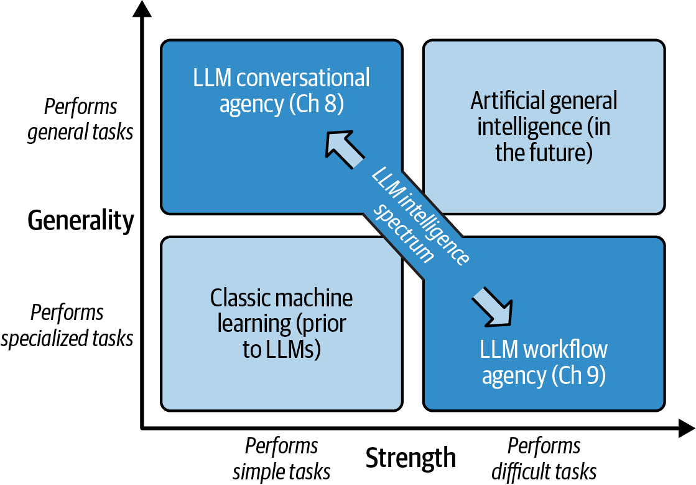
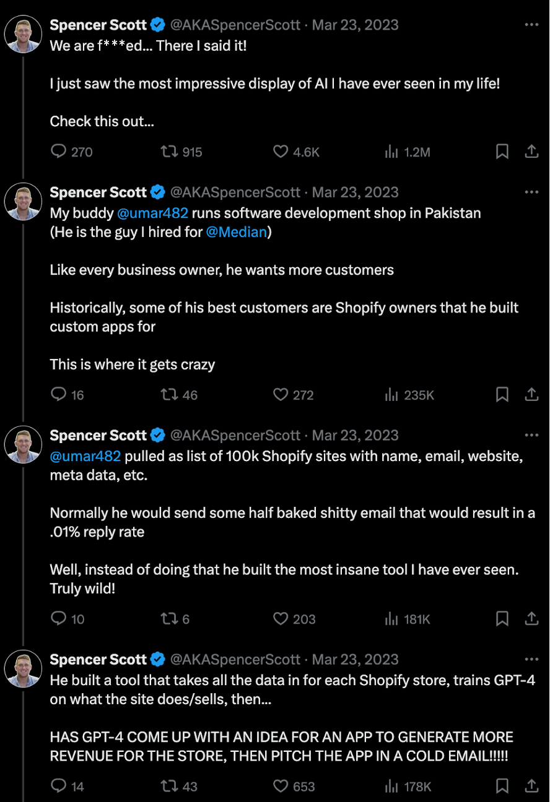
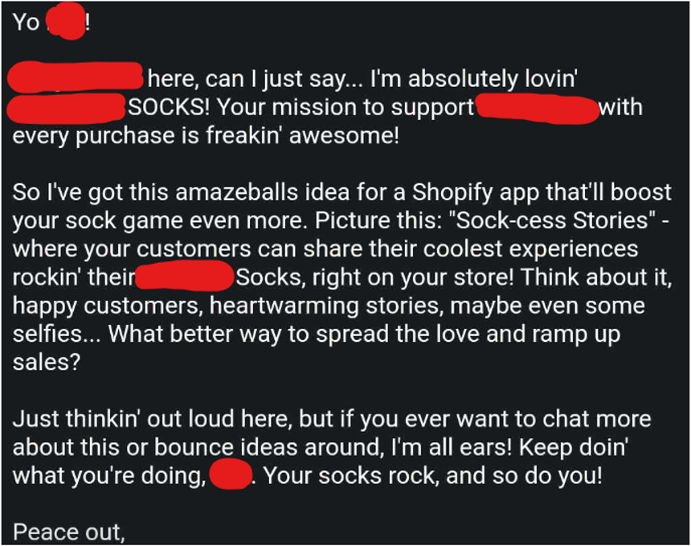
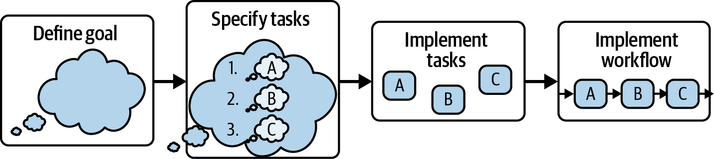
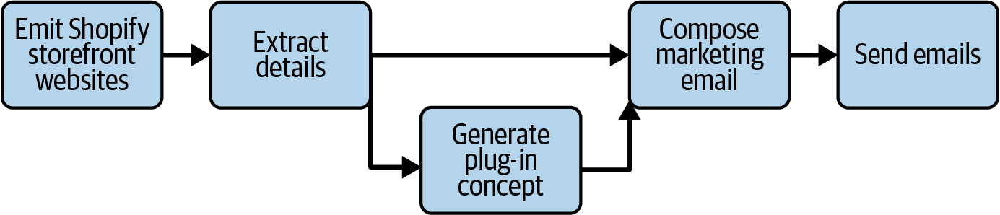
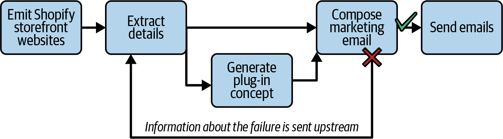
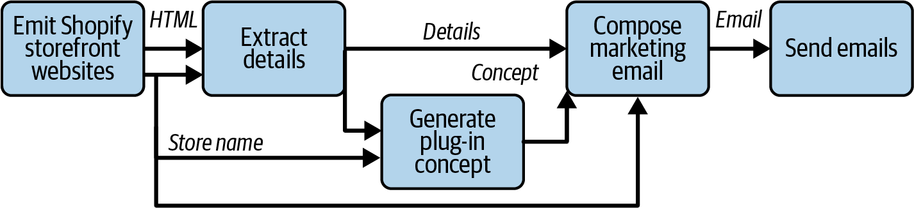

# فصل نهم: جریان‌های کاری مدل‌های زبانی بزرگ (LLM Workflows)

مدل‌های یادگیری ماشین کلاسیک معمولاً تنها در یک مهار خاص درون یک حوزه معین تبحر داشتند؛ وظایفی همچون تحلیل احساسات (Sentiment Analysis) در توییت‌ها، کشف تقلب (Fraud Detection) در تراکنش‌های کارت اعتباری، ترجمه متن از انگلیسی به فرانسوی و مواردی از این دست. اما با ظهور مدل‌های GPT، اکنون یک مدل واحد می‌تواند طیف فوق‌العاده متنوعی از وظایف را در به‌ظاهر هر حوزه‌ای به اجرا درآورد.

با وجود این، اگرچه کیفیت مدل‌ها از زمان عرضه GPT-2 پیشرفت خارق‌العاده‌ای داشته است، ما هنوز تا نقطه خلق هوش مصنوعی عمومی»«Artificial General Intelligence(یا AGI)— که گونه‌ای از هوش مصنوعی معادل یا فراتر از سطح شناخت انسانی است — فاصله بسیار زیادی داریم. زمانی که در نهایت موفق به ساخت AGI شویم، این سیستم توانایی جذب و هضم دانش، استدلال پیرامون آن، حل مسائل بدیع و پیچیده، و حتی تولید دانش جدید را خواهد داشت AGI.

از خلاقیتی شبه‌انسانی برای رویارویی با مسائل جهان واقعی در هر حوزه‌ای بهره خواهد گرفت.

در مقابل، مدل‌های زبانی بزرگ امروزی کاستی‌های مشهودی در استدلال و حل مسئله نشان می‌دهند و به‌ویژه در ریاضیات — که مؤلفه‌ای حیاتی برای اکتشافات علمی است — به‌شدت ضعیف هستند. متونی که این مدل‌ها تولید می‌کنند نشان‌دهنده درک گسترده‌ای از دانش موجود است، اما به‌ندرت مطلبی نوین ارائه می‌دهند؛ گذشته از این، خارج از چرخه آموزش، این‌ها توانایی یادگیری اطلاعات جدید را ندارند. بر اساس تعریف،مدل AGI در آینده از هر دو مؤلفه «قدرت» (توانایی حل مسائل پیچیده) و «عمومیت» (توانایی حل مسائل در هر حوزه‌ای) برخوردار خواهد بود؛ اما در مدل‌های زبانی بزرگ کنونی، به‌نظر می‌رسد نوعی مصالحه و بده‌بستان (Trade-off) میان این دو وجه از هوش وجود دارد (شکل ۱ - را ببینید۹.) شکل ۹: - تقابل و مصالحه میان عمومیت و توانمندی (قدرت) در مدل‌های زبانی۱ در یک انتهای این طیف، یک عامل محاوره‌ای قرار دارد؛ همان‌گونه که در فصل پیش معرفی شد. در حالت حداکثری، یک برنامه صرف مبتنی بر چت نظیر ChatGPT به‌شدت عمومی است؛ این سامانه پیرامون هر موضوعی که بخواهید با شما گفت‌وگو می‌کند، اما کارهای پیچیده را برایتان به سرانجام نمی‌رساند. اگر پیام سیستم (System Message) عامل را مختص یک دامنه خاص تنظیم نمایید و آن را به مجموعه‌ای از ابزارهای همان حوزه مجهز سازید، عامل از عمومیت کمتری برخوردار می‌شود، اما قابلیت آن برای به انجام رساندن وظایف در آن محدوده خاص افزایش می‌یابد. با این وجود، عامل‌های محاوره‌ای...

عامل‌ها هنوز هم در وظایفی بهترین عملکرد را دارند که در هر مرحله، تنها شامل یک یا دو گام باشند و با کمک کاربری همراه شوند که عملاً در تلاش است تا کاری را به سرانجام برساند.

در این فصل، در امتداد این طیف فراتر خواهیم رفت و بخشی از عمومیت را در ازای کسب توانایی انجام وظایف پیچیده‌تر فدا می‌کنیم (موازنه می‌کنیم). ما جریان‌های کاری مدل زبانی بزرگ (LLM workflows) را معرفی خواهیم کرد که از طریق متمرکز ساختن دامنه و ایجاد ساختاری صلب‌تر و ساختاریافته‌تر جهت هدایت تصمیم‌گیری‌های LLM، توانمندی آن را ارتقا می‌دهند. با جریان‌های کاری LLM، شما یک وظیفه بزرگ را به وظایف کوچک و کاملاً تعریف‌شده‌ای خرد می‌کنید که با دقت و صحت (fidelity) ب ال قابل اجرا هستند. یک فرایند سرپرست یا ناظر (supervisor process) — که ممکن است از یک LLM بهره ببرد یا نبرد — وظایف را هماهنگ کرده، کارها را توزیع می‌کند، نتایج را گردآوری نموده و در طول جریانی که با هدف دستیابی به نتیجه مطلوب طراحی شده است حرکت می‌کند. یک جریان کاری به درخواست‌های دلخواه و متفرقه کاربر رسیدگی نمی‌کند؛ بلکه برای انجام وظیفه‌ای معین و مشخص طراحی شده است و به همین دلیل، نسبت به یک عامل گفتگومحور (conversational agent) توانمندی بسیار بیشتری برای به پایان رساندن آن وظیفه خواهد داشت.

شکل ۹: - مدل‌های زبانی بزرگ هم قدرتمندتر و هم عمومی‌تر از یادگیری ماشین کلاسیک هستند، اما به هوش مصنوعی عام۱ (AGI) نرسیده‌اند؛ بلکه دادوستدی (trade-off) بین عمومیت و قدرت وجود دارد.

توجه داشته باشید که این فصل عمدت از ورود به بحث فریم‌ورک‌های موجود برای مدل‌های زبانی بزرگ — نظیر LangChain، Semantic Kernel، AutoGen، DSPy و سایرین — اجتناب می‌کند. این فصل به جای پرداختن به جزئیات فنی و ریز پیاده‌سازی (nitty-gritty)، بحث را در سطحی کالن و مفهومی حفظ می‌نماید. شما باید بتوانید رویکردهای ارائه‌شده در این بخش را فرا بگیرید و آن‌ها را در هر فریم‌ورکی که تمایل دارید، یا همان‌گونه که گاهی توصیه می‌کنیم، بدون هیچ فریم‌ورکی پیاده‌سازی کنید!

## آیا یک عامل گفتگومحور کفایت می‌کند؟

پیش از ورود عمیق به عاملی مبتنی بر جریان کاری (workflow agency)، بیایید بررسی کنیم در صورتی که برای انجام وظایف به‌مراتب پیچیده‌تر، اقدام به استفاده از عاملیت گفتگومحور (conversational agency) نمایید، چه رخ خواهد داد. ما در این بخش مثالی را معرفی می‌کنیم و هنگامی که نشان دادیم کار چگونه از مدار خود خارج شده و با شکست مواجه می‌شود (اصطلاح چرخ‌ها از حرکت بازمی‌ایستند)، در تمام طول مابقی فصل مکرر به این مثال بازخواهیم گشت.

فرض کنید در یک شرکت تخصصی کوچک توسعه نرم‌افزار (boutique software development firm) کار می‌کنید که برای ویترین فروشگاه‌های پلتفرم شاپفای (Shopify storefronts) پلاگین می‌سازد. اوضاع کسب‌وکار کساد و راکد است؛ بنابراین این ایده جنون‌آمیز به سرتان می‌زند که یک برنامه کاربردی مبتنی بر LLM بسازید که ایده‌های جدیدی برای پلاگین تولید کند و آن‌ها را به مالکان فروشگاه‌ها تبلیغ و پیشنهاد نماید. چنین کاری را ممکن است به شکل زیر پیش ببرید:.1 تولید فهرستی از فروشگاه‌های محبوب شاپفای و واکشی کدهای HTML وب‌سایت آن‌ها..2 برای هر فروشگاه، استخراج جزئیات — محصوالت ارائه‌شده، برندسازی، سبک بصری، ارزش‌ها و غیره..3 بررسی هر فروشگاه و ارائه ایده‌ای برای یک پلاگین که به نفع کسب‌وکار آن باشد..4 تولید ایمیل‌های بازاریابی جهت تبلیغ مفهوم پلاگین به مالکان هر فروشگاه..5 ارسال ایمیل‌ها.

ایده بسیار دیوانه‌وار و عجیبی به نظر می‌رسد، این‌طور نیست؟ شما عملاً در حال ارسال انبوه ایمیل برای محصوالت نرم‌افزاری هستید که هنوز وجود خارجی ندارند! آیا یک برنامه کاربردی مبتنی بر LLM واقع می‌تواند چنین کاری را به سرانجام برساند؟ آیا کیفیت کار به اندازه‌ای خوب خواهد بود که افراد حتی در پاسخ به شما ایمیل بزنند؟

پاسخ این پرسش، یک «بله» قاطع و قطعی است. در اوایل سال، هنگامی که سراسر جهان تازه در حال دست‌وپنجه۲۰۲۳ نرم کردن با قدرت جدید و پتانسیل‌های برنامه‌های مبتنی بر LLM بود، یک توسعه‌دهنده کارآفرین دقیقاً همین کار را انجام داد (شکل ۹ - را ببینید۲.) این رشته‌پیام در ادامه ماجراهای واقع تحسین‌برانگیزی را آشکار ساخت — هزاران ایمیل بازاریابی که تنها با فشردن یک دکمه ارسال شدند، ایده‌های محصو حقیقتاً خالقانه، و برخی پاسخ‌های مشتاقانه از سوی مالکان واقعی وب‌سایت‌ها. بهترین ایده تولیدشده توسط GPT-4 برای یک فروشگاه جوراب‌فروشی بود؛ صفحه‌ای وب با عنوان «داستان‌های جوراب‌موفقیت» Sock-cess Stories(— جناسی هوشمندانه میان واژگان Sock به معنای جوراب و Success به معنای موفقیت؛ شکل ۹ - را ببینید). باید اعتراف کرد که این یک ایده و نطق فروش فوق‌العاده۳ (sales pitch) است.

شکل ۹: - اسپنسر نوآوری شگفت‌انگیز دوستش عمر۲ (Umar) را در زمینه LLM معرفی می‌کند.

شکل ۹: - یک ایمیل تبلیغاتی تولیدشده توسط مدل زبانی بزرگ که مرا به‌شدت شگفت‌زده کرد۳
## آیا یک عامل گفتگوگر کفایت می‌کند؟

اما آیا می‌توان با یک عامل گفتگوگر (conversational agent) به چنین نتیجه‌ای دست یافت؟ بیایید با ساده‌ترین حالت ممکن شروع کنیم: یک عامل گفتگوگر بدون هیچ‌گونه ابزار و با این پیام سیستمی (system message) با پایا باز:

«شما یک دستیار مفید هستید. شما می‌توانید هر کاری انجام دهید — فقط کافی است باور داشته باشید.» بر روی طیف عمومیت تا قدرت» که در مقدمه ترسیم شد، این عامل در ب الترین سطح عمومیت و در عین حال به‌شدت ضعیف قرار دارد.«برای شروع وظیفه شپیفای (Shopify)، می‌توانید به‌سادگی فهرست دستورالعمل‌ها را در قالب یک پیام کاربری (user message) ارسال کنید؛ پیامی شبیه به این مضمون: «تعدادی از ویترین‌های فروشگاهی شپیفای را اسکرپ کن، برای هر یک افزونه‌های جدیدی طراحی کن، و سپس برای هر ویترین یک ایمیل تبلیغاتی درباره این ایده بفرست.» نتیجه کار — که در اینجا با آوردن آن وقت شما را نمی‌گیرم — چندان مفید نخواهد بود. در نهایت، دستیار به شما می‌گوید که قادر به جستجو در وب، مرور وب‌سایت‌های خاص یا ارسال ایمیل نیست. در عوض، یک برنامه فرضی از کارهایی که خودتان باید انجام دهید تولید می‌کند که عملاً چیزی فراتر از بسط و تشریح همان دستورالعمل‌های اولیه شما نیست.

کاملاً واضح است که این رویکرد به‌هیچ‌وجه عملی نخواهد بود؛ اما می‌توانید ابزارهایی در اختیار عامل خود بگذارید تا به آن در دستیابی به نتایج بهتر کمک کند. مشخص می‌توانید همان ابزارهایی را که درخواست کرده بود به آن بدهید:

search_web، browse_site و. send_email این رویکرد تا حدی از حالت عام خارج می‌شود، چرا که دامنه فعالیت را از «دقیقاً هر کاری» به «چیزی مرتبط با وب» محدود کرده‌اید، اما قدرتمندتر است زیرا عامل اکنون می‌تواند با دنیای واقعی تعامل داشته باشد.

اگر همان درخواست را با این عامل گفتگوگ مجهزتر اجرا کنید، بار دیگر ناامید خواهید شد. رویکرد آن برای جمع‌آوری فروشگاه‌های نامزد بسیار ابتدایی است؛ یک جستجوی وبی ساده برای عبارت "best Shopify storefronts 2024" انجام می‌دهد، چند افزونه را با توضیحاتی بسیار مختصر و سطحی معرفی می‌کند، و ایمیلی تولید می‌کند که چیزی بیش از یکً نامه اداری قالبی و کلیشه‌ای نیست که حتی عبارت [your_name] را به صورت تحت‌اللفظی در خود دارد؛ و مگر اینکه واقع خوش‌شانس باشید، وگرنه تمام کاری که ابزار send_email انجام خواهد داد، ارسال هرزنامه به مشتریان بالقوه با رویکرد بازاریابی بسیار ضعیف خواهد بود.

اما بیایید فعًال دست از تلاش نکشیم؛ بیایید عامل گفتگوگر را بیشتر به سوی قدرت سوق دهیم و از عمومیت آن بکاهیم.

به جای اینکه از عامل بخواهید این کار را برای شما انجام دهد، دستورالعمل‌ها را به درون پیام سیستمی منتقل کنید — بدین ترتیب عاملی با دامنه‌ای کاملاً تخصصی و محدود ایجاد خواهید کرد. دقت کنید که در پیام سیستمی خود جزئیات بسیار دقیقی ارائه دهید که تمامی جوانب مشکل‌ساز پیش‌گفته را پوشش دهد. همچنین می‌توانید ابزارهای مفیدتری متناسب با این کار خاص، هر یک همراه با توضیحات و جزئیات مشخص، در اختیار عامل قرار دهید. اما با انجام این کار، ناگزیر به بده‌بستان و مصالحه (trade-offs) هستید. ترکیب پیام سیستمی و ابزارها موجب حجیم‌تر و پیچیده‌تر شدن پرامپت پایه (base prompt) خواهد شد، و این موضوع به احتمال زیاد با طولانی‌تر شدن وظیفه، موجب سردرگمی و حواس‌پرتی عامل می‌شود.

در واقعیت، اوضاع حتی از این هم وخیم‌تر است. عامل گفتگوگر سازوکار ساده‌ای برای پردازش واحدهای کاری (units of work) فراهم نمی‌آورد. سرازیر کردن یک‌باره تمامی آن‌ها فاجعه به بار خواهد آورد، و انجام دادن دانه‌به‌دانه آن‌ها نیز مستلزم راه‌اندازی یک صف (queue) از سوی شما خواهد بود — بنابراین از همین ابتدا مشخص است که باید سیستمی پیچیده‌تر از یک عامل گفتگوگر بسازید. علاوه بر این، از آنجا که عامل در چگونگی به سرانجام رساندن کار تا حدی آزادی عمل دارد، هنگام بروز خطا برای اصلاح آن چه خواهید کرد؟ پیام سیستمی اساس صرف یک پیشنهاد قوی تلقی می‌شود و تضمینی فراتر از آن وجود ندارد.

این نتایج منفی نشان‌دهنده نیاز مبرم به ساختارمندی بیشتر هستند. عامل‌های گفتگوگر برای چنین جریان‌های کاری پیچیده‌ای مناسب نیستند. در عوض، هر گام از فرایند این عامل باید مجزا شده و به عنوان یک وظیفه تخصصی تعریف شود، و مجموعه کامل این وظایف باید در قالب یک گردش‌کار (workflow) در کنار یکدیگر قرار گیرند. در ادامه این فصل، خواهیم دید که چگونه گردش‌کارها اهداف ما را به شکل بسیار بهتری محقق می‌سازند.

##‌گردش کارهای پایه مدل‌های زبانی بزرگ (Basic LLM Workflows)

در نیمه دوم این فصل، به بررسی گردش‌کاری خواهیم پرداخت که در آن پیش‌برنده وظایف یک مدل زبانی بزرگ (LLM) است. در این بخش، الگوی رایج‌تر گردش‌کارهای LLM را تشریح خواهیم کرد؛ الگویی که در آن هر وظیفه احتماًال از یک مدل زبانی بزرگ استفاده می‌کند، اما گردش‌کار کالن صرف یک گردش‌کار سنتی و سرراست و بدون تشریفات اضافه (no-frills) است که از طریق انتقال اقالم کاری از هر وظیفه به وظایف پایین‌دستی متصل به آن به پیش می‌رود.

همان‌طور که در شکل ۹ - نشان داده شده است، مراحل لازم برای ساخت یک گردش‌کار پایه به شرح زیر است۴:.1 تعریف هدف:(Define goal) هدف گردش‌کار را مشخص کنید. خروجی مطلوب یا تغییر مورد نظری که گردش‌کار محقق خواهد کرد چیست؟.2 تعیین مشخصات وظایف:(Specify tasks) گردش‌کار را به مجموعه‌ای از وظایف تجزیه کنید که در صورت اجرا با ترتیبی مناسب، هدف شما را محقق سازند. برای وظایف مبتنی بر LLM، ابزارهایی را که هر وظیفه نیاز خواهد داشت مشخص کنید. همچنین ورودی‌ها و خروجی‌های هر وظیفه را تعیین نمایید..3 پیاده‌سازی وظایف:(Implement tasks) وظایف را طبق مشخصات تعریف‌شده بسازید. اطمینان حاصل کنید که ورودی و خروجی به وضوح تعریف شده‌اند. مطمئن شوید که هر وظیفه به صورت ایزوله و مستقل به درستی کار می‌کند..4 پیاده‌سازی گردش‌کار:(Implement workflow) وظایف را به یکدیگر متصل کرده و یک گردش‌کار کامل تشکیل دهید.

در صورت لزوم، وظایف را بازتنظیم کنید تا اطمینان حاصل شود که در بستر گردش‌کار کلی به درستی عمل می‌کنند..5 بهینه‌سازی گردش‌کار:(Optimize workflow) وظایف را برای بهبود کیفیت، کارایی و هزینه بهینه‌سازی کنید.

شکل ۹ - گردش‌کار برای ساخت گردش‌کارها … طنز فراساختاری (متا) واقع جذاب است۴!:

جذابیت فراوان گردش‌کار، ماژوالر بودن آن است. از آنجا که ما یک مسئله پیچیده را به اجزای سازنده‌اش خرد می‌کنیم،علت ساخت آن آسان‌تر می‌شود؛ و هنگامی که خطایی رخ دهد، تحلیل منطقی و تفکیک منشأ مشکل به‌مراتب ساده‌تر خواهد بود.

بیایید به سامانه تبلیغ‌کننده افزونه شپیفای بازگردیم و مراحلی را که برای ساخت یک گردش‌کار موفق مبتنی بر LLM لازم است مرور کنیم. ما پیش از این هدف را تعریف کرده‌ایم: ساخت یک برنامه کاربردی مبتنی بر LLM که ایده‌هایی برای افزونه‌ها خلق کرده و آن‌ها را به مالکان فروشگاه‌ها تبلیغ کند. در بخش بعدی، درباره مراحل و۲، یعنی تعیین مشخصات و پیاده‌سازی۳ وظایف صحبت خواهیم کرد.

وظایف (Tasks) ● گام دوم در ایجاد یک گردش‌کار، تعیین مشخصات وظایف است. بیایید دقیقاً از همان وظایفی استفاده کنیم که در هنگام معرفی مثال شپیفای مطرح کردیم:.1 ایجاد فهرستی از ویترین‌های فروشگاهی محبوب شپیفای و دریافت کدهای HTML وب‌سایت آن‌ها..2 برای هر فروشگاه، استخراج جزئیات — محصوالت ارائه‌شده، برندسازی، سبک بصری، ارزش‌ها و غیره..3 بررسی هر فروشگاه و ارائه ایده افزونه‌ای که برای کسب‌وکار آن‌ها سودمند باشد..4 تولید ایمیل‌های بازاریابی جهت تبلیغ ایده افزونه به هر یک از مالکان فروشگاه‌ها..5 ارسال ایمیل‌ها.

حال بیایید به سراغ گام برویم — پیاده‌سازی وظایف. کلمه «وظایف» اصطلاحی آشنا است — وظایف زیرمراحل دستیابی به۳ هدف کلی هستند. وظایف ممکن است کاملاً الگوریتمی بوده و با استفاده از روش‌های مرسوم مهندسی نرم‌افزار پیاده‌سازی شوند، یا اینکه می‌توان آن‌ها را با استفاده از مدل‌های زبانی بزرگ پیاده‌سازی کرد.

در گردش‌کار تکمیل‌شده، وظایف به گونه‌ای به یکدیگر متصل خواهند شد که خروجی یک وظیفه، ورودی وظیفه بعدی را تأمین کند. بنابراین، ورودی و خروجی هر وظیفه باید کاملاً مشخص و شفاف تعریف شود. چه اطلاعاتی برای یک وظیفه لازم است تا بتواند به...... هدف آن چیست؟ چه اطلاعاتی را به‌عنوان خروجی ارائه خواهد داد؟ آیا ورودی‌ها و خروجی‌ها داده‌های ساختاریافته هستند یا متن آزاد؟ و در صورتی که این مؤلفه‌ها ساختاریافته باشند، طرحواره (schema) آن‌ها چیست؟

بیایید به تسک تولید ایمیل در مثال Shopify نگاهی بیندازیم. ورودی باید ایده‌ای برای یک پلاگین باشد، اما لازم است آن را دقیق‌تر و مشخص‌تر سازید. بیایید از طرحواره تعریف‌شده در جدول ۹ - استفاده کنیم۱.

جدول ۹. - تعاریف فیلدها و مثال‌های توصیف‌کننده یک پلاگین۱ Shopify که به‌عنوان ورودی تسک تولید ایمیل استفاده می‌شود فیلد نوع داده محتوا مثال (Example) ((Content)(Datatype)Field) Text name نام پلاگین Sock-cess Stories Text concept ایده اولیه و دیواری از داستان‌ها و سلفی‌ها همراه با محصوالت فروشگاه اصلی (A wall of stories and selfies with store merchandise) Text rationale دلیل مناسب جهت افزایش تعامل و ارتقای یک تصویر صمیمانه از برند بودن این ایده (To drive engagement and promote a warm brand image) Uuid store_id برای بازیابی 550e8400-e29b-41d4-a716-446655440000 جزئیات مربوط به فروشگاه استفاده می‌شود به همین ترتیب، خروجی تسک ایمیل می‌تواند از طرحواره تعریف‌شده در جدول ۹ - استفاده کند۲.

جدول ۹. - تعاریف فیلدها و مثال‌های توصیف‌کننده ایمیلی که از خروجی تسک تولید ایمیل استفاده می‌کند۲ نوع داده محتوا فیلد (Field) مثال (Example) ((Content)Datatype) Text subject_line موضوع معرفی Sock-cess Stories برای فروشگاه شما ایمیل (Introducing Sock-cess Stories for your storefront.) Text body ایده اصلی فروشگاه جوراب شما فوق‌العاده است؛ ما می‌توانیم در کنار یکدیگر آن را بهتر کنیم sock store is amazing; we can make it better together.) بر مشخص کردن ورودی و خروجی، باید تصوری نسبت شفاف از چگونگی انجام تسک داشته باشید. به عنوان مثال،علاوه موضوع صرف این نیست که تسک ایمیل باید محتوایی برای ارسال به مالکان فروشگاه تولید کند، بلکه این محتوا باید ماهیتی خاص داشته باشد: ارائه‌ای جذاب و سرگرم‌کننده از کانسپت که بر اساس ارزش‌ها و مضامین بازتاب‌یافته در وب‌سایت فروشگاه طراحی شده تا توجه مالک را به خود جلب نماید.

بنابراین، تسک تولید ایمیل هم به محتوای استخراج‌شده از صفحه وب و هم به پرامپت‌نویسی دقیقاً برای هدایت (condition) مدل به تولید پاسخ از نوعی خاص نیاز خواهد داشت. «چگونگی» (how) اجرای تسک لازم نیست به اندازه طرحواره ورودی / خروجی خشک و غیرقابل‌انعطاف تعیین شود، زیرا تغییر دادن محتوای یک تسک بسیار آسان‌تر از تغییر دادن رابط کاربری (interface) آن خواهد بود. با این حال، این فرایند باید به اندازه کافی خوب تبیین گردد تا مطمئن شوید با یک تسک منطقی و عملیاتی مواجه هستید. در غیر این صورت، با آغاز ساخت تسک ممکن است متوجه شوید که ناچارید به نقطه صفر بازگردید و به بازآرایی تسک‌ها یا طراحی مجدداً اینترفیس‌ها بپردازید.

## پیاده‌سازی‌تسک های مبتنی بر مدل‌های زبانی بزرگ (LLM)

اکنون شما جریان کاری (workflow) خود را تعریف کرده‌اید و آن را به تسک‌های خرد، ساختاریافته و دارای عملکردی روشن با ورودی و خروجی کاملاً مشخص تفکیک نموده‌اید. حال زمان آغاز پیاده‌سازی تسک‌ها فرا رسیده است. آیا تسک شما بدون نیاز به LLM قابل پیاده‌سازی است؟ اگر چنین باشد فوق‌العاده خواهد بود؛ چرا که LLMها در مقایسه با نرم‌افزارهای سنتی هزینه‌بر، ُکند، دارای ماهیت غیرقطعی (nondeterministic) و با اتکاپذیری کمتری هستند. اما از آنجا که تا این بخش از کتاب توسعه کاربردهای مبتنی بر LLM پیش آمده‌اید، احتماًال اکثر تسک‌های شما استفاده گسترده‌ای از این مدل‌ها خواهند داشت. بر همین اساس، در این بخش مروری جامع بر شیوه پیاده‌سازی چنین تسک‌هایی ارائه خواهیم داد.

رویکرد پرامپت قالب‌بندی‌شده (Templated prompt approach) ● یک رویکرد این است که صرف یک قالب پرامپت (prompt template) سفارشی‌سازی‌شده برای تسک مدنظر ایجاد کنید.

این دقیقاً همان رویکردی است که فریم‌ورک LangChain بر آن تأکید دارد؛ هر «حلقه» در زنجیره (chain)، یک قالب پرامپت ساده است که متغیرهای تعریف‌نشده را بر اساس داده‌های ورودی پر کرده و سپس متن تکمیل‌شده (completion) تولیدی توسط مدل را به منظور استخراج خروجی‌ها تجزیه (parse) می‌کند.

هنگام طراحی یک قالب پرامپت، تمامی مفاهیمی را که تا این بخش از کتاب آموزش دیده‌اید به کار خواهید گرفت: گردآوری اطلاعات مرتبط با تسک، رتبه‌بندی داده‌ها، پالایش و هرس کردن آن‌ها برای تناسب با بافتار پرامپت (prompt context)، و در نهایت سرهم‌بندی سندی که متن تکمیل‌شده آن، هدف تعیین‌شده را محقق سازد. برای تسک تولید ایمیل در Shopify، هدف نگارش یک ایمیل بازاریابی است که ایده پلاگین را متناسب با وب‌سایت مالک فروشگاه به نمایش بگذارد. بافتار انتخابی باید حاوی اطلاعات تفصیلی درباره وب‌سایت آن‌ها و توصیفی کامل از مفهوم پلاگین باشد. اگر با یک مدل تکمیل متن (completion model) کار می‌کنید، همان‌طور که در جدول ۹ - نشان داده شده است، پرامپت ماهیت تسک را شرح داده۳، بافتار را معرفی می‌کند و در ادامه از مدل می‌خواهد که ایمیل را تولید نماید. توجه داشته باشید که در مثال جدول، نام شرکت شما JivePlug-ins است، متغیرهای ورودی درون قالب درون‌یابی (interpolate) می‌شوند و از متن تکمیل‌شده به عنوان خروجی استفاده می‌شود.

جدول ۹. - یک قالب پرامپت برای یک مدل تکمیل متن۳ (Completion Model)
### بخش محتوا

پیشوند (Prefix) Research and Proposal Document # JivePlug-ins creates delightful and profitable Shopify plug-ins.

This document presents research about {storefront.name}, our plug-in concept "{plugin.name}", and an email sent to the store owner {storefront.owner_name}.

Store Website Details ## {storefront.details} Plug-in Concept ## {plugin.description} Proposal to Storefront Owner ## Dear {storefront.owner_name}, پسوند (Suffix) We hope to hear from you soon, JivePlug-ins این صرف یک نقطه آغازین است و قالب نهایی محسوب نمی‌شود. پس از چند بار اجرای این پرامپت برای ارزیابی ماهیت متن‌های تولیدشده، احتماًال دستورالعمل‌های موجود در قالب را در مورد نحوه دقیقاً نگارش ایمیل شفاف‌تر خواهید کرد؛ به عنوان مثال مشخص می‌کنید که متن باید پرانرژی و مثبت باشد، از مالک فروشگاه تمجید کند و مواردی از این قبیل. همچنین ممکن است متون پایه و استاندارد (boilerplate text) توصیفی‌تری را پیرامون جزئیات فروشگاه و توصیف پلاگین بگنجانید تا مدل درک عمیق‌تری از متنی که مطالعه می‌کند به دست آورد.

نکته حیاتی این است که هر تسک باید متن تکمیل‌شده را پس‌پردازش (post-process) کرده و مقادیر خروجی مورد نیاز تسک‌های پایین‌دستی (downstream tasks) را استخراج کند. در پرامپت جدول ۹ -، این امر با قرار دادن عبارت۳ Dear {storefront.owner_name}, در پیشوند و عبارت We hope to hear from you soon, در پسوند تسهیل شده است. با این ساختاربندی، محتوای متن تکمیل‌شده دقیقاً همان پیامی خواهد بود که قصد ارسال آن به مشتری بالقوه را دارید و هیچ عبارت اضافه‌ای تولید نخواهد شد.

رویکرد مبتنی بر ابزار (Tool-based approach) ● در بسیاری از موارد، جریان‌های کاری شما دارای تسک‌هایی خواهند بود که وظیفه استخراج محتوای ساختاریافته از داده‌های ورودی را بر عهده دارند. به عنوان مثال، تسکی که اطلاعات رستوران‌ها را استخراج (scrape) می‌کند، ممکن است ساختار HTML صفحه رستوران را دریافت کرده و سپس نام، آدرس و شماره تلفن آن را استخراج نماید. مدل‌هایی که از قابلیت فراخوانی ابزار (tool-calling) پشتیبانی می‌کنند، انجام این تسک را بسیار ساده می‌سازند. کافی است ابزاری تعریف کنید که ساختار مدنظر شما برای استخراج را به عنوان آرگومان بپذیرد، سپس پرامپت را طوری تنظیم کنید که این ابزار فراخوانی شود.

قالبی که در جدول ۹ - نشان داده شده است، این هدف را برآورده می‌کند۴.

جدول ۹ - مثالی از به‌کارگیری رویکرد مبتنی بر ابزار برای گردآوری محتوای ساختاریافته از داده‌های ورودی بدون ساختار (فرم‌آزاد۴).

مؤلفه پیکربندی پیام سیستم (System) Your job is to extract content about restaurants and save them to the database.

ابزار (Tool) { "type": "function", { "function":

"name": "saveRestaurantDataToDatabase", "description": "Saves restaurant information to the database.", { "parameters":

"type": "object", { "properties":

{ "name":

"type": "string", "description": "The name of the restaurant", }, { "address":

"type": "string", "description": "The address of the restaurant", }, { "phoneNumber":

"type": "string", "description": "The phone number of the restaurant", }, }, "required": ["name"], }, }, } User The following text represents the HTML of a restaurant website. Can you extract the name, address, and phone number of the restaurant and save it to the database? {restaurant_html_content} اگر از مدل‌های شرکت OpenAI استفاده می‌کنید، حتی می‌توانید با بهره‌گیری از پارامتر tool_choice صریح مشخص کنید که خروجی مدل ملزم به اجرای آن ابزار باشد:

{"type": "function", "function": {"name": "saveRestaurantDataToDatabase"}} با اتخاذ این رویکرد، مدل تابع saveRestaurantDataToDatabase را به همراه اطلاعات ساختاریافته مدنظر شما فراخوانی خواهد کرد. در اینجا هیچ اهمیتی ندارد که پایگاه داده واقعی اصًال وجود خارجی دارد یا خیر؛ بلکه شما صرف در تلاش هستید تا مدل را متقاعد کنید اطلاعاتی را که از کدهای HTML خوانده است، ارسال کند. اخیر شرکت OpenAI امکان اجبار خروجی‌های ساختاریافته (Structured Outputs) را در فراخوانی توابع (Function Calls) فراهم کرده است. این قابلیت تضمین می‌کند که خروجی پارس‌شده دقیقاً منطبق بر ساختاری باشد که به آن نیاز دارید. اطلاعاتی که در قالب فراخوانی ابزار دریافت می‌کنید، سپس می‌توانند به یک وظیفه یا تسک پایین‌دستی (Downstream Task) منتقل شوند.

چنانچه در اجرای این رویکرد با مشکل مواجه شدید، مسئله عموم ناشی از دو منبع است. نخست آنکه شاید استخراج محتوای ساختاریافته از اسنادی که در حال پردازش آن‌ها هستید، ذات دشوار باشد. آیا خودتان تلاش کرده‌اید این کار را به دستی انجام دهید؟ اگر یک انسان نتواند از پس انجام آن برآید، مدل زبانی نیز درمانده خواهد بود. برای حل این مشکل،صورت پرامپت خود را مجدداً مطالعه کرده و آن را بازنویسی و تمیز کنید تا فهم آن ساده‌تر شود.

منبع احتمالی دیگر بروز مشکل، ساختاری است که قصد استخراج آن را دارید؛ این ساختار ممکن است بیش از اندازه پیچیده باشد. آیا ساختار مربوطه کلیدهای بسیار زیادی دارد؟ آیا دارای اشیاء تودرتو (Nested Objects) یا آرایه‌ها و لیست‌ها است؟ آیا ممکن است برخی از فیلدها تهی (null) یا خالی باشند؟ در چنین شرایطی، شکستن ساختار به اجزای کوچک‌تر را مدنظر قرار دهید تا بتوانید هر بار بخش کوچکی از آن را حل‌وفصل کنید. مزیت مضاعف این روش آن است که هنگام تمرکز بر بخش‌های کوچک‌تر اطلاعات، این فرصت را نیز خواهید داشت که دستورالعمل‌های اختصاصی‌تر و دقیق‌تری برای استخراج آن اجزا ارائه نمایید. این کار قطع نتایج خروجی شما را ارتقا خواهد داد.

## افزودن پیچیدگی و پختگی بیشتر به وظایف (Tasks)

بنابراین، شما نخستین پیش‌نویس از تسک خود را پیاده‌سازی کرده‌اید، اما به نتایج باکیفیتی که انتظارش را داشتید نرسیده‌اید. فعًال نگران نباشید؛ اکنون زمان آن است که گامی به عقب بردارید و اتخاذ رویکردی پیشرفته‌تر را در مهندسی پرامپت خود در نظر بگیرید. رویکردهای مهندسی پرامپت زیر را بررسی کنید:

در فصل، به بررسی استدلال زنجیره افکار۸ (Chain-of-Thought) و الگوی ReAct پرداختیم. هر دوی این تکنیک‌های مهندسی پرامپت، مدل را هدایت می‌کنند تا قبل از اقدام به استفاده از ابزارها و پیش از رسیدن به پاسخ نهایی، ابتدا افکار خود را درباره مسئله با صدای بلند حالجی و بیان کند. چنانچه وظایف مدل زبانی بزرگ شما هنگام انجام کار، تأمل و استدلال کافی از خود نشان نمی‌دهند، می‌توانید صرف با افزودن عبارت «بیایید گام‌به‌گام فکر کنیم»)"let’s think step-by-step"(در نقطه‌ای از پرامپت و پیش از درخواست پاسخ نهایی و صیقل‌خورده، نتایج را به‌طرز چشمگیری بهبود بخشید.

بر این، اگر مدل‌ها بدون برنامه‌ریزی اولیه برای نحوه حل مسئله خیلی سریع به سراغ فراخوانی توابع می‌روند،علاوه درخواستی را به مدل ارسال کنید که در آن فراخوانی توابع غیرفعال شده باشد. این کار به مدل فرصت می‌دهد تا قبل از اقدام در نوبت بعدی، درباره مسئله استدلال کند. در API شرکت OpenAI، می‌توانید با تنظیم مقدار tool_choice بر روی "none" این هدف را محقق سازید. با این حال، حتم دقت کنید که مشخصات ابزارها (Tool Specification) همچنان در درخواست گنجانده شده باشد؛ زیرا هدف این است که مدل با این پیش‌فرض استدلال کند که در درخواست بعدی به ابزارهای تعیین‌شده دسترسی خواهد داشت. اگر از مدل‌های Claude شرکت Anthropic استفاده می‌کنید، استدلال زنجیره افکار در مدل Opus به‌صورت پیش‌فرض انجام می‌پذیرد؛ در حالی که مدل‌های Sonnet و Haiku تنها در صورت دریافت پرامپت مشخص، از استدلال زنجیره افکار استفاده خواهند کرد.

یک مشکل متداول در وظایف مبتنی بر مدل‌های زبانی بزرگ این است که آن‌ها کار خود را با اعتماد‌به‌نفس تمام به پایان می‌رسانند و خروجی را تحویل می‌دهند، اما آن خروجی نادرست است. ممکن است فرمت‌بندی خروجی اشتباه باشد، یا اینکه در عمل به سوال پاسخ نداده باشد. چنانچه خروجی یک قطعه کد باشد، ممکن است حاوی باگ یا حتی خطاهای نحوی (Syntax Errors) باشد. اولین اقدامی که باید امتحان کنید، منسجم‌تر کردن و اصلاح متن پرامپت است تا اطمینان حاصل شود نیازمندی‌های شما شفاف و دقیقاً تعریف شده‌اند. آیا خود شما به عنوان یک انسان، با خواندن آن پرامپت متوجه می‌شوید که چه کاری باید انجام شود؟

اما اگر اجرای وظیفه کماکان با شکست مواجه می‌شود، ممکن است نیاز باشد مکانیزم «خوداصلاحی» (Self-Correction) را به کار ببندید. یکی از تکنیک‌ها برای نیل به این هدف، روش رفلکشن (Reflexion) است که در آن از هر شیوه مهندسی پرامپتی که برای انجام تسک مناسب می‌دانید، استفاده می‌کنید (مقاله مرجع، از روش ReAct به عنوان مثال بهره برده است). سپس در لایه نرم‌افزاری کاربرد، خروجی را مورد تجزیه‌وتحلیل قرار می‌دهید تا مشخص شود آیا الزامات شما را برآورده می‌کند یا خیر.

تحلیل می‌تواند یک ارزیابی سریع برای صحت قالب‌بندی و فرمت باشد. چنانچه تسک شما کد نرم‌افزاری تولید می‌کند،این می‌توانید کد را کامپایل کرده و تست‌های واحد (Unit Tests) را علیه آن به اجرا درآورید. این تحلیل حتی می‌تواند از یک مدل زبانی دیگر بخواهد که خروجی را بررسی کند (که اصطلاح به آن «مدل زبانی در نقش داور» یا LLM-as-judge می‌گویند). در هر حالت، فرایند تحلیل یک گزارش تولید خواهد کرد. چنانچه گزارش حاکی از آن باشد که خروجی تسک نیازهای شما را برآورده کرده است، کار به پایان رسیده است.

اما دقیقاً در همین نقطه است که رفلکشن وارد عمل می‌شود: اگر گزارش مشخص کند که خروجی به هر شکلی ناکافی یا ناقص است، وارد یک زیروظیفه (Subtask) می‌شوید تا مشکل را حل کنید. برای این زیروظیفه، پرامپت جدیدی طراحی می‌کنید که شامل الزامات اولیه تسک، تلاش پیشین مدل، و محتوای ارزیابی پس از اجرا است. سرانجام، پرامپت با درخواستی تازه به پایان می‌رسد که در آن از مدل خواسته می‌شود از اشتباهات گذشته خود بیاموزد و مجدداً برای انجام وظیفه تلاش کند.

هشدار در خصوص هزینه‌های پردازشی: ِاعمال روش رفلکشن (Reflexion) برای یک یا چند مرتبه، شانس شما را برای دستیابی به نتایج مطلوب از تسک افزایش می‌دهد؛ اما توجه داشته باشید که این امر به بهای مصرف منابع محاسباتی به‌مراتب بیشتر تمام خواهد شد.

در نهایت، یک رویکرد تجربی‌تر برای وظایف پیچیده و با پایان باز (Open-ended)، تکیه بر عامل‌های گفتگوگر (Conversational Agents) معرفی‌شده در فصل قبل است. یک عامل گفتگوگر بسازید که در تسک مورد نظرتان نقش یک «متخصص» را ایفا کند و به ابزارهای مورد نیازش برای حل مسئله مجهز شده باشد. طبیعت این عامل به خودی خود کاری انجام نخواهد داد؛ زیرا عامل‌های گفتگوگر برای تعامل محاوره‌ای با انسان‌ها توسعه یافته‌اند. از این رو، عامل دیگری می‌سازید؛

یعنی یک «پروکسی کاربر» (User Proxy) که پرامپت آن برای همکاری با عامل متخصص در جهت حل مسئله تنظیم شده است. اگر مایل به پیاده‌سازی این رویکرد هستید، نگاهی به کتابخانه AutoGen بیندازید که برای ساخت این الگو به کار می‌رود. این تنها یک الگوی بسیار ابتدایی قابل پیاده‌سازی با AutoGen است.

این کتابخانه به شما اجازه می‌دهد تیم‌هایی از عامل‌های گفتگوگر ایجاد کنید که همگی با نقش‌ها و قابلیت‌های مختص به خود، در کنار یکدیگر برای دستیابی به هدفی معین همکاری می‌کنند. در اواخر این فصل، مجدداً درباره AutoGen بحث خواهیم کرد.

## تنوع بخشیدن به وظایف

تمام مطالبی که تا این نقطه در خصوص وظایف بیان کردیم، مبتنی بر این فرض بوده است که این وظایف حتم با مدل‌های زبانی بزرگ پیاده‌سازی می‌شوند. اما لزومی ندارد همیشه این‌گونه باشد. به خاطر داشته باشید که برخی از تسک‌ها برای پیاده‌سازی با رویکردهای سنتی مهندسی نرم‌افزار بسیار مناسب‌تر هستند. به عنوان نمونه، هیچ دلیلی وجود ندارد در تسکی که هدف آن دریافت محتوای ویترین فروشگاه در Shopify است، از یک LLM استفاده شود؛ صرف از یک خزنده‌وب (Web Crawler) بهره بگیرید. برخی وظایف مکانیکی هستند؛ نظیر وظیفه‌ای که محتوا را در پایگاه داده ذخیره می‌کند. در پاره‌ای از موارد ممکن است به یادگیری ماشین احتیاج داشته باشید، اما اجباری به استفاده از LLM نیست. چنانچه کارتان با یک دسته‌بند مبتنی بر BERT پیش می‌رود، حتم از آن استفاده کنید؛ این دسته‌بند ورودی را با اتکاپذیری ب التری طبقه‌بندی می‌کند (به‌جای آنکه مثًال در خروجی حاشیه‌پردازی کند) و در کنار آن، سریع‌تر و ارزان‌تر نیز خواهد بود.

نکته: همواره ممکن است بخواهید تعامل انسانی (Human-in-the-loop) را در وظایف خود بگنجانید. اگر انجام وظیفه‌ای نیازمند کنشی است که هزینه‌بر بوده و قابلیت بازگشت ندارد، الزام باید برای اجرای آن از یک ناظر انسانی تاییدیه بگیرید. در تسک‌هایی که ارزیابی خروجی مستلزم قضاوت در سطح ادراک انسانی است، صفی از بازبین‌های انسانی را مهیا کنید. در وظایفی که از متدولوژی رفلکشن استفاده می‌کنند، چنانچه زیرمجموعه کوچکی از تسک‌ها دائم شکست می‌خورند، از یک بازبین انسانی بخواهید وظیفه دارای اشکال را بازرسی کرده و پرامپت را به شکلی تنظیم کند که تسک به مسیر درست خود بازگردد.

در نهایت، حتی هنگامی که وظایف بر پایه مدل‌های زبانی بزرگ تعریف می‌شوند، لزومی ندارد همگی آن‌ها از یک مدل LLM یکسان استفاده کنند. برای وظایف ساده، باید از یک LLM سبک، کم‌هزینه و خودمیزبان (Self-hosted) استفاده نمایید؛

برای وظایف دشوار، از هر مدل بزرگ و گران‌قیمتی که در آن مقطع زمانی تیتر اول اخبار فناوری است کمک بگیرید؛ و برای وظایف شدید سفارشی‌سازی‌شده، از یک مدل اختصاص تنظیم‌شده (Fine-tuned) درون‌سازمانی استفاده کنید.

## ارزیابی از سطح وظیفه (تسک) آغاز‌می شود

حتی پیش از سرهم‌بندی کامل کل جریان کار، می‌توانید ارزیابی وظایف را به‌صورت مجزا آغاز کنید. هر چه پیچیدگی سیستم افزایش یابد، بستر بروز خطاها گسترده‌تر شده و نقاط بیشتری وجود خواهد داشت که باید برای ردیابی خطاها به جستجوی آن‌ها بپردازید. عاملیت جریان کار (Workflow Agency) چارچوبی بسیار کارآمد برای طراحی یک سامانه ماژوالر در اختیارتان می‌گذارد؛ چرا که در صورت وقوع هرگونه نقص یا شکست، مشکل عموم قابل انتساب و ردیابی به یک وظیفه معیوب خواهد بود. پس همواره وظایف خود، چگونگی عملکرد مطلوب آن‌ها، خطاهای احتمالی، و راه‌های بازیابی از خطا را با دقت مورد بازبینی و تفکر قرار دهید. در فصل آینده، راهکارهایی کاربردی جهت سنجش و ارزیابی برنامه‌های مبتنی بر مدل‌های زبانی بزرگ ارائه خواهیم کرد که تطابق کاملی با وظایف و جریان‌های کاری ارائه‌شده در این فصل خواهند داشت.

## سرهم‌بندی جریان کار

تا این بخش، شما فعالیت مورد نظر خود را به مجموعه‌ای متناهی از وظایف مجزا تجزیه کرده‌اید؛ وظایفی که هر کدام بخش مربوط به خود از جریان کار را با نرخ موفقیت ب الیی به انجام می‌رسانند. اکنون نوبت به گام بعدی رسیده است:

سرهم‌بندی و پیوند دادن این قطعات پراکنده در قالب یک جریان کار واحد.

یک گردش‌کار (workflow) مجموعه‌ای به‌هم‌پیوسته از وظایف (tasks) است که می‌توان آن را به شیوه‌های متعددی مفهوم‌سازی کرد. می‌توانید گردش‌کار را به عنوان یک ماشین حالت (state machine) در نظر بگیرید که در آن هر وظیفه، یک حالت مستقل به شمار می‌رود. با رسیدن ورودی به یک وظیفه، این داده به یک یا احتماًال چند خروجی تبدیل می‌شود و سپس به حالت‌های پایین‌دستی (downstream states) انتقال می‌یابد.

از سویی دیگر، می‌توانید وظایف را گره‌هایی (nodes) فرض کنید که به الگوی انتشار - اشتراک (publish-subscribe) به دیگر گره‌های وظیفه متصل شده‌اند و اقالم کاری (work items) را بر پایه اشتراک‌های تعریف‌شده خود ارسال و دریافت می‌کنند. افزون بر این، می‌توانید وظایف را کاملاً تحت هدایت و مدیریت یک ارکستریتور گردش‌کار (workflow orchestrator) تصور کنید؛ سامانه‌ای که بر وظایف نظارت داشته و نحوه پیشروی اقالم کاری میان آن‌ها را کنترل می‌کند. با این حال، در بنیادین‌ترین سطح، تمامی این نگرش‌ها نمایانگر ماهیتی یکسان هستند؛ بارزترین مؤلفه، شیوه برقراری ارتباط و پیوستگی میان وظایف است.

وظایف را می‌توان در توپولوژی‌های ساختاری گوناگونی پیوند داد. ساده‌ترین ساختار، یک خط‌لوله یا پایپ‌الین (pipeline) است؛ مجموعه‌ای از وظایف که به‌صورت متوالی متصل شده‌اند، به‌گونه‌ای که خروجی هر وظیفه، ورود حداکثر یک وظیفه دیگر خواهد بود. پایپ‌الین‌ها برای دگرگونی و پردازش گام‌به‌گام اطلاعات بسیار کارآمد هستند. به عنوان نمونه، می‌توانید مثال شاپیفای (Shopify) را همانند شکل ۹ - در قالب یک پایپ‌الین پیاده‌سازی کنید. مزیت بنیادین پایپ‌الین‌ها سادگی آن‌ها۵ است، اما این مزیت به بهای کاهش چشمگیر انعطاف‌پذیری به دست می‌آید. به عنوان مثال، در این شکل توجه کنید که جزئیات استخراج‌شده از وب‌سایت برای تولید ایده‌های پلاگین (plug-in concepts) به کار می‌روند، اما این اطلاعات در اختیار وظیفه نگارش ایمیل (email composer) قرار نمی‌گیرد، هرچند که ممکن است عملاً بسیار مفید باشد. می‌توانید با عبور دادن داده‌های استخراج‌شده از میان مولد پلاگین (plug-in generator) این تنگنا را دور بزنید، اما این کار موجب جفت‌شدگی (coupling) بیش از حد وظایف با یکدیگر خواهد شد؛ بدین معنا که وظیفه نگارش ایمیل ناچار می‌شود جزئیات فروشگاه را از مولد پلاگین دریافت کند؛ امری که به هیچ وجه شهودی و ساختارمند نیست.

شکل ۹: - پیاده‌سازی پایپ‌الین برای سیستم تبلیغ‌کننده پلاگین شاپیفای۵

با افزایش پیچیدگی گردش‌های کار، ممکن است یک وظیفه خروجی خود را به چندین وظیفه پایین‌دستی ارسال کند یا نیازمند دریافت ورودی از چندین وظیفه ب الدستی باشد. چنانچه جریان پردازش همواره تک‌جهته باشد (برای نمونه، هیچ دور یا چرخه‌ای در مسیر پیوندها وجود نداشته باشد که موجب بازگشت اطلاعات به وظایف پیشین شود)، چنین ساختاری یک گراف جهت‌دار بدون دور directed acyclic graph(یا DAG) نامیده می‌شود. مثال شاپیفای را می‌توان با بازنمایی در قالب یک DAG به شکل ملموسی بهبود بخشید؛ به‌گونه‌ای که با انتقال مستقیماً جزئیات فروشگاه به هر دو وظیفه «ایده‌پردازی» و «نگارش ایمیل»، مسئله قبلی رفع می‌گردد (شکل ۹ - را مشاهده کنید۶.) گراف‌های جهت‌دار بدون دور DAG(ها) نقشی حیاتی در اتوماسیون گردش‌کار ایفا می‌کنند، زیرا می‌توانند بدون از دست دادن قابلیت مدیریت‌پذیری، طیف وسیعی از فرایندهای کاری واقعی را به شکلی اثربخش مدل‌سازی کنند. پلتفرم‌های متداول اتوماسیون گردش‌کار مانند Airflow و Luigi، گردش‌های کار را به مثابه DAG هایی در نظر می‌گیرند که در آن‌ها گره‌ها بیانگر وظایف و اتص الت نشان‌دهنده وابستگی‌ها هستند. این معماری، استدلال و تصمیم‌گیری درباره DAG ها را ساده می‌سازد؛

یک وظیفه تنها زمانی اجرا خواهد شد که تمام وابستگی‌های ب الدستی آن با موفقیت پایان یافته باشند.

شکل ۹: - پیاده‌سازی۶ DAG برای سیستم تبلیغ‌کننده پلاگین شاپیفای همان‌گونه که در شکل ۹ - نمایش داده شده است، عام‌ترین آرایش وظایف، گراف چرخه‌ای یا دوری۷ (cyclic graph) است؛ شبکه‌ای از وظایف که در آن داده‌های خروجی یک وظیفه می‌توانند به وظایف ب الدستی بازگشته و حلقه‌ها (loops) را به وجود آورند. در پاره‌ای از موارد، این چرخه‌ها بسیار مفید واقع می‌شوند. برای نمونه، در فرایند شاپیفای می‌توانید یک گام کنترل کیفیت (quality control) تعبیه کنید: چنانچه ایمیل‌ها استانداردهای لازم را دارا بودند، مستقیماً به صاحب فروشگاه ارسال می‌شوند؛ در غیر این صورت، گزارش نقص و عدم تأیید به مرحله ب الدست «استخراج جزئیات» بازگردانده می‌شود تا بلکه در تکرار بعدی نتیجه باکیفیت‌تری به دست آید.

شکل ۹: - پیاده‌سازی گراف چرخه‌ای برای سیستم تبلیغ‌کننده پلاگین شاپیفای۷

هنگام تعامل با فرایندهای مبتنی بر مدل‌های زبانی بزرگ (LLM)، بهره‌گیری از گراف‌های چرخه‌ای گریزناپذیر خواهد بود؛ زیرا در صورت بروز اشتباه از سوی مدل زبانی در انجام یک وظیفه، ناگزیرید قلم کاری را به گام‌های پیشین ارجاع دهید تا خطا اصلاح گردد. با این وجود، نسبت به استفاده از این الگو احتیاط کنید، چرا که پیچیدگی سیستم را به‌شدت افزایش می‌دهد.

مورد مندرج در شکل ۹ - را ارزیابی کنید. نخستین معضل این است که با بازگشت گزارش نقص به وظیفه استخراج۷ جزئیات، این داده‌ها باید مجدداً با محتوای صفحه وب تطبیق یافته و ادغام شوند، در حالی که در پیاده‌سازی مبتنی بر DAG، این اطلاعات دیگر هرگز مورد نیاز نخواهند بود و به تبع آن نیازی به ذخیره‌سازی آن‌ها وجود ندارد.

چالش دیگر این است که تمامی وظایف اکنون باید احتمال الحاق گزارش نقص به اقالم کاری را پیش‌بینی کنند؛ این مؤلفه باید در منطق کدنویسی تک‌تک وظایف لحاظ شود. در نهایت، چالش توقف چرخه مطرح می‌شود: چگونه مانع از چرخش بی‌پایان اقالم کاری دارای خطا در بطن سیستم می‌شوید؟ به منظور مهار این چالش، باید تعداد دفعات تلاش (number of attempts) را شمارش کنید و در صورت تخطی از حد مجاز، پردازش را متوقف سازید.

هنگام تصمیم‌گیری در خصوص افزودن وابستگی‌های دوری به گردش‌کار، ترجیح منطق بازگشت‌پذیری (recursion) را در لایه درونی همان وظیفه کپسوله و پنهان کنید؛ بدین ترتیب پیچیدگی به لایه‌های ب التر گردش‌کار نفوذ نمی‌کند و سایر وظایف مجبور به درگیر شدن با مدیریت وابستگی‌های چرخه‌ای نخواهند شد.

افزون بر شیوه پیوستگی وظایف، باید ساختار پردازش اقالم کاری را بر اساس دو شیوه پردازش دسته‌ای (batch) یا جریانی (streaming) تعیین کنید. در گردش‌کار دسته‌ای، مجموعه‌ای معین و متناهی از اقالم کاری پردازش می‌شود، در حالی که گردش‌کار جریانی، شمار نامحدودی از اقالم کاری را که حین کار تولید یا واکشی می‌شوند به جریان می‌اندازد. سناریوی پیشنهادی ما برای شاپیفای به هر دو روش قابل اجرا است: در شیوه دسته‌ای، فهرستی از فروشگاه‌ها را از پیش گردآوری کرده و پردازش می‌کنیم؛ در شیوه جریانی، یک خزشگر وب (web crawler) پیوسته در پی شناسایی فروشگاه‌های جدید بوده و به کشف، آن‌ها را به درون خط پردازش هدایت می‌کند. هر دو رویکرد معتبرند. پردازش دسته‌ای معماری ساده‌تری داشته،محض نگهداری آن آسان‌تر است و حجم عظیمی از داده را به‌شکلی بهینه پردازش می‌کند؛ حال آنکه پردازش جریانی برای سناریوهای بلادرنگ (real-time) با تأخیر بسیار پایین (low-latency) مناسب‌تر است، هرچند که در پیاده‌سازی پیچیدگی‌های بیشتری به همراه دارد.

## نمونه گردش‌کار: بازاریابی پلاگین شاپیفای

در مبحث «گردش‌های کار پایه‌ای LLM» در صفحه، مراحل بنیادین طراحی یک فرایند را ترسیم کردیم. اکنون بیایید این۲۰۴ مراحل را در قالب ساخت یک گردش‌کار واقعی و جامع برای «سیستم تبلیغ‌کننده پلاگین شاپیفای» پیاده‌سازی کنیم. در این سناریو، ما یک تیم مهندسی نرم‌افزار کوچک هستیم که ابزارهایی برای اکوسیستم شاپیفای توسعه می‌دهیم. مجدداً یادآوری می‌شود که هدف ما بررسی ویترین فروشگاه‌های شاپیفای، خلق ایده‌های نوین برای ساخت پلاگین و سپس ارسال پیشنهاد بازاریابی به صاحبان فروشگاه‌ها است تا بتوانیم پروژه‌های آینده (backlog) را ایجاد کنیم.

با تکیه بر مثال آغازین، پیش‌تر درباره وظایف لازم بحث کردیم؛ اکنون زمان پیاده‌سازی آن‌ها است. طبیعت پیاده‌سازی جامع نهایی کدهای این سامانه در گنجایش صفحات کتاب نخواهد بود، اما با توجه به مسیری که تاکنون در این کتاب پیموده‌اید،و تصویر روشنی از ساختار کدنویسی این وظایف در ذهن خواهید داشت. در ادامه خلاصه فرایند پیاده‌سازی آورده شده است:

تولید HTML ویترین فروشگاه (Emit storefront html) ● این بخش یک پیاده‌سازی شبیه‌سازی‌شده (mock) است. کدهای HTML مربوط به چندین فروشگاه به روش دستی گردآوری شده و روی سیستم فایل ذخیره گردیده‌اند. این وظیفه صرف کدهای مذکور را منتشر و به گردش‌کار تزریق می‌کند.

خلاصه‌سازی مشخصات فروشگاه (Summarize storefront) ● این وظیفه، محتوای متنی را از کدهای HTML استخراج کرده و سپس با اجرای یک پرامپت روی مدل زبانی بزرگ (LLM)، از مدل می‌خواهد مشخصات بنیادین و کلیدی وب‌سایت را بر اساس موارد زیر خلاصه کند:.1 آن‌ها چه محصوالتی می‌فروشند؟.2 لحن و فضای کلی حاکم بر وب‌سایت چگونه است؟ مفرح و صمیمانه؟ جدی و رسمی؟ آرامش‌بخش؟.3 ارزشمندترین ارزش‌های آن‌ها کدامند؟ پایداری؟ مسئولیت‌ها و آرمان‌های اجتماعی؟.4 چه درون‌مایه‌هایی در وب‌سایت به چشم می‌خورد؟ سفر؟ بهره‌وری؟ ورزش؟.5 آیا نکته درخوری برای ستایش و تمجید در وب‌سایت وجود دارد؟ (داریم خودمان را آماده می‌کنیم تا در ایمیل کمی از آن‌ها تعریف کنیم)!.6 آیا نکته دیگری وجود دارد که شایان توجه به نظر برسد؟

تولید ایده برای افزونه جدید (Generate new plug-in concept) ● این یک فرایند دو مرحله‌ای است که ابتدا گزینه‌های مناسب متعددی را از طریق طوفان فکری ایجاد کرده و بهترین مورد را شناسایی می‌کند، و در گام دوم، گزارشی تفصیلی درباره بهترین ایده و نحوه سودرسانی آن به مشتری ارائه می‌دهد. دلیل مدیریت این فرایند در دو مرحله، تفکیک طوفان فکر مبتنی بر زنجیره تفکر(chain-of-thought) از مفهوم نهایی افزونه است؛ زیرا مفهوم نهایی، تنها بخشی است که آن را به‌عنوان خروجی حفظ می‌کنیم.

تولید ایمیل (Generate email) ● این بخش نیز فرایندی چندمرحله‌ای است. در گام نخست، با هدایت مدل به تدوین راهبردی متناسب با ویترین فروشگاه جهت ترویج ایده، از پرامپت‌نویسی زنجیره تفکر استفاده می‌کنیم. در ادامه، عنوان موضوع ایمیل(subject line) را از مدل درخواست کرده و در نهایت، متن اصلی ایمیل body(را می‌خواهیم.) ارسال ایمیل (Send email) ● این بخش نیز یک پیاده‌سازی ساختگی و شبیه‌سازی‌شده(mocked implementation) است. وظیفه ارسال ایمیل صرف متن ایمیل را روی صفحه نمایش چاپ می‌کند.

گام بعدی، ادغام این وظایف در گردش کار کامل است؛ همان‌طور که در شکل ۸ - نشان داده شده است. این نمودار عم۹ همان نمودار شکل ۶ - — یک گراف جهت‌دار بدون دور۹(DAG)— است، با این تفاوت که در شکل ۸ -، ورودی‌ها و خروجی‌های۹ مشخص حاشیه‌نویسی شده‌اند.

در نهایت، ما یک گردش کاری کامل در اختیار داریم. برای محک زدن آن، اجازه دادیم کدهای HTML یک فروشگاه اینترنتی محبوب فعال در زمینه آشپزی سیچوآن را دریافت و پردازش کند. خروجی کار برای یک هوش مجازی فاقد جسم که هرگز لذت چشیدن غذاهای سیچوآن را تجربه نکرده، اصًال بد نیست؛ این‌طور فکر نمی‌کنید؟

شکل ۹: - پیاده‌سازی نهایی مر ّوج افزونه شاپیفای۸

موضوع: ماجراجویی آشپزی خود را با افزونه ادغام دستور پخت ما شعله‌ور سازید تیم گرامی Fly By Jing، امیدوارم حال همگی شما خوب باشد! باید تعهد ستودنی شما به اصالت و مهارت هنرمندانه در ارائه طعم‌های پرشور و زنده آشپزی سیچوآن به دوستداران غذا، مانند خودم، را تحسین کنم.

بسیار هیجان‌زده‌ام که ایده‌ای پیشگامانه را به شما معرفی کنم که سفر آشپزی مشتریانتان را متحول خواهد کرد —«افزونه ادغام دستور پخت» ما. (Recipe Integration Plug-in) این قابلیت نوآورانه به‌صورت یکپارچه در فروشگاه شاپیفای (Shopify) شما ادغام می‌شود و مجموعه‌ای گلچین‌شده از دستورپخت‌های لذیذ را ارائه می‌دهد که تنوع و کارایی شگفت‌انگیز سس‌های فلفل چینی و اقالم ضروری آشپزخانه Fly By Jing را برجسته می‌سازد.

یک رابط کاربری کاربرپسند را تجسم کنید که در آن مشتریان می‌توانند طیف متنوعی از دستورپخت‌ها را کاوش کنند؛ از پیش‌غذاهای وسوسه‌انگیز گرفته تا دسرهای دلپذیر، همگی به نحوی که طعم‌های منحصربه‌فرد محصوالت شما را به نمایش بگذارند. کاربران نه تنها فرصت خواهند داشت راه‌های جدید و هیجان‌انگیز گنجاندن محصوالت Fly By Jing را در آشپزی خود کشف کنند، بلکه با جامعه‌ای از علاقه‌مندان هم‌فکر به غذا تعامل برقرار کرده و تجربیات و خلاقیت‌های آشپزی‌شان را به اشتراک بگذارند.

فراتر از افزایش مشارکت مشتری، این افزونه انبوهی از فرصت‌های درآمدزایی را برای Fly By Jing رقم می‌زند. با ارتقای فروش محصوالت از طریق پیشنهادهای جذاب دستور پخت، ارائه محتوای ویژه و ممتاز، و بررسی زمینه‌های همکاری با سرآشپزها و افراد تأثیرگذار (influencers) نامدار، می‌توانید جایگاه برند خود را ارتقا بخشیده و سود نهایی شرکت را به‌طور چشمگیری افزایش دهید.

از شما دعوت می‌کنم جلسه‌ای با ما در JivePlug-ins ترتیب دهید تا به بررسی چگونگی انطباق دقیقاً این افزونه نوآورانه با اهداف برند شما پرداخته و با فراهم آوردن تجربه‌ای بی‌نظیر از دنیای آشپزی، رضایت خاطر مشتریانتان را فراهم سازیم. بیایید در کنار هم سفری را برای برانگیختن اشتیاق، خلاقیت و طعم در هر آشپزخانه‌ای آغاز کنیم.

مشتاقانه در انتظار گفت‌وگو با شما در آینده‌ای نزدیک هستم!

گرم‌ترین درودها،با آلبرت بریمن (Albert Berryman) مدیر نوآوری شرکت JivePlug-ins Inc.

گام نهایی، بهینه‌سازی گردش کاری است. مثالی که در این فصل پیاده‌سازی کردیم صرف یک مسئله اسباب‌بازی و آموزشی (toy problem) است؛ بنابراین اولین اقدام این خواهد بود که اطمینان حاصل کنیم این وظایف واقع وظایف درستی هستند.

به‌عنوان نمونه، ایده‌های تولیدشده از این جریان کاری صادقانه تا حدی با کمبود تنوع مواجه بودند — تعداد فراوانی افزونه پرو مجازی»«virtual try-on(برای فروشگاه‌های پوشاک و تعداد زیادی «ردیاب اثرگذاری»(impact tracker)) برای فروشگاه‌هایی با تمرکز بر اثرات اجتماعی یا زیست‌محیطی تولید شدند. شاید بتوانید مرحله طوفان فکری را قدرتمندتر و مستحکم‌تر سازید و آن را از ایده‌های بسیار تکراری دور نگه دارید. مشکل بعدی این است که برخی از ایده‌های تولیدشده قابلیت پیاده‌سازی عملی ندارند. احتماًال باید یک زیرفرایند(subprocess) برای برنامه‌ریزی نحوه پیاده‌سازی هر ایده اضافه کنید تا مطمئن شوید که ایده‌های منتخب از نظر اجرایی امکان‌پذیر هستند.

بهینه‌سازی دیگر، گنجاندن بازخورد اصلاحی در گردش کاری است. این اقدام می‌تواند در سطح وظیفه(task level)، با اضافه کردن یک جریان پرامپت تأملی(Reflexion prompt flow) انجام گیرد که خروجی وظیفه را ارزیابی کرده و سپس پرامپت اصلاحی جدیدی برای بهبود به مدل ارسال می‌کند. شما همچنین می‌توانید بازخورد را در سطح گردش کار workflow(level) با شناسایی موارد کاری ناموفق و بازگرداندن آن‌ها به ابتدای گردش کار، به همراه جزئیات نحوه بهبود آن‌ها در دفعات بعدی، اعمال کنید.

در نهایت، به محض اینکه وظایف به‌خوبی تعریف شدند، باید شروع به جمع‌آوری داده‌های نمونه برای هر وظیفه کنید تا بتوانید آن‌ها را ارتقا دهید. پیش از آنکه پیاده‌سازی یک وظیفه وارد مرحله عملیاتی(production) شود، باید آزمون‌های مهار آفلاین(offline harness tests) تدوین کنید که پرامپت‌ها را محک بزنند و بررسی کنند که آیا تکمیل‌ها (completions) با رفتار مورد انتظار همخوانی دارند یا خیر. این رویکرد به شما امکان می‌دهد با اطمینان از عدم افت کیفیت وظایف، تغییرات پرامپت را در بستر عملیاتی اعمال نمایید. داشتن نمونه‌های ورودی - خروجی(I/O) برای تکنیک‌های بهینه‌سازی نوظهوری نظیر DSPy و TextGrad نیز بسیار کارآمد است. این فریم‌ورک‌ها از مثال‌های ورودی - خروجی برای بهینه‌سازی پرامپت استفاده می‌کنند تا کیفیتی که توسط یک سنجه ارائه‌شده ارزیابی می‌شود، به‌صورت خودکار افزایش یابد.

به محض اینکه یک وظیفه وارد فاز عملیاتی شد، ثبت و ضبط داده‌های ورودی - خروجی حاصل از ترافیک واقعی امری حیاتی است. این داده‌ها را می‌توان نمونه‌برداری کرد تا مطمئن شد هیچ‌گونه افت کیفیتی رخ نداده است. مهم‌تر از آن، این ترافیک را می‌توان برای ارزیابی پیاده‌سازی‌های رقیب در آزمون‌های زنده A/B به کار گرفت. ما مبحث ارزیابی را در فصل بعدی با جزئیات کامل بررسی خواهیم کرد.

## گردش‌های کاری پیشرفته مدل‌های زبانی بزرگ (Advanced LLM Workflows)

تحلیل و استدلال درباره جریان‌های کاری پایه مدل‌های زبانی که پیش‌تر شرح داده شدند نسبت ساده است: آن‌ها از مجموعه‌ای متناهی از وظایف تشکیل یافته‌اند که هر یک از آن‌ها از پیش(a priori) مشخص است و همگی با یک الگوی ارتباطی ثابت به یکدیگر متصل شده‌اند. بنابراین، اگر مشکلی رخ دهد، تفکیک و رفع آن خطا نسبت ساده خواهد بود. ارزیابی و‌سازی وظایفی که گردش کار را تشکیل می‌دهند نیز به همین میزان آسان است. با توجه به این سادگی و قابلیت اتکا،بهینه معمولاً توصیه می‌شود پیش از روی آوردن به رویکردهای نامتعارف‌تر و «جذاب‌تری» که در این بخش معرفی می‌کنیم، در ابتدا از یک گردش کاری پایه استفاده کنید. با این وجود، جریان‌های کاری پایه محدودیت‌های خود را دارند. همان مواردی که کار کردن با آن‌ها را آسان می‌سازند، سبب انعطاف‌ناپذیری، صلب بودن و ناتوانی آن‌ها در انطباق با سناریوهای خارج از چارچوب طراحی‌شان نیز می‌شوند.

در این بخش، رویکردهای پیشرفته‌تری از جریان‌های کاری را با دقت بررسی خواهیم کرد. هر یک از ایده‌هایی که در اینجا مورد بحث قرار می‌دهیم به مدل‌ها این توانایی را می‌دهند تا مسائلی با پایان بازتر(open-ended) را حل کنند. با این حال، به شما هشدار منصفانه‌ای می‌دهیم: به محض اینکه خودفرمانی و عاملیت(autonomy and agency) بیشتری به مدل زبانی بزرگ اعطا کنید...... سیستم‌های حاصل ذات از پایداری کمتری برخوردار خواهند بود و بنابراین تحلیل و استدلال درباره رفتار آن‌ها دشوارتر خواهد شد.

با این حال، هم‌گام با بهبود پیوسته مدل‌های زبانی بزرگ (LLMها) و کشف رویکردهای نوین توسط جامعه علمی و فنی، بر این باوریم که تکنیک‌های پیشرفته بسیار بیشتر از گذشته مورد استفاده قرار خواهند گرفت. سه رویکردی که در بخش‌های بعدی معرفی می‌کنیم به‌هیچ‌وجه جامع و مانع (فراگیر) نیستند، اما امیدواریم هنگامی که به راهکارهای نوآورانه در حوزه مسئله خاص خود می‌اندیشید، جرقه‌های فکری لازم را در ذهن شما روشن کنند.

## سپردن هدایت جریان کاری به یک عامل LLM

در بحث جریان‌های کاری پایه‌ا مبتنی بر LLM، خو وظایف از مدل‌های زبانی بزرگ استفاده می‌کنند، اما ساختار جریان‌های کاری، خطوط لوله سنتی (traditional pipelines)، گراف‌های جهت‌دار بدون دور DAG(ها) یا گراف‌هایی هستند که در امر مسیریابی اقالم کاری (work items) به‌هیچ‌عنوان از LLMها بهره نمی‌گیرند. بنابراین، گام منطقی بعدی در مسیر پیچیدگی و انعطاف‌پذیری بیشتر، این است که اجازه دهیم روند گردش کار در خارج از حیطه وظایف، توسط یک LLM هدایت و مدیریت شود. هنگامی که چنین رویکردی را اتخاذ می‌کنید، خو جریان کاری در نقش عاملی ظاهر می‌شود که هماهنگی و هم‌نوازی کل فرایند را عهده‌دار است. در این زمینه گزینه‌های گوناگونی پیش روی شما قرار دارد.

هنگامی که LLM را بر صندلی راننده می‌نشانید، یک احتمال این است که مجموعه وظایف بالقوه را ثابت نگه دارید و به عامل جریان کاری اجازه دهید چگونگی هدایت کار را به سمت وظایفی که به درستی از عهده آن برمی‌آیند برگزیند. شما می‌توانید این ایده را در سطح جریان کاری با در نظر گرفتن جریان کاری به‌مثابه یک عامل گفتگوگر (conversational agent) و تجهیز آن به ابزارهایی متناظر با وظایف موجود پیاده‌سازی کنید. در این حالت، هر زمان که عامل جریان کاری بخش جدیدی از کار را دریافت نماید، می‌تواند تصمیم بگیرد که آن را به کدام وظیفه ارجاع دهد.‌توان در این مسیر گامی فراتر نهاد. علاوه بر تبدیل جریان کاری به یک عامل گفتگوگر مجهز به ابزارهای متناظر با وظایف،می می‌توانید خو وظایف را نیز به عامل‌های گفتگوگری مبدل سازید که مجهز به ابزارهای تخصصی برای مدیریت حوزه‌های معین و تعریف‌شده‌ای از کار هستند. با این سازوکار، جریان کاری به معنای واقعی کلمه به «عام عامل‌ها» (agent of agents) تبدیل می‌شود. یک بخش چالش‌برانگیز در این ساختار آن است که هم عامل‌های سطح وظیفه و هم عامل جریان کاری همچنان موظف‌اند یک خروجی مشخص را بازگردانند؛ آن‌ها نمی‌توانند صرف به تبادل پیام و گفتگوی بی‌پایان ادامه دهند.

بنابراین، باید یک ابزار اتمام (finish) در اختیار آن‌ها بگذارید تا به محض پایان کار، قادر باشند دستاورد نهایی خود را ارسال کنند.

نکته: برای مشاهده نمونه‌ای بارز و مناسب از ابزار finish، به مقاله اصلی ReAct مراجعه نمایید.

سپس می‌توانید یک گام جلوتر بروید. به‌جای بهره‌گیری از عامل‌های گفتگوگ از پیش تعیین‌شده برای هر وظیفه، می‌توانید از عامل جریان کاری بخواهید که وظایف دلخواه را در لحظه (on the fly) ایجاد کند. هنگامی که جریان کاری تشخیص دهد اجرای وظیفه‌ای الزامی است، یک عامل گفتگوگر مختص به آن وظیفه خلق می‌کند (شامل یک پیام سیستمی (system message) اختصاصی که اهداف کاری را تبیین می‌نماید) و مجموعه‌ای از ابزارها را که برای تحقق مقصو آن وظیفه ضروری قلمداد می‌شوند به آن تخصیص می‌دهد. (این ابزارها از میان گستره وسیعی از ابزارهای از پیش موجود برگزیده می‌شوند).

در نهایت، به‌جای ارسال کارها به صورت تک‌به‌تک و متوالی به یک وظیفه، عامل جریان کاری قادر است فهرستی پویا و رو به رشد از وظایف را مدیریت کند. همچنین، با استفاده از سازوکارهایی نظیر الگوریتم لیست کاری (work list algorithm)، عامل جریان کاری می‌تواند پیوسته وظایف را بازبینی و اولویت‌بندی مجدداً کرده و مواردی را که در شرایط فعلی ب الترین درجه اهمیت و اولویت را دارند، به جریان بیندازد.

##‌عامل های وظیفه‌حالت مند (Stateful Task Agents)

تاکنون، ما جریان کاری را به‌صورت شبکه‌ای از وظایف مجسم کرده‌ایم که وظیفه دارند اقالم کاری را دریافت کرده، روی آن‌ها پردازش انجام دهند و سپس به وظایف بعدی منتقل سازند. در این سناریو، یک وظیفه هیچ حالت ماندگاری (persistent state) را نزد خود نگه نمی‌دارد؛ با دریافت یک قلم کاری جدید، وظیفه کار خود را کاملاً از ابتدا آغاز می‌کند، بدون آن‌که هیچ دانشی نسبت به کارهای پیشین داشته باشد. اما چه خواهد شد اگر هر وظیفه در قالب عاملی پیاده‌سازی شود که به‌طور مداوم با یک قلم کاری مرتبط بوده و در صورت نیاز، مسئولیت تغییر حالت آن قلم کاری را بر عهده بگیرد؟

به‌عنوان نمونه، سناریویی را فرض کنید که در آن قلم کاری، یک فایل متنی است که قرار است به‌زودی کدهای پیاده‌سازی جاوااسکریپت (JavaScript) یک صفحه وب را شامل شود. این فایل متنی با یک عامل کدنویس در پیوند است؛ عاملی که مأموریت دارد کد صفحه وب را ایجاد کند و سپس در صورت لزوم، بر پایه رویدادهای خارجی، این فایل را به‌روزرسانی نماید.

فایل‌های دیگری نیز برای سایر بخش‌های وب‌سایت در نظر گرفته شده‌اند که هر یک عامل‌های اختصاصی خود را دارند.

هم‌زمان با پیشرفت جریان کاری «ساخت یک وب‌سایت»، ممکن است عامل صفحه وب تلاش اولیه‌ای را برای پیاده‌سازی به نمایش بگذارد. اما از آنجا که فایل‌های پیرامونی دستخوش تغییر می‌شوند، پیاده‌سازی این فایل نیز نیازمند به‌روزرسانی خواهد بود تا هماهنگی و یکپارچگی آن با سایر کدها حفظ گردد. مثًال ممکن است یک توسعه‌دهنده انسانی خواستار اعمال تغییری در رابط کاربری (UI) شود. عامل وظیفه متصل به رابط کاربری، تغییرات لازم را در آن بخش اعمال کرده و سپس به سایر عامل‌های وظیفه مرتبط اطلاع می‌دهد تا فایل‌های خود را بر همین اساس هماهنگ سازند. در این حالت، عامل صفحه وب پیامی پیرامون تغییرات رابط کاربری دریافت می‌کند، متوجه ضرورت اصلاح کد صفحه وب می‌شود، ویرایش‌ها را انجام می‌دهد و سپس به دیگر عامل‌ها اطلاع‌رسانی می‌کند که کد جاوااسکریپت صفحه وب تغییر کرده است.

در سطح جریان کاری، شیوه‌های متنوعی جهت تعامل با این عامل‌های وظیفه حالت‌مند وجود دارد. شما می‌توانید عامل جریان کاری را به‌منزله یک هم‌نواز (orchestrator) تعریف کنید که درخواست‌هایی را مبنی بر به‌روزرسانی دارایی‌های تحت تکفل هر عامل وظیفه به آن‌ها ارسال می‌کند. رویکرد متفاوت دیگر این است که جریان کاری با ایجاد هر دارایی، گرافی از وابستگی‌ها (dependency graph) میان عامل‌های وظیفه بنا نهد؛ بدین ترتیب با به‌روزرسانی هر قلم کاری، عامل آن وظیف وظای وابسته را مستقیماً از دگرگونی‌های حاصله مطلع می‌سازد.

هشدار: در استفاده از رویکرد مبتنی بر گراف وابستگی، پیشگیری از وابستگی‌های چرخه‌ای یا حلقوی (circular dependencies) یا تدبیر راهکاری جهت مقابله با آن‌ها امری کاملاً حیاتی است؛ در غیر این صورت، جریان کاری ممکن است در گرداب یک حلقه بی‌پایان گرفتار شده و هرگز به نقطه پایانی دست نیابد.

در نهایت، با توجه به این‌که این عامل‌ها حالت‌مند هستند، این شیوه مسیر جذابی را برای تعامل کاربران با جریان کاری باز می‌کند — به این صورت که به کاربران اجازه می‌دهد به‌طور مستقیماً با عامل‌هایی که مسئولیت هر یک از اقالم کاری را دارند به گفتگو بنشینند. علاوه بر این، یک توسعه‌دهنده به‌جای دستکاری مستقیماً محتوای یک فایل، می‌تواند با عاملی که متولی آن فایل است مکالمه داشته باشد. پس از اعمال اصلاحات مدنظر توسط عامل وظیفه، می‌توان عامل‌های همسایه در گراف وابستگی را آگاه ساخت تا اقدامات مقتضی را اتخاذ نمایند.

## نقش‌ها و واگذاری مسئولیت (Roles and Delegation)

یکی از روندهای نوظهور در جریان‌های کاری متکی بر LLM، تعریف عامل‌ها با نقش‌هایی معین و سپس واگذاری وظایف (delegation) به آن‌هاست؛ به گونه‌ای که تویی گویی تیمی تخصصی هستند که برای نیل به هدف شما مأمور شده‌اند. ما پیش‌تر به فریم‌ورک AutoGen اشاره کردیم. در ساده‌ترین ساختار، AutoGen دو نقش اصلی را معرفی می‌کند: دستیار (Assistant) و نماینده کاربر. (UserProxy) عامل Assistant دقیقاً بر مبنای همان الگوی عاملیت گفتگوگر که در فصل پیشین تشریح شد عمل می‌کند؛ یک چرخه گفتگویی که قابلیت اجرای ابزارها را در پس‌زمینه در بر دارد.

مقابل،در UserProxy عاملی است که نقش جانشین یا بدلی برای کاربر انسانی را ایفا می‌نماید. این عامل به یک پیام سیستمی مجهز است که به آن فرمان می‌دهد با Assistant تعامل داشته باشد و هدفی را که کاربر انسانی واقعی معین کرده است به سرانجام برساند. سپس UserProxy مکالمه را با Assistant به پیش می‌برد و در خالل انجام کارها توسط Assistant، این عامل در نقش نیرویی اصلاح‌گر ظاهر می‌شود تا Assistant را در مسیر صحیح حفظ کند، توصیه‌های تکمیلی ارائه دهد و در نهایت حصول موفقیت‌آمیز هدف را اعلام کند.

زوج‌های متشکل از Assistant-UserProxy را می‌توان جریان‌های کاری کوچ مبتنی بر LLM قلمداد نمود، اما قابلیت‌های AutoGen فراتر از این سطح است. این چارچوب مؤلفه‌ای به نام «مدیر گفتگوی گروهی» (group chat manager) ارائه می‌دهد که نقش هماهنگ‌کننده جریان کاری را بر دوش دارد. این مؤلفه می‌تواند چندین عامل گفتگوگر را — که هر کدام نقش، پیام سیستمی و ابزارهای متمایز خود را دارا هستند — تحت پوشش قرار دهد؛ هرگاه سؤالی متوجه این مدیر شود، وی وظیفه دارد بنا به صالحدید و ارزیابی خود، آن درخواست را به عامل مناسب ارجاع دهد.

کتابخانه متأخر دیگری به نام CrewAI بستر مشابهی را فراهم آورده است. همان‌طور که از عنوان آن برمی‌آید، در CrewAI شما اقدام به چینش «خدمه» یا گروه‌هایی (crews) از عامل‌ها می‌کنید که هر عامل از نقش (role)، هدف (goal)، پیش‌داستان (backstory) و ابزارهای مشخص برخوردار است. وظایفی جهت حل مسائل برای رسیدن به یک هدف بنیادین به عامل‌ها تخصیص داده می‌شود و می‌توان فرایند سازمان‌دهی عامل‌ها را در قالب چند مدل مختلف پیاده ساخت:

ترتیبی:(Sequential) دقیقاً مشابه ساختار یک خط لوله.(pipeline) سلسله‌مراتبی:(Hierarchical) یک هدایت‌کننده، مدیریت و جهت‌دهی امور را به سبکی مشابه مدیر گفتگوی گروهی در AutoGen در دست می‌گیرد.

اجماعی:(Consensual) عامل‌ها در قالب کار گروهی و با مشارکت یکدیگر تعیین می‌کنند که چگونه وظایف به انجام برسند — خاطرنشان می‌شود که در زمان نگارش این فصل، این ویژگی هنوز در مرحله تدوین و برنامه‌ریزی قرار دارد.

## ح ال نوبت شماست که امتحان کنید!

تعداد بی‌شماری از فریم‌ورک‌های نوین پیش روی ماست... با این وصف، شما کدام‌یک را برمی‌گزینید؟! نظرتان در مورد «هیچ‌کدام» چیست؟ همگان در جستجوی تکنیک جادویی و جدیدی هستند که عاملیت‌های مبتنی بر LLM را به شکلی معجزه‌آسا به سامانه‌هایی پایدار و قابل‌اتکا تبدیل کند. به‌جای وابستگی به فریم‌ورک دیگران — و متوقف ماندن در هر آنچه تاکنون به آن دست یافته‌اند — تلاش کنید ایده شخصی خود را از پایه و از نقطه صفر پیاده کنید.

یک ایده فوق‌العاده برای تجربه و توسعه، به‌کارگیری الگوی UserProxy است. هدفی معین را تصور کنید — مثًال ساخت یک آموزش‌دهنده تعاملی ریاضی در محیط خط فرمان به زبان پایتون. (Python) سپس، دو عامل گفتگوگر را معماری کنید. به یکی از آن‌ها نقش CodeAssistant را محول کنید و ابزارهای متعددی را در دسترس آن بگذارید تا بتواند کار محوله را انجام دهد؛ ابزارهایی مانند نوشتن فایل‌ها، اجرای تست‌ها و موارد دیگر. با این حال، به آن هیچ چیز نگویید...... دربارٔه هدف کلی. در مرحلٔه بعد، یک UserProxy ایجاد کنید. این عامل هیچ ابزاری نخواهد داشت، اما دارای یک پیام سیستمی (system message) خواهد بود که هدف آن را با شفافیت کامل تبیین می‌کند.

سپس، این دو عامل گفتگوگر را در یک مکالمه در کنار یکدیگر قرار دهید و نظاره‌گر اتفاقات باشید. آیا آن‌ها به سمت یک راه‌حل همگرا می‌شوند؟ آیا تمرکز خود را از دست داده و منحرف می‌شوند؟ آیا مکالمٔه خود را با رشته‌ای بی‌پایان و رفت‌وبرگشتی از تعارفات نظیر «خداحافظ! باز هم متشکرم.»، «خواهش می‌کنم، من هم از شما ممنونم!» و مواردی از این دست به پایان می‌برند؟ در نهایت، پیام‌های سیستمی و ابزارهای آن‌ها را بازنگری و اصلاح کنید. تا چه اندازه می‌توانید آن‌ها را به حل واقعی مسئله نزدیک سازید؟

## نتیجه‌گیری

در آغاز این فصل، موازنه‌ای (trade-off) را آشکار کردیم که در کار با فناوری مدل‌های زبانی بزرگ (LLM) با آن روبه‌رو هستیم. مدل‌های زبانی بزرگ مسلم نسبت به مدل‌های یادگیری ماشین سنتی که منحصر برای یک وظیفٔه منفرد معماری و آموزش دیده بودند، عمومی‌تر و در اغلب موارد قدرتمندترند؛ با این حال، آن‌ها هنوز در تراز یک هوش جامع مصنوعی (AGI) کامل نیستند. از این رو، ناگزیریم دست به انتخاب بزنیم: آیا هوش نسبت عامی را هدف قرار دهیم که چندان قدرتمند نیست، یا هوش قدرتمندتری را برگزینیم که به یک دامنٔه محدودتر مقید شده است؟ در این فصل، گزینٔه دوم را به بوتٔه بررسی گذاشتیم.

ما به شما نشان دادیم که چگونه با استفاده از گردش‌های کاری (workflows)، اهداف پیچیده را به وظایف کوچک‌تر تجزیه کنید تا سپس بتوانید آن‌ها را در قالب ترکیبی از نرم‌افزارهای سنتی و راهکارهای مبتنی بر LLM پیاده‌سازی نمایید. در بخش پایانی فصل، همچنین نشان دادیم که می‌توانید با خو گردش کار به مثابٔه عاملی برخورد کنید که ارکستراسیون و هماهنگی (orchestration) این وظایف را راهبری می‌کند.

هنگامی که عامل‌های مبتنی بر گردش کار خود را توسعه می‌دهید، به یاد داشته باشید که سادگی تقریباً همیشه بهتر است. هر زمان که می‌توانید از به‌کارگیری LLMها اجتناب کنید، حتم این کار را انجام دهید. رویکردهای نرم‌افزاری سنتی یا حتی مدل‌های یادگیری ماشین کلاسیک، غالب اتکاپذیرتر از راهکارهای متکی بر LLM بوده و اشکال‌زدایی (debugging) آن‌ها نیز بسیار ساده‌تر است. هنگامی که استفاده از LLMها در گردش کار شما اجتناب‌ناپذیر است، باز هم ایدٔه بهینه‌ای است که مدل‌های زبانی را به وظایف محدود نگه دارید و سپس عامل‌های وظیفه‌محور را در یک گردش کار سنتی، قطعی (deterministic) و مبتنی بر گراف ادغام کنید. در این صورت، چنانچه خطایی رخ دهد، تفکیک و ایزوله‌سازی ریشٔه مشکل در قالب یک وظیفٔه خاص بسیار آسان‌تر خواهد بود. به همین ترتیب، هنگام بهینه‌سازی یک گردش کار، بهبود مستقل هر وظیفه به مراتب ساده‌تر از بهینه‌سازی هم‌زمان کل گردش کار است.

با این حال، اگر اهداف شما مستلزم ب الترین سطح از انعطاف‌پذیری است، گامی فراتر نهاده و وارد قلمرو پرچالش ناشناخته‌ها شوید و بخت خود را با آزمودن برخی از ایده‌های مطرح‌شده در بخش «گردش‌های کاری پیشرفتٔه LLM بسنجید.» اگرچه این متدها هنوز به پایداری یا اتکاپذیری تام نرسیده‌اند، اما بی‌گمان خط مقدم و افق‌های نوآوری در مهندسی پرامپت (prompt engineering) به شمار می‌آیند. هم‌گام با پیشرفت این حوزه، همین روش‌ها — و سایر ایده‌هایی که هنوز در مخیلٔه ما نمی‌گنجند — افق‌های نامحدودی را پیش روی کاربردهای LLM خواهند گشود؛ از حل مسائل غامض و پیچیده گرفته تا توسعٔه تمام‌خودکار نرم‌افزار.

بسیار خب، شما یک گردش کار ایجاد کرده‌اید؛ اما چگونه اطمینان حاصل می‌کنید که رفتار درستی دارد؟ در فصل آینده، به بررسی مبحث ارزیابی برنامه‌های کاربردی LLM خواهیم پرداخت.

