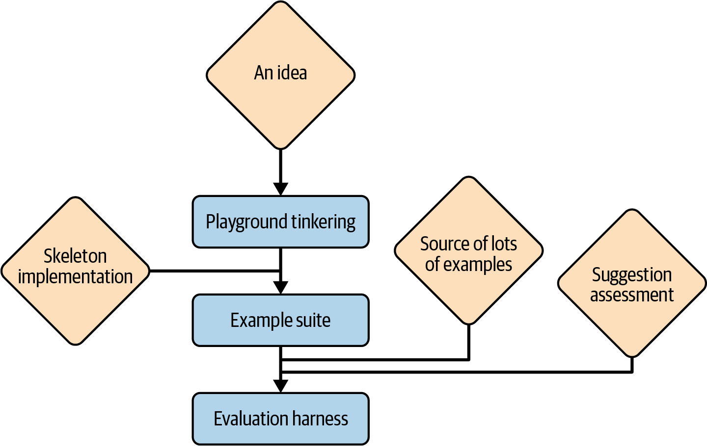
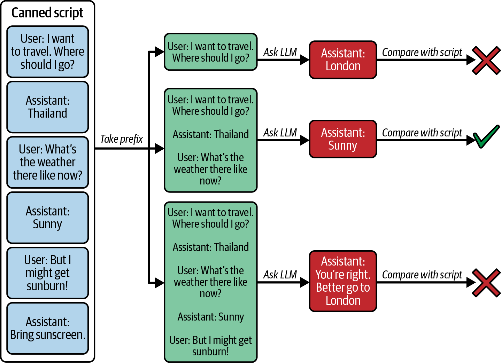
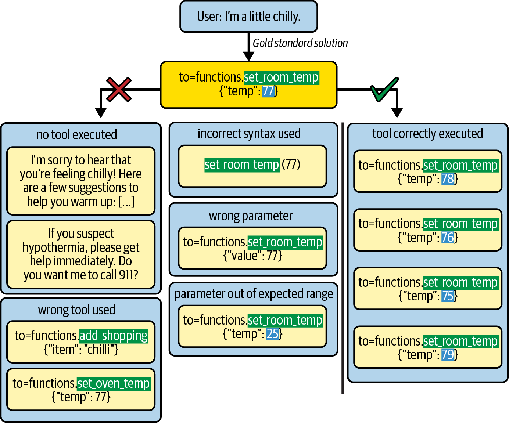

# فصل دهم: ارزیابی برنامه‌های کاربردی مدل‌های زبانی بزرگ (Evaluating LLM Applications)

گیت‌هاب کوپایلوت (GitHub Copilot) به زعم صاحب‌نظران، نخستین برنامٔه کاربردی در مقیاس صنعتی است که از LLMها بهره می‌برد. نفری اولین بودن در یک مسیر این است که برخی از تصمیمات شما در نگاه به گذشته ساده‌لوحانه به نظر می‌رسند؛ گزینش‌هایی که خنده‌دار جلوه می‌کنند و در تضاد آشکار با چیزهایی هستند که (امروزه) همگان از آن‌ها آگاهند.

اما یکی از مواردی که آن را کاملاً درست و اصولی محقق ساختیم، نحؤه آغاز پروژه‌مان بود. دیرینه‌ترین بخش در پایگاه‌کد (codebase) کوپایلوت، پروکسی، پرامپت‌ها، رابط کاربری (UI)، یا حتی کدهای زیرساختی اولیه (boilerplate) جهت برپایی برنامه به عنوان یک افزونه برای محیط توسعه یکپارچه (IDE) نیست. نخستین قطعه کدی که نگاشتیم، سیستم ارزیابی (evaluation) بود؛ و تنها به پاس همین تدبیر توانستیم سایر اجزا را با چنین شتاب و موفقیتی پیش ببریم. چرا که با هر تغییر ریز و درشتی، می‌توانستیم مستقیماً محک بزنیم که آیا آن تغییر گامی رو به جلو بوده، یک لغزش به شمار می‌آمده، یا تلاشی سنجیده بوده که صرف اثر ملموسی بر جای نگذاشته است. مزیت بنیادین یک چارچوب ارزیابی برای برنامٔه مبتنی بر LLM شما دقیقاً در همین نکته خلاصه می‌شود: این چارچوب قطب‌نمای هدایت‌گر تمامی گام‌های آتی توسعه خواهد بود.

بسته به ماهیت برنامٔه شما و جایگاه پروژه در چرخٔه حیات آن، اشکال مختلفی از ارزیابی ممکن است مقدور و متناسب باشند. دو کلان‌دسته در این عرصه، ارزیابی آفلاین (offline evaluation) و ارزیابی آنلاین (online evaluation) هستند. ارزیابی آفلاین متمرکز بر سنجش نمونه‌ها و سناریوهایی است که مستقل از اجراهای زنده و بلادرنگ برنامٔه شما تعریف می‌شوند. از آنجا که این روش به کاربران واقعی و حتی در اغلب موارد به یک برنامٔه کامل و سرتاسری (end-to-end) نیازی ندارد، قاعدتاً نخستین رویکرد ارزیابی خواهد بود که در چرخٔه توسعٔه پروژه پیاده‌سازی خواهید کرد.

با این وجود، ارزیابی آفلاین تا حدی جنبٔه انتزاعی دارد و چه بسا اندکی از جهان واقعی منفک باشد. اما به محض آنکه برنامٔهً خود را در بستر واقعی مستقر (deploy) کنید، دسترسی به ارزیابی آنلاین آزاد می‌شود؛ رویکردی که ایده‌های شما را مستقیماً بر روی جامعٔه کاربران می‌آزماید. اجرای عملیاتی در محیط زنده، در مقایسه با ارزیابی آفلاین، ریسک و حساسیت را به شدت افزایش می‌دهد: باید اطمینان یابید که فرضیات شما چنان ضعیف نباشند که تجربٔه کاربری (user experience) را یکسره مخدوش کنند؛ همچنین در وهلٔه نخست، به حجم مکفی از کاربران نیازمندید تا بازخوردی شفاف و قابل‌اتکا استحصال نمایید.

اما چنانچه این چالش‌ها را با موفقیت پشت سر بگذارید، داده‌های گردآوری‌شده برای مورد کاربرد (use case) اختصاصی شما از اعتباری بی‌نظیر برخوردار خواهند بود؛ سطحی از اصالت داده که در ارزیابی آفلاین هرگز نمی‌توان به آن پشت‌گرم بود.

هر دو ارزیابی برون‌خط (offline) و برخط (online) حائز اهمیت هستند؛ اما پیش از آن‌که به بررسی تفصیلی آن‌ها بپردازیم، بیایید برای لحظه‌ای تصویر کالن‌تر را بنگریم و یک پرسش بنیادین از خود بپرسیم.

## اصًال چه چیزی را مورد آزمون قرار‌می دهیم؟

فرایند ارزیابی می‌تواند سه مؤلفه را بسنجد:

مدل مورد استفاده شما تعاملات فردی و مجزای شما با مدل (یعنی پرامپت‌های شما) نحوه هماهنگی و ترکیب این تعاملات متعدد درون کل برنامه کاربردی شما به حلقه‌ای بیندیشید که معرف یک‌بار اجرای برنامه کاربردی شماست؛ موضوعی که در فصل به آن پرداختیم. همانند۴ آزمون‌های نرم‌افزاری سنتی، آزمودن هر دوی «کل تعامل» (هم‌ارز با آزمون‌های رگرسیون یا regression tests) و «کوچک‌ترین بلوک‌های سازنده»— که در این‌جا متناظر با یک دور پردازش مدل (one pass of the model) است (هم‌ارز با آزمون‌های واحد یا unit tests مزیت‌های خاص خود را دارد.)— بسیاری از جریان‌های کاری برنامه‌ها تنها شامل یک فراخوانی منفرد به مدل هستند؛ از این رو، این تفکیک چندان معنادار نخواهد بود. اما برای برنامه‌هایی که دارای حلقه‌های بزرگ با فراخوانی‌های مکرر و تکرارشونده هستند، شما با جدا کردن بخش‌های خاصی از حلقه و اعلام این‌که «اکنون دقیقاً در حال آزمودن این بخش هستم!»، یک بستر آزمون (test harness) طراحی خواهید کرد. البته در این انتخاب کاملاً دست‌تان باز نیست؛ آزمودن بخش‌های خاصی ممکن است دشوار باشد، اما حالت ایده‌آل آن است که چند آزمون رگرسیون داشته باشید که تا حد امکان بخش عمده‌ای از مسیر پیش‌رو (feedforward pass) حلقه را پوشش دهند، و هم‌زمان آزمون‌های واحدی نیز برای تک‌تک تعاملاتی که از نظر شما بحرانی تلقی می‌شوند (یعنی تعاملاتی که دشوار و کلیدی هستند) در نظر بگیرید.

در تمامی آزمون‌های خود، آمارهای مربوط به تأخیر کل (total latency) و میزان مصرف توکن (token consumption) را ثبت کنید. هرچند این شاخص‌ها معمولاً کانون اصلی ارزیابی نیستند، اما سنجش آن‌ها آسان است و قطع مایل خواهید بود از هرگونه تأثیر چشمگیر در این زمینه آگاه شوید.

چنانچه چنین مجموعه‌ای از آزمون‌ها را در اختیار داشته باشید، می‌توانید از آن‌ها برای ارزیابی اجزای مختلف برنامه خود به شرح زیر بهره بگیرید:

اگر به فکر تعویض مدل یا ارتقای آن هستید، احتماًال تمایل خواهید داشت که تا جای ممکن بخش وسیع‌تری از برنامه را زیر پوشش قرار دهید. می‌توانید هر واحد را به‌صورت مجزا بیازمایید، اما انتخاب آزمون‌های رگرسیونی که بخش بزرگی از حلقه را پوشش می‌دهند تا حدودی طبیعی‌تر است — مگر این‌که در نظر داشته باشید مدل‌ها را با یکدیگر ترکیب و تطبیق دهید (به‌عنوان مثال، به دلایل هزینه یا زمان تأخیر). در چنین شرایطی، بررسی منفرد هر دور پردازش منطقی‌تر خواهد بود.

اگر قصد دارید پرامپت‌ها یا سایر پارامترهای API مانند دما (temperature) یا طول پاسخ نهایی (completion length) را بهینه‌سازی کنید، تمرکز اصلی شما احتماًال باید بر آزمون‌های واحد کوچک باشد که یک دور فراخوانی منفرد به مدل را پوشش می‌دهند. در نهایت، این همان چیزی است که مستقیماً تحت تأثیر تغییر یک پرامپت واحد قرار می‌گیرد. چنانچه آزمون‌های رگرسیون شما به اندازه کافی قدرتمند باشند، می‌توانید از آن‌ها نیز استفاده کنید، اما در این آزمون‌ها احتمال زیادی وجود دارد که نویزهای آماری مانع از دیده شدن اثرات منحصربه‌فردی شوند که در سطح آزمون‌های واحد به‌وضوح قابل مشاهده‌اند.

اگر در حال بازنگری یا دست‌کاری معماری کلی برنامه هستید (مثًال تغییر ساختار کلی حلقه را در نظر دارید)، در این صورت بنا به تعریف، آزمون‌های رگرسیون همان چیزی هستند که برای مقایسه رویکردهای گوناگون به آن‌ها نیاز خواهید داشت.

در مجموع، تمامی ساختارهای آزمون مفید هستند، اما اگر ناچار باشید یکی از آن‌ها را به‌عنوان مهم‌ترین نقطه شروع برگزینید، احتماًال بهترین کار ایجاد سیستمی است که کل حلقه را مورد آزمون قرار دهد. در نهایت، آزمون‌ها باید بازتابی از واقعیت باشند و در عمل، این کارایی و عملکرد کل سامانه شماست که قصد بهینه‌سازی آن را دارید. به محض این‌که چارچوبی در اختیار داشته باشید که (تقریباً) کل حلقه را پوشش دهد، هم‌چنان می‌توانید آزمون‌های خاصی را برای بخش‌های به‌شدت بحرانی حلقه اضافه کنید.

## ارزیابی برون‌خط (Offline Evaluation)

مجموعه آزمون‌های ارزیابی برون‌خط شما می‌توانند طیف وسیعی از پیچیدگی را در بر بگیرند. ما دریافتیم که آغاز کار با سیستمی ساده بسیار سودمند است.

مجموعه‌های نمونه (Example Suites) ● هنگامی که نسخه صفر پرامپت‌های خود را می‌نویسید، احتماًال پنجره‌ای برای چت با مدل زبانی بزرگ باز کرده‌اید یا محیط آزمایشی تولید پاسخ (completion playground) را در اختیار دارید که در آن یک یا دو نمونه را امتحان می‌کنید. این شیوه مقیاس‌پذیر نیست، اما نسخه مقیاس‌پذیری از آن وجود دارد که بی‌نهایت مفید است: «مجموعه نمونه» (example suite) یک مجموعه نمونه دارای ساختار ساده‌ای متشکل از سه جزء است:.

مجموعه‌ای شامل تا۵ نمونه از ورودی‌های برنامه شما یا یکی از مراحل محوری آن. در صورت امکان، این نمونه‌ها باید۲۰ طیف سناریوهایی را که انتظار دارید در عمل با آن‌ها روبه‌رو شوید پوشش دهند.

اسکریپتی که فرایند تولید پرامپت برنامه‌تان را روی تک‌تک نمونه‌ها اعمال کرده و از مدل درخواست پاسخ نهایی (completion) می‌کند، و هم پرامپت‌های سرهم‌بندی‌شده و هم پاسخ دریافتی را در قالب فایل ذخیره می‌نماید.

روشی برای بررسی چشمی (eyeball) تفاوت‌های میان این فایل‌ها؛ برای مثال از طریق ثبت و کامیت کردن آن‌ها در مخزنً (repo) کد و بررسی تغییرات از طریق.git diff یک مجموعه نمونه، مشابه یک مجموعه آزمون (test suite) به مفهوم مرسوم در آزمون نرم‌افزار نیست (هرچند بعد می‌تواند تکامل یافته و به آن تبدیل شود). شما هیچ راهکار خودکاری در دست نخواهید داشت که مشخص کند آیا تغییر ایجادشده یک بهبود است یا پس‌رفت. (regression) در عوض، باید خودتان تفاوت‌ها را بررسی کرده و تصمیم بگیرید که آیا‌ها را پیشرفت می‌دانید یا افت کیفیت. این فرایند نسبت به اجرای یک مجموعه آزمون خودکار و بررسی نتیجه خلاصه نهایی،آن نیازمند صرف وقت و بررسی فردی بیشتری است.

با این حال، این پیکربندی دو مزیت بزرگ دارد: نخست این‌که می‌توانید آن را درست از لحظه‌ای که اولین پرامپت‌های خود را در قالب کد مدون می‌کنید آغاز کنید؛ یعنی حتی پیش از آن‌که کمترین سازوکاری برای ارزیابی خروجی‌ها داشته باشید. مزیت دوم این است که همگام با آشنایی بیشتر با این نمونه‌ها، نه‌تنها متوجه خواهید شد که آیا یک روش پرامپت‌نویسی جدید کار می‌کند یا خیر، بلکه کاستی‌های معمول خروجی مدل را نیز مشاهده خواهید کرد و می‌توانید پرامپت‌های خود را دقیقاً برای رفع آن‌ها تنظیم کنید.

به‌عنوان مثال، ما در گیت‌هاب بر روی پروژه‌ای پیرامون خلاصه‌سازی درخواست‌های ادغام Pull Request(یا PR) کار می‌کردیم PR. ها مؤلفه‌های متداولی در فرایند توسعه نرم‌افزار هستند که در آن‌ها برنامه‌نویس تغییرات کد را پیشنهاد می‌دهد و بازبین باید آن‌ها را بررسی کند؛ هدف ما این بود که با خلاصه‌سازی تغییرات در قالب چند نکته بالت‌دار، کار را برای آن‌ها آسان‌تر کنیم. بنابراین، مجموعه‌ای متشکل از ده‌ها نمونه PR (استخراج‌شده از گیت‌هاب) را گردآوری کردیم و با بررسی چشمی خلاصه‌ها، توانستیم مشکلات رایج خلاصه‌ساز خود را با صورت‌بندی‌های مختلف پرامپت شناسایی کنیم. اگر به نظرمان می‌رسید متن خیلی خلاصه و ناکافی است، می‌توانستیم به‌سرعت کلمه detailed (مفصل) را به پرامپت اضافه کرده و بالفاصله اثر آن را مشاهده نماییم. اگر احساس می‌کردیم بیش از حد پرحرف و طولانی است، از مدل می‌خواستیم خروجی را به یک یا دو پاراگراف محدود کند. اگر مفروضات بی‌اساسی درباره دلایل ایجاد PR مطرح می‌کرد، از آن می‌خواستیم که فقط به شرح عملکرد و کارایی بسنده کند. در واقع، از مدل می‌خواستیم که پاراگرافی درباره کارکرد تغییرات و پاراگراف دومی درباره قرار دادن آن کارکرد در بستر اهداف پروژه تولید کند، و سپس با استفاده از ترفندی که هنگام بحث درباره «حشو» (fluff) در فصل شرح دادیم، صرف از نمایش پاراگراف دوم خودداری می‌کردیم. مجموعه نمونه با فراهم کردن امکان مقایسه آسان اثرات۷ پرامپت‌های مختلف، کارایی فوق‌العاده ب الیی از خود نشان داد: به اندازه کافی ساختاریافته بود تا پیامدهای تغییرات را به ما گوشزد کند، و در عین حال به قدری انعطاف‌پذیر بود که حتی پیش از تدوین معیارهای کیفی سخت‌گیرانه، ارزش افزوده ایجاد کند.

مجموعه‌های نمونه برای کاوش‌های هدفمند بسیار عالی هستند، اما مقیاس آن‌ها به تعداد نمونه‌هایی محدود می‌شود که حاضرید با هر بار اعمال تغییر، به‌صورت چشمی ارزیابی کنید. با این وجود، برای بررسی اثرات دقیق‌تر و ظریف‌تر، به صدها نمونه و شاید هزاران مورد نیاز خواهید داشت.

شکل ۱۰ - نشان می‌دهد که اگر بخواهید از توان آماری همراه با چنین چارچوبی بهره‌مند شوید، باید دو مسئله را حل کنید۱:

شکل ۱۰: - دو مسئله بنیادین در ارتقا به یک چارچوب ارزیابی آماری۱.1 مسائل نمونه را از کجا به دست می‌آورید؟.2 چگونه راهکارهای ارائه‌شده توسط برنامه کاربردی خود را برای آن مسائل ارزیابی می‌کنید؟

به محض آن‌که نخستین پیاده‌سازی کد خود را نوشتید، می‌توانید فرایند را از آزمون و خطای سرسری در محیط‌های آزمایشی (playground) به یک مجموعه نمونه ارتقا دهید. اما برای ارتقا به یک بستر آزمون و ارزیابی (evaluation harness) تمام‌عیار، به نمونه‌های بسیار بیشتری و همچنین روشی برای سنجش خودکار پیشنهادها نیاز دارید.

با واژه «نمونه» (example)، به شرایط و وضعیت خاصی اشاره داریم که ممکن است برنامه خود را در آن اجرا کنید. برای حلقه‌های ساده، این مفهوم کاملاً سرراست است؛ اگر مدل زبانی بزرگ را یک‌بار فراخوانی کنید، آن‌گاه یک نمونه از تمام زمینه‌ها و اطلاعات متنی (context) که از لحاظ نظری می‌توانستند به پرامپت آن فراخوانی وارد شوند، یک «مسئله نمونه» (example problem) محسوب می‌شود و آنچه امیدوارید (پس از پردازش) از آن به دست آورید، «راهکار نمونه» (example solution) خواهد بود.

شکل ۱۰ - درخت فناوری ارزیابی‌های برون‌خط (آفلاین۱):

اما اکنون، ما با معماری‌های تعاملی و پیچیده‌تری آشنا هستیم که در آن‌ها مدل زبانی بزرگ (LLM) چندین بار فراخوانی می‌شود و این فراخوانی‌ها به یکدیگر وابسته‌اند. پیچیده‌ترین حالت احتماًال زمانی رخ می‌دهد که مکالمه‌ای دوطرفه بین کاربر و LLM شکل می‌گیرد. برای ارزیابی چنین مواردی دو راهکار پیش رو دارید:

شما از ارزیابی کل حلقه صرف‌نظر می‌کنید و در عوض، گام‌های منفرد مکالمه (individual passes) را ارزیابی می‌نمایید. برای نمونه، می‌توانید از اصطلاح «مکالمات از پیش‌آماده» یا کنسروشده (canned conversations) بهره بگیرید که در آن کل فیلم‌نامه یا متن سناریو به‌طور کامل نوشته شده است و می‌توانید عملکرد مدل را در هر یک از گام‌های مکالمه‌اش بسنجید که در آن گام خاص با چه کیفیتی عمل می‌کند. سپس، فارغ از این‌که مدل در عمل چه پاسخی داده است، با این فرض که مدل در واقع پاسخ از پیش‌تعیین‌شده در مکالمٔه کنسروشده را داده است، به سراغ ارزیابی گام بعدی در مکالمه می‌روید (شکل ۱۰ - را ببینید۲.)

می‌توانید از مدل برای شبیه‌سازی (mock out) نقش کاربر در مکالمه استفاده کنید. در این حالت، نمونٔه ارزیابی از یک پروفایل یا نمایٔه کاربر تشکیل می‌شود که کمابیش شبیه به دستورالعمل‌های توصیفی در تئاتر بداهه‌پردازی (improv theater) است. مدل از آن نمایه برای تقلید رفتار یک کاربر واقعی استفاده خواهد کرد. این رویکرد به شما اجازه می‌دهد تا کل حلقه را مورد آزمایش قرار دهید، اما به بهای نهادینه شدن کاستی‌های احتمال خود مدل؛ به‌ویژه نقص‌هایی مانند درک نادرست از دامنٔه تخصصی مسئله یا پیش‌داوری در خصوص نحؤه رفتار احتمالی کاربران. این روش بی‌نقصی نیست، اما در بسیاری از موارد، بهترین کاری است که از عهده‌تان برمی‌آید.

شکل ۱۰ - مکالمات از پیش‌آماده (کنسروشده۲):

## یافتن‌نمونه ها (داده‌های آزمون)

برای خیل کثیری از مثال‌هایی که ناگزیر به یافتن آن‌ها خواهید بود، سه منبع اصلی وجود دارد:

آن‌ها از پیش وجود دارند و شما صرف باید پیدایشان کنید.

آن‌ها توسط پروژٔه خودتان در حال ایجاد شدن هستند و شما آن‌ها را جمع‌آوری خواهید کرد.

مجبورید آن‌ها را تمام از صفر خلق کنید.

ما به نوبت به هر یک از این منابع خواهیم پرداخت و کار را با آنچه هم‌اکنون موجود است آغاز می‌کنیم.

هر برنامٔه مبتنی بر LLM مسئلٔه خاصی را حل می‌کند، و ممکن است آن مسئله (یا یکی از زیرمسائل آن) مشابه موردی باشد که بتوان آن را استخراج و داده‌کاوی (mine) کرد؛ زیرا جفت‌های مسئله / راه‌حل فراوانی در دنیای بیرون موجودند. اگر بخت یارتان باشد، برنامه‌ای که در نظر دارید مسئله‌ای را حل خواهد کرد که کاربران بارها و بارها (بدون کمک هوش مصنوعی) هزاران مرتبه خودشان آن را حل کرده‌اند و رکوردهایی از آن بر جای مانده است. اخیر با یک دستیار هوش مصنوعی برای پر کردن

خودکار فیلد چکیده در یک فرم آنلاین برخورد کردم. هر کس که آن قابلیت را برنامه‌نویسی کرده بود، به احتمال قریب‌به‌یقین رکوردهایی از ده‌ها هزار فرم در اختیار داشت که در آن‌ها، انسان‌ها خودشان آن فیلد چکیده را پر کرده بودند. این داده‌ها می‌توانستند منبعی غنی از نمونه‌ها را برای هر سامانٔه تست و ارزیابی (evaluation harness) فراهم آورند.

اما در اغلب موارد، آنچه می‌توانید استخراج کنید تنها با مسئله‌ای که برنامٔه شما در صدد حل آن است مشابهت دارد، نه تطابق کامل. در چنین شرایطی، منبع نمونه‌های شما باید تعادلی ظریف برقرار سازد: یافتن منبعی از نمونه‌ها که در پیکره‌های دنیای واقعی به‌قدر کافی فراگیر و متداول باشد تا بتوان بر اساس آن مقیاس‌پذیری ایجاد کرد، و در عین حال به‌اندازٔه کافی به مسئلٔه برنامٔه شما شباهت داشته باشد تا دستیابی به نتیجه‌گیری‌های معتبر را میسر سازد. این رویکرد به مثابٔه یک سنگ‌بنا و پلٔه واسط میان فضای آزمایشگاهی و دنیای واقعی عمل می‌کند.

به عنوان مثال، صورت‌مسئلٔه اصلی در گیت‌هاب کوپایلوت (GitHub Copilot) این است: «کاربر در ادامه چه متنی را می‌خواهد تایپ کند؟» چنانچه گیت‌هاب کوپایلوت پاسخ این پرسش را بداند، می‌تواند آن را در حین تای کاربر، در قالب متنیِ خاکستری و کم‌رنگ (grayed-out text) پیشنهاد دهد. با این حال، دقیقاً برای چنین پرسشی، هیچ پیکرٔه مقیاس‌بزر متن‌بازی وجود ندارد. آنچه در عمل وجود دارد، پیکره‌ای بسیار عظیم از کدهای متن‌باز در قالب کلیٔه مخازن موجود در گیت‌هاب است.

از این رو، ما تصمیم گرفتیم با انجام گام‌های زیر به تولید نمونه‌ها بپردازیم:.1 یک مخزن متن‌باز را انتخاب کنید، از درون آن یک فایل کد بردارید، و از آن فایل یک تابع را برگزینید..2 بدنٔه آن تابع را حذف کنید؛ با این فرض که کاربر هم‌اکنون در حال نوشتن آن فایل بوده و تقریباً نگارش همه چیز را به پایان رسانده است جز پیاده‌سازی واقعی این یک تابع، و نشانگر ماوس یا مکان‌نما (cursor) دقیقاً در جایی قرار دارد که پیاده‌سازی باید نوشته شود..3 از گیت‌هاب کوپایلوت بپرسید که بعد از این نقطه چه چیزی باید تایپ شود.

این سازوکار به دلایل گوناگون با مسئلٔه واقعی و جاری در دنیای واقعی یکسان نیست. یک دلیل آن است که توزیع داده‌ها اریب و نامتقارن (skewed) است: بدنٔه کامل یک تابع، به‌مراتب طولانی‌تر از قطعه‌کدهای استانداردی است که معمولاً توسط پیشنهاد می‌شوند. دلیل دیگر این است که کلیٔه تغییرات وابسته به این بدنه در سایر نقاط فایل (برای نمونه،کوپایلوت عبارت‌های import که به بخش مقدماتی و ابتدای فایل افزوده می‌شوند) هم‌اکنون اعمال شده‌اند. هیچ‌کدام از این موارد در ایده‌آل نیستند، اما در تقابل با این واقعیت که این شیوه چاهی تقریباً بی‌پایان از نمونه‌ها را در اختیار شما می‌گذارد،وضعیت تعادل قابل قبولی ایجاد می‌شود.

اما شاید مدت‌ها در این باره اندیشیده‌اید و هیچ منبع دادٔه موجودی را نیافته‌اید که برای مقصود شما کفایت کند؛ نه مصادیق مستقیمی از مسئله‌ای که برنامه با آن دست‌وپنجه نرم می‌کند و نه حتی مواردی مشابه با آن. بنابراین، به یک منبع دادٔه کاملاً جدید نیاز پیدا خواهید کرد. خبر خوب این است: شما هم‌اکنون در حال نگارش یک منبع داده هستید. برنامه‌ای که در حال توسعه‌اش می‌باشید، خودبه‌خود تولیدکنندٔه موارد نمونه برای مسئلٔه خویش است؛ به این ترتیب که با بهره‌برداری مداوم کاربران از برنامه، نمونه‌های تازه روی هم انباشته می‌شوند. چنین داده‌هایی مسلم تا ب الترین حد ممکن به واقعیت نزدیک هستند، اما با معایب و چالش‌های چشم‌گیری نیز همراهند:

داده‌ها تنها زمانی شروع به سرازیر شدن می‌کنند که نخستین پیش‌نمونهً (prototype) شما روانٔه بازار شده باشد.

هر زمان که به‌روزرسانی‌های اساسی در برنامٔه خود ایجاد کنید، این احتمال قوی وجود دارد که داده‌های پیشین شما کام منسوخ و فاقد اعتبار شوند.

ثبت داده‌های گستردٔه رفتارشناسی و تله‌متری کاربر (user telemetry) نیازمند رعایت استانداردهای بسیار سخت‌گیرانه‌ای در اخذ رضایت، پردازش و حفاظت امنیتی از داده‌ها است.

تعاملات شکل‌گرفته در برنامه، منبعی عالی برای مسائل نمونه (ورودی‌ها) به شمار می‌روند اما لزوم منبع فوق‌العاده‌ای برای راه‌حل‌های نمونه (خروجی‌ها) نیستند. حتی اگر بتوانید ثبت کنید که...

اقدامی که کاربر در نهایت انجام می‌دهد، به‌شدت تحت تأثیر اقدام پیشنهادی از سوی برنامه کاربردی شما خواهد بود.

در پاراگراف‌های پی رو خواهیم دید که همه ارزیابی‌ها متکی بر دانستن این نیستند که کدام راهکار، تنها پاسخ درست است (که با عنوان راهکار «معیار طالیی» یا gold standard نیز شناخته می‌شود). در این حالت، گردآوری داده‌ها از تعاملات درون برنامه می‌تواند ارزشمند باشد. در غیر این صورت، توصیه می‌کنیم داده‌های تله‌متری (telemetry) حاصل از برنامه را برای ارزیابی آنلاین واگذارید؛ رویکردی که افزون بر اجتناب از برخی معضالت پیرامون مدیریت داده، مزایای مضاعفی را نیز به همراه دارد.

بنابراین، چه اقدام جایگزینی می‌توان انجام داد؟ خب، همیشه می‌توانید داده‌ها را به‌صورت ساختگی تولید کنید؛ البته مسلم نه به شکل دستی و نه تمام توسط شخص خودتان (چرا که این بخش اساس درباره مقیاس‌پذیری بحث می‌کند)؛ اما اکنون شما یک توسعه‌دهنده با‌تجربه هوش مصنوعی هستید و می‌توانید از مدل زبانی بزرگ (LLM) بخواهید تا نمونه‌ها را تولید کند. در پاره‌ای از موارد، این شیوه می‌تواند به شکلی حیرت‌آور مؤثر واقع شود. این موضوع به‌ویژه در سناریوهایی صادق است که می‌توانید کار را از راهکار نهایی آغاز کرده و صورت‌مسئله را بر پایه آن بسازید. در حالتی دیگر، چنانچه اصًال نیازی به راهکار معیار طالیی نداشته باشید، تولید موقعیت‌ها و سناریوها امری است که مدل‌های زبانی بزرگ تبحر ویژه‌ای در آن دارند. اگر این رویکرد را در پیش می‌گیرید، اتخاذ یک روند سلسله‌مراتبی به شرح زیر ایده مطلوبی خواهد بود:

یا از LLM بخواهید فهرستی از موضوعات را تدوین کند یا خودتان فهرستی را ارائه دهید. اگر مسائل شما ابعاد گوناگونی دارند که قابلیت ترکیب با یکدیگر را دارا هستند، می‌توانید به‌خوبی از این قاعده بهره ببرید که اگر برای جنبه A به تعداد n گزینه، برای جنبه B به تعداد m گزینه، برای جنبه C به تعداد l گزینه و برای جنبه D به تعداد k گزینه وجود داشته باشد، آنگاه k × l × m × n ترکیب احتمالی خواهید داشت. بهره‌گیری از چنین انفجارهای ترکیبیاتی (combinatorial explosions) می‌تواند به‌سادگی شمار گسترده‌ای از عناوین و موضوعات را در اختیارتان بگذارد که در فضایی پهناور با توازن مناسبی توزیع شده‌اند.

اگر شمار نمونه‌هایی فراتر از تعداد موضوعات می‌طلبید، همچنان می‌توانید از مدل زبانی بزرگ بخواهید به ازای هر موضوع، چندین نمونه مجزا تولید کند. به شرطی که پنجره زمینه (context window) شما گنجایش بازگرداندن تمام آن‌ها را در خروجی داشته باشد، درخواست دریافت چند نمونه در قالب یک پرامپت واحد، غالب به تنوع ب التری نسبت به فراخوانی‌های مکر مدل با دمای (temperature) ب التر از صفر منتهی می‌گردد.

چنانچه اطمینان ندارید که مدل زبانی بزرگ تسلط جامعی بر فضای مسئله دارد یا خیر، نمونه‌های ایجادشده ممکن است تا حد زیادی الگوهای کلیشه‌ای اغراق‌آمیز و بسیار پیش‌پاافتاده باشند، بر بدفهمی‌های عمومی تکیه داشته باشند، یا این‌که به‌کلی نادرست باشند. خطرناک‌تر از آن، شکل‌گیری یک رابطه خویش‌آمیز و خودارجاع (incestuous relationship) میان مدل ارزیابی‌کننده و مدل طراح آزمون است؛ اگر هر دوی این نقش‌ها بر عهده یک مدل واحد باشد، سوگیری سیستماتیک در برآیند آزمایش به وجود خواهد آمد. به‌عنوان نمونه، اگر از بستر ارزیابی (test harness) خود برای تصمیم‌گیری جهت مهاجرت از مدل A به مدل B استفاده می‌کنید، در شرایطی که تمامی نمونه‌ها توسط مدل A تدوین شده باشند، احتمال زیادی وجود دارد که مدل A برتری ناعادالنه‌ای نسبت به مدل B از خود نشان دهد.

هر یک از شیوه‌های فوق در دستیابی به نمونه‌ها، متضمن مزایا و معایبی است و بسته به شرایط پروژه خود، ممکن است یک یا چند مورد از آن‌ها را به کار گیرید. این فرآیند حجم کثیری از داده‌های نمونه را، چه همراه با پاسخ‌های معیار طالیی و چه بدون آن‌ها، مهیا می‌سازد. بدین ترتیب می‌توانید برنامه خود را بر روی آن‌ها اجرا کرده و برای هر مورد یک راهکار کاندید (candidate solution) اخذ نمایید؛ اما اکنون پرسش این است که گام بعدی چیست؟

## ارزیابی راهکارها

جهت سنجش راهکارهای احتمالی در مقیاس ب ال، سه رهیافت محوری مطرح است. این رویکردها بر حسب درجه پیچیدگی عبارتند از: انطباق با معیار طالیی (اعم از انطباق تمام‌عیار یا جزئی)، آزمون کارکردی (functional testing) و سنجش مبتنی بر مدل زبانی بزرگ.(LLM assessment) معیار طالیی (Gold Standard) ● ساده‌ترین شیوه در صورت امکان‌پذیری، انطباق با معیار طالیی است (بدین معنا که یک راهکار نمونه برای مسئله مورد نظر اختیار دارید که به درستی آن تا حد زیادی معتقد هستید). به عنوان مثال، اگر اسناد و سوابق تاریخی را کاوش کرده باشید،در معیار طالیی می‌تواند همان رفتاری باشد که انسان بدون مداخله و کمک LLM از خود نشان داده است. بسته به ماهیت راهکاری که برنامه شما تدوین می‌کند، ممکن است این رویکرد تمامی آن چیزی باشد که تا همیشه به آن نیاز خواهید داشت؛

علی‌الخصوص زمانی که راهکار بتواند با ساختاری بسیار سرراست بیان شود.

در ساده‌ترین سناریو، برنامه مبتنی بر مدل زبانی شما نهایت باید به یک پاسخ واحد «بله / خیر» برسد و شما نیز داده‌هایی متکی بر معیار طالیی از تصمیمات صائب در دست دارید. در این وضعیت، کل ارزیابی مورد نیاز، صرف بررسی این شاخص است که تصمیم اتخاذشده توسط برنامه شما در چند درصد موارد با معیار طالیی مطابقت دارد. به عنوان نمونه، آلبرت زمانی روی سامانه‌ای برای تولید آزمون‌های واحد (unit test generation) فعالیت می‌کرد که نخستین مرحله در حلقه پردازشی برنامه این بود که از خود بپرسد: «آیا این قطعه‌کد اساس نیازی به تست واحد دارد؟» این پرسشی با پاسخ صریح بله / خیر است و اعتبارسنجی کارایی سامانه در این گام، از رهگذر سنجش میزان همگرایی با راهکارهای معیار طالیی، بسیار ساده صورت می‌پذیرفت.

ارزیابی تصمیمات دودویی (binary decisions) یا رده‌بندی‌های چندبرچسبی (multilabel classification) با اتکا به معیارهای طالیی می‌تواند صرف شمارش دفعات پاسخ صحیح مدل باشد. با این حال، اگر در پی توان آماری ب التری هستید، می‌توانید بر اساس مباحث مطرح‌شده در فصل، از احتمال‌های لگاریتمی۷ (logprobs) بهره‌برداری نمایید.

با این همه، خروجی یک مدل زبانی بزرگ در اکثر موارد متنی با قالب آزاد (free-form text) است. در چنین وضعیتی می‌توانید از شمارش تطابق دقیقاً (exact match) سود ببرید؛ بدین ترتیب که ثبت کنید برنامه شما چه تعداد راهکار کاندید با انطباق عین‌به‌عین نسبت به معیار طالیی ارائه می‌دهد. اما هر چه درجه آزادی متن فزونی یابد و به‌ویژه زمانی که طول پاسخ مدل طویل‌تر گردد، رخداد تطابق دقیقاً حتی برای پیشرفته‌ترین مدل‌ها نیز نایاب خواهد شد. در آستانه‌ای خاص، احتمال وقوع دقیقاً تا جایی تنزل می‌یابد که این سنجه کم‌وبیش بی‌فایده و تهی از معنا می‌شود. حتی قبل از رسیدن به آن مرز،انطباق مسئله بنیادین دیگری طرح می‌گردد: هدف بهینه‌سازی شما چیست؟ آیا دستیابی به راهکارهای صحیح را مد نظر دارید یا راهکارهایی که صرف در سبک نگارشی ویژه‌ای صورت‌بندی شده‌اند؟

این نقطه، سرآغاز کارآمدی سنجه‌های تطابق جزئی (partial match metrics) است. مکانیزم این سنجه‌ها گزینش یک مؤلفه شاخص از راهکار و محدود ساختن ارزیابی به انطباق صرف بر روی همان جنبه است. به عنوان مثال، چنانچه قرار است LLM برای شما کد منبع تولید کند، ممکن است بخواهید از توضیحات (comments)، سطرهای خالی یا حتی (بسته به زبان برنامه‌نویسی) تمامی فاصله‌ها (whitespace) چشم‌پوشی کنید. از این رو، سنجه تطابق جزئی را بر مبنای «تطابق دقیقاً پس از حذف تمامی خطوط توضیحات و پاک‌سازی همه فاصله‌ها» تعریف می‌کنید. یا اگر قرار است مدل مقاصد گردشگری پیشنهاد دهد، ممکن است تطابق را صرف روی کشور مقصد بررسی نموده و جزئیات تکمیلی مدل را نادیده انگارید؛ این نیز مصداقی از سنجه تطابق جزئی محسوب می‌شود.

تمامی سنجه‌های تطابق جزئی مستلزم یک گزینش دشوار هستند: باید معین سازید که حقیقتاً کدام جنبه از راهکار برای شما اولویت قطعی دارد. اجرای این امر در عمل به مراتب دشوارتر از بیان نظری آن است؛ زیرا در اغلب کاربردها، بروز نقصی فاجعه‌بار در هر مؤلفه‌ای از راهکار می‌تواند از نظر مفهومی کل نتیجه را باطل سازد. با این حال، برخی ح الت شکست احتمال وقوع بیشتری دارند، لذا می‌توانید تدابیر دفاعی را روی همان موارد متمرکز کنید.

بیایید مسئله را با یک مثال تشریح کنیم. فرض کنید در حال توسعه یک سامانه مدیریت خانه هوشمند هستید و با موقعیتی مواجه می‌شوید که کاربر اظهار می‌دارد: «سردم است» (شکل ۱۰ - را ملاحظه فرمایید). شما از پیش، راهکار معیار۳ طالیی این مورد را تعیین کرده‌اید: اینکه سامانه دما را بر روی 77ºF (درجه فارنهایت) تنظیم کند و این پاسخی کاملاً ایده‌آل۷۷ خواهد بود. سنجش تطابق جزئی در این سناریو می‌تواند صرف شامل وارسی این امر باشد که آیا مدیر هوشمند، سیستم درستی را تنظیم کرده است یا خیر (که در این حالت، سیستم گرمایشی است). بررسی این مؤلفه تصمیمی معقول است، چرا که این احتمال واقعی وجود دارد که سیستم اصولاً واکنشی مبنی بر مداخله در سامانه گرمایش نشان ندهد و این امر نشان‌دهنده یک نقص ساختاری خواهد بود. از سوی دیگر، چنانچه مدیر خانه هوشمند سامانه گرمایشی را تنظیم نماید، احتمال بسیار ب الیی دارد که آن را روی عددی معقول قرار دهد، خواه دقیقاً ًوجود 77ºF باشد یا خیر. مسلم این احتمال نیز هست که مدیر دما را روی 0ºF تنظیم کند، اما این حال نقص، در مقایسه با سناریویی که سامانه اصًال متوجه نیاز به تنظیم گرمایش نشود یا شیوه فرمان‌دادن به آن را نداند، از احتمال به‌مراتب پایین‌تری برخوردار است. بدین سبب، منطقی است که آزمون بر روی اص «تنظیم دما» معطوف گردد تا بررس دمای دقیقی که مدل ملزم به اعمال آن بوده است.

شکل ۱۰: - ارزیابی تطابق جزئی در فراخوانی ابزار و تنظیم سیستم گرمایشی۳ به‌طور کلی، بهینه‌ترین رویکرد، سنجش بر مبنای مؤلفه‌ای است که واجد این دو شاخصه باشد:

توانایی تمایز شفاف بین انحراف بحرانی و آسیب‌رسان (breaking) از انحراف بی‌خطر و خوش‌خیم (benign) نسبت به راهکار معیار طالیی را داشته باشد؛ مؤلفه‌ای که ارزیابی را پرمعنا و معتبر می‌گرداند.

بیش از اندازه ریز و انحصاری نباشد، چرا که در این صورت مدل شانس پایینی برای انطباق با آن خواهد داشت؛ و از سویی بیش از حد کلی نیز نباشد، زیرا در این حالت ارزیابی خاصیت اعتبارسنجی خود را از کف خواهد داد.

تأمین هر دوی این معیارها منوط به آن است که مدتی با مدل کلنجار بروید و رفتار آن را بیازمایید تا محل الگوهای خطای پرتکرار و شدت پیامد منفی آن‌ها برایتان آشکار گردد. متأسفانه در این نقطه نوعی دور باطل یا دوری‌بودن (circularity) حادث می‌شود؛ چرا که شما آزمون را دقیقاً بر اساس نقاط قوتی برمی‌گزینید که مدل یا ساختار کنونی شما در آن مهارت دارد، و از همان ارزیابی برای خط‌مشی‌گذاری ارتقای آتی آن سود می‌جویید. با این وجود، این روش باز هم به مراتب اصولی‌تر از گنجاندن مؤلفه‌ای ناکارآمد یا گمراه‌کننده در چارچوب ارزیابی شما خواهد بود.

چنانچه مدل زبانی خروجی‌های ساختاریافته‌تری نسبت به متن‌های کاملاً آزاد بازمی‌گرداند، آزمودن یک فیلد کلیدی و تعیین‌کننده از میان فیلدهای گوناگون تولیدی، غالب زاویه مناسبی برای ارزیابی به روش تطابق جزئی خواهد بود. این مسئله به‌ویژه در برنامه‌هایی صدق می‌کند که کاربرد گسترده‌ای از ابزارها (tool use) دارند: در اینجا می‌توانید بررسی کنید که آیا ابزار مناسب فراخوانی شده است و آیا از ساختار نحوی (syntax) صحیح برای صدا زدن آن استفاده گردیده است یا خیر (شکل ۱۰ - را ملاحظه فرمایید۳.) بررسی اینکه آیا مدل از ابزار درستی استفاده می‌کند یا خیر، نمونه‌ای از به‌کارگیری یک توصیه عمومی دیگر نیز به شمار‌رود: هنگامی که مدل حین تولید پشت سر ه توکن‌های خود به‌صورت تک‌به‌تک، چندین تصمیم‌گیری متوالی اتخاذ می‌کند،می منطقی است تصمیمی را مورد ارزیابی قرار دهید که نخستین احتمال واقعی برای به خطا رفتن را دارد (و نقاط تصمیم‌گیری

بعدی را باطل اعلام کنید.) در شکل ۱۰ -، مدل ابتدا با آغاز کردن با عبارت۳ to=functions. تصمیم می‌گیرد که اصًال از ابزاری استفاده کند، سپس به استفاده از ابزار مشخ ِمتعهد set_room_temp‌شود و در نهایت مقادیر خا می {"temp": 77} را برمی‌گزیند.

شکل ۱۰: - آزمودن اینکه ابزار صحیح با نحو (سینتکس) درست فراخوانی شده است۳ در شکل توجه کنید که اگر ابزار set_room_temp به‌درستی فراخوانی نشود (مانند سمت چپ)، پیشنهاد خروجی به احتمال زیاد بی‌فایده خواهد بود. اگر ابزار به‌درستی اما به شیوه‌ای متفاوت از راه‌حل استاندارد طالیی (gold standard) فراخوانی شود (مانند سمت راست)، شانس این که پیشنهاد معقول و منطقی باشد (مانند بخش ب ال سمت راست) همچنان قابل توجه است.

## تست عملکردی (Functional Testing)

اگر راه‌حل استاندارد طالیی در اختیار ندارید یا نمی‌توانید به‌سادگی آن را با راه‌حل برنامه کاربردی خود مقایسه کنید چه؟ یکی از گزینه‌ها «تست عملکردی» (functional testing) است: گرفتن پاسخ تولیدشده (completion) و حصول اطمینان از این که موارد خاصی همراه با آن «کار می‌کنند». برای مثال، می‌توانید بسنجید که مدل زبانی بزرگ در چه بازه‌هایی خروجی‌ای ارائه می‌دهد که قابلیت پارس کردن (parse) داشته باشد، فقط توابع و ابزارهایی را که در دسترس دارید فراخوانی می‌کند (و با آرگومان‌هایی با نوع داده صحیح)، و مواردی از این دست. در بیشتر کاربردها، این ارزیابی بسیار ضعیف است، اما گه‌گاه می‌توانید با تست عملکردی مسیر قابل توجهی را پیش ببرید.

بیایید بار دیگر چارچوب ارزیابی کوپایلوت (Copilot) را به‌عنوان نمونه‌ای از این دست تست‌های عملکردی بررسی کنیم.

این چارچوب ارزیابی، مواردی را شبیه‌سازی می‌کرد که در آن‌ها از کوپایلوت برای پیاده‌سازی مجدداً تابعی از یک مخزن متن‌باز (open source repository) استفاده شده بود؛ سپس بررسی می‌کرد که آیا مجموعه تست‌های واحد

(unit test suite) آن مخزن با کد منبع جایگزی ارائه‌شده توسط کوپایلوت همچنان با موفقیت پاس می‌شوند یا خیر (نسخه‌ای ضعیف‌تر بررسی می‌کرد که آیا ابزارهای لینتر (linters) کد را تأیید می‌کنند یا نه). ایده اصلی، بهره‌گیری از یک ویژگی خاص کد است: (اغلب) تست‌های واحدی وجود دارند که می‌توانید آن‌ها را اجرا کنید و کد از پیش همراه با تست عملکرد از قبل موجود ارائه شده است. از سوی دیگر، در برخی حوزه‌ها ممکن است نتوانید هیچ تست عملکردی قابل اجرایی به‌صورت برنامه‌نویسی‌شده تدوین کنید. اما تیر دیگری نیز در ترکش یک مهندس پرامپت نظیر شما وجود دارد: خو مدل.

## ارزیابی به کمک مدل زبانی بزرگ (LLM Assessment)

کیفیت پاسخ زبان طبیعی به یک مسئله، اغلب موضوعی مبهم، چندوجهی و غیرقابل‌تعیین است. اگر مدل یک عدد را در خروجی بدهد، می‌توانید به‌راحتی آن را با استاندارد طالیی مقایسه کنید؛ اگر مدل یک دسته‌بندی (classification) را خروجی دهد، می‌توانید مستقیماً رشته‌ها را برای تعیین دقت بسنجید؛ و اگر مدل یک برنامه خروجی دهد، می‌توانید تست‌های واحد را به اجرا درآورید.

اگر مدل یک پاسخ متنی به یک پرسش بدهد، چگونه میزان صمیمیت و مفید بودن آن پاسخ را می‌سنجید؟ خوشبختانه،اما چنین ارزیابی‌هایی دقیقاً جایی است که مدل‌های زبانی بزرگ می‌درخشند و شما می‌توانید از آن‌ها برای ارزیابی پاسخ بهره بگیرید. از طرفی، شاید این کار ایده چندان مناسبی به نظر نرسد؛ هر چه باشد، احتماًال همان مدل زبانی پاسخی را که در حال ارزیابی آن هستیم تولید کرده است و اکنون از آن می‌خواهید به کار خودش نمره دهد تا مشخص شود چقدر خوب است. آیا این کار کمی شبیه این نیست که به یک دانش‌آموز دبیرستانی تکلیف نگارش مقاله بدهیم و سپس از او بخواهیم به کار خودش نمره دهد؟ پاسخ منفی است — دست‌کم اگر کار را درست انجام دهید این‌طور نیست.

حتی با وجود این که پرسش‌های ارائه‌شده به مدل زبانی غالب به‌صورت پرسش‌های سنجش کیفیت مطلق فرمول‌بندی می‌شوند (مانند: «آیا این درست است؟»)، ارزیابی مدل زبانی در اصل و به‌صورت پیشینی (a priori) صرف به‌عنوان یک قضاوت کیفی نسبی عمل می‌کند (مانند: «نسخه A در مقایسه با نسخه B در دفعات بیشتری درست در نظر گرفته می‌شود.)» ممکن است به ارزیابی‌هایی نظیر «مدل زبانی خروجی برنامه را در موارد درست تشخیص می‌دهد» برسید، که این موارد٪۸۱ به‌تنهایی معنای چندانی با خود به همراه ندارند.

اگر می‌خواهید از یک مدل زبانی بزرگ به‌درستی برای ارزیابی کار خودش استفاده کنید، نباید اجازه دهید مدل متوجه شود که در حال نمره‌دهی به کا خود است. ارزیابی‌ها نوعی گفتگوی مشاوره‌ای (advice conversation) هستند و همان‌طور که از فصل می‌دانید، گفتگوهای مشاوره‌ای زمانی بهترین عملکرد را دارند که مدل تصور کند در حال نمره‌دهی به یک شخص۶ ثالث است. در واقع، در حالی که مدل‌ها وقتی تصور می‌کنند از آن‌ها خواسته شده به کاربر نمره دهند در مقایسه با زمانی که فکر می‌کنند به یک شخص ثالث نمره می‌دهند اندکی دقت کمتری نشان می‌دهند، اما وضعیت آن‌ها زمانی بسیار بدتر می‌شود که تصور کنند از آن‌ها خواسته شده به خودشان نمره دهند؛ زیرا ناگهان دستخوش انبوهی از سوگیری‌های متناقض می‌شوند.

داده‌های آموزش بیشتر مدل‌ها شامل بخش بزرگی از بحث‌های ت الرهای گفتگو (یا حتی بخش نظرات) است که دقیقاً به خودانتقادی و خوداندیشی بی‌طرفانه شناخته نمی‌شوند. از سوی دیگر، چنانچه مدل تحت یادگیری تقویتی با بازخورد انسانی (RLHF) قرار گرفته باشد، برای جلب رضایت ارزیاب‌های انسانی‌اش اغلب یاد می‌گیرد که به سمت دیگر افراط کشیده شود و با کوچک‌ترین ابراز تردید از سوی کاربر، دستپاچه شده و سریع خروجی خود را اصلاح کند. حتی اگر یک مدل بتواند به‌طور میانگین نوعی تعادل برقرار کند، قرار گرفتن در کشاکش این سوگیری‌های متضاد به ارائه یک تحلیل عینی و بی‌طرفانه کمکی نخواهد کرد.

## ارزیابی سوما (SOMA Assessment)

یکی دیگر از روش‌های مطلوب جهت بهینه‌سازی مدل زبانی بزرگ برای امر ارزیابی، به‌کارگیری رویکردی است که ما آن را ارزیابی سوما»«(SOMA assessment) می‌نامیم؛ این ارزیابی از پرسش‌های مشخص (Specific questions - S)، پاسخ‌های مقیاس‌بندی‌شده ترتیبی (Ordinal scaled answers - O) و پوشش چندجنبه‌ای (Multiaspect coverage - MA) تشکیل شده است. بیایید درباره هر یک از بخش‌های ارزیابی SOMA صحبت کنیم.

پرسش‌های مشخص (Specific Questions) ● وظایفی وجود دارند که در آن‌ها اعتبارسنجی یک راه‌حل بسیار ساده‌تر از ارائه داد آن راه‌حل است. به عنوان مثال، سرودن فی‌البداهه یک شعر فکاهی پنج‌بیتی (limerick) دشوار است، اما تأیید اینکه آیا یک شعر مشخص معیارهای یک لیمریک را برآورده می‌سازد یا خیر، کار ساده‌ای است. اگر وظیفه برنامه شما برحسب تصادف یکی از این موارد باشد، شاید با پرسید «آیا این درست است؟» کارتان راه بیفتد. اما در بیشتر موارد، اطلاعات بسیار اندکی از چنین ارزیابی‌های کلی و عمومی به دست می‌آید. در شکل ۱۰ -، ما نمونه‌ای از یک سیستم خانه هوشمند داشتیم که به کاربری که می‌گفت «من کمی سردم است»، با۳ to=functions.set_room_temp {"temp": 77} پاسخ می‌داد. پاسخ دادن به این پرسش که «آیا متن تکمیل‌شده درست است؟» چندان ساده‌تر از تولی خو آن پاسخ در وهله اول نیست. در واقع، پاس بخش ارزیابی حتی ممکن است به‌مراتب بدتر از متن تولیدشده اولیه باشد، چرا که روش‌های متعددی برای تفسیر آن وجود دارد.

پاسخ‌های مقیاس‌بندی‌شده ترتیبی (Ordinal Scaled Answers) ● یکی از این ابهامات این است که مشخص نیست یک متن تولیدشده باید تا چه حد خوب باشد تا «درست» به شمار آید.

اصًال مطلوب نیست اگر استانداردهایی که یک پاسخ بر پایه آن‌ها سنجیده می‌شود وابسته به نوسانات رفتاری و تمایالت مدل باشد و پاسخ بعدی با استاندارد متفاوتی ارزیابی گردد. شرایط زمانی وخیم‌تر می‌شود که به‌جای یک اثر تصادفی، یک سوگیری سیستماتیک در کار باشد؛ برای مثال، مدل پاسخ‌هایی را که برای دقت بیشتر تلاش می‌کنند مشمول استانداردهای سخت‌گیرانه‌تری قرار دهد، یا پاسخ‌هایی را که به‌طور کلی قابل‌قبول هستند (بیش از درست‌اند) بپذیرد در حالی که٪۵۰ پاسخ‌های تقریباً بی‌نقص (که صرف صددرصد درست نیستند) را رد کند.

راهکار این است که از همان ابتدا پاسخ‌های دوگانه بله / خیر را کنار بگذارید و از مدل بخواهید تا متن تولیدشده را بر روی یک مقیاس ترتیبی (ordinal scale) رتبه‌بندی کند؛ جایی که نه تنها انتقال ظرافت‌ها و تمایزها آسان‌تر است، بلکه می‌توان از طریق مشخص ساختن معنای این اعداد، به معیارهای اندازه‌گیری پایدار و همگنی دست یافت.

## پوشش‌چندجنبه ای (Multi-aspect coverage)

در واقع، پژوهش‌های حوزه روان‌سنجی (psychometrics) نشان می‌دهند که عدد یک مقدار پیش‌فرض بسیار۵ مناسب است. برای نمونه، اگر از مدل بخواهید در یک مقیاس۱ تا۱ امتیازدهی کند، می‌توانید همان‌طور که در مثال۵ ۱۰ - نشان۱ داده شده است، برای هر یک از این سطوح توضیحات یا مثال‌هایی را اضافه نمایید.

اما عبارت «چقدر خوب، خوب است؟» تنها منشأ ابهام در دستیابی به پاسخ سؤالی نظیر «آیا تکمی ارائه‌شده (completion) درست است؟» نیست. اگر به خروجی‌های مختلف برای عبارت "I'm a little chilly" (کمی احساس سرما می‌کنم) فکر کنید، مدل ممکن است گاهی بر این پرسش متمرکز شود که آیا دمای پیشنهادی اتاق صحیح است یا خیر؛ گاهی بر این موضوع تمرکز کند که آیا دستیار باید پیش از تغییر دادن دما از کاربر اجازه می‌گرفت؛ و گاهی نیز بر این مسئله تمرکز نماید که آیا set_room_temp تابع صحیحی برای استفاده بوده است یا خیر. چنین ناهمگونی‌ها و تناقضاتی در صورتی که بخواهید از ارزیابی مدل به شیوه‌ای نظام‌مند (systematic) استفاده کنید، بسیار نامطلوب خواهند بود.

راهکار در اینجا، کنترل صریح این جنبه‌های متعدد است: به جای آنکه صرف از مدل بپرسید یک پیشنهاد چقدر خوب است و دعا کنید که همواره از معیار یکسانی برای قضاوت درباره «خوب بودن» استفاده کند، می‌توانید از پیش چند دسته‌بندی برای قضاوت مدل آماده نمایید و از آن بخواهید که پیشنهاد را در هر دسته به‌طور مجزا ارزیابی و رتبه‌بندی کند. برای دستیار خانه هوشمند مذکور، دسته‌بندی‌ها می‌توانند به شرح زیر باشند:

آیا خروجی تکمیل‌شده موفق به پیاده‌سازی اقدامی شد که مدل مد نظر داشت؟ (انتخاب صحیح ابزار و فراخوانی آن با نحو syntax[ درست)] آیا آن اقدام، مشکل فعلی کاربر را برطرف ساخت؟ (احساس سرما) آیا مدل به میزان کافی مهار شده بود تا بدون اجازه دست به کارهای عجیب و نامتعارف نزند، و آیا در عین حال به اندازه کافی قاطع و مستقل بود تا نیازی به هدایت و دخالت پیوسته کاربر نداشته باشد؟

در این حالت، به جای طرح یک سؤال، سه سؤال مطرح می‌کنید و سپس یا نمرات را با یکدیگر جمع می‌زنید و یا الگوهای پیچیده‌تری را بررسی می‌نمایید.

به یاد داشته باشید پیش از نشان دادن مثال به مدل، تصریح کنید که در حال انجام یک ارزیابی هستید و دقیقاً مشخص نمایید مدل باید بر اساس کدام جنبه‌ها نمره‌دهی کند. از این گذشته، مدل‌های زبانی بزرگ (LLM) قابلیت بازگشت به عقب (backtrack) ندارند و متن را صرف یک‌بار از ابتدا به انتها می‌خوانند. اگر سؤال پیش از مثالی که قرار است ارزیابی شود قرار گیرد، مدل زبانی هنگام خواندن مثال، این کار را با داشتن چارچوب ارزیابی در ذهن انجام می‌دهد و می‌تواند بر روی جنبه‌های صحیح و مرتبط تمرکز کند.

هنگامی که این جنبه‌ها را برای درجه‌بندی یک برنامه کاربردی انتخاب می‌کنید، گزینش جنبه‌های درست اهمیت بنیادین دارد. یک رویکرد متداول، تمرکز بر جنبه‌های «قصد» (intent) و «اجرا» (execution) است:

آیا مدل قصد درستی داشته است؟ برای نمونه، آیا واقع ب ال بردن حرارت تا درجه فارنهایت۷۷ (درجه سانتی‌گراد) راه‌حل۲۵ مشکل کاربر است؟

آیا مدل بر مبنای آن قصد به درستی عمل و اجرا کرده است؟ برای مثال، آیا مدل از ابزارهای صحیح و نحو درس فراخوانی ابزار استفاده کرده است؟

به عنوان نمونه، می‌توانید از برنامه‌های گفتگومحور که به کاربر مشاوره می‌دهند بپرسید آیا توصیه‌های ارائه‌شده به درستی پرداخته‌اند یا خیر. اگر کاربر درباره مکان‌هایی پرسیده باشد که در سفر به مراکش نباید از دست داد،موضوعات می‌توانید از برنامه ارزیاب بپرسید آیا واقع اطلاعات مربوط به جاذبه‌های گردشگری مد نظر را به شیوه‌ای جامع ارائه کرده است نه اینکه صرف به کاربر بگوید پروازش را از دست ندهد!) یا اینکه تنها به فهرست کردن بهترین کافه‌ها بسنده کرده است.(همچنین می‌توانید از برنامه بپرسید که آیا توصیه ارائه‌شده از نظر واقعیت نیز درست بوده است یا خیر. این جنبه‌ها، مبنای سیستم «ارتباط - صحت - جامعیت» (RTC: Relevance-Truth-Completeness) را شکل می‌دهند که در اصل برای۲ امتیازدهی به مکالمات متنی در گیت‌هاب کوپایلوت (GitHub Copilot) توسعه یافته بود.

شما باید هرگونه سؤال «گلدیالکس» (Goldilocks questions) را که می‌پرسد آیا خروج ارائه‌شده «دقیقاً به اندازه و مناسب» (just right) بوده است، تجزیه و تفکیک کنید. این سؤ الت در حقیقتاً حامل دو جنبه هستند: اینکه «کافی بوده است» و اینکه «بیش از اندازه نبوده است». معمولاً اگر این سؤ الت را به صورت تفکیک‌شده مطرح کنید، به نتایج دقیق‌تر و تمیزتری دست خواهید یافت.

## تسلط بر (SOMA mastery) SOMA

با جمع‌بندی تمام این موارد، یک ارزیابی SOMA (ارزیابی با پرسش‌های مشخص، ترتیبی و چندجنبه‌ای) پرسش‌های معینی را در یک مقیاس ترتیبی (ordinal scale) پوشش‌دهنده چندین جنبه مطرح می‌کند؛ درست مانند آنچه در مثال ۱۰ - آمده۱ است SOMA. با تعریف فوق‌العاده دقیقاً تسک ارزیابی، همانند یک نرده محافظ (guardrail) عمل می‌کند؛ به‌گونه‌ای که مدل چاره‌ای جز عینی‌گرایی و بی‌طرفی در ارزیابی‌های خود ندارد... دست‌کم امیدواریم که چنین باشد. اما چگونه می‌توانید مطمئن شوید که این روش کارایی دارد؟ چگونه پرسش‌ها، جنبه‌ها و تعاریف گزینه‌های ترتیبی را به درستی تعیین می‌کنید، و چگونه مطمئن می‌شوید که فهم آن‌ها فراتر از توان درک مدل نبوده است؟

مثال ۱۰: - درخواست از مدل زبانی بزرگ برای امتیازدهی به یکی از جنبه‌های انتخاب‌شده۱ ● I need your help with evaluating a smart home assistant. I'm going to give you some interactions of that assistant, which you are to grade on a scale of 1 to 5.

Grade each interaction for effectiveness: whether the assistant's attempted action would have remedied the user's problem.

Please rate effectiveness on a scale of 1 to 5, where the values mean the following:

1. This action would do nothing to address the user's problem or might even make it worse.

2. This action might address a small part of the problem but leave the main part unaddressed.

3. This action has a good chance of addressing a substantial part of the problem.

4. This action is not guaranteed to work completely, but it should solve most of the problem.

5. This action will definitely solve the problem completely.

The conversation was as follows:

User: I'm a bit chilly.

Assistant: to functions.set_room_temp {"temp": 77} Please provide a thorough analysis and then conclude your answer with "Effectiveness: X," where X is your chosen effectiveness rating from 1 to 5.

ترجمه فارسی پرامپت فوق:

«من برای ارزیابی یک دستیار خانه هوشمند به کمک شما نیاز دارم. قصد دارم چند تعامل از این دستیار را در اختیارتان بگذارم که باید آن‌ها را در مقیاسی از تا۱ درجه‌بندی کنید. هر تعامل را از نظر اثربخشی۵ (effectiveness) بسنجید: اینکه آیا اقدام انجام‌شده توسط دستیار، مشکل کاربر را برطرف می‌کرد یا خیر.

لطف اثربخشی را در مقیاس تا۱ ارزیابی کنید، به‌طوری که مقادیر به شرح زیر تعریف می‌شوند۵:.1 این اقدام هیچ کمکی به حل مشکل کاربر نمی‌کند یا حتی ممکن است وضعیت را بدتر سازد..2 این اقدام ممکن است بخش کوچکی از مشکل را برطرف کند، اما بخش اصلی را بدون پاسخ رها می‌کند..3 این اقدام شانس ب الیی برای حل بخش قابل‌توجهی از مشکل دارد..4 تضمینی وجود ندارد که این اقدام به طور کامل کارساز باشد، اما باید بیشتر مشکل را حل کند..5 این اقدام قطع مشکل را به صورت کامل حل خواهد کرد.

مکالمه به شرح زیر بود:

کاربر: کمی سردم است.

دستیار to functions.set_room_temp {"temp": 77}:

لطف یک تحلیل جامع ارائه دهید و سپس پاسخ خود را با عبارت "Effectiveness: X" به پایان برسانید، که در آن X نمره اثربخشی انتخابی شما از تا۱ است۵».

پاسخ این است که شما باید ارزیابی مدل خود را بر پایه ارزیابی انسانی بنا کرده و به آن استناد دهید. (ground) مزیت برجسته مدل این است که مقیاس‌پذیر است، در حالی که انسان‌ها مقیاس‌پذیر نیستند (صرف‌نظر از شخصیت «الستی‌گرل.)!» بنابراین، به‌کارگیری مدل‌های زبانی بزرگ برای سنجش عملکرد خودشان، اساس راهکاری جایگزین برای استفاده از ارزیاب‌های انسانی است و شما باید اطمینان یابید که با این اقدام دچار هیچ‌گونه پسرفت یا افت محسوس عملکرد نخواهید شد. شما می‌توانید به یک انسان اجازه دهید برخی سناریوها را برچسب‌گذاری کند و سپس آن را مقایسه کنید؛ اما تمام آنچه دریافت خواهید کرد این است که مقداری عدم توافق میان انسان و مدل وجود دارد — و این امری طبیعی است. انسان‌ها نیز با یکدیگر اختالف نظر دارند؛ بنابراین کاری که در عمل باید انجام دهید، این است که اجازه دهید چندین انسان به پرسش‌ها پاسخ دهند.

سپس باید تأیید کنید که میزان عدم توافق در میان این مجموعه از ارزیاب‌های انسانی (که از طریق یک روش استاندارد مانند ضریب تاوی کندال Kendall’s Tau[ ] اندازه‌گیری می‌شود)، در صورت افزوده شدن مدل (که یک‌بار با دمای صفر temperature 0[ فراخوانی شده است) به این جمع، بدون تغییر و پایدار باقی می‌ماند.] فهرست‌های زیر گزینه‌های ارزیابی آفلاین را خلاصه می‌کنند. توجه داشته باشید که برای ارزیابی آفلاین، شما به یک منبع برای داده‌های ورودی و یک آزمون برای داده‌های خروجی نیاز دارید. این فهرست‌ها شامل انواع اصلی به همراه حیاتی‌ترین پرسش از دیدگاه ما هستند؛ چنانچه نتوانید راهی برای دادن پاسخ «بله» به آن بیابید، مجاز به استفاده از آن ردیف نخواهید بود.

یک منبع ورودی انتخاب کنید:

● سوابق موجود (Existing records) آیا می‌توانید به تعداد فراوان از آن‌ها پیدا کنید؟

داده‌های استفاده از برنامه (App usage) آیا جریان ورود تدریجی داده‌ها به اندازه کافی سریع است (با در نظر گرفتن بی‌اعتبار شدن داده‌های قدیمی به دلیل تغییرات اعمال‌شده در برنامه)؟

نمونه‌های ساختگی (Synthetic examples) آیا تمایل دارید زمان لازم را صرف طراحی دقیقاً فرایند تولید داده‌های ساختگی کنید؟

پاورقی‌ها:. تحقیقات روان‌سنجی نشان می‌دهد که مقیاس لیکرت۱ نقطه‌ای تعادل بهینه‌ای میان تمایزپذیری و پایایی ارزیابی ایجاد۵ می‌کند.

۲ Validation Principles for. & Lizzie Redford, “Machine Psychometrics: Design LLM Self-Evaluation” ارزیابی برخط و سنجه‌های اعتبارسنجی سامانه‌های مبتنی بر مدل‌های زبانی بزرگ (LLM)
## انتخاب یکی از روش‌های آزمون ارزیابی

تطابق با حقیقتاً مبنا:(Ground truth match) آیا یک تطابق (کامل یا نسبی) واقع‌بینانه و معنادار است؟

آزمون کارکردی:(Functional test) آیا می‌توانید یک مؤلفه حیاتی را مجزا کنید که بتوان آن را به‌صورت خودکار ارزیابی کرد؟

ارزیابی مبتنی بر مدل زبانی:(LLM assessment) آیا خروجی‌های مطلوب و نامطلوب (مثًال از دید انسان‌ها) تفاوت مشخص و قابل تشخیصی دارند؟

## ارزیابی برخط (Online Evaluation)

تمامی روش‌های ارائه‌شده در بخش پیشین تا حدی ساختگی و آزمایشگاهی هستند؛ چراکه عملکرد مدل را در محیط آزمایشگاه می‌سنجند و نه در دنیای واقعی. ارزیابی سامانه در محیط آزمایشگاه سه مزیت عمده دارد:

محیط آزمایشگاهی امن و ایزوله است؛ در صورت بروز خطا هیچ کاربری متوجه آن نخواهد شد.

مقیاس‌پذیری بسیار بهتری دارد و امکان آزمودن ایده‌های بیشتر در زمان کوتاه‌تر را فراهم می‌کند.

پیش از انتشار یا استقرار نهایی سامانه در دسترس است، بنابراین فرآیند ارزیابی می‌تواند بسیار زودتر آغاز شود.

با این حال، همان‌طور که گروه موسیقی اوپوس (Opus) در آهنگ مشهور خود یادآوری می‌کند: «زندگی واقعی، اجرای زنده است» "Life is live"() و چیزی نمی‌تواند جایگزین آن شود. اجرای یک نرم‌افزار در دنیای واقعی به معنای قرار گرفتن کاربران واقعی در چرخه است(Users in the loop)؛ عملکرد سامانه در تعامل با کاربران نهایی، آزمون غایی برای تعیین ارزش و شایستگی واقعی محصول است.

## آزمون‌های (A/B Testing) A/B

رویکرد استاندارد جهت یادگیری از رفتار کاربران، آزمون A/B است: شما دو (یا تعداد معدودی) گزینه جایگزین — که آن‌ها را A و B می‌نامیم — را به مرحله اجرا درمی‌آورید تا عملکرد بهینه‌تر مشخص شود.

به‌طور معمول، یکی از این گزینه‌ها وضعیت موجود(Status quo) است و گزینه دیگر تغییری است که قصد ارزیابی آن را دارید. ترجیح باید پیش از این، ارزیابی آفلاین گزینه‌ها را انجام داده باشید تا دامنه انتخاب‌ها محدود شود و از ارائه خروجی‌های فاجعه‌بار و بی‌کیفیت به کاربران جلوگیری به عمل آید.

شما باید سنجه‌هایی را که قصد بهینه‌سازی آن‌ها را دارید از قبل تعریف کنید؛ این سنجه‌ها معمولاً متغیرهای جایگزین و نیابتیً(Proxies) برای سنجش رضایت کاربر هستند (مانند میانگین امتیازدهی، نرخ پذیرش یا). Acceptance rate همچنین ممکن است سنجه‌های حفاظتی(Guardrail metrics) تعیین کنید که عدم افزایش آن‌ها حیاتی است؛ این سنجه‌ها معمو شاخص‌هایی برای خطاهای فاجعه‌بار هستند (نظیر نرخ خطاها یا شکایات.) سپس گروهی تصادفی از کاربران، سامانه را در وضعیت A دریافت می‌کنند و مابقی کاربران سامانه را در وضعیت B تجربه خواهند کرد. آزمایش برای مدتی اجرا می‌شود، سنجه‌های تعریف‌شده جمع‌آوری می‌گردند و برتری گزینه A یا B تعیین خواهد شد. در نهایت، گزینه پیروز برای تمام کاربران فعال و اعمال می‌شود.(Rollout) نکته فنی در مورد تفکیک گروه‌ها ● شما نمی‌توانید صرف بگویید: «کاربرانی را که برنامه را به‌روزرسانی کرده‌اند در گروه B (گزینه جدید) و بقیه را در گروه A (وضعیت فعلی) قرار می‌دهیم». کاربرانی که سریع برنامه‌های خود را به‌روزرسانی می‌کنند، رفتار کاملاً متفاوتی نسبت به کاربرانی دارند که ارتقای برنامه را به تعویق می‌اندازند. رویکرد صحیح این است: «آزمون را فقط روی کاربرانی اجرا کنیم که نسخه جدید را دریافت کرده‌اند؛ کاربرانی که ارتقا نداده‌اند در هیچ‌یک از گروه‌های A یا B قرار نگرفته و از جامعه آماری تحلیل حذف شوند».

محدودیت ظرفیت: ارزیابی برخط معمولاً ظرفیت و پهنای باند(Bandwidth) کمتری نسبت به ارزیابی آفلاین دارد؛ زیرا حجم کاربران متناهی است و اخذ سیگنال‌های رفتاری به زمان نیاز دارد. بنابراین، باید در انتخاب ایده‌هایی که به ارزیابی آنلاین وارد می‌کنید بسیار سنجیده عمل نمایید.

آزمون‌های A/B مختص سامانه‌های مبتنی بر LLM نیستند و راهکارهای اثبات‌شده متعددی برای مدیریت انتساب گروه‌های آزمایشی به کاربران یا نشست‌ها(Sessions) و محاسبات آماری وجود دارد. ابزارهایی مانند Optimizely، VWO و AB Tasty از این دسته‌اند. زیرساخت این ابزارها مستلزم قابلیت اجرای نرم‌افزار در دو حالت عملیاتی A و B است.

به‌عنوان مثال، اگر حالت A منطق مهندسی پرامپت فعلی شما باشد و حالت B پرامپت آزمایشی جدید، برنامه باید بتواند بر اساس فلگ تنظیمی در سناریوی آزمون، هر دو ساختار را اجرا کند:

// Logic Branching Example { 'variant_B') === if (experiment.getVariant(userId) return executePromptLogicB(input); { else } return executePromptLogicA(input); } اگر پردازش در سمت کالینت(Client-side) انجام گیرد، باید پیش از شروع آزمون، به‌روزرسانی شامل منطق پرامپت جدید را برای عموم کاربران منتشر کنید. این بازه انتشار و توزیع نسخه، دلیل فنی مهم دیگری است که فرآیند آزمایش‌های A/B را کندتر از ارزیابی‌های آفلاین می‌کند.

##‌سنجه ها (Metrics)

برای رسیدن به یک ارزیابی آنلاین موفق، نخستین گام اساسی، تعریف دقیقاً سنجه یا سنجه‌های هدف جهت بهینه‌سازی است. این سنجه‌ها مبنای قضاوت پیرامون برتری گزینه‌ها هستند.

سامانه‌ای را در نظر بگیرید که مقاصد سفر را به کاربران پیشنهاد می‌دهد. به کاربر گروه A شهر «موناکو» و به کاربر گروه B شهر «شیکاگو» پیشنهاد شده است. چه سیگنالی نشان‌دهنده کیفیت یا ضعف این پیشنهادات خواهد بود؟ برای پاسخ به این مسئله، سنجه‌های ارزیابی را در پنج دسته اصلی تقسیم‌بندی می‌کنیم.

از ساده‌ترین به پیچیده‌ترین حالت، سنجه‌ها عبارتند از:.1 بازخورد مستقیم:(Direct feedback) واکنش یا اظهار نظر صریح کاربر درباره پیشنهاد چیست؟.2 صحت کارکردی:(Functional correctness) آیا پیشنهاد ارائه‌شده عملاً کار می‌کند و قابل پیاده‌سازی است؟.3 پذیرش از سوی کاربر:(User acceptance) آیا کاربر پیشنهاد ارائه‌شده را اجرا یا دنبال می‌کند؟.4 اثرگذاری نهایی حاصل‌شده:(Achieved impact) کاربر چه اندازه از این پیشنهاد منتفع شده است؟.5 سنجه‌های جنبی و فرعی:(Incidental metrics) چه شاخص‌های پیرامونی در حاشیه تعامل کاربر با پیشنهاد ثبت می‌شود؟. بازخورد مستقیم۱ (Direct Feedback) ● تصویر ۱۰: - دو رویکرد متفاوت سیستم۴ ChatGPT در استخراج بازخورد مستقیماً کاربران رویکرد پلتفرم ChatGPT در پرسش مداوم دیدگاه کاربران مشهود است. ارزیابی مکالمات امری دشوار است و کاربری که در دیالوگ قرار دارد بهترین ناظر جهت اعتبارسنجی خروجی به شمار می‌رود. وجود دکمه‌های «پسندیدم»(Thumbs-up) و نپسندیدم»«Thumbs-down(در کنار پاسخ‌ها، راهکاری سریع برای اعلام رضایت یا تخلیه بار نارضایتی به کاربر می‌دهد.) بازخورد منفی بیشتر رخ می‌دهد و عموم سیگنالی معتبر و پایا است. در سناریوهایی که امتیازدهی اختیاری است،ثبت کاربران معمولاً برای عملکردهای معمولی و صرف صحیح دکمه الیک را نمی‌فشارند و تنها زمانی این کار را می‌کنند که پاسخ بسیار درخشان و برجسته باشد؛ این رفتار جهت‌دار منجر به رقیق شدن سیگنال آماری(Diluting the signal) می‌شود (شاید به دلیل،همین OpenAI نمایش دکمه‌های بازخورد را برای تک‌تک بخش‌های گفتگو متوقف ساخت.) سرویس ChatGPT گاهی از آزمون سنتی A/B فراتر رفته و به سمت آزمون A/B تقابلی (Contrastive A/B testing) حرکت می‌کند؛ به این شکل که دو پاسخ متفاوت به یک ورودی را ارائه کرده و مستقیماً می‌پرسد: «کدام‌یک از این دو پیشنهاد بهتر است؟.» این تکنیک شفاف‌ترین سیگنال ممکن را استخراج می‌کند، اما روشی کاملاً تهاجمی و مخل تجربه کاربر(Intrusive) است (کًال هر نوع درخواست بازخورد مستقیماً مداخله‌گر تلقی می‌شود). در دستیارهای هوشمندی نظیر ChatGPT که کاربر آگاهانه و با تمرکز ب ال با سیستم وارد تعامل می‌شود، استفاده از این شیوه قابل توجیه است؛ اما در سیستمی مانند خانه هوشمند، کاربر تمایلی ندارد که پس از هر بار تنظیم روشنایی، دستیار صوتی بالفاصله بپرسد: «این میزان نور برای شما چطور بود؟.» بسیاری از سناریوهای کاربردی،در بازخورد با تأخیر (Delayed feedback) ارزش تحلیلی به‌مراتب ب التری دارد. ممکن است کاربر در لحظه دریافت پیشنها سفر به شیکاگو واکنش مثبتی نشان دهد و نسبت به پیشنهاد موناکو مردد باشد؛ اما اگر هدف شما خلق ارزش واقعی و عملیاتی است، داده اصلی زمانی حاصل می‌شود که پس از انجام سفر متوجه شوید پیشنهاد سفر به شیکاگو فوق‌العاده بوده، در حالی که سفر به موناکو تجربه‌ای ضعیف و نامطلوب ثبت کرده است.

داده‌هایی که با بهره‌گیری از بازخورد مستقیماً گردآوری می‌کنید، معمولاً از کیفیت بسیار ب الیی برخوردارند؛ افزون بر به‌کارگیری این داده‌ها جهت ارزیابی، می‌توانید از آن‌ها به عنوان داده‌های آموزشی برای تنظیم دقیقاً مدل (model fine-tuning) نیز بهره ببرید.

معیارهایی که «صحت عملکردی» (functional correctness) را می‌سنجند، بر بخش‌های عینی‌ت یک برنامه مبتنی بر مدل‌های زبانی بزرگ (LLM) تمرکز دارند: برنامه تلاش کرده است کاری را انجام دهد، اما آیا این کار به درستی انجام شد؟

گاهی اوقات می‌توانید دست‌کم یک جنبه جزئی را به‌آسانی بررسی کنید: کد با موفقیت کامپایل می‌شود — و این نکته مثبتی است (هرچند ممکن است کد در عمل کار درستی را انجام ندهد)؛ شما تأییدیه بلیت را دریافت می‌کنید — و این خوب است (گرچه ممکن است مقصد مناسبی را رزرو نکرده باشید). در زمان‌های دیگر، سیگنال‌های مربوط به صحت عملکردی بسیار ملموس‌تر و قطعی‌تر هستند، به‌ویژه در مورد خرده‌کارهای کوچک‌تر در یک فرایند بزرگ‌تر. شما می‌خواستید برنامه‌ای را باز کنید، اما آیا اکنون در حال اجرا است؟ می‌خواستید ایمیلی بفرستید، اما آیا در صندوق خروجی (outbox) شما قرار گرفته است؟

اگر امکان ارزیابی مستقیماً پیشنهاد وجود ندارد، بیشتر برنامه‌ها می‌توانند بررسی کنند که آیا کاربر آن‌ها را می‌پذیرد یا دست‌کم گام‌هایی در جهت پذیرش آن‌ها برمی‌دارد یا خیر — برای مثال، آیا کاربر در نهایت سفری به شیکاگو رزرو کرد؟ گاهی اوقات این پایش به‌صورت مستقیماً از طریق نرخ کلیک (click-through rate) سنجیده می‌شود: اگر پیشنهاد شما حاوی یک پیوند است، کاربران هر چند وقت یک‌بار روی آن کلیک می‌کنند؟ این موضوع تنها نشان می‌دهد که یک پیشنهاد نویدبخش و جذاب به نظر رسیده است، نه اینکه لزوم در عمل هم مفید بوده باشد؛ با این حال، در اغلب موارد، یک نقطه شروع اولیه و معقول، در واقع مهم‌ترین گام به شمار می‌رود.

این دقیقاً همان چیزی بود که در بررسی‌هایمان برای کوپایلت (Copilot) متوجه شدیم؛ ما دریافتیم که معیارهای پذیرش، همبستگی بسیار قوی‌تری با میزان افزایش بهره‌ور گزارش‌شده توسط کاربر دارند تا معیارهای پیچیده‌ت سنجش اثرگذاری. این‌ها سیگنال‌های مرتبطی هستند که تلاش دارند به پرسش یکسانی پاسخ دهند: «آیا کاربر این پیشنهاد را مفید ارزیابی کرده است؟»؛ با این تفاوت که از زاویه‌ای دیگر و با نگاه به نتیجه نهایی، به ماجرا نگاه می‌کنند. در اینجا، با معیارهایی از این دست مواجه می‌شوید: «در پایان کار، چه بخشی از متن ایمیل توسط دستیار نگارش شده است؟» یا «هنگامی که کاربر روی مقصد سف پیشنهادی کلیک کرد، آیا واقع در پایان خریدی برای بلیت انجام داد؟» در نهایت، هر برنامه‌ای با انبوهی از معیارهای جانبی و فرعی (incidental metrics) همراه است که جنبه‌های را می‌سنجند، اما این معیارها لزوم رابطه یک‌به‌یک و مستقیمی با «خوب بودن» خروجی ندارند. در سناریوهای تعاملی،مرتبط مهم‌تری این معیارها میزان تأخیر یا زمان پاسخ‌دهی (latency) خواهد بود؛ هرچند یک پیشنهاد فوق‌العاده سریع ممکن است کاملاً بی‌ارزش باشد و پیشنهادی حساب‌شده‌تر و با تأ ّنی، ارزشمند تلقی شود. دستیارهای گفتگومحور معمولاً زمان گفتگو را نیز رصد می‌کنند، با وجود اینکه به‌طور کلی اصًال مشخص نیست که آیا یک گفتگوی کوتاه نشانه خوبی است (مثًال مشکل بالفاصله حل شده و کاربر کاملاً راضی است) یا نشانه بدی است (یعنی دستیار از همان آغاز ناکارآمدی خود را نشان داده و کاربر با خشم و کالفگی برنامه را ترک کرده است ]). rage-quits[ عموم پایش معیارهای جانب بیشتر نسبت به کمتر، ترجیح داده می‌شود؛ هم به عنوان شاخص‌های تقریبی کیفیت (برای نمونه، ممکن است حدس بزنید که گفتگوهای طولانی‌تر اغلب بهتر و عمیق‌ترند) و هم برای برانگیختن بررسی و کنکاش دقیق‌تر در مواجهه با هرگونه تغییر غیرمنتظره.

و بدین ترتیب، این شما و ایده‌های گوناگون بسیاری که می‌توانید از میان آن‌ها دست به انتخاب بزنید. شایسته است زمانی را صرف بررسی این موضوع کنید که برای سناریوی کاربرد خود قادر به جمع‌آوری چه دسته‌ای از معیارها هستید و تا چه اندازه به ارزش و اعتبار آن‌ها اطمینان دارید. محتمل‌ترین حالت و جایی که باید بررسی را از آنجا کلید بزنید، یک معیار پذیرش یا اثرگذاری خواهد بود. چنانچه به معیاری دست نیافتید که نسبت به آن مطمئن باشید، ناچار خواهید بود به سراغ درخواست بازخورد مستقیماً بروید. اما حتی در این وضعیت نیز، احتماًال برخی از معیارهای پذیرش یا اثرگذاری را به منزله ریل‌های محافظتی (guardrails) حفظ خواهید کرد تا مطمئن شوید برنامه دچار پسرفت نمی‌شود؛ افزون بر این، به احتمال زیاد برخی معیارهای صحت عملکردی و معیارهای جانبی (به‌ویژه تأخیر و خطاها) را نیز نگه خواهید داشت.

## نتیجه‌گیری

ارزیابی، مبحثی بسیار حیاتی است، اما به دلیل کلیدها و اهرم‌های تنظیمی متعددی که می‌توانید تغییر دهید، دشوار و چالش‌برانگیز است. آیا ارزیابی آفلاین شما، نمونه‌های آزمایشی خود را از سوابق پیشین و تاریخچه استفاده از برنامه استخراج می‌کند یا آن‌ها را به‌صورت داده‌های ساختگی و مصنوعی (synthetically) تولید می‌نماید؟ آیا آن‌ها را از طریق مقایسه با یک «استاندارد طالیی» (gold standard) محک می‌زنید، صحت کارکرد آن‌ها را به شیوه خودکار بررسی می‌کنید، یا اینکه ارزیابی‌شان را بر عهده خو مدل زبانی بزرگ می‌گذارید؟ آیا ارزیابی آنلاین شما، بازخورد کاربر، صحت عملکردی، نرخ پذیرش یا میزان اثرگذاری را رصد می‌کند؟ و چه معیارهای جانبی دیگری را به این فرایند اضافه خواهید کرد؟

گزینه ایده‌آل و بدون‌نقص برای هر برنامه‌ای متفاوت خواهد بود. با این همه، آنچه همواره به عنوان یک حقیقتاً ثابت باقی می‌ماند این است که ارزیابی، امری ضروری برای توسعه پایدار و پیشرفت مستمر برنامه شماست، و هر زمانی که در این مسیر صرف شود، بی‌تردید زمانی است که به درستی و شایستگی سرمایه‌گذاری شده است.

