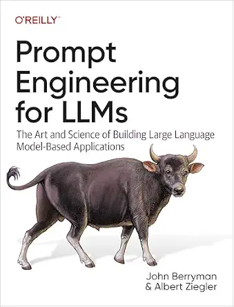

  

<h1 align="center">🚀 ترجمه جامع و آزاد کتاب Prompt Engineering for Generative AI & LLMs</h1>

  <strong>هنر و علم ساخت برنامه‌های کاربردی نوین با مدل‌های زبانی بزرگ؛ مرجع جامع مهندسی پرامپت، RAG و عامل‌های هوشمند</strong>

  
  
  
  
  

---

## 💡 چرا این پروژه؟

کتاب **Prompt Engineering for Generative AI** نوشته‌ی *جان بری‌من (John Berryman)* و *آلبرت زیگلر (Albert Ziegler)* از انتشارات معتبر O'Reilly، یکی از فنی‌ترین، دقیق‌ترین و کاربردی‌ترین مراجع دنیا برای توسعه‌دهندگانی است که می‌خواهند از سطح تعاملات آماتور با هوش مصنوعی فراتر رفته و نرم‌افزارهای مقاوم، مقیاس‌پذیر و هوشمند مبتنی بر LLM خلق کنند.

این اثر تنها به «چند پرامپت نمونه» بسنده نمی‌کند؛ بلکه معماری درونی ترنسفورمرها، نحوه نمونه‌برداری و احتمال توکن‌ها، تکنیک‌های پیشرفته Few-Shot و Chain-of-Thought، بازیابی اطلاعات پویا (RAG)، ابزارخوانی (Tool Calling) و هدایت عامل‌های خودمختار هوشمند را گام‌به‌گام واکاوی می‌کند.

هدف ما در این پروژه اوپن‌سورس:
* 🎯 **ترجمه‌ای روان، فنی و کاملاً وفادار به متن اصلی** با بازبینی دقیق تخصصی مهندسی
* 💻 **ارائه کامل و رایگان تمامی مباحث، دیاگرام‌ها و مثال‌ها** برای تمام جامعه برنامه‌نویسان
* 🌍 **توانمندسازی جامعه فارسی‌زبان** برای تسلط بر فناوری‌های لبه هوش مصنوعی و معماری سیستم‌های نوین

---

  ## ⚡ دسترسی سریع

| مرجع | توضیحات | لینک |
| :--- | :--- | :---: |
| 📖 **نسخه وب (گیتاب)** | تجربه خواندن آنلاین با جستجوی سریع، تم تاریک/روشن و دسترسی فصل‌به‌فصل | [ورود به گیتاب ↗](https://hheydarian.github.io/Gitab/books/book9/) |
| 📥 **سرفصل‌های کتاب** | مطالعه مستقیم فایل‌های منبع به زبان مارک‌داون تمیز در گیت‌هاب | [مشاهده پوشه Book ↗](Book/) |

---

## 🔍 راهنمای خوانایی بهتر در گیت‌هاب

برای اینکه متون فارسی در گیت‌هاب و مرورگر با خط استاندارد، خوانا و چشم‌نواز نمایش داده شوند:
1. افزونه رایگان **[فونت ایران (FontIran)](https://chromewebstore.google.com/detail/fontiran/edbchgkbejkdkdkpgenlaciegoidmjoh)** را روی مرورگر خود فعال کنید.
2. فونت پیش‌فرض را روی **وزیرمتن (Vazirmatn)** یا **ایران‌یکان** قرار دهید تا هماهنگی کلمات و کدها در ایده‌آل‌ترین شکل ممکن باشد.

---

## 📚 فهرست سرفصل‌ها

تمامی **۱۲ سرفصل کتاب** به طور کامل ترجمه، ویرایش و راست‌چین شده و آماده مطالعه است:

| شماره | نام سرفصل (انگلیسی) | عنوان فارسی | وضعیت | مطالعه مستقیم |
| :---: | :--- | :--- | :---: | :---: |
| **00** | Preface | پیش‌گفتار و مقدمه نویسندگان | ✅ | [مطالعه فصل](Book/00/Preface/index.md) |
| **01** | Introduction to Prompt Engineering | مقدمه‌ای بر مهندسی پرامپت | ✅ | [مطالعه فصل](Book/01/Introduction-to-Prompt-Engineering/index.md) |
| **02** | Understanding LLMs | درک مدل‌های زبانی بزرگ | ✅ | [مطالعه فصل](Book/02/Understanding-LLMs/index.md) |
| **03** | Moving to Chat | گذار به مدل‌های گفت‌وگومحور | ✅ | [مطالعه فصل](Book/03/Moving-to-Chat/index.md) |
| **04** | Designing LLM Applications | طراحی و معماری برنامه‌های کاربردی LLM | ✅ | [مطالعه فصل](Book/04/Designing-LLM-Applications/index.md) |
| **05** | Prompt Content | محتوا و داده‌های پرامپت | ✅ | [مطالعه فصل](Book/05/Prompt-Content/index.md) |
| **06** | Assembling the Prompt | سرهم‌بندی و ساختاردهی به پرامپت | ✅ | [مطالعه فصل](Book/06/Assembling-the-Prompt/index.md) |
| **07** | Directing the Model | هدایت و مهار رفتار مدل | ✅ | [مطالعه فصل](Book/07/Directing-the-Model/index.md) |
| **08** | Conversational Agency | عاملیت و مدل‌های گفت‌وگومحور هوشمند | ✅ | [مطالعه فصل](Book/08/Conversational-Agency/index.md) |
| **09** | LLM Workflows | جریان‌های کاری و خط لوله‌های چندمرحله‌ای | ✅ | [مطالعه فصل](Book/09/LLM-Workflows/index.md) |
| **10** | Evaluating LLM Applications | ارزیابی و اعتبارسنجی کیفی برنامه‌ها | ✅ | [مطالعه فصل](Book/10/Evaluating-LLM-Applications/index.md) |
| **11** | Looking Ahead: The Future | نگاه به آینده مهندسی پرامپت | ✅ | [مطالعه فصل](Book/11/The-Future/index.md) |

---

## 🤝 مشارکت در پروژه (Contributions Welcome)

این پروژه نیز مانند کل گیتاب، متعلق به جامعه توسعه‌دهندگان است. هرگونه بهبود ویرایشی، بازبینی اصطلاحات فنی یا افزودن مثال‌های تجربی جدید با آغوش باز پذیرفته می‌شود:

1. **فورک کنید (Fork):** ریپازیتوری را فورک کرده و یک برنچ جدید ایجاد کنید (`git checkout -b feature/refine-chapter-03`).
2. **اصلاح و بازبینی:** تغییرات مورد نظر را اعمال کنید.
3. **ارسال پول‌ریکوئست:** تغییرات را کامیت کرده و یک Pull Request ارسال نمایید.

> اگر سوال، ابهام یا پیشنهادی درباره سرفصل‌ها یا ترجمه دارید، خوشحال می‌شویم آن را در بخش **[Issues](https://github.com/hheydarian/prompt-engineering-for-llms-persian/issues)** مطرح فرمایید.

---

## ⚖️ مجوز و حقوق مالکیت معنوی

* **اثر اصلی:** کلیه حقوق نسخه اصلی کتاب متعلق به نویسندگان محترم (*John Berryman & Albert Ziegler*) و انتشارات O'Reilly است.
* **متن ترجمه فارسی:** ترجمه فارسی با هدف اشاعه رایگان دانش به جامعه توسعه‌دهندگان، تحت مجوز بین‌المللی **[CC BY-NC-SA 4.0](https://creativecommons.org/licenses/by-nc-sa/4.0/)** (استفاده غیرتجاری با ذکر منبع و اشتراک با شرایط مشابه) منتشر شده است.
* **کدها و اسکریپت‌ها:** تحت مجوز **MIT License** در دسترس عموم قرار دارند.

---

  ⭐ <strong>اگر این اثر برای مسیر یادگیری شما مفید بوده، با اهدای یک ستاره (Star) به دیده‌شدن آن در کامیونیتی کمک کنید!</strong> ⭐

  توسعه داده شده با ❤️ برای جامعه برنامه‌نویسان و مهندسان هوش مصنوعی ایران

